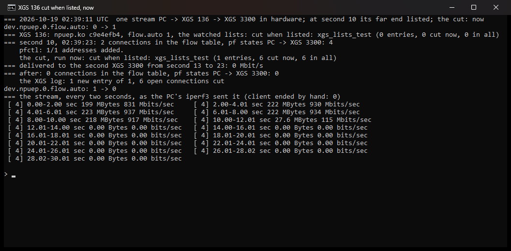
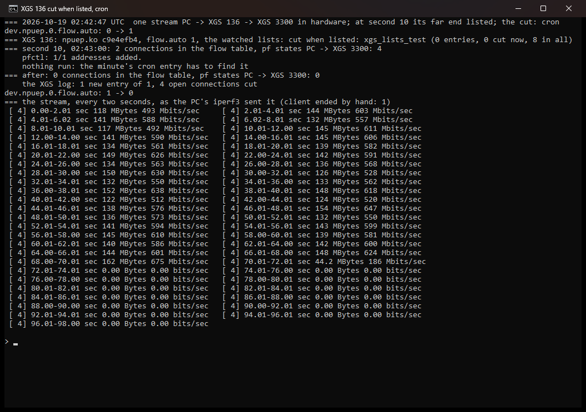
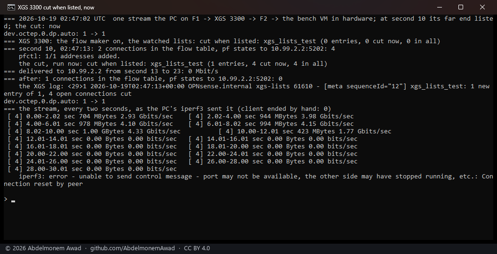
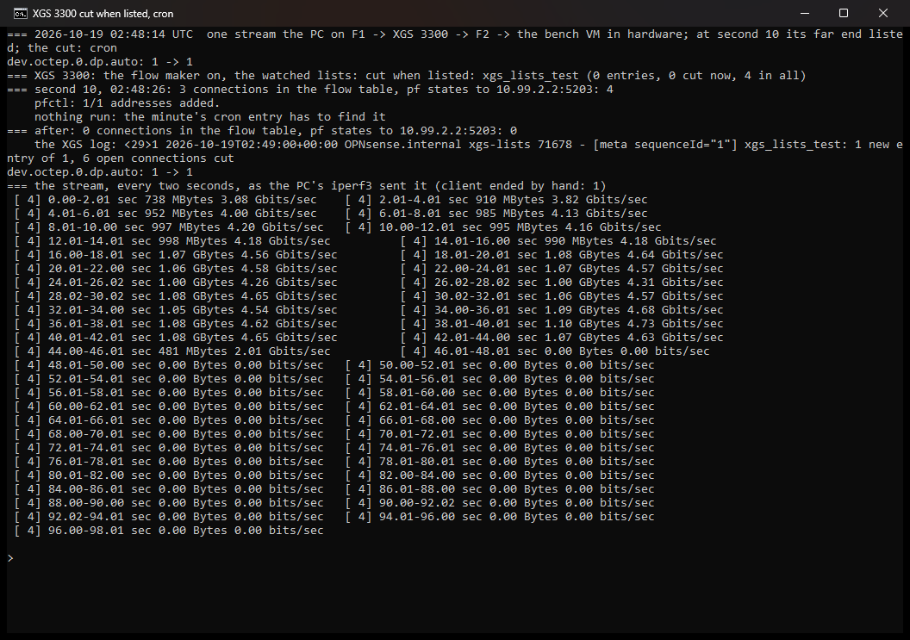

<!-- reviewed: 2026-10-19 -->
# A block list that cuts the connections already open, measured, 2026-10-19

**XGS: Settings - Cut open connections when listed.** A block list in OPNsense is an alias - a pf
table filled from a URL, a feed or by hand - and a rule that blocks it blocks new connections only. A
connection opened before its address was listed keeps its pf state, and with offloading on its flow in
the coprocessor, for as long as it carries traffic. With a list chosen here,
`scripts/xgs/lists_cut.py` compares it every minute (cron) and when the settings are saved with what
it held before, and kills by id every pf state with either end in what was added; each driver then
takes the connection out of hardware. Choosing a list cuts what it already names. **Since 2026-10-23**
the connection is dropped on the coprocessor itself first, by its verdict, and kept there while its
sender goes on - XGS: Settings **Cut in hardware**, on by default
([measured](verdict-2026-10-23.md)).

## How it was measured

On each appliance, an empty test alias, `xgs_lists_test`, made and watched by
`images/deploy/lists-test.php` and removed afterwards. One iperf3 stream, made in hardware; at second
10 the far end's address added to the alias's table with `pfctl -t xgs_lists_test -T add` - what a
list's refresh does. With **now** the cut was run at once, as saving the settings page runs it; with
**cron** nothing was run, and the minute's cron entry had to find it. What still arrived was read
where the traffic ends, and the stream's own two-second intervals say when it stopped. Run by
`images/deploy/lab-lists-cut.sh`, each in a window of its own, photographed.

- **XGS 136**: the bench PC on its LAN, through the 136 to the second XGS 3300 behind Port8, read on
  the 3300's Port8. Driver `c9e4efb4`.
- **XGS 3300**: the bench PC on F1, through the second XGS 3300 out of F2 to the bench VM, read on the
  VM. The driver it loaded at its boot of 2026-10-18 14:53 UTC; the module file was rebuilt since
  by the deploy, without a reboot.

Both with os-xgs-npu at `f8aef39`.

## Results

| appliance | the cut | listed at | cut | the stream | delivered afterwards | in the flow table after |
|---|---|---|---|---|---|---|
| XGS 136 | now | second 10 | 6 states at once | 917 Mbit/s, then 115 in the two seconds of the cut, then nothing | **0 Mbit/s** (seconds 13 to 23) | 0 |
| XGS 136 | cron | 02:43:00 | 4 states at 02:44:00, the next minute | 490 to 675 Mbit/s for sixty seconds, 186 in seconds 70 to 72, then nothing | **0** from second 72 | 0 |
| XGS 3300 | now | second 10 | 4 states at once | 4.33 Gbit/s, then 1.77 in the two seconds of the cut, then nothing | **0 Mbit/s** (seconds 13 to 23) | 1 |
| XGS 3300 | cron | 02:48:26 | 6 states at 02:49:00, 34 s later | 4.2 to 4.7 Gbit/s, 2.01 in seconds 44 to 46, then nothing | **0** from second 46 | 0 |

- **Both appliances let the connection go with its state.** A stream in hardware stopped within the
  two seconds its address was listed in, and nothing more reached the far end. On the XGS 136 that
  is the takeout fixed the day before ([the finding](../findings/a-takeout-took-nothing-out-on-the-armada.md));
  on the XGS 3300 it is the first measurement of a killed state there.
- **Through cron the wait is up to a minute**: 60 s on the XGS 136, where the address was listed on
  the minute, 34 s on the XGS 3300. A list is refreshed on its own schedule - an hour, a day - so a
  minute is small beside it; saving the settings page cuts at once.
- Every state with the listed address is cut, not only the stream's: its two connections - the data
  and iperf3's control - had four states at second 10, a state on each interface they cross, and
  the others cut held the same address; which connections they were, the runs do not say.
- **Not looked into**: in the XGS 136's cron run the stream ran at 490 to 675 Mbit/s rather than the
  link's ~930 of the run before it; and on the XGS 3300 the flow table still counted one connection
  27 s after the cut, with no state left for it. Neither changed what arrived.
- A first cron run on the XGS 136 never started its stream: the run before had been cut mid-test and
  left its iperf3 server holding the port, which the script then failed to end. Its photograph was
  not kept; the script ends that server by its own command line now.
