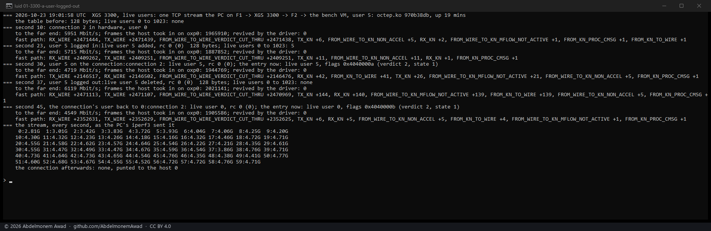
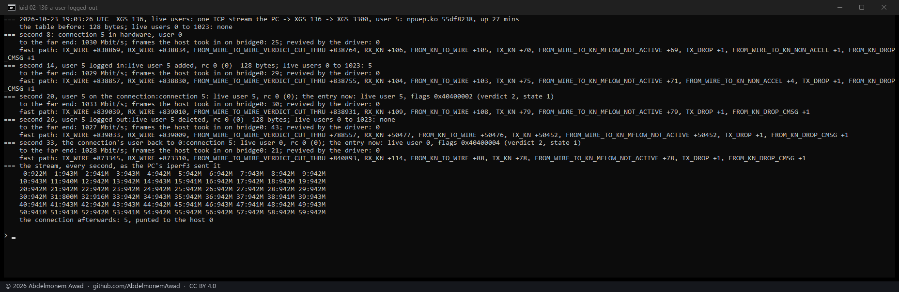

<!-- reviewed: 2026-10-23 -->
# Live users: a user's logout takes their connections out of hardware, measured, 2026-10-23

Discovery 5 of [the discoveries](../findings/discoveries-2026-10-22.md#live-users), from source to
measured on both appliances. The coprocessor keeps a table of the users logged in - a bit for each of
65,536 - and every connection carries its user's number in its entry. Two commands set and clear a
user's bit, and a third sets a connection's user in place (the vendor's `luid_fpop.c`, `luid_rpc.c`
and `conn_table.h`; [680](https://github.com/AbdelmonemAwad/os-xgs-npu/issues/680)).

**The fast path checks it.** On both families, a connection whose user is not in the table is given
back to the host at once and its frames go to the host; a user number of 0 is not checked. So a user
logged out - one command - takes every connection that user has in hardware out of it, and pf on the
host decides what happens to them next. That is what OPNsense's Captive Portal needs from the
coprocessor at a logout, and it is not used yet: today the drivers make every connection with user 0,
and when the fast path gives one back they make it again with user 0, so a logout would take a
connection out of hardware for a moment only.

| | when the user is logged out | to the host after it, in the next seconds | then |
|---|---|---|---|
| XGS 3300, octep.ko 970b38db | 4 runs | **81,076**, 343, **51,752** and 144 frames | the driver made the connection again, a new revision in its entry, and the stream went back to hardware |
| XGS 136, npuep.ko 55df8238 | 5 runs | **34,307**, **36,932**, **62,629**, **50,452** - and in one run 86, with about 32,000 frames fewer forwarded in hardware than in the stages around it | the same; the driver counted its revival in two of the runs |

The numbers are the fast path's own count of frames it sent the host (`TX_KN`), against a few tens in
every other stage. They came as `FROM_WIRE_TO_KN_MFLOW_NOT_ACTIVE` - the connection's microflows no
longer active - and in one run on the XGS 136 also as `CONN_RECLAIM_PENDING` (15,990): the
connection given back. How many frames go to the host is how long the driver takes to make the
connection again, from a fraction of a millisecond to a fifth of a second; the stream itself went on
at the link's rate, through the host in between. `FROM_WIRE_TO_KN_LIVE_UID_INVALID`, the counter the
vendor's source names for this, did not move in any run.

## What the table and the commands are

- `ADD_LIVE_UID` (18) and `DELETE_LIVE_UID` (19) take the user's number as a u32 and set or clear its
  bit; `LO_LUID_READ` (41) reads the bits back for a range a multiple of 64 long, with nothing in
  front of them. The numbers follow the vendor's list from `FW_STATE_REV_SET` at 0, as `CONN_MODIFY_FP_VERDICT`
  at 13 does.
- `CONN_MODIFY_FP` (12) sets a connection's user in place: the index, its revision, a word saying
  which fields - bit 0 the user, bits 1 and 2 the two QoS words - then the user and the two QoS words.
  The handler writes only what the word names (`conn_fpop_modify`).
- The user is the 16-bit field after the flags word in the connection's entry, which both drivers have
  always sent as 0. Read back after the boot, the table was empty on both appliances - user 0 among
  them - while every connection in hardware carried 0 and was forwarded: 0 is not checked.

## How it was measured

`images/deploy/lab-luid.sh`, each run in a window of its own and photographed
(`images/deploy/lab-luid-series.ps1`); the text of every run is in the run log. Instruments in both
drivers, for this measurement: `flow.live_uid` / `dp.live_uid` (write `add <user>` or `del <user>`),
`flow.conn_luid` / `dp.conn_luid` (write `<index> <user>`; the entry is read back after, and its user,
verdict and state are shown) and `flow.luid_table` / `dp.luid_table` (the users 0 to 1023 set). One
iperf3 stream made in hardware, sixty seconds; user 5 added to the table, set on the stream's
connection, deleted, then the connection's user set back to 0 - each step at the second of the stream
it was taken at, with four seconds read after it: what reached the far end, every fast-path counter
that moved, the frames the host took in, and the connections the driver revived. The far end is the
bench VM behind the XGS 3300's F2 - read on F2's counters, which carry what the coprocessor forwards
- and the second XGS 3300's Port8 for the XGS 136.

## What it found on the way

**The first order hid the logout.** The runs began by setting a user that was not yet in the table:
the connection was given back at once - read back in state 2 on both appliances, and 175,231 frames to
the host on the XGS 3300 - and the driver made it again with user 0, so the user's login and logout
after it acted on a connection that no longer carried the user, and showed nothing. Read that way, the
XGS 136 seemed not to check at all. The order above, the user in the table before it is set, is the
one that shows a logout.

**The stages were seconds later than their headings said.** Each stage's readings over ssh take
seconds, and in the first runs the logout came near the end of a 32-second stream; the stream is now
sixty seconds and every step is stamped with the second of the stream it was taken at.

**A boot left two of the XGS 136's links down while they carried traffic** - the jumbo-frame writes
at boot talked to the switch over the bus the coprocessor's agent follows the links on, and no
connection through Port3 went into hardware until the next boot
([706](https://github.com/AbdelmonemAwad/os-xgs-npu/issues/706)).

## What using it would take

- The drivers to keep a connection's user, and to make it again with that user after the fast path
  gives it back - today both make it again with 0.
- A user number for each Captive Portal session, added at its login and deleted at its logout, and the
  connections of the session's address made with it.
- Then a logout takes every one of that user's connections out of hardware with one command, and pf
  on the host - where the Captive Portal's rules are - decides the rest. Not measured with the
  Captive Portal yet; these runs set the user by hand.
