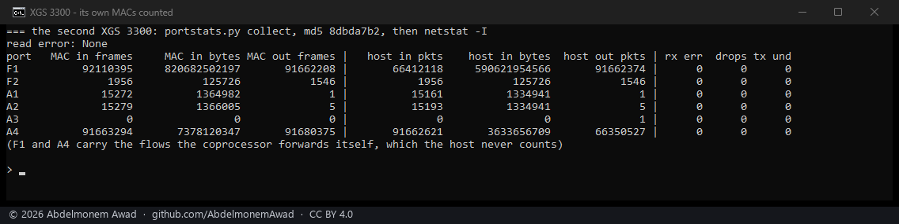

<!-- reviewed: 2026-10-20 -->
<!-- board: F1, F2 and the module's ports counted | XGS 3300 | 1,956 frames -->
# The XGS 3300's own MACs counted on XGS: Ports, 2026-10-20

[The switch's counters](port-errors-136-2026-10-20.md) gave XGS: Ports a row for Port1 to Port8 and
for the two cages behind the switch - on the XGS 3300, F3 and F4. Its F1 and F2 and the expansion
module's ports are not on the switch: they hang off the coprocessor's own BGX blocks, and nothing read
what those count.

Each BGX LMAC counts its own frames: what it took in good, PAUSE frames, what its address filter
dropped, what a full receive FIFO dropped, what arrived with an error; and what it sent, and what it
sent short of data. Cavium published the registers in its board development kit, which coreboot
carried (`bdk-csrs-bgx.h`): `BGX(a)_CMR(b)_RX_STAT0` to `8` and `TX_STAT0` to `17`, at
`0x87E0E0000000 + a * 0x1000000 + b * 0x100000` on the CN83XX, 48 bits, **not cleared by a read** -
so reading them takes nothing from anyone else who does. The coprocessor reads them with busybox
`devmem`.

Which LMAC is which port:

- **F1 and F2** are BGX 2's LMACs 0 and 1, from the coprocessor's own enumeration
  ([docs/families/octeon-tx.md](../families/octeon-tx.md)).
- **The module's ports** are BGX 0's LMACs in the order of their tags in `ports.json` - on this
  4x10G module (AMDA0207) A4, A3, A2 and A1 are LMACs 0 to 3. Read here first from all eleven LMACs:
  A3's is the one at zero, and A3 is the one cage whose module sees no light; the other three moved
  with their interfaces. A second module would go on in BGX 1; none has been fitted.

`portstats.py` asks for them in the same visit to the coprocessor's console as the switch's counters,
and XGS: Ports shows them in the same table, now headed *Errors and drops on the ports*: frames and
bytes each way, **received in error** (RX_STAT8) beside the switch's error kinds, **dropped, receive
buffer full** (RX_STAT6) beside its drops, **sent short of data** (TX_STAT16) beside its send errors.
What the address filter dropped (RX_STAT4) and the PAUSE frames are kept but not shown as faults.

## Measured on the second XGS 3300

`portstats.py` from the working tree run on the appliance, and the host's own counters for the same
ports read straight after (`netstat -I`):

| port | the MAC: in, frames and bytes | out, frames | the host: in, frames and bytes | out, frames |
|---|---|---|---|---|
| F2 | 1,956 · 125,726 | 1,546 | 1,956 · 125,726 | 1,546 |
| A1 | 15,272 · 1,364,982 | 1 | 15,161 · 1,334,941 | 1 |
| A2 | 15,279 · 1,366,005 | 5 | 15,193 · 1,334,941 | 5 |
| A3 | 0 · 0 | 0 | 0 · 0 | 1 |
| F1 | 92,110,395 · 820,682,502,197 | 91,662,208 | 66,412,118 · 590,621,954,566 | 91,662,374 |
| A4 | 91,663,294 · 7,378,120,347 | 91,680,375 | 91,662,621 · 3,633,656,709 | 66,350,527 |

- **F2 agrees to the frame and to the byte** each way: a port whose every frame crosses the host.
- **A1 and A2**: the same frames out; about 110 more in at the MAC than the host counted - frames the
  coprocessor took and did not hand up. Which ones has not been looked into.
- **A3**: nothing on the wire. The host's one frame out never left - the cage has no light.
- **F1 and A4** carry the flows the coprocessor forwards itself, which the host never sees - the
  reason the MAC's counts are the ones to read there.
- Every error and drop counter read 0, on all six.

Script: `images/deploy/lab-3300-mac-counters.sh`, photographed.

## What it does not mean

- **No error was made on purpose.** On the XGS 136 the switch's frame limit was lowered and ten frames
  sent too long to see the counter move; nothing here has been made to fail, so the error counters
  are read, and at zero, not shown to count.
- **One module, one appliance.** BGX 1, for a module with more than four ports, is computed, not
  measured.
