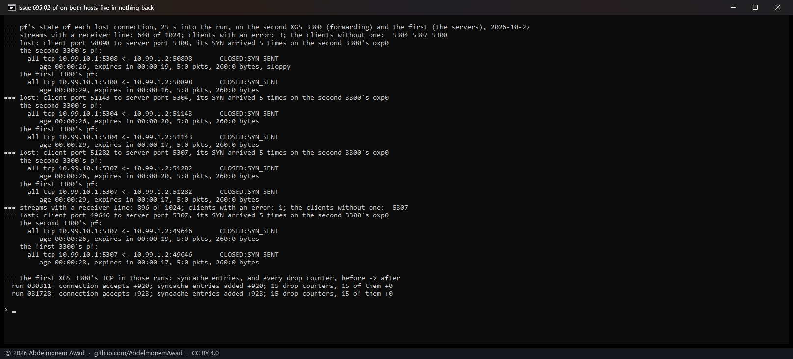
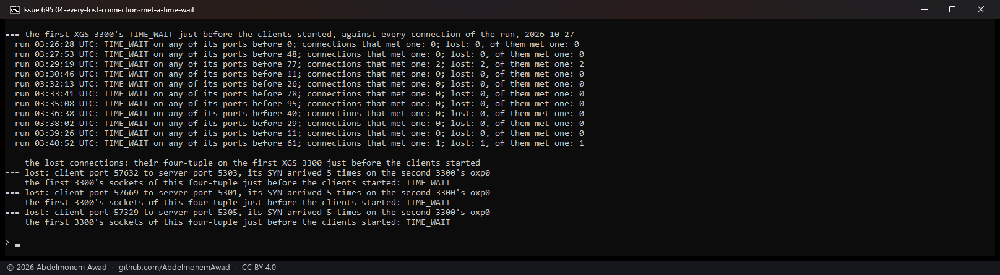
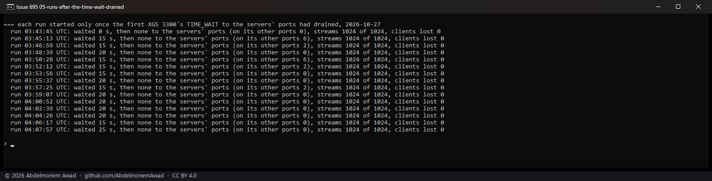

<!-- reviewed: 2026-10-27 -->
# The thousand-connection run's lost clients: the bench, not the appliance, 2026-10-27

[695](https://github.com/AbdelmonemAwad/os-xgs-npu/issues/695): the thousand-connection run - eight
iperf3 clients of 128 streams each, from the bench PC through the appliance to eight iperf3 servers
on another one - lost clients in about one run in five, on both families, with the flows made in
hardware and without them. A client says `unable to connect stream: Connection timed out` and gives
up all 128 of its streams.

Measured here through the second XGS 3300 (vendor version 22): the PC's 10G port into its oxp0, out
of its oxp12, to the servers on the first XGS 3300's oxp0 (vendor version 23). Both on OPNsense
26.7.7 (FreeBSD 15.1-RELEASE-p4) and 0.1.0-alpha.8.9, octep.ko `54a32be8`; the second 3300 with its
automatic acceleration on (`dp.auto` 1), as on 2026-10-25.

**What loses the connection is the servers' own host, by design:** a connection's four-tuple - both
addresses, both ports - was still in TIME_WAIT there from the run before, and FreeBSD drops a SYN for
such a four-tuple without an answer unless it carries a newer timestamp or a higher sequence number
than the old connection's last. The PC's Windows TCP sends no timestamps. Runs started only once that
TIME_WAIT had drained lost nothing in fifteen.

The run logs, the client outputs, the PC's captures (pcapng) and the second 3300's are local; the
scripts are `images/deploy/lab-3300-many-pc.sh`, `lab-3300-many-pf.sh` and `lab-3300-many-tw.sh`,
and the reports photographed here `lab-695-report.sh`.

## Every SYN of a lost connection left the PC and arrived

The PC's own capture (pktmon on its 10G port, every TCP segment with SYN set to or from ports
5301-5308) against the second 3300's tcpdump of the SYNs arriving on its oxp0, nine runs back to
back: three lost clients, thirteen connections in all. Each lost connection's SYN was sent five times
- at 0, 1, 3, 7 and 15 s - and all five arrived on the second 3300's oxp0; no SYN-ACK came back for
any of them. Every other connection's single SYN arrived and was answered.

## The servers' host received all five and answered none

pf keeps a state for every connection it passes, with the packets counted each way, on both hosts.
Read 25 s into each of fifteen runs, two of them with a loss (four connections): each lost
connection had a state on the second 3300 and on the first, both `CLOSED:SYN_SENT` with `5:0` packets
- five SYNs through, nothing back. The first 3300, where the servers listen, took all five in and
sent nothing; its TCP made no syncache entry for them (as many entries as connections accepted) and
counted no drop of any kind.

## Why: FreeBSD's TIME_WAIT check, and a client without timestamps

A SYN whose four-tuple belongs to a connection in TIME_WAIT goes to `tcp_twcheck`
(`sys/netinet/tcp_timewait.c`). It ends the old connection and lets the new one start only if the
SYN carries a timestamp newer than the old connection's, or - with no timestamps on either - if its
sequence number is above the last one the old connection received. Otherwise it reaches "Drop the
segment if it does not contain an ACK": dropped, with no answer, no counter and no log line. A
retransmitted SYN repeats the first one's sequence number, so the retransmissions go the same way
until the TIME_WAIT runs out - twice `net.inet.tcp.msl`, 60 s. The client gives up before that.

The PC's Windows TCP has timestamps "allowed", which is to say it does not offer them: the 981 SYNs
it sent in one run carried MSS, window scale and SACK-permitted, and no timestamp.

The first 3300 closes many of the run's connections itself, and holds them in TIME_WAIT after the
run - up to 95 just before the runs below, 117 after one. The scripts started the next run about 45 s
after the last one's streams ended, inside that minute, and the PC gave some four-tuples out again:
its client port to the same server port.

## Tested: every lost connection had met a TIME_WAIT

Eleven runs back to back, the first 3300's sockets listed just before the clients started and every
connection of the run looked up in that list: three connections in two runs found their four-tuple
in TIME_WAIT there, and those three were exactly the three lost. None did in the nine runs that lost
nothing.

## Runs started after that TIME_WAIT drained lost nothing

Fifteen runs, each started only once no connection to the servers' ports was left in TIME_WAIT on the
first 3300 - a wait of 0 to 25 s: 1,024 streams of 1,024 in every one, no client lost. Back to back
the same day, seven runs of thirty-five had lost clients.

## What it means

- **The appliance does not lose these connections.** The loss is the servers' host keeping a
  four-tuple from the run before; it does the same with no appliance between, and it is why the run
  lost clients as often with the flows made in hardware as without them (2026-10-25: 5 of 33 and 5
  of 30).
- **The kind that "did not finish"** - every connection arrived, some SYNs retransmitted, a client
  still running at second 52 - fits the same cause: a SYN that met a TIME_WAIT which ran out while it
  retried connects late, and the client's 40 seconds begin only when all of its streams are open.
  Not measured on its own.
- **The XGS 136's runs** (`lab-136-many.sh`, 2026-10-23) are the same harness against servers on the
  second XGS 3300; not run again, most likely the same.
- **The runs from now on wait** for that TIME_WAIT to drain (`lab-3300-many-tw.sh` with `DRAIN=1`).

## A correction

On 2026-10-25 I wrote in the issue that a lost connection's SYN and its retransmissions never reached
the second 3300's host, so that the loss was between the PC and it. My own captures of that evening
already showed otherwise: in every failed run the lost connection's SYN is there five times on the
second 3300's oxp0. I had counted the connections against the streams a client opened, and was one
short. Struck there, with this page.
