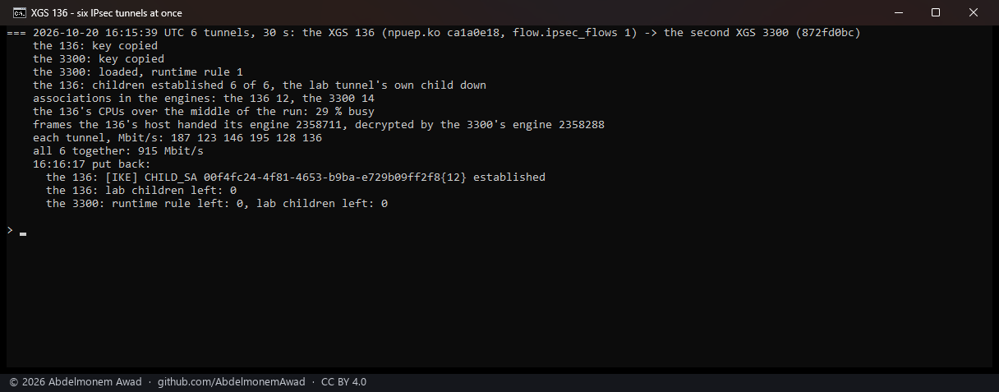

<!-- reviewed: 2026-10-20 -->
<!-- board: six IPsec tunnels at once | XGS 136 | 6 at 915 Mbit/s -->
# Six IPsec tunnels at once through the XGS 136, 2026-10-20

The XGS 136's side of [the sixteen tunnels between the two XGS 3300s](many-tunnels-3300-2026-10-20.md):
a lab connection of its own on the 136 and the second XGS 3300 with six children, each child one TCP
port of the 3300's Port8 address, so each child a tunnel with its own pair of associations; six iperf3
streams from the PC's adapter on F1 at once, for 30 seconds, one to each port - encrypted by the 136's
engine and decrypted by the 3300's.

The first try, the same afternoon, brought up none of the six: the lab connection authenticated with
the lab tunnel's identities - the two addresses - and the 3300 matched every child to the lab tunnel's
own connection and refused it (TS_UNACCEPTABLE). Now it authenticates as identities of its own, so the
3300 picks it and an IKE_SA of its own; the pre-shared key is the lab tunnel's, copied on each box into
the lab file and removed with it. A run whose children do not all come up stops there.

Script: `images/deploy/lab-136-many-tunnels.sh`, photographed. The XGS 136 running `npuep.ko`
`d34004f6`, main's source but for a comment (main's own build, `ca1a0e18`, is the file the run names).

## Measured

| | |
|---|---|
| children established | **6 of 6** |
| associations in the engines | the XGS 136 **12**, the second XGS 3300 14 |
| all six together | **915 Mbit/s** |
| each tunnel, Mbit/s | 187 123 146 195 128 136 |
| the XGS 136's CPUs, the middle of the run | 29 % busy |
| frames the 136's host handed its engine | 2,358,711 |
| frames the 3300's engine decrypted from it | 2,358,288 |

## What it does not mean

- **Six tunnels, not hundreds.** Twelve associations on the 136's engine at once.
- **The rate is the gigabit link's**, less the tunnels' envelope.
- **The connections stayed with the host and the engine encrypted what the host handed it** - the
  frames handed to it are the whole stream; each child selects one TCP port, as on the XGS 3300, and
  the CPUs at 29 % are the host forwarding.
