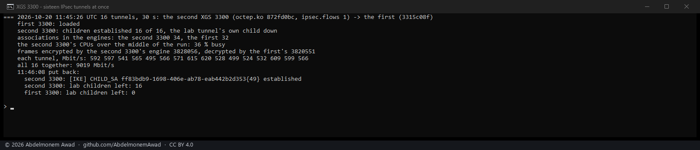

<!-- reviewed: 2026-10-20 -->
<!-- board: sixteen IPsec tunnels at once | XGS 3300 | 16 at 9,019 Mbit/s -->
# Sixteen IPsec tunnels at once between the two XGS 3300s, 2026-10-20

What remained of both IPsec rows was "many tunnels". One tunnel at a time had been measured on each
board; this run makes many at once, between the second XGS 3300 and the first:

- a lab connection of its own on each 3300 for the run, with sixteen children, each child one TCP
  port of the first 3300's address - so each child is a tunnel with its own pair of associations;
  the lab tunnel's own child, which covers the same pair whole, taken down for the run;
- sixteen iperf3 streams from the bench PC's 10G port at once, one to each port, for 30 seconds:
  encrypted by the second XGS 3300 (`octep.ko` md5 `872fd0bc`, its tunnel flows on) and decrypted by
  the first (`3315c08f`);
- AES-GCM-256 on every child; everything put back after.

Script: `images/deploy/lab-3300-many-tunnels.sh`, photographed.

## Measured

| | |
|---|---|
| children established | **16 of 16** |
| associations in the engines | the second 3300 **34**, the first **32** - two a tunnel, and two more on the second |
| all sixteen together | **9,019 Mbit/s** |
| each tunnel, Mbit/s | 592 597 541 565 495 566 571 615 620 528 499 524 532 609 599 566 |
| the second 3300's CPUs, the middle of the run | 36 % busy |
| frames the second 3300's engine encrypted | 3,828,056 |
| frames the first 3300's engine decrypted | 3,820,551 - within 0.2 % of what the other encrypted |

The vendor's figures for the XGS 3300 give IPsec 31.1 Gbps with 6,500 tunnels (the 2026-09
brochure), without the method: frame size, ports, cipher and direction are not stated.

## What it does not mean

- **Sixteen tunnels, not thousands.** The vendor's figure names 6,500; this bench made sixteen.
- **The rate is the PC's 10G port,** less the tunnels' envelope - one port in, one sender. It says
  nothing of what the engine would do from more ports at once.
- **Whether the streams ran as tunnel flows in the fast path was not read during the run.** Each
  child selects one TCP port, and the CPUs at 36 % suggest the host forwarded much of it, with the
  engine doing the encryption either way; the share is for a run that reads it.
- ~~**The XGS 136 is not in it.** The same run with the XGS 136 at the encrypting end could not
  establish its lab children (0 of 6) - the 3300 answering them refused the selectors - so its
  948 Mbit/s that day crossed in clear and is not an IPsec figure. Its many tunnels stay open.~~ Measured the same evening with identities of its own for the lab connection: [six tunnels through the XGS 136](many-tunnels-136-2026-10-20.md).
