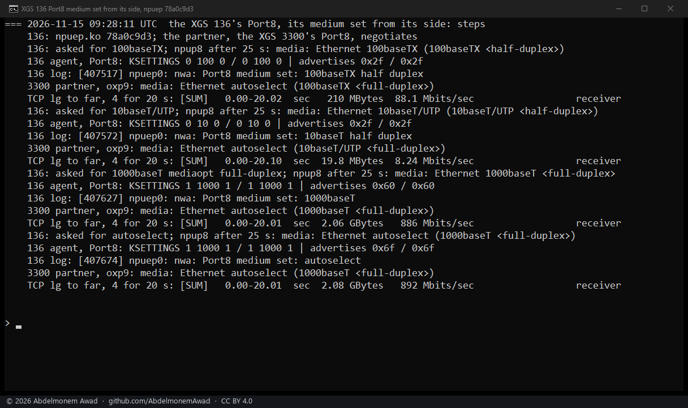
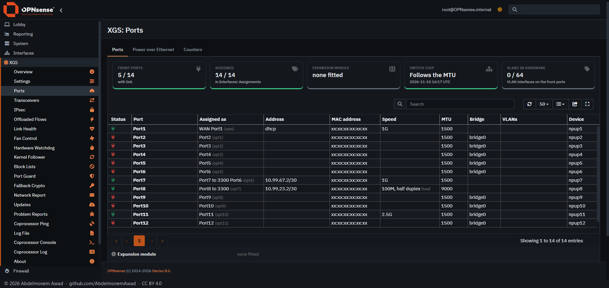

<!-- reviewed: 2026-11-15 -->
# A switch socket's speed and duplex set from the XGS 136's side, 2026-11-15

The XGS 136's front ports offered `autoselect` alone, and a change of medium was accepted and ignored. Since the
change a switch socket - Port1 to Port8, copper behind the switch - offers 10 and 100 half and full, 1000baseT full
and autoselect, set by the network agent's KSETTINGS attribute (`0x55`) with what autonegotiation advertises in
attribute `0x43`, as on [the second XGS 3300](media-3300-2026-11-15.md). The cages and Port9 to Port12 keep
autoselect. The request is applied by the agent's link poll, as an MTU is (`npunwa_media_apply`); a set already
in place is not sent again, since the agent takes the port down and up for it; half duplex is read beside the
speed when the carrier comes up (attribute `0x0d`), and the port's address is named to the switch again at every
carrier up.

## How it was measured

2026-11-15 from 09:05 to 09:32 UTC: the XGS 136 (vendor version 21), its Port8 cabled to the second XGS 3300's Port8
(vendor version 22), a switch socket that negotiates.

- **Read first, by GET only**: KSETTINGS of each port behind the switch, each read twice through the agent's
  probe. A cabled port answered autonegotiation on, 1000, full duplex - Port1, Port7, Port8 and F1 - and a dark one
  1000 with the duplex unknown (`0xff`) - Port2 to Port6 and F2: so a request reaches the port it names. One read
  of `0x43`, in an earlier run of the steps, came back with another request's answer, as the probe can when it
  meets the link poll in the mailbox; every value in the table below is two reads that agree.
- **Each step**: the medium asked for with `ifconfig npup8 media ...`, from autoselect; 25 seconds later what the
  port reports, the agent's KSETTINGS and what it advertises (GET, twice), and the partner's medium.
- **Traffic through it**: TCP, four connections for 20 seconds, from a jail on the FreeBSD test machine behind the
  XGS 3300 to a jail behind the XGS 136's Port11, routed over the two appliances' Port8 link.
- **As a user meets it**, from 09:44 to 09:57 UTC: Interfaces: [Port8] read for its list of speeds and duplexes, and
  Port11's page beside it; XGS: Ports read with Port8 at `100baseTX`, then autoselect put back. The XGS 136 ran
  main's userland but six files [#1163](https://github.com/AbdelmonemAwad/os-xgs-npu/pull/1163) changed; main's
  copies of the six were put in for the reading and taken out again.
- **The build**: npuep.ko `78a0c9d3`.

## Results

| Asked for | The XGS 136 reports | KSETTINGS, advertises | The partner reports | TCP through it |
|---|---|---|---|---|
| `100baseTX` | 100baseTX half | 0 / 100 / 0, `0x2f` | ~~100baseTX full~~ 100baseTX half (see below) | 88.1 Mbit/s |
| `10baseT/UTP` | 10baseT half | 0 / 10 / 0, `0x2f` | ~~10baseT full~~ 10baseT half (see below) | 8.24 Mbit/s |
| `1000baseT` full | 1000baseT full | 1 / 1000 / 1, `0x60` | 1000baseT full | 886 Mbit/s |
| `autoselect` | 1000baseT full | 1 / 1000 / 1, `0x6f` | 1000baseT full | 892 Mbit/s |

- **Each medium took effect on the wire**: the partner, negotiating, came to the speed set on the XGS 136, and TCP
  crossed it at that speed.
- ~~**The partner's "full duplex" at 100 and 10 is the XGS 3300 driver's word, not the link's**: it reads the duplex
  only for a medium set on its own side, and takes a negotiated link to be full.~~ Since the same day the XGS 3300
  reads its socket's duplex from the network agent and says half here ([a partner forced to
  half](media-3300-2026-11-15.md#a-partner-forced-to-half-2026-11-15-from-1142-to-1152-utc)). A forced 10 or 100 runs half at a
  partner that negotiates; TCP at 88.1 and 8.24 Mbit/s, near the line rate, says the two ends agreed - a duplex
  mismatch loses most of its frames.
- **The medium change takes the port down and up**, and the connections leaving by it - up to five each time,
  the step before's - were taken back to the host as for any lost link ([a lagg and a lost link on the XGS
  136](lag-136-2026-11-15.md)).
- **One step failed in a first build** (`435a51f8`): 1000baseT set, then no unicast for 40 seconds, and the same step
  passed when tried again. That build named the port's address to the switch at its next turn after the set,
  before the carrier came back - its log of the second try shows it so - the likeliest reason; since then it is
  named at carrier up, and every step passed, in two runs of the four: `13e18014`, then `78a0c9d3`, which adds
  the half duplex to what the port reports.

- **The pages say it**: Interfaces: [Port8] lists the six media under "Speed and duplex", and Port11's page,
  whose port offers autoselect alone, has no such list; XGS: Ports gives Port8 as "100M, half duplex", marked
  fixed - before the change the XGS 136 said full duplex of every link.

### What is not measured

- **A partner that keeps a forced full duplex** of its own.
- **Port1 to Port7**, and the SoC ports' and cages' refusal of a forced medium (they offer autoselect alone).
