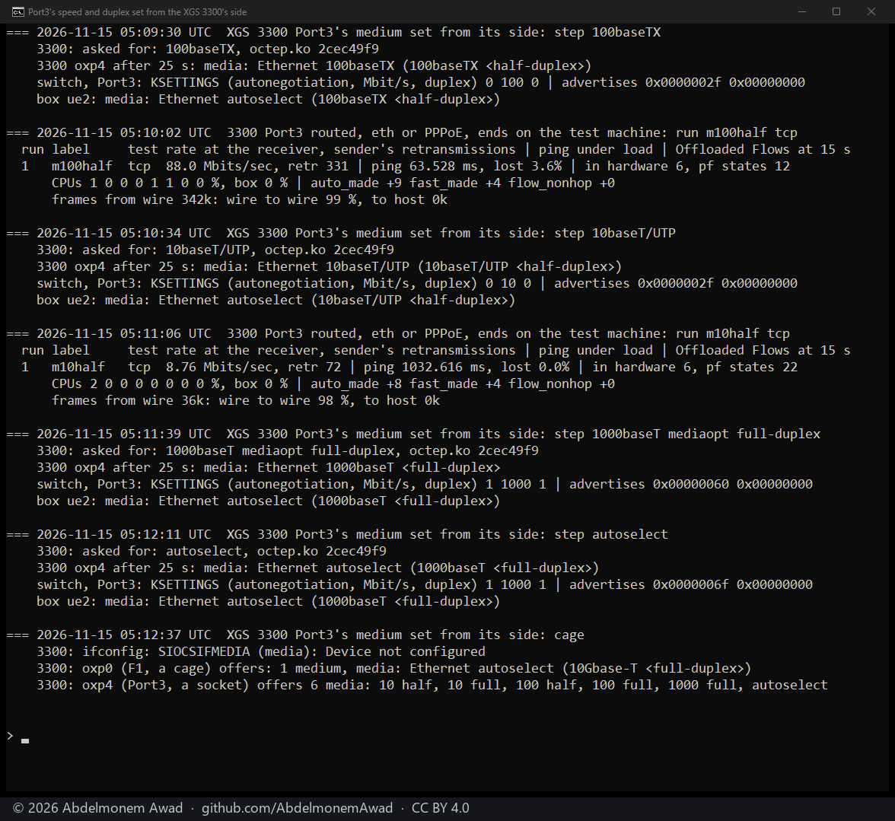

<!-- reviewed: 2026-11-15 -->
# A switch socket's speed and duplex set from the second XGS 3300's side, 2026-11-15

The front ports offered `autoselect` alone, and a change of medium was accepted and ignored. The switch sockets'
speed and duplex are set by the network agent's KSETTINGS attribute (`0x55`), the one the SDK's own host sends for
an `ethtool -s`, with what autonegotiation advertises in attribute `0x43`
([the attributes](../families/octeon-tx.md#the-attributes-from-the-target-rather-than-from-a-sweep)). Since the change
a socket offers 10 and 100 half and full, 1000baseT full and autoselect (`octep_dp_media_change`), and a cage keeps
autoselect.

## How it was measured

2026-11-15 from 05:09 to 05:13 UTC: the second XGS 3300 (vendor version 22, octep.ko `2cec49f9`), its Port3 cabled
to a USB 2.5 Gbit/s adapter on the FreeBSD test machine (ue2), which negotiates.

- **Each step**: the medium asked for with `ifconfig oxp4 media ...` (from autoselect, since ifconfig adds new
  options to the ones in force); 25 seconds later, what the port reports, what the switch holds (a GET of `0x55`:
  autonegotiation, Mbit/s, duplex; and of `0x43`), and the adapter's view of the link.
- **Traffic at 100 and 10 half**: TCP, four connections for 30 seconds, routed from a jail behind Port4 out of
  Port3, as in [the PPPoE measurement](pppoe-3300-2026-11-14.md).
- **A cage**: F1 asked for 100baseTX full.

## Results

| Asked for | The port reports | The switch: KSETTINGS, advertises | The adapter | TCP through it |
|---|---|---|---|---|
| `100baseTX` | 100baseTX half | 0 / 100 / 0, `0x2f` | 100baseTX half | 88.0 Mbit/s, 99 % wire to wire |
| `10baseT/UTP` | 10baseT half | 0 / 10 / 0, `0x2f` | 10baseT half | 8.76 Mbit/s, 98 % wire to wire |
| `1000baseT` full | 1000baseT full | 1 / 1000 / 1, `0x60` | 1000baseT full | - |
| `autoselect` | 1000baseT full | 1 / 1000 / 1, `0x6f` | 1000baseT full | - |
| F1, `100baseTX` full | refused: the cage offers autoselect alone | - | - | - |

- **Each medium took effect on the wire**: the adapter, negotiating, came to the speed set on the XGS 3300.
- **A forced 10 or 100 is half at a partner that negotiates**: Ethernet's parallel detection, not this driver.
  Forced 100 full against the adapter forced to 100 full ran at 1.11 Mbit/s on 2026-11-14: the switch port read
  100 full (status register `0x0d0f`) and counted 817 fragments from the adapter, which behaved as half duplex.
  Not tried with a partner that keeps a forced full duplex.
- **A gigabit copper link is never forced**: 1000baseT is autonegotiation with 1000 full alone advertised.
- **XGS: Ports** reads the speed from what the link runs at, and says "half duplex" and "fixed" when the port was
  set by hand.

