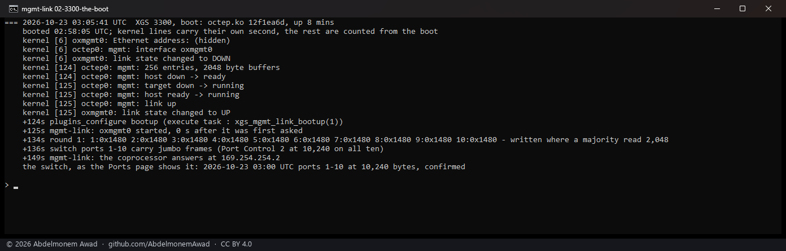
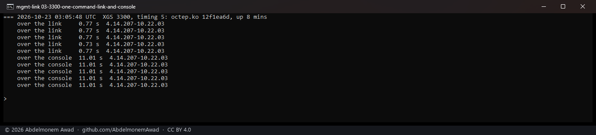
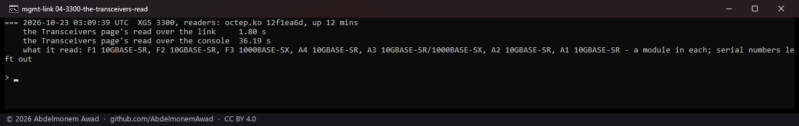
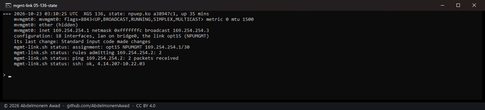
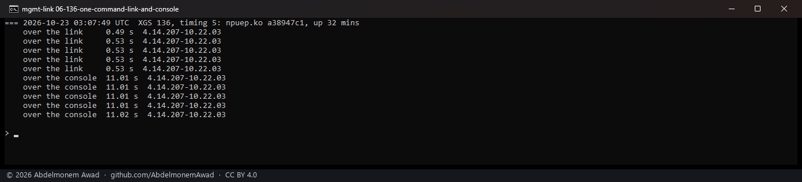

<!-- reviewed: 2026-10-23 -->
<!-- board: Coprocessor link | XGS 3300 | one command: 0.77 s, was 11 s -->
# The XGS 3300's coprocessor reached over its management link. Measured, 2026-10-23

Until this, everything the XGS 3300's host asked of its coprocessor's own Linux went through the
coprocessor's console: a serial line at 115,200 baud, one session at a time, and also the console of
its boot firmware, whose menus take what is typed as choices (#559). The Transceivers page, the port
counters, the coprocessor's health and the port identify light all queued on it. The PCIe management
link beside it - an Ethernet over PCIe that the coprocessor runs `sshd` behind - was built in this
driver during its bring-up and answered a ping once, and was not used
([the discovery](../findings/discoveries-2026-10-22.md#the-xgs-3300s-management-link-built-and-not-used),
[680](https://github.com/AbdelmonemAwad/os-xgs-npu/issues/680)). The XGS 136 has used its own since
[374](https://github.com/AbdelmonemAwad/os-xgs-npu/issues/374).

Now:

- **The link is an interface from the driver's load**: `oxmgmt0`, made when the driver attaches and
  down until the link is started, assigned in OPNsense as NPUMGMT with 169.254.254.1/30 - the same
  pair, the same two rules and the same `scripts/npuctl/mgmt-link.sh` as the XGS 136's `mvmgmt0`.
- **At every boot the plugin's boot hook starts it** once the coprocessor is ready, gives the
  coprocessor its end's address over the console - the coprocessor restarts with the host, and its
  root filesystem forgets - and trusts this host's key there the first time. On three boots in a
  row: the link up at second 125, the coprocessor answering at second 148 and 149, every interface
  kept, the switch's jumbo frames confirmed.
- **Every reader of the coprocessor goes over the link first** (`npu-run.sh`): one command in **0.73
  to 0.77 seconds instead of 11.01**, the Transceivers page's whole read in **1.80 seconds instead of
  36.19**. The console stays the way in when the link does not answer.
- **The XGS 136 is unchanged** by it, measured with the same scripts: 0.49 to 0.53 seconds over its
  link, 11.01 over its console.

The modules measured: **octep.ko 12f1ea6d** on the second XGS 3300 and **npuep.ko a38947c1** on the
XGS 136.

## How it was measured

Each run in a window of its own, photographed (`images/deploy/lab-mgmt-series.ps1`, `lab-mgmt.sh`);
the text of every run, the three boots before the photographs among them, is kept in the run log.
The link's hardware addresses, and the link-local addresses made from them, are hidden in every
picture; a transceiver's serial number is left out.

- **One command**: `npu-run.sh 5 'uname -r'` five times as it runs now, over the link, then five
  times with `NPU_RUN_NO_LINK=1`, over the console. The console's figure is what `npu-run.sh` waits
  there: a second to wake it, the login, and the command's own five seconds, because a console has no
  end to its answer to wait for. Over the link the answer ends when the command does.
- **A page's read**: `transceivers.py collect`, which the Transceivers page and the boot run, the
  same two ways.
- **The boot**: the kernel's own lines of the link, then the boot hook's and the switch's lines in the
  appliance's log, counted in seconds from the boot.

## The XGS 3300

| boot | the link started | the coprocessor answered | the switch's jumbo frames | interfaces kept |
|---|---|---|---|---|
| 1 | second 125 | second 149 | confirmed at 136 | 21 of 21 |
| 2 | second 124 | second 148 | confirmed at 136 | 21 of 21 |
| 3 | second 125 | second 149 | confirmed at 136 | 21 of 21 |

## The XGS 136

Rebooted once with the new boot hook: its 18 interfaces kept, the hook run, the link and its `ssh`
answering. With the locked `switch-jumbo.sh` after it, its read-only check went over the link and
took 0.88 seconds.

## What it found on the way

**An interface assigned before it exists at boot costs every assignment.** The first build made
`oxmgmt0` only when the link was started, a minute after OPNsense checks at boot that every assigned
interface is there. On the next boot OPNsense found the assigned one missing and ran its console
assignment by itself: twenty interfaces became four, LAN moved to the management port. The
appliance was recovered from the configuration's own backup. The interface is made when the driver
attaches now, down until the link is started, and the three boots since kept all 21.

**The coprocessor restarts with the host, and its console has no prompt for a while after the link
is up.** Six tries in 40 seconds to give it its address were all refused, each within a few seconds -
the way `npu-run.sh` refuses a console that shows no Linux prompt - and the link came up with the
coprocessor's end unaddressed; read over the console a minute later, the coprocessor had been up as
long as the host and its link had become ready at its own second 134. It is asked until five minutes have passed
now; it answered 24 seconds after the link started, on each of three boots.

**Two users of the console at boot collided.** On two boots of three the switch's jumbo frames were
left at 2,048 bytes: `switch-jumbo.sh` read the console while the link's boot hook was using it, and
its second and third rounds of reads came back empty. It takes the same lock as `npu-run.sh` now, and
uses the link whenever its `ssh` answers; the three boots since confirmed the frames every time.

## What it does not do yet

- The coprocessor's address still goes over its console once at every boot, because the coprocessor
  forgets it. Keeping it on the coprocessor's own persistent partition was not tried.
- `npu-platform.sh`, which reads an expansion module's port names at bring-up, before the link is
  up, still reads the console.
- At boot `switch-jumbo.sh` runs before the coprocessor has its address, so it uses the console there
  - under the lock now.
