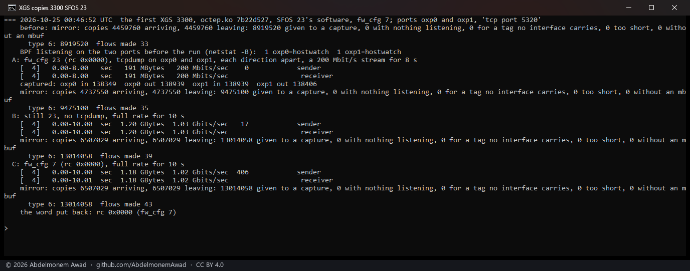
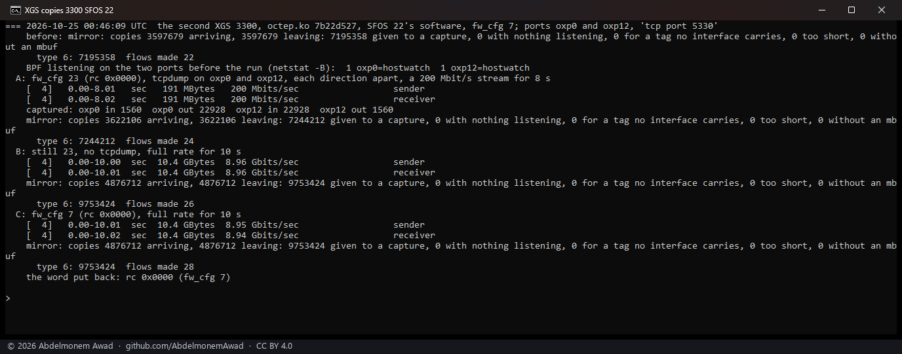
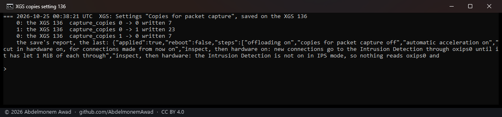

<!-- reviewed: 2026-10-25 -->
# Copies for a packet capture, measured on the XGS 136 and both XGS 3300s, 2026-10-25

Discoveries 12 and 17 of [the discoveries](../findings/discoveries-2026-10-22.md#mirrored-packets),
which turned out to be one thing, taken from the source to a product. A capture on a port sees
nothing of a connection once the coprocessor forwards it. The fast path can send the host a copy of
what it forwards: the configuration word's `FP_PKT_DUMP` bit, `0x010`, has it send control message
type 6 (`MIRROR_PKT`) for every frame - a byte of direction (0 arriving at the port, 1 leaving it), a
reserved byte, the port's tag, then the frame as it crossed that port (the vendor's
`cmsg_types.h`, `struct cmsg_mrr_hdr`). The vendor's host hands each copy to the packet capture of
that port and nowhere else. Until now both drivers counted type 6 and let it go: an earlier page
took the bit for a log that wrote nothing
([struck there](../findings/the-engine-accepts-and-nothing-returns.md)).

Now both drivers show each copy to that port's BPF - only while something listens there, an arriving
copy with the port as its receiving interface and a leaving one with none, so `tcpdump -Q in` and
`-Q out` read it as they read the host's own frames - and to nothing else: no copy enters the stack,
so pf, the rules and the counters never see a frame twice (`octep_dp_mirror`, `npugiu_mirror`;
`dev.octep.0.dp.mirror`, `dev.npuep.0.giu.mirror`). XGS: Settings **Copies for packet capture**, on
the Acceleration tab and off by default, writes the bit with the offload gate, at a save and at every
boot (`scripts/xgs/offload.sh`). octep.ko `7b22d527` on both XGS 3300s and npuep.ko `68c476f1` on the
XGS 136, built from this change against the appliances' own kernel.

## How it was measured

On each board, a TCP stream it forwards in hardware between two of its ports, in three phases
(`images/deploy/lab-mirror-octep.sh`, `lab-mirror-npuep.sh`):

- **A** - the bit set, tcpdump on both ports, each direction apart, a stream held to 200 Mbit/s for 8 s;
- **B** - the bit set, no tcpdump, the stream at full rate for 10 s;
- **C** - the bit clear, the stream at full rate for 10 s.

Read each time: the driver's copy counts, the type-6 messages, and the stream's own rate. The word
went back to what it was at the end of every run. OPNsense's `hostwatch` has a BPF listener on every
interface, so on these boards a copy always finds one; "nothing listening" is never reached.

| board | its coprocessor's software | ports | frames |
|---|---|---|---|
| the XGS 136 | Vendor version 21 | Port13 in (`npup13`), Port8 out (`npup8`), the PC to the second XGS 3300 | 1,500 bytes |
| the first XGS 3300 | Vendor version 23 | F1 (`oxp0`) to F2 (`oxp1`), both ends on the second XGS 3300 as in [the flow runs](sfos-versions-2026-10-25.md#the-first-xgs-3300-flow-offload-over-vendor-version-23) | 1,500 bytes |
| the second XGS 3300 | Vendor version 22 | F1 (`oxp0`) from the PC to A4 (`oxp12`), the first XGS 3300 at the far end, the lab tunnel down for the run | 9,000 bytes |

## The XGS 136, vendor version 21

**Every frame, both ways, on both ports.** In the run of the picture tcpdump counted 137,365 data
frames arriving at Port13 and 137,369 replies arriving at Port8. The host itself received 9,968 and
9,753 of them - the frames it forwarded before the connection was in hardware, which a capture always
saw (`giu.rx_port`) - and the coprocessor sent 255,193 copies a direction: 274,914 frames in all,
where the two captures counted 274,734. At the link's full rate the copies kept pace by count.

| run (UTC) | at 200 Mbit/s, tcpdump: data / replies | the host's own | copies a direction | full rate with the copies, copies a direction in 10 s | without |
|---|---|---|---|---|---|
| 00:23 | 136,764 / 137,450 | not read | 248,262 | 919 Mbit/s, 1,531,528 | 911 Mbit/s |
| 00:40 | 137,305 / 137,309 | not read | 250,752 | 897 Mbit/s, 1,532,663 | 813 Mbit/s |
| 00:47 | 137,489 / 137,493 | not read | 182,733 | 858 Mbit/s, 1,354,862 | 845 Mbit/s |
| 00:49, the picture | 137,365 / 137,369 | 9,968 + 9,753 | 255,193 | 914 Mbit/s, 1,529,489 | 809 Mbit/s |

The run at 00:47 has 92,249 frames the copies do not account for and no count of the host's own to
set against them; the read was added to the run after it.

## The first XGS 3300, vendor version 23

**Every frame, both ways, on both ports.**

| run (UTC) | at 200 Mbit/s, tcpdump: data / replies | copies a direction | full rate with the copies, copies a direction in 10 s | without |
|---|---|---|---|---|
| 00:19 | 138,948 / 138,918 | 277,719 | 1.27 Gbit/s, 2,184,391 | 1.02 Gbit/s |
| 00:39 | 138,970 / 138,957 | 277,846 | 1.00 Gbit/s, 1,719,804 | 1.00 Gbit/s |
| 00:46, the picture | 138,349 / 138,939 | 277,790 | 1.03 Gbit/s, 1,769,479 | 1.02 Gbit/s |

In the first two runs the copies came to the two captures' count less 147 and 81, the frames before
the connection was in hardware. In the picture's run tcpdump counted 57 fewer data frames arriving at
F1 than leaving F2, and the copies were 502 more than the captures counted: tcpdump itself fell
behind there. Both ends are the second board's own processor, which sets the full rate.

## The second XGS 3300, vendor version 22

**Part of them, and not the same part from one boot to the next.** Before this board's next boot:

| run (UTC) | at 200 Mbit/s, tcpdump: data / replies, each port | copies a direction | full rate with the copies, copies a direction in 10 s | without |
|---|---|---|---|---|
| 00:18 | 22,896 / 22,900 | 45,596 | 3.64 Gbit/s, 108,783 | 3.34 Gbit/s |

and after it, the setting on through the boot and then saved off and on:

| run (UTC) | at 200 Mbit/s, tcpdump: data / replies, each port | copies a direction | full rate with the copies, copies a direction in 10 s | without |
|---|---|---|---|---|
| 00:38 | 1,556 / 22,893 | 24,388 | 9.00 Gbit/s, 1,260,661 | 8.91 Gbit/s |
| 00:41 | 1,558 / 22,929 | 24,427 | 8.46 Gbit/s, 1,179,482 | 8.57 Gbit/s |
| 00:42 | 1,556 / 22,913 | 24,408 | 7.79 Gbit/s, 1,084,313 | 8.89 Gbit/s |
| 00:46, the picture | 1,560 / 22,928 | 24,427 | 8.96 Gbit/s, 1,254,606 | 8.94 Gbit/s |

Before the boot, every frame at 200 Mbit/s, and at full rate 108,783 copies a direction in ten
seconds where the stream alone carried some 474,000 data frames; after it, every reply
but only the stream's first 1,556 to 1,560 data frames - about its first half second - at 200 Mbit/s,
and far more at full rate. Read by hand before the boot, not photographed: 83,005 copies a direction
in five seconds at 5.42 Gbit/s, while the host's receive path counted nothing lost (`oq_lose`,
`rx_span_nobuf`, `rx_long` unmoved) - the coprocessor sent fewer, the host did not drop them; and
with the first board's F1 set to 1,500 bytes for a moment, 204,126 a direction at 1.73 Gbit/s and
152,022 at 1 Gbit/s, five seconds each. What decides which frames this board copies was not found.
The second XGS 3300 is also the only one of the three whose stream leaves by a port of its expansion
module.

Two runs before these are not in the tables: in them the stream was in the lab's IPsec tunnel, which
carries the PC's network to the first XGS 3300, and the copies were of its encrypted frames.

## The setting, saved and booted

The setting set as the page's save sets it - the model's field, `config.xml`, then `apply.php`
(`images/deploy/lab-copies-setting.php`). Saved on, every board's word became 23 (`0x17`: the gate,
the sequence check, "Cut in hardware" and the copies); saved off, 7. The XGS 136 cannot be asked for
its word, so what is shown there is the word its last write recorded, and the copies that a stream
then brought. Rebooted with the setting on, the second XGS 3300 came up with the word 23, and the XGS
136's boot hook wrote 23 and the copies came. On that family the word goes out as a byte in hex, and
`offload.sh` wrote it as `0${new}` - right only while the word stayed below 10; with the copies it is
23, so it is written with two hex digits now.

## What it does not say

- Whether OPNsense's Intrusion Detection in IDS mode sees the copies was not tried.
- Why the second XGS 3300 copies only part of its frames, and why which part changed at a boot.
- The cost to the host's processor with the copies on was not read; forwarding was, and stayed within
  the spread of the runs without them.
