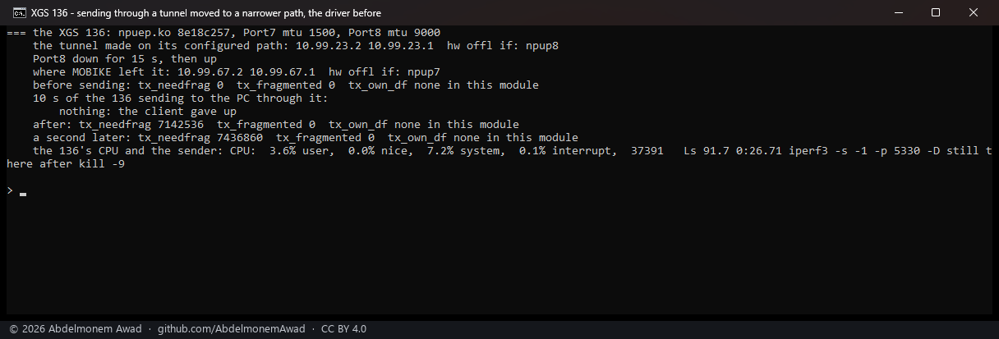
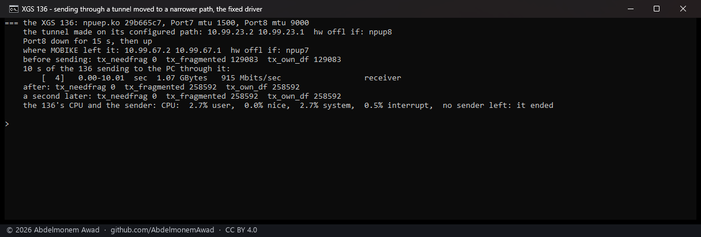
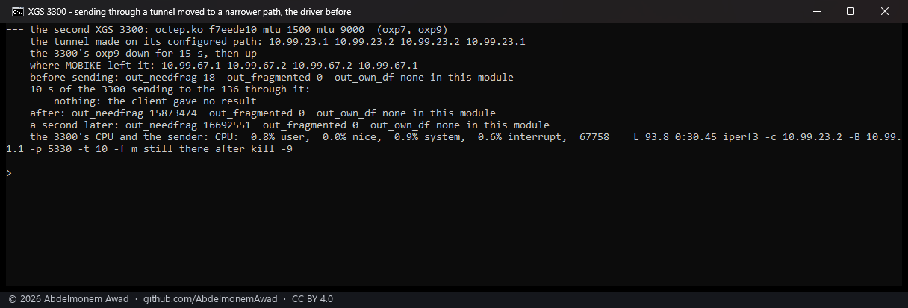
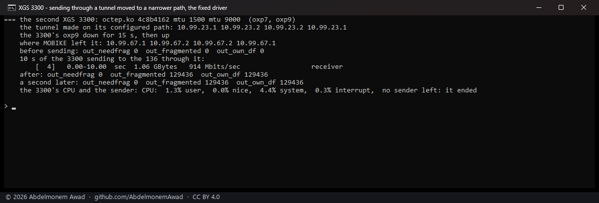

<!-- reviewed: 2026-10-21 -->
<!-- board: own traffic over a narrower tunnel path | XGS 136 | 915 Mbit/s -->
# The appliance's own traffic through a tunnel moved to a narrower path. Measured, 2026-10-21

Until this, a tunnel that strongSwan's MOBIKE moved onto a path narrower than the route to the inner
destination stopped carrying anything the appliance itself sent through it - and the program sending
was caught in a loop inside the kernel, a CPU at full rate, beyond `kill -9`, until a reboot. On both
families. It is what [644](https://github.com/AbdelmonemAwad/os-xgs-npu/issues/644) saw and took for
the effect of remaking a tunnel many times.

## Why

The driver hands an inner packet too big for the tunnel's outer path, marked DF, back with
`EMSGSIZE` - right for a forwarded packet, whose sender is told with ICMP and shrinks its segments.
For the appliance's own TCP it is not: `tcp_output` takes `EMSGSIZE` as "the route's MTU fell", reads
the MTU of the route to the **inner** destination, updates the segment size to it and sends again at
once, with no check that anything got smaller. Here the route stays on a 9,000-byte link while the
tunnel runs over a 1,500-byte one, so nothing does, and it loops. The kernel's own IPsec never meets
this: it fragments the outer packet with DF cleared (`net.inet.ipsec.dfbit` 0).

Now the appliance's own IPv4 packet is fragmented before the envelope even when marked DF, as a
packet without DF always was ([fragmentation before the
envelope](../findings/fragmentation-before-the-envelope-on-the-armada.md)), and the far end reassembles
it after decrypting; its own IPv6 packet is dropped with `ENOBUFS`, which `tcp_output` waits out on
its timer instead of looping - fragmenting IPv6 here is not built. A forwarded packet is answered as
before. New counters: `dev.npuep.0.ipsec.tx_own_df` and `tx_own_refused`, `dev.octep.0.ipsec.out_own_df`
and `out_own_refused`.

## How it was measured

The lab tunnel between the second XGS 3300 and the XGS 136 is configured between the 3300's `oxp9` and
the 136's Port8, both at MTU 9,000; the two are joined a second time through the 3300's `oxp7` and the
136's Port7, at 1,500. With the configured link down for fifteen seconds, MOBIKE moves the tunnel to
the other pair of addresses and keeps it there when the link comes back, while each appliance's route
to the other's inner network stays on the 9,000 link. Then ten seconds of one appliance sending to the
other's side through the tunnel with iperf3, the counters before and after, and the sender's state.
Each driver tried from a reboot.

**The XGS 136 sending** (`images/deploy/lab-136-narrow-path.sh`), its Port8 down for 15 s, the PC
receiving:

**The second XGS 3300 sending** (`images/deploy/lab-3300-narrow-path.sh`), its `oxp9` down for 15 s,
the 136 receiving:

| | before | fixed |
|---|---|---|
| XGS 136 sending through the moved tunnel | nothing arrives; ~300,000 refusals a second; sender at 92 % of a CPU, unkillable | 915 Mbit/s; 129,509 of its own packets fragmented in 10 s |
| second XGS 3300 sending | nothing arrives; ~820,000 refusals a second; sender at 94 %, unkillable | 914 Mbit/s; 129,436 fragmented |

## What it does not mean

- **IPv6 over a narrower path is not carried**, only no longer a loop: an appliance's own IPv6 packet
  too big for the path is dropped and TCP retries on its timer. Forwarded IPv6 is answered with Packet
  Too Big as before.
- **Fragments cost throughput** compared with segments that fit: TCP keeps its large segments, the
  driver cuts each into pieces. The lab's numbers are the link's either way.
- **MOBIKE moving a tunnel is strongSwan's choice**, on by default in strongSwan; keeping the tunnel
  on its configured path is a setting of the IPsec connection, not this driver's.
