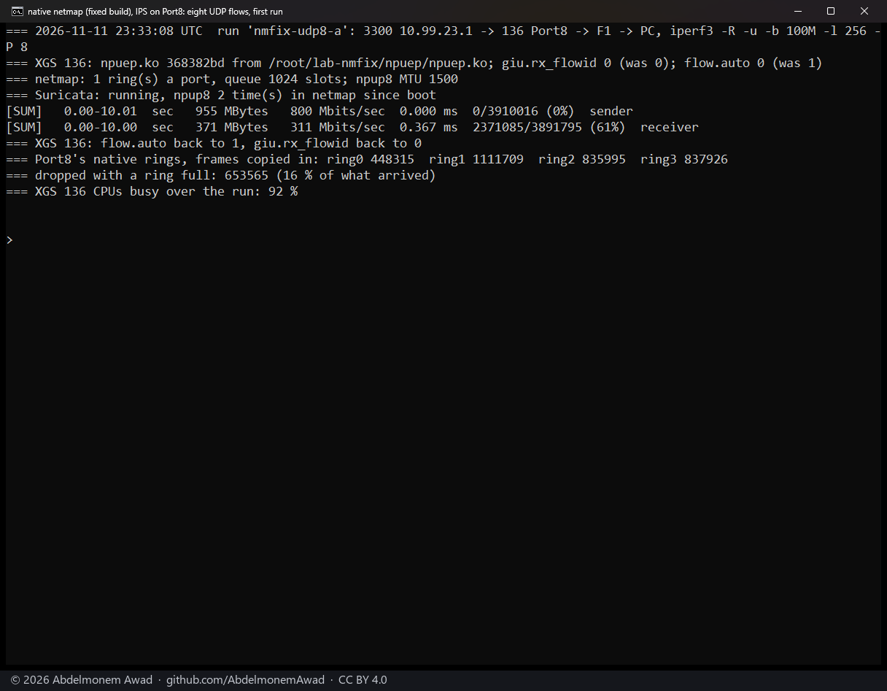
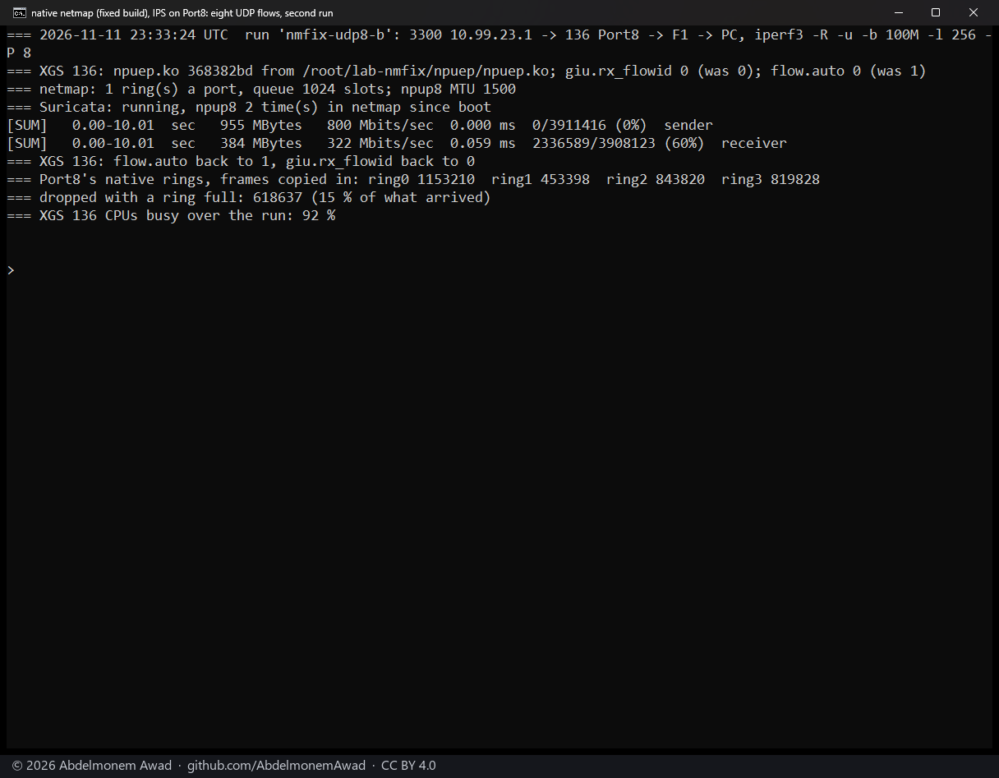
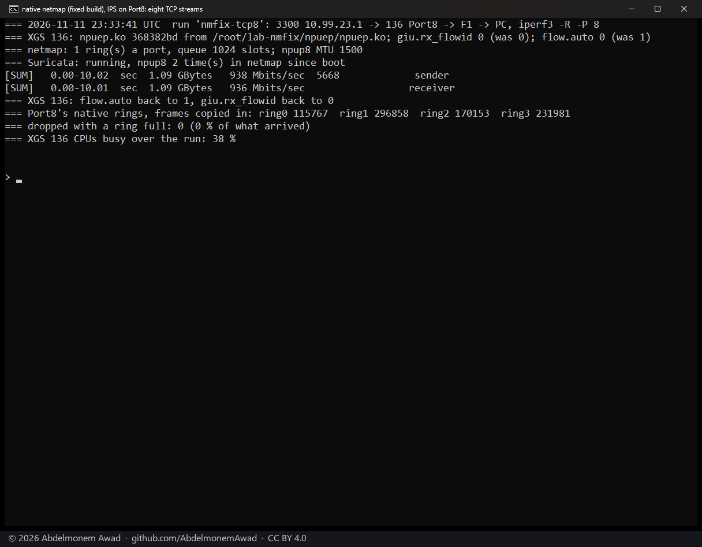
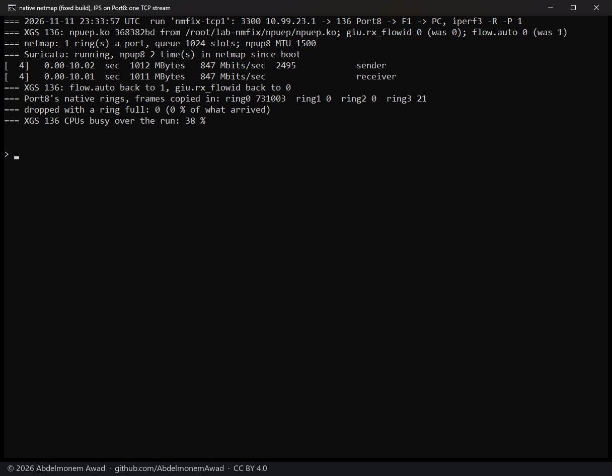
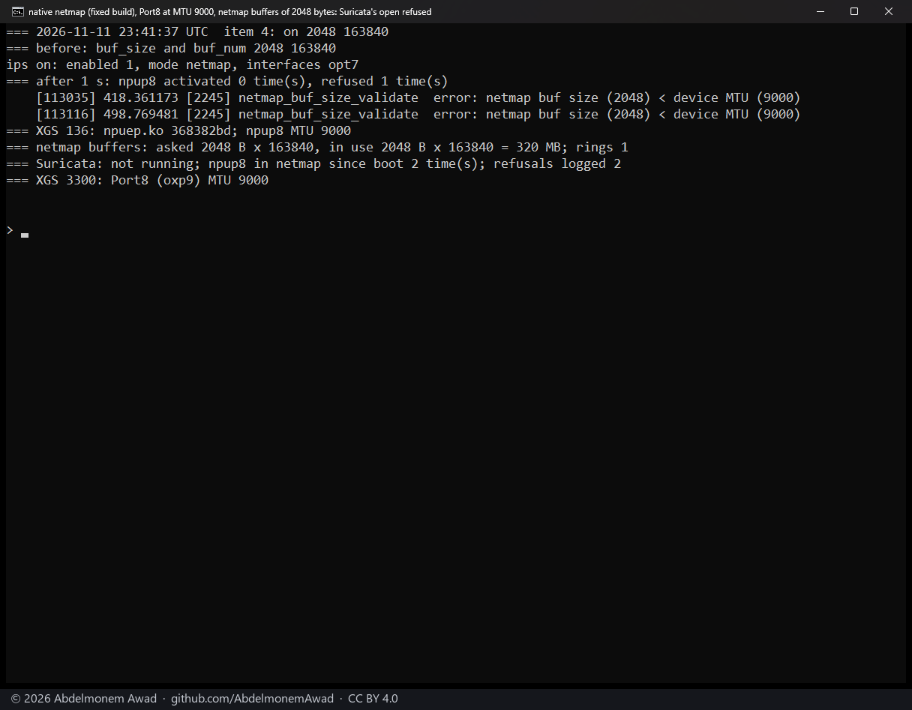
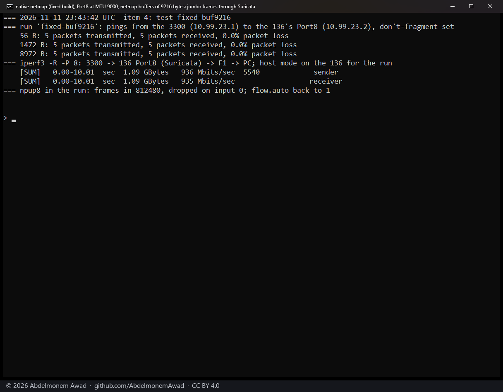
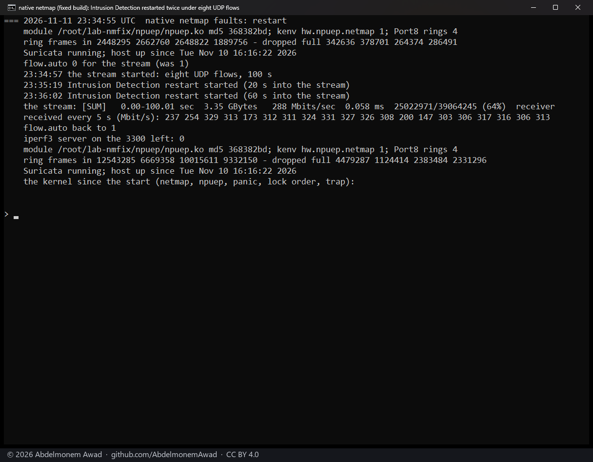
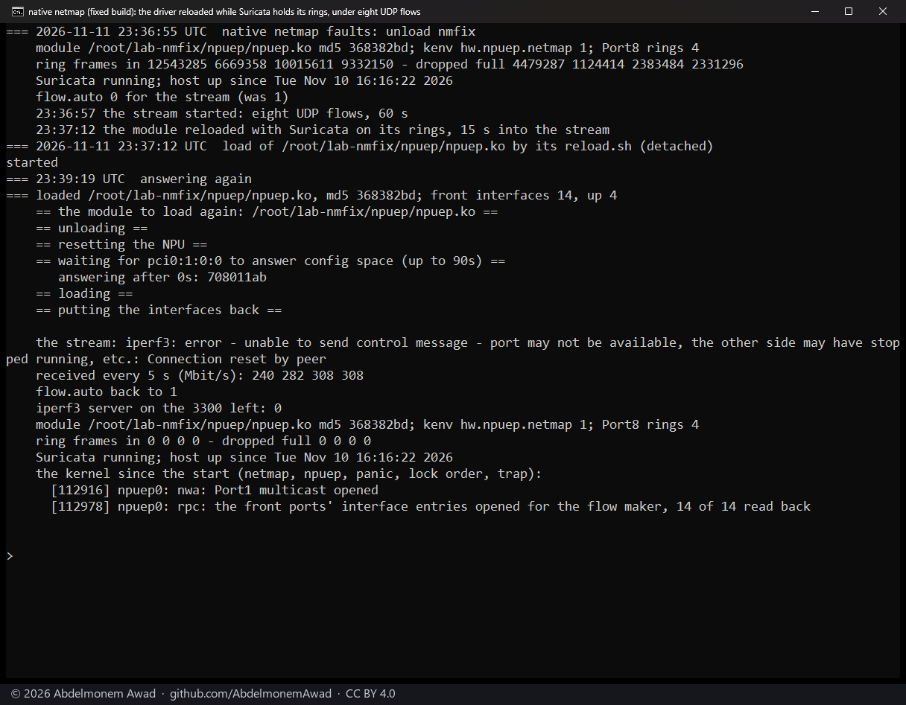
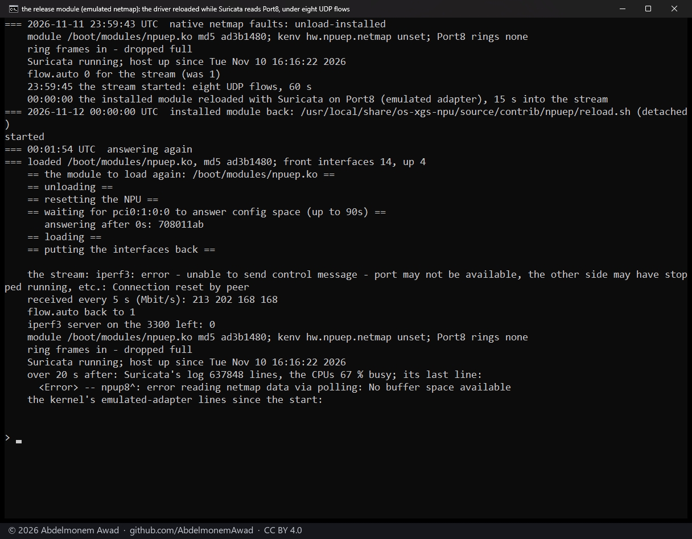
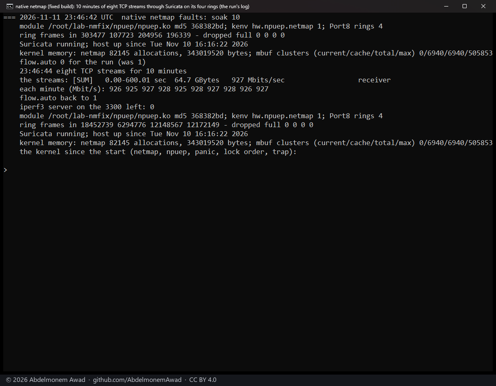

<!-- reviewed: 2026-11-11 -->
# netmap on the XGS 136's own rings: four of them, and jumbo frames through Suricata, 2026-11-11

Suricata in IPS mode reads a port through netmap. On the XGS 136's ports netmap used its emulated adapter,
and that adapter cuts every frame to one 2,048-byte cluster on its way out (FreeBSD's
`nm_os_generic_xmit_frame`: "size 2048 < len 9014"), so a port at MTU 9000 cannot run through Suricata in
IPS mode (measured the same day). npuep now gives each front port an adapter of its
own, behind a loader tunable.

## What changed

- **`hw.npuep.netmap=1`** at the loader (0 by default): each front port gets a native netmap adapter. A frame
  from receive queue N is copied into ring N, so both directions of one connection share a ring and the
  four queues fill four rings; transmit takes a ring's frames to the transmit queue of the same number.
  As many host rings as hardware rings.
- **`hw.npuep.netmap_slots`** at the loader: slots in each ring, a power of two from 256 to 2048 (1024 by
  default); read-only as `dev.npuep.0.giu.netmap_slots`. 2048 is what fits netmap's default ring objects
  (`dev.netmap.ring_size`), and every slot holds a buffer: Suricata in IPS mode opens sixteen rings a port
  (four each way, and as many host rings), 16,384 buffers at 1024 slots against netmap's default 163,840.
- **One frame, one slot.** A port whose MTU is above netmap's buffer size is refused when a reader opens it:
  for a port at MTU 9000, `dev.netmap.buf_size=9216`. A frame is never spread over several slots: Suricata's
  IPS path sends what it read back through the host rings, and netmap hands each slot of a chain to the stack
  as a frame of its own.
- **A reader's close waits** for the wake-ups the receive path has already taken for its rings, and drops
  those it has not taken, before netmap may tear the rings down; a reader's open or close resets only the
  rings whose mode changes.
- Counts for each port under `dev.npuep.0.giu.netmap_port.<port>`: its rings, each ring's frames in, frames
  dropped (`nm_rx_drop`) and among them frames longer than one buffer (`nm_rx_toolong`), and what transmit
  sent, found full or dropped.
- At 0 nothing changes: the ports have no adapter of their own and netmap uses its emulated one, as before.

## How it was measured

The XGS 136 (vendor version 21, four CPUs, four queues), OPNsense 26.7.8_2 on FreeBSD 15.1-RELEASE-p6, its
release module in `/boot/modules`. The module with this change was built on the appliance against its own
kernel's sources with no warning (md5 `368382bd`) and loaded in place with `kenv hw.npuep.netmap=1`, on
2026-11-11 from 23:29 UTC; the release module was loaded again after, the tunable removed.

- **Intrusion Detection in IPS mode** on Port8 (`npup8`), the driver's automatic acceleration at 0 for each
  run so every frame crossed Suricata.
- **The traffic** from the second XGS 3300 through Port8 and out of F1 to a PC with iperf3: eight UDP flows
  of 100 Mbit/s in 256-byte datagrams, eight TCP streams, one TCP stream, 10 s each.
- **Jumbo frames**: Port8 and the second XGS 3300's port facing it at MTU 9000; pings of 56, 1,472 and 8,972
  bytes from the XGS 3300 to Port8 with don't-fragment set, then eight TCP streams, with netmap's buffers at
  2,048 bytes (163,840 of them, 320 MB) and then at 9,216 (36,864 of them, `dev.netmap.buf_num`, 324 MB).
- **Faults**: Intrusion Detection restarted twice during a 100 s stream of the eight UDP flows; the driver
  reloaded 15 s into a 60 s stream - unloaded, the coprocessor reset and the driver loaded again, as the
  plugin's recovery in place does - with Suricata on its rings; then ten minutes of eight TCP streams.
- **Read on the XGS 136**: the frames copied into each ring and dropped with a ring full, how busy its CPUs
  were, the kernel's log, and whether the host stayed up (its boot time).

## Results

| Run | Received | Dropped at the rings | CPUs busy |
|---|---|---|---|
| eight UDP flows, two runs | 311 and 322 Mbit/s | 16 and 15 % | 92 % |
| eight TCP streams | 936 Mbit/s | 0 | 38 % |
| one TCP stream, three runs | 847, 929 and 925 Mbit/s | 0 | 38, 30 and 28 % |

| Pings through Suricata to a port at MTU 9000 | 56 B | 1,472 B | 8,972 B | eight TCP streams |
|---|---|---|---|---|
| netmap buffers of 2,048 bytes | the port refused: Suricata does not start | | | |
| netmap buffers of 9,216 bytes | 5 of 5 | 5 of 5 | **5 of 5** | 935 Mbit/s |

- **Four rings carry the load, and the CPUs are then the limit**: eight UDP flows filled all four rings (for
  example 448,315, 1,111,709, 835,995 and 837,926 frames) and were received at 311 and 322 Mbit/s with the CPUs
  92 % busy - what the emulated adapter reaches with four rings and the receive queue as the flow id
  ([the measurement](flowid-136-2026-11-11.md)). The native adapter's gain is not speed.
- **It is jumbo frames**: with 9,216-byte buffers every 8,972-byte ping crossed Suricata whole, and the four
  rings took the run's 812,495 frames with none too long and none dropped. With 2,048-byte buffers netmap
  refuses Suricata the port ("netmap buf size (2048) < device MTU (9000)"), rather than let a frame reach
  Suricata in pieces.
- **One TCP stream stays in one ring**: 925 to 929 Mbit/s, and once 847.

### Faults

| Fault | The stream | The host | Suricata |
|---|---|---|---|
| Intrusion Detection restarted twice, 22 and 65 s into 100 s of eight UDP flows | 288 Mbit/s on average; 173, then 200 and 147 in the 5 s after each restart, then back to 300-330 | up, no kernel message | running, on the rings |
| the driver reloaded 15 s into 60 s of eight UDP flows | ended: F1, the PC's way in, went down with the driver | up, no kernel message but the driver's own | running, but on the old rings: see below |
| ten minutes of eight TCP streams, every frame through the rings | 927 Mbit/s, each minute 925 to 928 | up, no kernel message | running; 48.3 million frames through the four rings, none dropped |

- **A restart under load costs a few seconds**: the stream dipped once for each and came back.
- **A reload under Suricata leaves the host up, and Suricata on rings that are gone.** The driver came back
  with new rings, and Suricata, still running, never read them: it logged "npup8: error reading netmap data
  via polling: No buffer space available" about 30,000 times a second, the CPUs were 98 % busy, and the next
  stream passed Port8 uninspected. Intrusion Detection restarted ended it.
  **The release does the same** with netmap's emulated adapter: the module from `/boot/modules` reloaded under
  Suricata, which logged 637,848 lines in 20 seconds with the CPUs 67 % busy - the recovery path restarts
  nothing ([1153](https://github.com/AbdelmonemAwad/os-xgs-npu/issues/1153)).
- **Ten minutes under load, nothing lost**: eight TCP streams at 925 to 928 Mbit/s each minute, 48.3 million
  frames through the four rings with none dropped, netmap's memory and the mbuf clusters the same before and
  after, and nothing in the kernel's log.

## What it does not mean

- **TCP with jumbo frames was not measured**: the streams' other legs, out of F1 to the PC, set their
  segment size, and only the pings above are known to have crossed Port8 at 8,972 bytes.
- **`dev.netmap.buf_size=9216` was run with `dev.netmap.buf_num=36864`** to keep netmap's memory near its
  default; other counts were not tried.
- **Only the XGS 136 was measured**, and only npuep has the tunable.
