<!-- reviewed: 2026-11-03 -->
# The XGS 136's host panics at the driver's unload, 2026-11-03

[988](https://github.com/AbdelmonemAwad/os-xgs-npu/issues/988): on 2026-11-02 the XGS 136's host stopped
after its coprocessor had been taken up again in place, and left nothing to say why - ~~its kernel waited
in the debugger after a panic, if it was one, until the hardware watchdog restarted it.~~ the hardware
watchdog restarted it, with no dump. (Corrected 2026-11-03: OPNsense loads a script for the kernel's
debugger at every boot, `kdb.enter.default` in `debug.ddb.scripting.scripts`, which writes a textdump and
restarts the host - ~~a panic that entered the debugger would not have waited there for the watchdog, so
that stop was a hang, or a panic that never finished its textdump.~~ Corrected 2026-11-05: that script
does not finish before the plugin's watchdog on these appliances - its output goes to the VGA console too
- so a panic ends in the watchdog's restart with no textdump, as this stop did; it may have been a panic
or a hang: [panic-record-2026-11-05](panic-record-2026-11-05.md).) For the runs of
2026-11-03 `debug.debugger_on_panic` was 0, so that a panic writes its dump and restarts the host. The
lab's XGS 136 (vendor version 21), the same stop as in [the runs of 2026-11-02](coprocessor-quiesce-2026-11-02.md)
(`images/deploy/lab-768-silent.sh`: the coprocessor's getty and watchdog feeder stopped, its end of the
management link down; its own watchdog resets it and `fastpath.py` takes it up again in place), and a
logger on the host reading `dev.npuep.0.heartbeat.state` every half second.

## A sysctl read through the unload

The first run (stop 06:13:30 UTC) did not get to the end of the recovery: the host panicked at 06:15:03,
as `recover.sh` unloaded npuep, and the dump says how.

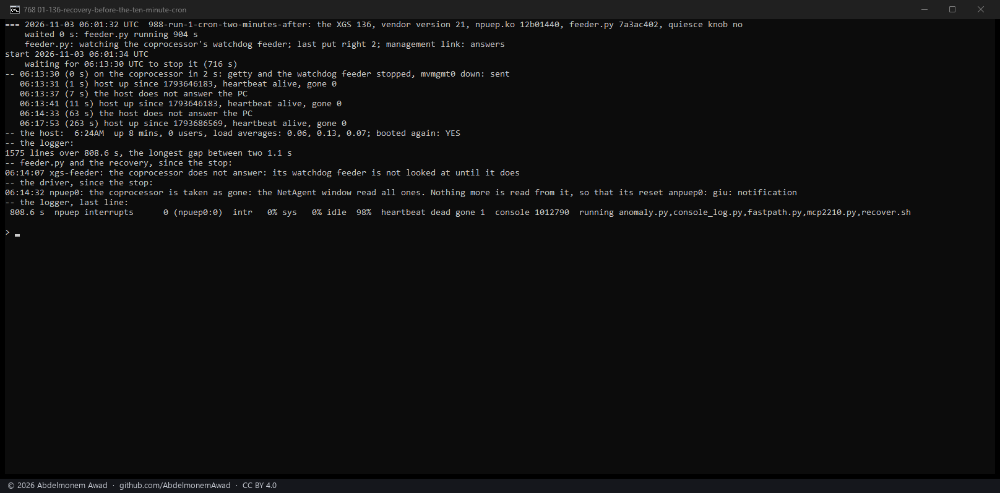

    Fatal trap 12: page fault while in kernel mode
    fault virtual address   = 0x488
    current process         = 62789 (sysctl)
    __mtx_lock_sleep() at __mtx_lock_sleep+0xc9
    npugiu_sysctl_hb_state() at npugiu_sysctl_hb_state+0x42
    sysctl_root_handler_locked() at sysctl_root_handler_locked+0x91

A read of the heartbeat's state took the lock of a facility already torn down. Every sysctl of npuep
was in the device's own context, which newbus frees only after the driver's detach returns, while the
facilities' detaches destroy the locks most of their handlers take before that. A destroyed mutex reads
`MTX_DESTROYED`, whose owner bits are a null thread, and the lock's slow path reads a field of that
owner: the fault at 0x488. octep had the same, and has kept its sysctls in a context of its own, freed
first in detach, since [2026-10-31](coprocessor-stop-capture-2026-10-31.md); npuep never had. The
reader was the logger, but `fastpath.py` reads the heartbeat every minute, and anything reading the
driver's sysctls meets the same window.

The same run again at 06:35:31 with that module panicked the same way at 06:37:03 - the logger alone
reading; its label says four loops, which were not started (the series' wrapper did not pass the
setting on).

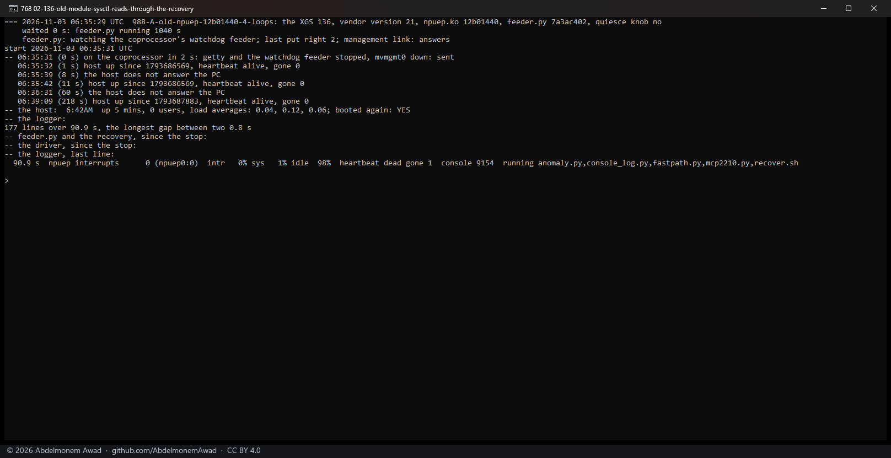

**The change.** npuep now makes a context of its own at the top of its attach, every facility adds its
sysctls there, and its detach frees it before anything else (`npuep_sysctl_ctx`); `sysctl_ctx_free`
waits for a handler already running, and no new one starts. Built as npuep.ko `fe1fcd89` and put on the
XGS 136, then run four times with four loops reading the heartbeat's state and the gone latch as fast as
they could besides the logger:

- **06:47:31, a recovery in place:** 1,491,245 reads by the loops; the coprocessor taken up again in place
  in 94 s, the host up throughout.
- **06:55:02, a recovery in place:** the host panicked at 06:57:03 - not in a sysctl handler: see below.
  This run's photograph prints, under "the crash it left", the trace of the 06:37 panic, which the
  message buffer still held - the script read the first trap in it, not the last (corrected); its own
  trace is in the photograph of all four below.
- **07:04:38, `contrib/npuep/reload.sh`** (unload, reset, load): 324,758 reads; the module back, the
  heartbeat alive, the bridge with its ten members, the host up.
- **07:07:04, the same reload:** the host panicked at 07:07:09, three seconds into the unload, the same
  way as at 06:57. The `reload.sh` lines in its photograph are the 07:04 run's - the file as the disk
  held it when the panic came, before this run had written to it - and its first line is cut off.

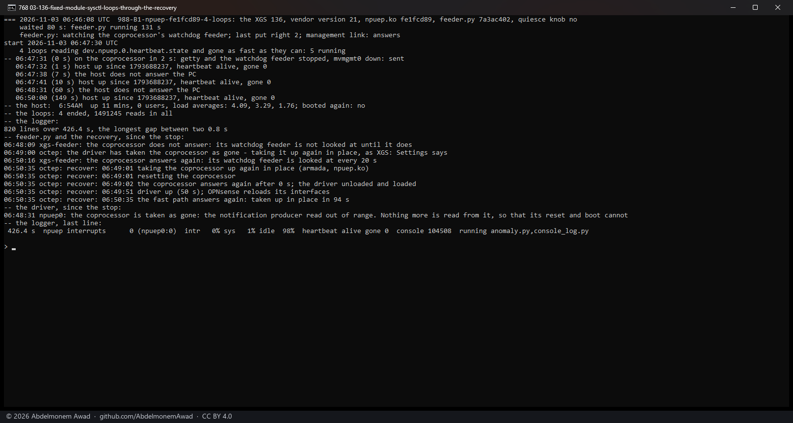

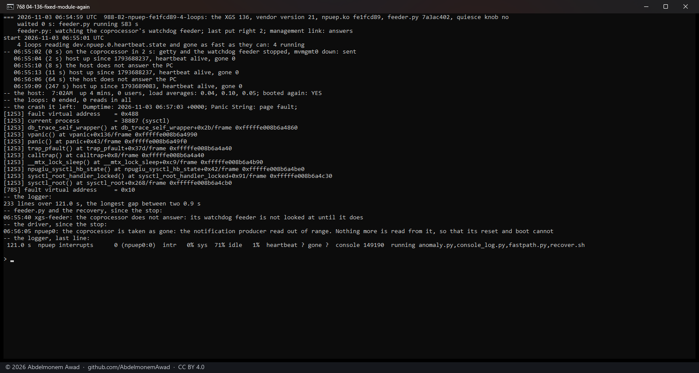

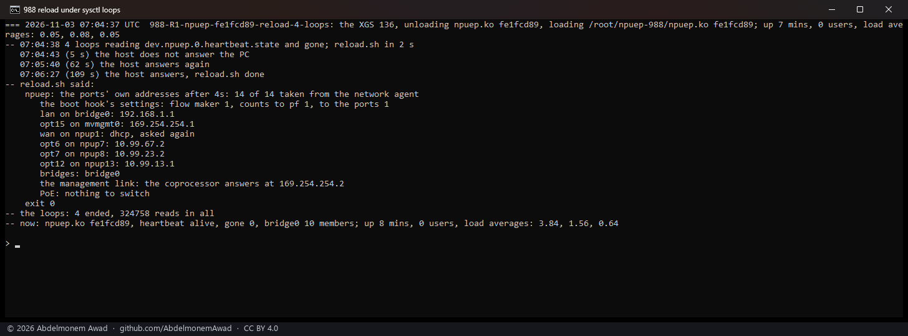

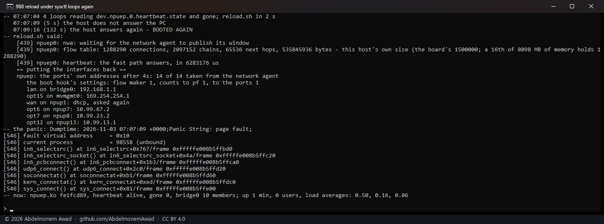

In none of the four did a sysctl handler fault.

## The other panic: IPv6 source selection

The four dumps, each with its own trap - a dump's message buffer carries the earlier boots' text too,
and its own trap is the one with the latest time:

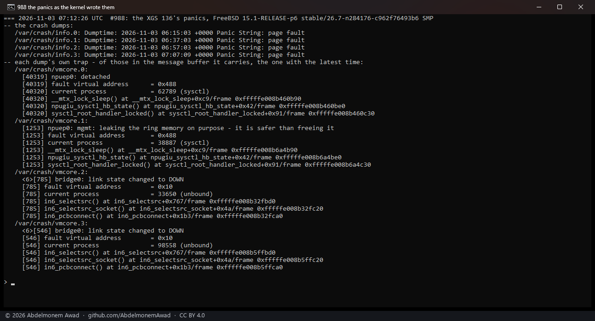

The second kind is FreeBSD's own IPv6 path, by unbound connecting a UDP socket for a query, as the
front ports' interfaces were detached:
[994](https://github.com/AbdelmonemAwad/os-xgs-npu/issues/994). In FreeBSD 15.1 an interface's detach
flushes its routes and then sets its IPv6 data to NULL at once, waiting for the network epoch only before
freeing it; ~~a thread that looked a route up before the flush still has the interface~~ a route lookup
still returns the interface for a while after the flush (measured below), and `in6_selectsrc()` reads
`ND_IFINFO()` of it - the third pointer of that data, at offset 0x10. The same read
is in `in6_selecthlim()`, which [755](https://github.com/AbdelmonemAwad/os-xgs-npu/issues/755)'s panic on
an XGS 126 went through. The change above does not touch it; 994 is where it is taken on.

## The IPv6 panic, taken on

A loop doing what unbound did - a UDP socket over IPv6 connected, which makes the kernel choose the
source address - as fast as one process can, out of both front-port interfaces that carry IPv6 here: the
WAN's default route (npup1) and the lab link (npup8) (`images/deploy/lab-994-udp6.py`). Four of them
through the same reload - from the second run on with the four sysctl loops besides.

- **The module of the change above** (`fe1fcd89`), 07:21, the UDP loops alone: the host panicked five
  seconds in, the same trace, by the loop's process.
- **Each port's addresses purged, its routes flushed and the network epoch waited for, before its
  detach** (`8118f01f`), 07:26: panicked the same way.
- **Taken down as well, and its IPv6 side detached** - addresses, prefixes and default routers learned
  on it, as FreeBSD's own detach does (`66a30c95`), 07:35: panicked the same way.

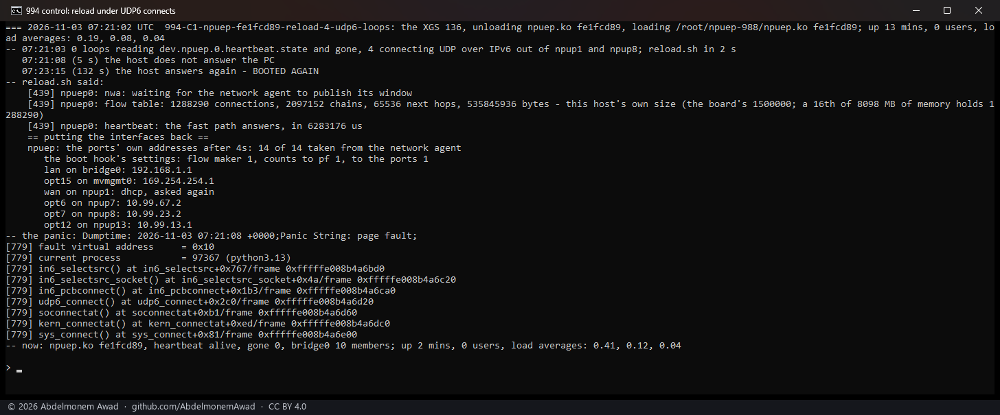

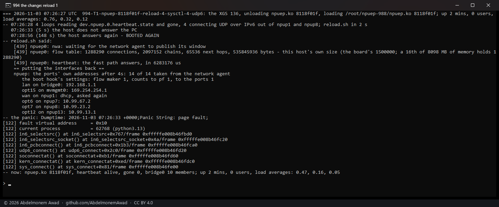

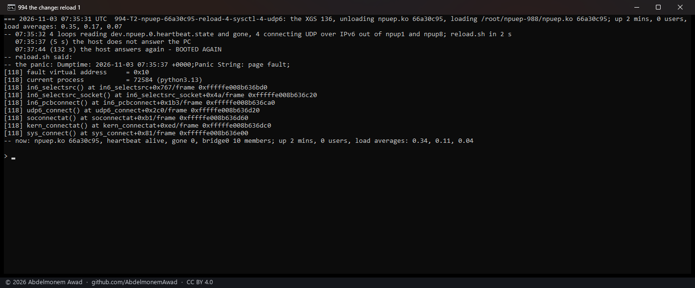

Which interface, and when: a build that said each step (`f51bb89d`) - the trap's interface, handed to
`if_getafdata()` in `rdi`, was npup1, the WAN's port, which had been put out of reach, the epoch waited
for, and detached; the next port's turn had begun 6 ms later. A route lookup still returned an interface
whose every route had been flushed. The lookups here do not read the routing table itself but a
lock-free copy of it (`net.route.algo`: `radix6_lockless`, `radix4_lockless`), which follows it within
`fib_max_sync_delay_ms` - 1,000 ms on this kernel.

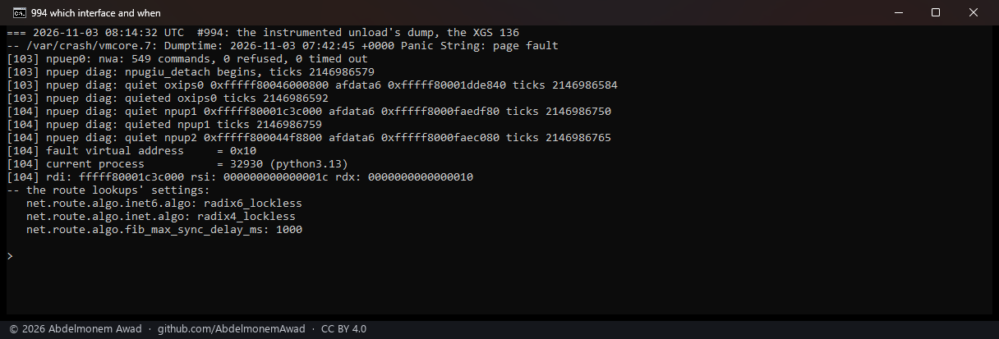

**The change.** At the start of npuep's detach every interface of the driver - the front ports, the
inspector's `oxips0` and the management link's `mvmgmt0` - is taken down, its addresses, IPv6 side and
routes taken away; then that delay is waited out once (`fib_max_sync_delay_ms` read from the kernel, and
100 ms more) and the epoch after it, and only then is anything detached. The unload takes a second or
so longer. Built as `4b721602`, three reloads under the same eight loops:

| reload | UDP connects over IPv6 | sysctl reads | the host |
|---|---|---|---|
| 07:51:21 | 16,658,340 | 98,699 | up, the module back, the heartbeat alive, bridge0 with its ten members |
| 07:53:31 | 16,760,770 | 100,154 | the same |
| 07:55:41 | 22,656,298 | 143,733 | the same |

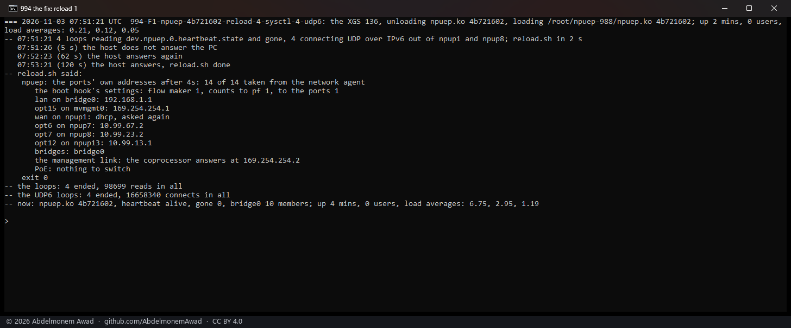

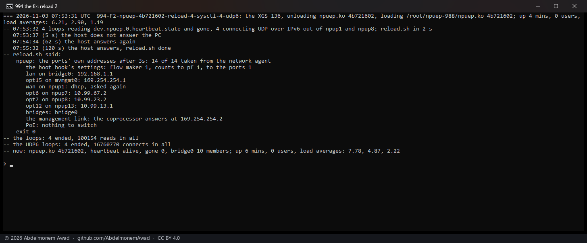

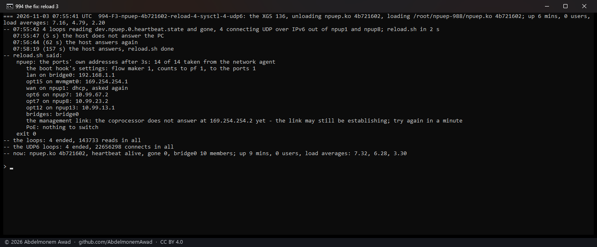

## What remains

- [994](https://github.com/AbdelmonemAwad/os-xgs-npu/issues/994) for octep: its front ports go the same
  way when its device is detached in a recovery. Not reproduced on an XGS 3300 yet, and not changed:
  one recovery in place of the second XGS 3300 (vendor version 22, octep.ko `a6ad497f`) under four of
  the same loops, out of its WAN's default route (oxp3), oxp9 and oxp0 - 129,042,726 connects - ended
  without a panic, taken up again in place in 350 s. Its recovery detaches the device only once the
  coprocessor has booted again, minutes after its ports went down; the XGS 136's reload came at once.

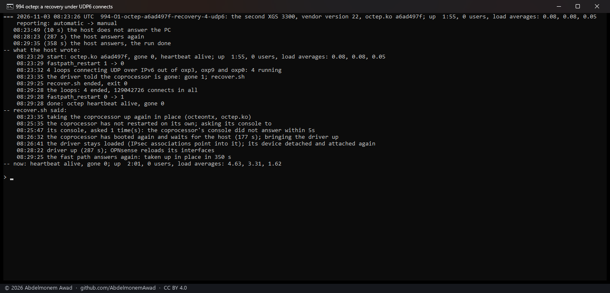

- The stop of 2026-11-02, two and a half minutes after a recovery that had ended, is not explained by
  either: nothing was being unloaded then, as far as its logger shows.
- Not run on the other ARMADA models, nor with the GUI open through a recovery.
