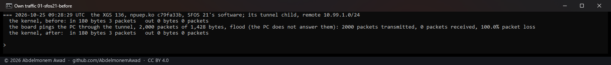
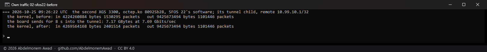
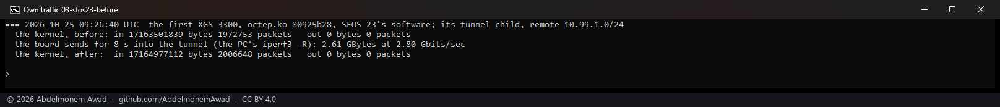
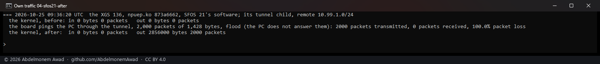
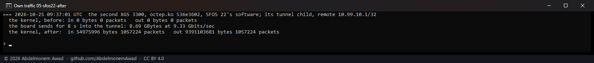
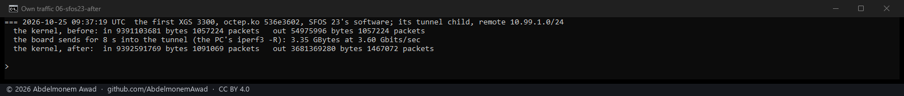

<!-- reviewed: 2026-10-25 -->
# The appliance's own traffic into an offloaded tunnel, in the association's lifetime, 2026-10-25

[774](https://github.com/AbdelmonemAwad/os-xgs-npu/issues/774): a packet an appliance itself sends into
an offloaded tunnel does not go through the transform the drivers interpose. `ip_output` hands it to the
kernel's own offload path (`ipsec_accel_output`), which tags it for the driver and records it only in a
software counter of its own (`accel_lft_sw`, reported apart as `SADB_X_EXT_LFT_CUR_SW_OFFL`); the
association's current lifetime - what its byte and packet limits, and strongSwan, read - grows only by
what the driver reports with `ipsec_accel_drv_sa_lifetime_update`. Neither driver reported the tagged
packets it encrypted, so for traffic the appliance originates the lifetime stood still.

Since octep.ko `536e3602` and npuep.ko `873a6662` each driver adds a tagged packet it hands to the
engine to the totals it reports, once a second with the rest (`octep_ipsec_handed`, `npuipsec_handed`).
A packet the interposed transform hands over is counted by the kernel itself and is not added again.
octep now also counts `handed` - the frames given to the coprocessor on an outbound association, each a
sequence number - which its reckoning of the kernel's counter used and nothing incremented; npuep
already did.

Measured on all three boards, each one's own host sending into its tunnel, the kernel's counts of
the tunnel's child read before and three seconds after (`images/deploy/lab-own-traffic.sh`,
`lab-own-traffic-series.ps1`).

## Before

## After

| board | its software | sent from its own host | the kernel's outbound count, before | after |
|---|---|---|---|---|
| the XGS 136 | SFOS 21 | 2,000 pings of 1,428 bytes | 0 and 0 (2,000 sent the same way) | **2,856,000 bytes, 2,000 packets** |
| the second XGS 3300 | SFOS 22 | 8.69 GBytes | unchanged by 7.17 GBytes | **9,391,103,681 bytes, 1,057,224 packets** |
| the first XGS 3300 | SFOS 23 | 3.35 GBytes | unchanged by 2.61 GBytes | **+3,626,393,284 bytes, +409,848 packets** |

The XGS 136's figure is the pings exactly: 2,000 times 1,428 bytes, the inner packet's length. The two
XGS 3300s check each other: the first board's inbound count, which its host keeps for the packets it
decrypts and takes in, read 9,391,103,681 bytes and 1,057,224 packets - the second board's outbound
count to the byte and the packet - and the second board's inbound count read the first's outbound
before its stream, 54,975,996 bytes and 1,057,224 packets, to the byte as well.

## What this does not settle

- **Delivery from the XGS 136.** The PC does not answer pings it receives from that tunnel, so the
  2,000 were counted going out and not seen arriving; the board's echo replies through the same
  tunnel do arrive, which is the same path.
- **A rekey by bytes.** The counts now move as they should; a byte lifetime set low enough to see the
  rekey it asks for was not configured on the lab tunnels.
