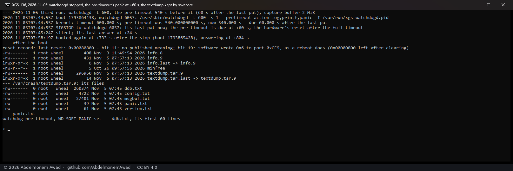
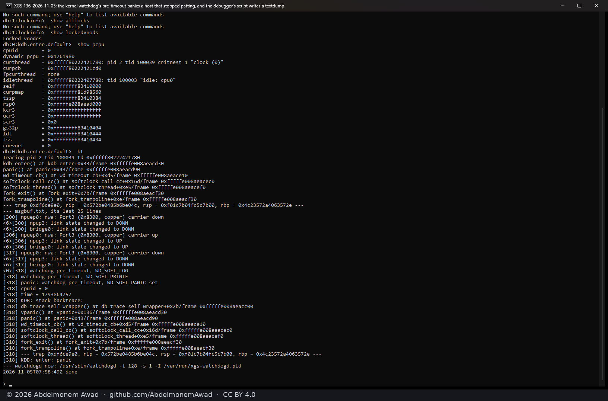
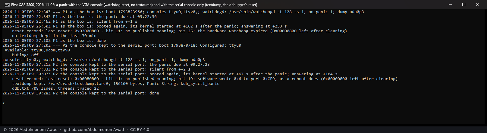

# A panic's record on XGS 3300 and XGS 136: watchdog, VGA console and debugger script, 2026-11-05

Asked: why the host stops of [988](https://github.com/AbdelmonemAwad/os-xgs-npu/issues/988) and
[1005](https://github.com/AbdelmonemAwad/os-xgs-npu/issues/1005) on the XGS 136 left no textdump.
Both times the hardware watchdog restarted the host, and both issues read that as a hang. The answer:
on these appliances a panic ends the same way, so that reading was wrong. It is struck and corrected in
both issues and in the two pages below.

## What was run

On the lab's XGS 136 (vendor version 21) and the first XGS 3300 (vendor version 23).
- OPNsense 26.7, kernel `stable/26.7-n284176-c962f76493b6`, and the plugin's hardware watchdog armed as
  it is by default (`watchdogd -t 128`).
- On both, `debug.debugger_on_panic` is 1 and a dump device is set (the installer's swap partition).
- OPNsense loads the kernel debugger's script at every boot, `kdb.enter.default`: `textdump set;
  capture on; run lockinfo; show pcpu; bt; ps; alltrace; capture off; textdump dump; reset`.
- Both boxes print "Dual Console: Serial Primary, Video Secondary" at boot: the kernel's console is the
  serial port and vt's VGA console at 640x480.

| box | how the panic was made | consoles | watchdog | what the next boot found |
|---|---|---|---|---|
| XGS 136 | `watchdogd --pretimeout 60 --pretimeout-action panic`, watchdogd then stopped | serial and VGA | 128 s | no panic at all; the hardware watchdog's restart (bit 25) |
| XGS 136 | the same pre-timeout set in the kernel's own unit (below); the panic 60 s after the last pat | serial and VGA | 128 s | the watchdog's restart (bit 25), **no textdump** |
| XGS 136 | the same | serial and VGA | 600 s | **a textdump**, the host restarted by the debugger itself (bit 19), about 10.5 minutes after the panic |
| first XGS 3300 | `sysctl debug.kdb.panic=1` | serial and VGA | 128 s | the watchdog's restart (bit 25), **no textdump** |
| first XGS 3300 | the same, after `conscontrol delete ttyv0` | serial only | 128 s | **a textdump**, the host restarted by the debugger itself (bit 19); its next kernel ran 67 s after the panic |

## What it means

- **With the VGA console in the list, the debugger's script does not finish before the watchdog.**
  - Its output goes to both consoles. With only the serial one, the first XGS 3300 wrote its textdump and
    restarted well inside 131 s.
  - With both, the XGS 136 took about ten and a half minutes. The plugin's watchdog restarts the host
    after 131 s, so the script never reaches `textdump dump`.
- **No panic on these appliances has left a textdump since the watchdog was armed by default
  (2026-10-17).** A restart by the watchdog with no textdump is a hang or a panic; the record cannot tell
  which. The stops of 988 (2026-11-02) and 1005 (2026-11-03) may have been either.
- **OPNsense's capture buffer is 48 KiB by default.** That cuts the threads' traces short: the 3300's
  textdump held 708 lines, 22 threads traced. With 2 MiB (`debug.ddb.capture.bufsize`) the XGS 136's held
  4,247 lines, 366 threads.
- **`watchdogd --pretimeout` never fires on FreeBSD 15.1.** watchdogd passes the seconds as a `u_int` to
  `WDIOC_SETPRETIMEOUT`, which the kernel has read as an `sbintime_t` since freebsd-src `26d6617f3e`
  ("watchdog: Convert to using sbintime_t format", 2025-08-14). So 60 s becomes 60/2^32 s and the
  pre-timeout falls at the timeout itself. Set through the same ioctl as an `sbintime_t` (60 << 32), it
  panics 60 s after the last pat, as runs 2 and 3 show.

## What it does not mean

- Nothing in the plugin is changed by this page. Which of these, if any, an appliance gets is still open:
  the kernel's console kept to the serial port, a larger capture buffer, or more time for the script.
- The cause of 988 and 1005 is still not known. The XGS 136's long series for them is set up with the
  600 s watchdog and the pre-timeout above, so that a panic, or a stall that still runs the kernel's
  timers, leaves a textdump.
