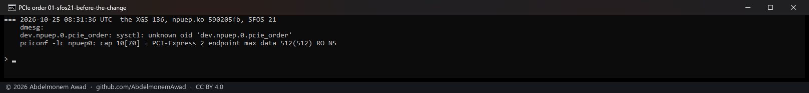
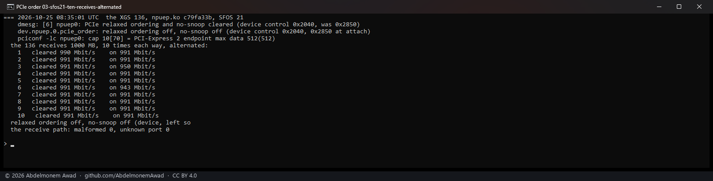

<!-- reviewed: 2026-10-26 -->
# The coprocessor's PCIe relaxed ordering and no-snoop, cleared by the driver, 2026-10-25

[748](https://github.com/AbdelmonemAwad/os-xgs-npu/issues/748): an XGS 107 moved about a megabit a
second, with whole seconds of nothing, and its driver counted 202,606 of 2,971,077 received frames as
malformed - a receive descriptor whose producer index said it was filled still held the watermark the
driver stamps into it before handing it over. The ARMADA coprocessor's firmware leaves **Relaxed
Ordering** and **No Snoop** enabled in its PCI Express Device Control, which lets it mark its writes
into host memory either way; with relaxed ordering a host may see the write that says a descriptor
is filled before the write that fills it. The 107's owner cleared the two bits by hand with
`pciconf -w`, and `malformed` stopped - 146,019 before and after, with 161,389 frames received in
between. The setting went back at the next boot, as the register is the host's and the firmware
sets it again.

Since npuep.ko `c79fa33b` the driver clears the two itself, on every attach, before it turns bus
mastering on, so that no write the coprocessor makes for it carries either attribute. It says so in
the kernel's log, and `dev.npuep.0.pcie_order` reads the register live beside the value attach found:

    npuep0: PCIe relaxed ordering and no-snoop cleared (device control 0x2040, was 0x2850)
    dev.npuep.0.pcie_order: relaxed ordering off, no-snoop off (device control 0x2040, 0x2850 at attach)

The loader tunable `hw.npuep.pcie_relaxed=1` leaves the two as found, to compare. The XGS 3300's
driver, octep, is not changed: the second XGS 3300's endpoint shows `RO NS` too, and no loss of this
kind has been seen on either XGS 3300 - a different coprocessor, a different ring format and a
different host.

Measured on the XGS 136, on vendor version 21, the only ARMADA board on the bench
(`images/deploy/lab-pcie-order.sh`, `lab-pcie-order-series.ps1`). Its host, a Ryzen R1606G, never
showed the 107's loss; what is measured here is that clearing the two costs it nothing. ~~That the
change ends the 107's loss is its owner's hand-made test above, not one taken here.~~ It does not end
it: with the two cleared at attach, the 107 counted 160,354 descriptors refused of 4,378,383 frames in
the support bundle its owner sent on 2026-10-25, and on 0.1.0-alpha.8.5, under iperf3, 128,198
against 35,030. What did, on the host's side, is in
[giu.md](../npuep/giu.md#the-validity-scheme-is-a-heuristic-and-the-wire-format-has-no-ownership-bit)
(2026-10-26).

## Before the change

## Cleared at attach, and 1 GB each way

The 136 is one end of each transfer - 1 GB into an `nc` sink on it from the second XGS 3300 over
their gigabit link at MTU 9,000, and 1 GB from it the other way - so every frame crosses its receive
or transmit ring; the rate is `dd`'s. Then the same with the two set back on by hand, and cleared
again after.

## Ten receives each way, alternated

The 959 Mbit/s of the first receive was checked by repeating it: ten 1 GB receives with the two
cleared and ten with them on, alternated, so that anything drifting on the link falls on both alike.

| | runs | Mbit/s |
|---|---|---|
| cleared, as the driver leaves them | 10 | 990 once, 991 nine times |
| on, as the firmware leaves them | 10 | 991 eight times, 950 and 943 once each |

The link carries 991 Mbit/s of TCP at MTU 9,000 either way; the dips fell with the bits on, as the
959 of the first run had fallen with them off, so they are the link's and not the setting's. The
two cost the 136 nothing, and gave it nothing.

## What this does not settle

- **The 107's other loss.** Its `unknown port` count - frames tagged `0x0000`, which names none of
  its nine ports - kept rising after the bits were cleared by hand (31,332 to 40,602), and its
  throughput did not move. That is a second fault, and it is not this one.
- **Hosts other than the 136's.** Only a Ryzen R1606G was measured here. The RX-216TD of the 107
  is the host the change is for, and the first run on one after an update is the measurement.
- **The watermark's handling.** A descriptor still carrying the watermark is counted and its slot
  passed over; with ordering kept that should not happen, so waiting for it to fill instead is not
  done.
