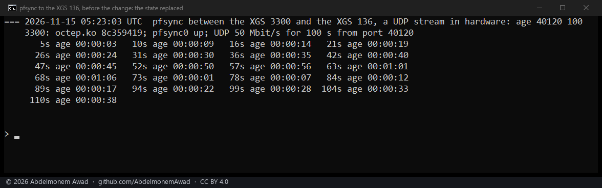
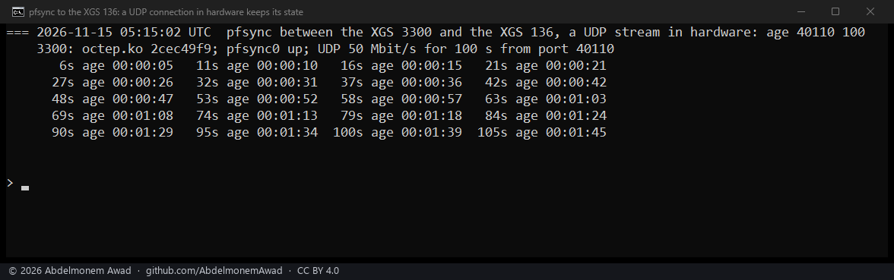

<!-- reviewed: 2026-11-15 -->
# pfsync to a peer: a UDP connection in hardware lost its state about a minute in, and keeps it now, 2026-11-15

With pfsync between two appliances, the state of a UDP connection the flow maker had put in hardware was
replaced 60 to 70 seconds in ([#1160](https://github.com/AbdelmonemAwad/os-xgs-npu/issues/1160)). pfsync sends a
state's update when pf passes one of its packets, and a connection in hardware passes none: the driver's
keepalive refreshed the state's expiry by writing it, and pfsync never heard of it, so the peer's copy expired on
`udp.multiple` (60 s) and the delete its expiry sent back removed the live state. Since the change the keepalive's
refresh is handed to pfsync's own update, on the same state under the same lock (`octep_pf_sync`,
`npuep_pf_sync`).

## How it was measured

2026-11-15 at 05:15 and 05:23 UTC: the second XGS 3300 (vendor version 22, AMD Ryzen Embedded V1780B) carried
the connection, the XGS 136 (vendor version 21) was its pfsync peer.

- **pfsync alone, no CARP**: `ifconfig pfsync0 syncdev ... syncpeer ...` on both, over the two boxes' Port8 link,
  set at run time with a pass rule for it in a pf sub-anchor; brought up and left two minutes before each run.
- **The connection**: UDP at 50 Mbit/s for 100 seconds from a fixed client port, from a jail on the test machine
  through the XGS 3300's Port4 and out of its Port3, routed, in hardware.
- **Read every 5 seconds**: the XGS 3300's state for it (`pfctl -ss -vv`), its age. A state replaced shows as its
  age falling back.
- **Before and after**: the same run with octep.ko `8c359419`, which has no such call, and with `2cec49f9`.
- **Taken away after**: pfsync0 down and unset on both, no rule or state left, `config.xml` unchanged.

## Results

| octep.ko | the state's age, read every 5 s | replaced |
|---|---|---|
| `8c359419`, before | 1:06 at second 68, then 0:01 at second 73 | about 72 s in |
| `2cec49f9`, after | 0:05 to 1:45, rising at every read | no |

- **Before**: replaced once about 72 seconds in, as on 2026-11-14, when four runs of four replaced it 60 to 70
  seconds in and a fresh state with pfsync down never was.
- **After**: never replaced. On 2026-11-14, with the change, pfsync sent 172 compressed updates in a 105-second
  run: one a connection every keepalive pass, as pf sends for a connection it sees.

### What these figures do not mean

- **Not an HA failover.** No CARP ran: what happens to a connection in hardware when the backup takes over is not
  measured here.
- **UDP only.** A TCP state's own timeout is a day, so a TCP connection would meet the same only after a day in
  hardware; not measured.
- **Right after pfsync was first brought up on 2026-11-14**, the XGS 3300 sent hundreds of thousands of compressed
  updates over two to four minutes, once with the change and once without, and never again after; the cause was
  not found, and every run here began two minutes after pfsync came up.
