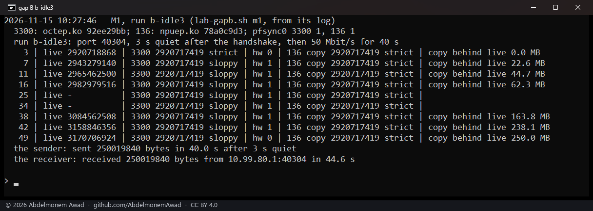
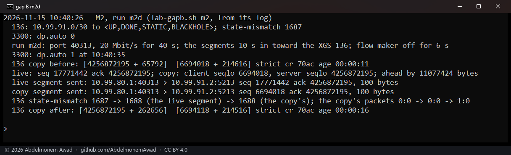
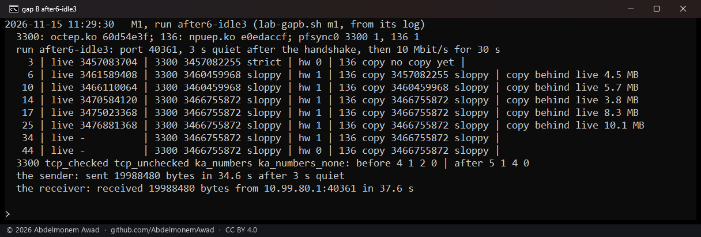
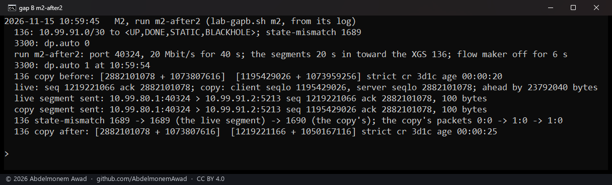
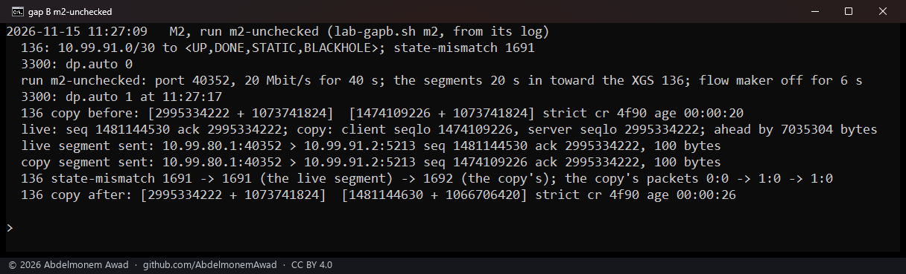
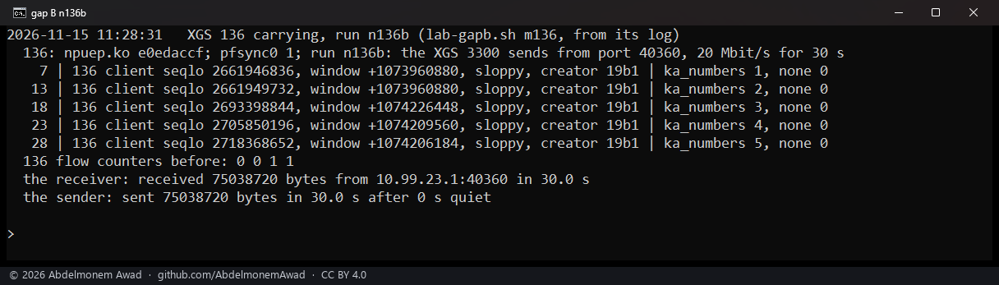

<!-- reviewed: 2026-11-15 -->
# pfsync to a peer: a TCP connection's numbers stood still at the make, and a peer taking over refused it; written for the peer now, 2026-11-15

pf sees none of a connection's frames once the flow maker has put it in hardware, so the numbers pf keeps for it
- each end's `[seqlo + window]` - stop at the make, and the state is marked sloppy there. pfsync copies what pf
has: a peer held a window hundreds of megabytes behind the live connection, and its copy was strict whenever it
had been sent before the make. Measured below, a peer with a strict copy refused a segment with the live numbers
as a state mismatch - every segment of the connection, on a takeover. Since the change, while pfsync0 is up, the
fast path's numbers are written into the connection's pf states at each keepalive pass and handed to pfsync, and
each TCP connection's states are given a gigabyte past their right edges at the make; the states stay sloppy on
the appliance that carries the connection.

## How it was measured

2026-11-15 from 10:20 to 11:31 UTC: the second XGS 3300 (vendor version 22) carried the connection, the XGS 136
(vendor version 21) was its pfsync peer.

- **pfsync alone, no CARP**: as for [pfsync and a UDP connection](pfsync-2026-11-15.md), over the two boxes' Port8
  link, set at run time.
- **The connection**: TCP from a jail on the test machine through the XGS 3300's Port4 and out of its Port3, in
  hardware, at 10 to 50 Mbit/s for 30 to 60 seconds, after 0 or 3 seconds quiet past the handshake.
- **M1, every 4 to 5 seconds**: the live numbers at the far end (`tcpdump -S`), the XGS 3300's state and the XGS
  136's copy (`pfctl -ss -vv`: each end's `[seqlo + window]`, sloppy or strict, creator), and whether the
  connection was in hardware.
- **M2, the copy put to the test**: a connection that began with the host - the flow maker off for its first six
  seconds, then on - so that the copy is strict; 10 or 20 seconds in, two segments of it written on the wire
  from the test machine toward the XGS 136, one with the live numbers and one with the copy's, against a discard
  route put there for them. pf's `state-mismatch` counter and the copy's packet counts read around each.
- **The XGS 136 carrying**: a TCP stream from the XGS 3300's own host over the Port8 link, through the XGS 136
  and out of its Port11, its state read every 5 seconds.
- **The builds**: before, octep.ko `92ee29bb` and npuep.ko `78a0c9d3`; after, octep.ko `9b42f139` (the numbers)
  and `60d54e3f` (with the room at the make and the counters), npuep.ko `8dc3bc74` and `e0edaccf`.
- **Taken away after**: pfsync0 down and unset on both, the routes, rules and addresses put back,
  `config.xml` unchanged.

## Results

| | The XGS 136's copy | A segment with the live numbers |
|---|---|---|
| Before | the make's numbers, strict in 3 runs of 5 and sloppy in 2: behind the live connection by 193 to 494 MB at the end | refused: `state-mismatch` 1687 to 1688, the copy's numbers 11 MB behind |
| After, the window checked in hardware | the connection's numbers at every keepalive pass, a gigabyte past the right edge | passed, the copy 23.8 MB behind; a segment with the copy's old numbers refused instead |
| After, the window not checked | the make's numbers, a gigabyte past the right edge | passed, the copy 7 MB behind |

- **The copy's flag is a matter of timing**: strict when pfsync sent the state before the flow was made, sloppy
  when after. A connection that begins with the host - one inspected first, or offloaded after a number of
  packets - got a strict copy in all four such runs.
- **Handing a connection back to the host did not move its numbers** before the change, in a run where it was
  handed back 18 seconds in: pf's state stayed sloppy at the make's numbers, and pfsync sent about a hundred
  updates a second with them.
- **The numbers come from the fast path only while it checks the connection's window** (`dp.tcp_window`, on by
  default): a connection made unchecked, or revived unchecked after the fast path gave it back
  (`dp.tcp_revive` 0, the default), has none there. For it the room given at the make is what a peer has:
  segments within a gigabyte of the make pass. `dp.ka_numbers_unchecked` counts the passes that met such a
  connection still moving. In these runs the test machine's USB adapters stalled now and then, the fast path gave
  connections back on the retransmissions, and they came back unchecked: three times in the last five runs.
- **The XGS 136** writes them too: its own state's numbers were written at each of five passes in a 30-second stream
  (`flow.ka_numbers`), sloppy, a gigabyte past the right edge.

The pictures show the runs as their log has them (`lab-gapb.sh`, read back by a small script that keeps the
columns that matter), not a run done again for the camera.

### What these figures do not mean

- **Not a failover.** No CARP ran, and nothing took over: a peer's copy was put to the test by single segments.
  A hook on a CARP change of master is the next part of this work.
- **A connection that moves more than a gigabyte past its last numbers** - one made or revived unchecked, a
  gigabyte after its make - is still refused by a strict copy. Not measured.
- **A segment acknowledging data past the copy's numbers**, an ACK of a download, fails pf's acknowledgement
  check until a data segment of the other way has passed and moved the copy on; not measured on a takeover.
- **The cost with many connections**: one more read of the coprocessor for each moving TCP connection at each
  keepalive pass, and only while pfsync0 is up. Not measured past a handful of connections.
- **The XGS 136's copy at a peer**: on the XGS 136 the numbers were read in its own state only; whether a peer's
  copy took them was not looked at.
