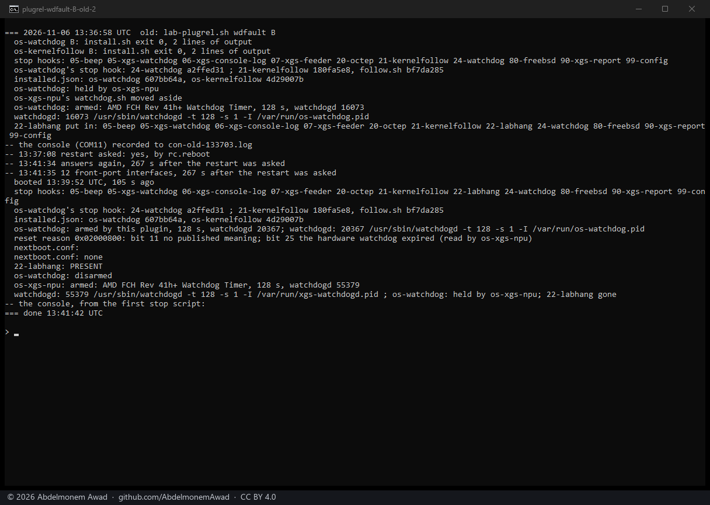
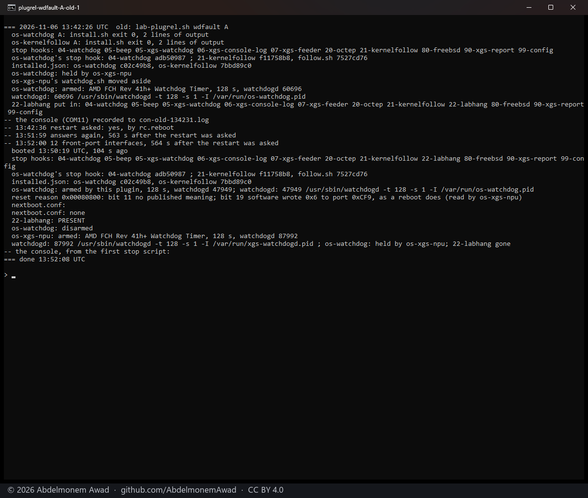
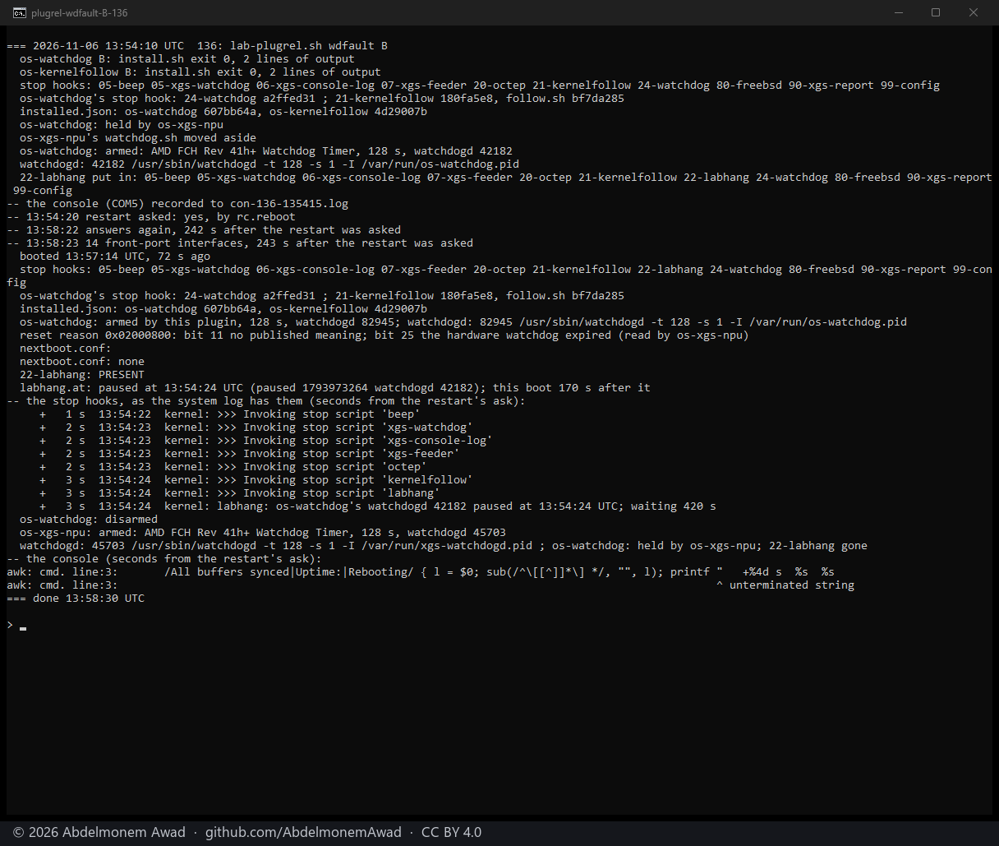
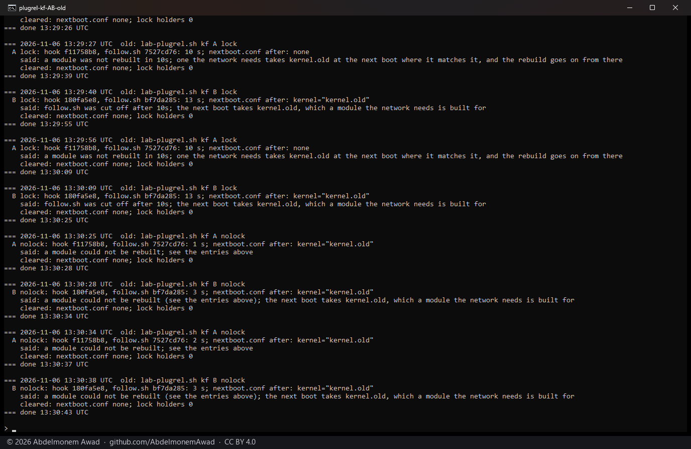
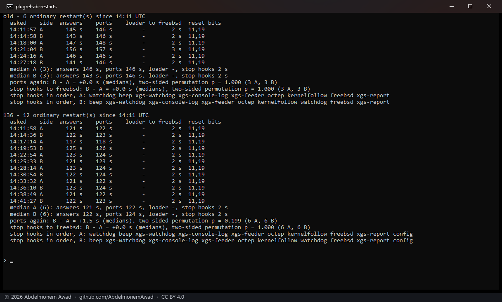
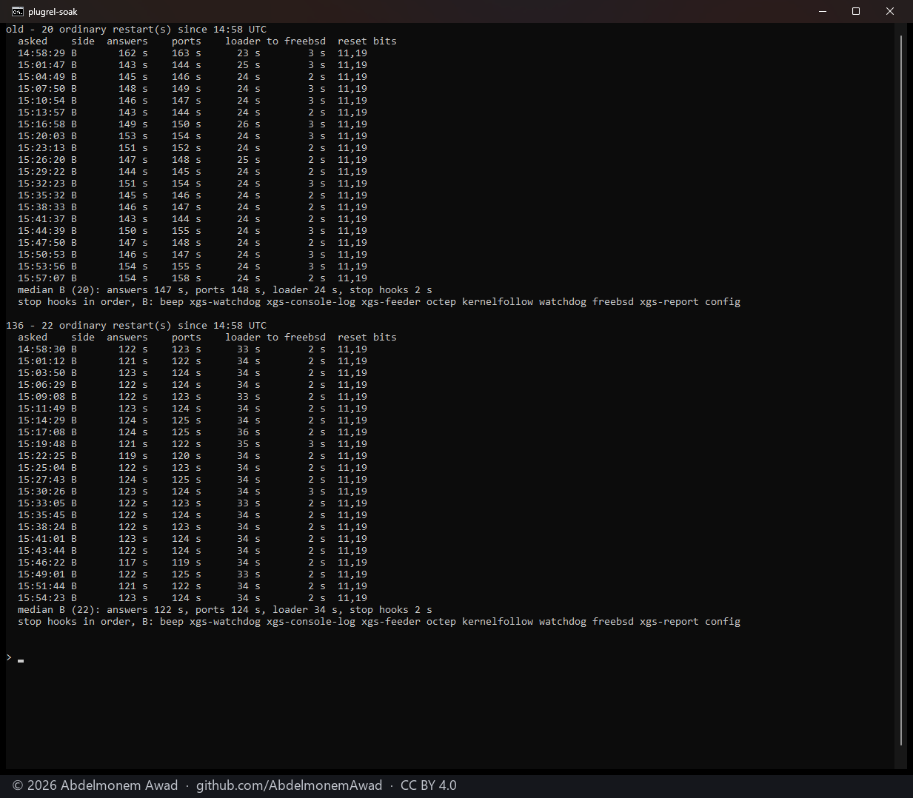
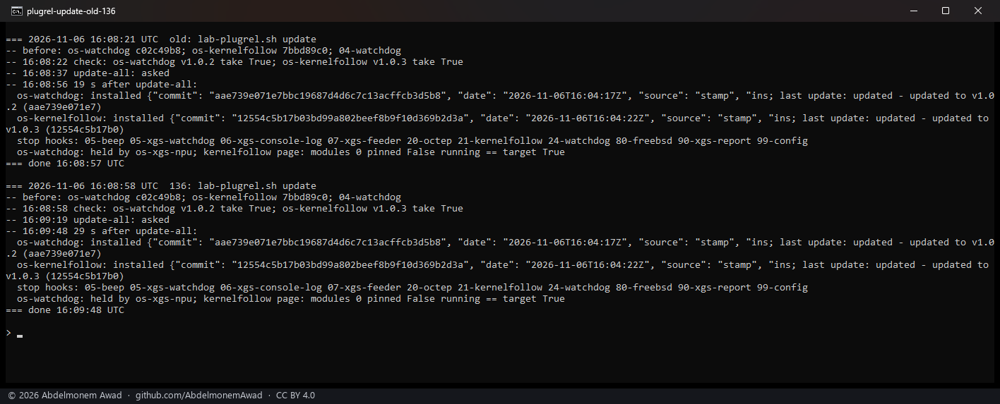

<!-- reviewed: 2026-11-06 -->
# Hardware Watchdog 1.0.2 and Kernel Follower 1.0.3, checked before their release, 2026-11-06

Two plugins of the family were released on 2026-11-06, each only after the same check a release of
this project gets: its fix shown on the appliances against the release before it, its install path,
ordinary restarts against the old release in turn, a soak, and then the release itself installed the
way an owner's appliance takes it. **[os-watchdog 1.0.2](https://github.com/AbdelmonemAwad/os-watchdog/releases/tag/v1.0.2)
keeps the host's timer armed through the slow stop hooks, so a shutdown that hangs in them ends in a
reset; [os-kernelfollow 1.0.3](https://github.com/AbdelmonemAwad/os-kernelfollow/releases/tag/v1.0.3)
arms its fall-back to kernel.old even while another run holds its lock, and never falls back to a
kernel of another FreeBSD major release.** Both were found in the userland review of the same day
([1072](https://github.com/AbdelmonemAwad/os-xgs-npu/issues/1072), B15 and P16).

## The bench

- The first XGS 3300 (vendor version 23) and the XGS 136 (vendor version 21), both with os-xgs-npu
  from `main`; the second XGS 3300 (vendor version 22) kept at the old releases until the end, for
  the update an owner would get.
- Side A: os-watchdog 1.0.1 and os-kernelfollow 1.0.2, the releases before; side B: the candidates.
  Each side was installed by the plugin's own `install/install.sh` from a copy of its tree, as the
  self-update installs a release, and `installed.json` read after.
- A restart was OPNsense's own (`/usr/local/etc/rc.reboot`, what the Reboot button and a firmware
  update run): the stop hooks, then `shutdown -or`. The first runs used `shutdown -r now`, whose stop
  hooks init ends after 120 s; they were run again with `rc.reboot` and only those count here.
- A new boot was one whose `kern.boottime` moved more than a minute - a shutdown steps the clock by a
  second - and the reset reason was read only once the record named that boot. Each appliance's
  console was recorded through every restart.

## Hardware Watchdog: a shutdown that hangs in the slow stop hooks

To make the hang, a lab stop hook `22-labhang` - between `21-kernelfollow` and the plugin's new place
at 24 - paused the plugin's watchdogd and slept 420 s. With 1.0.1 the timer was disarmed first of
all, at `04-watchdog`, before the hang; with 1.0.2 it is disarmed at `24-watchdog`, after it.

| appliance | side | answered again | reset reason | runs |
|---|---|---|---|---|
| first XGS 3300 | 1.0.2 | 267 s and 265 s after the restart was asked | bit 25, the hardware watchdog expired | 2 |
| XGS 136 | 1.0.2 | 242 s; its boot 170 s after the pause began | bit 25 | 1 |
| first XGS 3300 | 1.0.1 | 563 s: the 420 s pause sat out | bit 19, a reboot written by software | 1 |
| XGS 136 | 1.0.1 | its boot 472 s after the ask: the pause sat out | bit 19 | 1 |

The timer is 128 s (`watchdogd -t 128`), so with 1.0.2 the reset came a little over two minutes into
the hang; with 1.0.1 the appliance waited for whatever the hang was, here seven minutes, and would have
waited for ever for one that does not end. The XGS 136's 1.0.1 run was read too early at first - the
lab script took a one-second step of the clock in the shutdown for a new boot - and is read here from
its own boot's record and the system log; the script waits for a boot's own record since.

The check's review of the package found one thing more: 1.0.1 installed by `install.sh` or by its
package, then 1.0.2's package added over it with `pkg add -f`, left `04-watchdog` beside the new
`24-watchdog` - seen on the first XGS 3300. The package's post-install takes the old hook away since
[os-watchdog 12](https://github.com/AbdelmonemAwad/os-watchdog/pull/12), tested on the four ways of
installing the two before the release; with it, `24-watchdog` alone.

## Kernel Follower: the fall-back while another run holds the lock

The stop hook was run as a shutdown runs it, with a module the network needs registered and built for
kernel.old, while another run of the follower held its lock.

| side | stop hook | `nextboot.conf` after | what it said |
|---|---|---|---|
| 1.0.2 | 10 s | none | that the next boot takes kernel.old - it did not |
| 1.0.3 | 13 s | `kernel="kernel.old"` | that the follower was cut off and the next boot takes kernel.old |
| either, no lock held | 1 to 3 s | `kernel="kernel.old"` | that a module could not be rebuilt |

Three runs of each side on the first XGS 3300 and two on the XGS 136, the same every time; the final
1.0.3, after the fixes below, armed it and said so too (12 and 13 s).

Its review found three faults more, fixed in
[os-kernelfollow 12](https://github.com/AbdelmonemAwad/os-kernelfollow/pull/12) before the release: a
run that began while the new kernel was still staged did not let the fall-back go once its rebuilt
module matched; `PINONLY=1`'s answer that nothing needs the fall-back was status 2, which sh also
exits with on an error of its own, so the stop hook could take a shell error for all well - it is 3
now; and the fall-back went to a kernel.old of another FreeBSD major release - from 15.x to 14.x under
15's userland, which FreeBSD does not support. With a stand-in 14.3 kernel.old, 1.0.2 armed it and
1.0.3 did not, and said why. ~~This project's own follower has the same fall-back; it is in the review
as P19.~~ This project's own follower had the same fall-back (the review's P19), and has the same rule
since that evening: with the same stand-ins on the first XGS 3300, main's `kernel-follow.sh` armed
kernel.old and the change's did not, and said why.

## Ordinary restarts: no slower

Each side in turn - B the candidates before the Kernel Follower's three last fixes; the soak below ran
the final ones: three restarts of each side on the first XGS 3300, six of each on the XGS 136 - the
time until the appliance answered again and until its front ports were back, and the stop hooks' order
from the system log.

| appliance | front ports back, median A | median B | B - A | permutation p |
|---|---|---|---|---|
| first XGS 3300 (3 + 3) | 146 s | 146 s | 0.0 s | 1.000 |
| XGS 136 (6 + 6) | 122 s | 124 s | +1.5 s | 0.199 |

The stop hooks took 2 s on both sides of both; in B the watchdog's hook comes after `octep` and
`kernelfollow` instead of first. Every restart's reset reason was bits 11 and 19, an ordinary reboot.

## A soak

The final candidates, restarted for an hour: 20 restarts of the first XGS 3300 and 22 of the
XGS 136, every one an ordinary reboot (bits 11 and 19), all front ports back each time - medians
148 s and 124 s - and no line of either plugin in the log.

## The releases, as an owner gets them

After each release was published by its workflow, all three appliances - the second XGS 3300 still at
the old releases - were updated the way XGS: Updates does it (`plugins.py check`, then the update of
all): the first XGS 3300 in 19 s, the XGS 136 in 29 s, each reading `installed.json` at the release's
commit and `24-watchdog` alone among the stop hooks. Each was then restarted once: an ordinary reboot,
and 12, 14 and 16 front-port interfaces back.

## Not measured

- A shutdown that hangs somewhere other than between the follower's hook and the watchdog's - before
  `21-kernelfollow`, or in the kernel's own part of the shutdown after the last hook.
- A real upgrade across a FreeBSD major release; the stand-in kernel.old only shows the check.
- The plugins on any model but these three.
