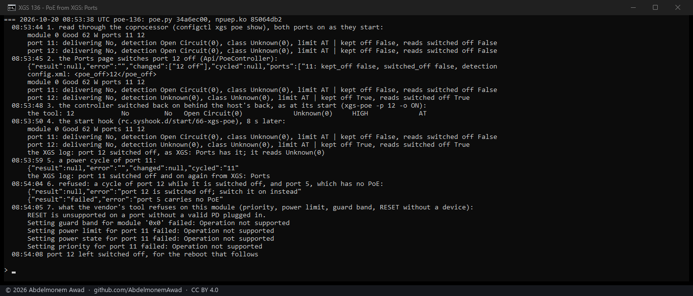

<!-- reviewed: 2026-10-20 -->
# Power over Ethernet switched from XGS: Ports on the XGS 136. Measured, 2026-10-20

The XGS 136's two PoE ports, labels 11 and 12, were read by hand on the coprocessor until now. The
Ports page now reads them each time it opens and switches a port's power **off**, **on**, or **off and
on again**; a port switched off stays off across a reboot. Measured on the XGS 136 with nothing
plugged into either port, so what changed is what the PoE controller reports, not a device's power.

## Where the controller is

**Not on the host's SMBus.** The host's SMBus (`intsmb0`, the AMD chipset's) was probed read-only
with `smbmsg -p` on 2026-10-20: it answers at the memory's SPD addresses, 0x30 to 0x37 and 0x50 and
0x51 (seven-bit), and nowhere else. The PoE controller (`U40`, a Microchip PD69104 by its marking) is
on the coprocessor's I2C, as the cages' modules are, and the vendor's tool on the coprocessor,
`xgs-poe`, reads and drives it. The plugin runs that tool there through `scripts/xgs/npu-run.sh`,
over the management link when it is up, else the coprocessor's console - the way the Transceivers
page reads the cages. The project distributes no part of the tool; it is the one the coprocessor
already carries.

## What the page does

- **Reads** (`scripts/xgs/poe.py show`, `api/xgs/ports/poe`, under the Ports page's own privilege):
  the module - its status and its power budget, 62 W on this one - and each port: whether it is
  delivering power, what the controller detects on it, the class, the drawn power, voltage and
  current while a device draws, and the limit.
- **Switches** (`api/xgs/poe/set`, under **XGS: Settings**, since a device on the port loses its
  power): off and on are kept in the configuration (`general.poe_off`, the labels switched off) and
  applied at once; a power cycle is off, three seconds, on, and kept nowhere. Every change is in the
  XGS log.
- **At every boot** a start hook (`rc.syshook.d/start/66-xgs-poe`) switches off again a port the
  owner switched off, asking every 20 s for up to three minutes while the coprocessor comes up: the
  controller starts with every port on, by the tool's own help. With no port switched off it does
  nothing.
- **A powered device is never cycled by an apply.** A port is switched on only when it reads switched
  off - delivering nothing, its detection "Unknown" - so a port that is powering something is not
  touched.

## Measured

`images/deploy/lab-136-poe.sh`, photographed; `poe.py` md5 `34a6ec00`, the driver `85064db2`. The
page's request was made by `Api/PoeController::setAction()` itself, from the command line on the
appliance, because the page asks for the owner's password.

| step | what the controller reports afterwards |
|---|---|
| both ports as they start | module 0 *Good*, 62 W; 11 and 12 not delivering, detection *Open Circuit* - looking, nothing there |
| port 12 switched off from the page | config.xml `<poe_off>12</poe_off>`; port 12's detection **Unknown** - it stopped looking; port 11 unchanged |
| the controller switched back on behind the host's back, as at its start | port 12 *Open Circuit* again |
| the start hook, eight seconds later | port 12 **Unknown** again; the XGS log: *port 12 switched off, as XGS: Ports has it* |
| a power cycle of port 11 | taken, four seconds; port 11 *Open Circuit* after it; the XGS log names it |
| a power cycle of port 12 while it is switched off, and port 5 | both refused: *port 12 is switched off; switch it on instead*, *port 5 carries no PoE* |

**What the controller on this module refuses.** The vendor's tool also offers a port's priority, its
power limit and the module's guard band; each answers *Operation not supported* here, so the page
does not offer them. Its own RESET is refused on a port with no powered device, which is why the
page's power cycle is off and on instead.

## What it does not mean

- **No powered device was on either port.** That the controller stops looking for one when a port is
  switched off is measured; that a camera or an access point loses its power and gets it back is not
  yet seen here. The drawn power, voltage and current columns have shown nothing so far for the same
  reason.
- **The page itself** was not looked at on the appliance - it asks for the owner's password; its
  request was made by its own controller, as above.
- **A reboot** of the appliance with a port switched off is the next measurement: the start hook was
  run by hand here.
