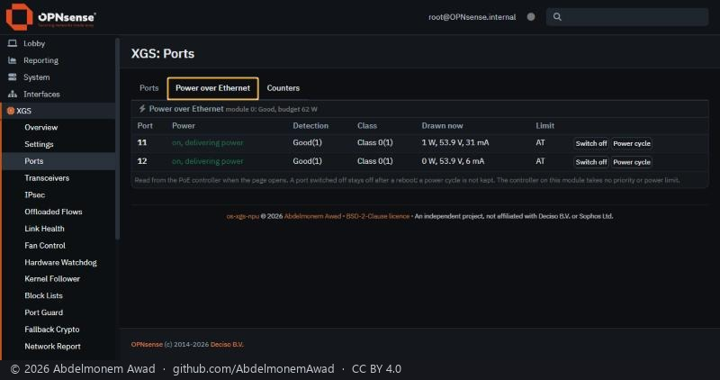

<!-- reviewed: 2026-10-29 -->
# Power over Ethernet with a device on each port of the XGS 136, measured, 2026-10-29

On 2026-10-20 the XGS 136's two PoE ports were switched from XGS: Ports with nothing plugged in
([the first measurement](poe-136-2026-10-20.md)). Here each has a powered device: the two units of an
HDMI extender, each through a PoE adapter, on Port11 and Port12. Both present a valid signature -
detection *Good*, *Class 0* - and take power only: neither has an Ethernet link on its port.

## Both powered

| port | delivering | detection | class | drawn | link |
|---|---|---|---|---|---|
| 11 | yes, power good | Good | 0 | 1 W - 53.8 to 53.9 V, 30 to 31 mA | none |
| 12 | yes, power good | Good | 0 | 0 W - 53.8 to 53.9 V, 6 to 7 mA | none |

The page and the controller agree, and the owner saw both PoE lights on the front steady.

## Before: one port at a time

These readings were taken every few seconds from 13:24 to 14:16 UTC and kept in the bench's log. They
were not photographed: the state they describe was gone once the owner had fixed the power of the
device on Port11.

- **Only one port was powered at a time.** Port12 delivered. Port11 was detected and classified, but
  not powered. When Port12 was switched off with the vendor's tool, Port11 came up. When it was
  switched on again, it took its power back, and Port11 was off three seconds later. This happened
  once with both limits at AT and once at AF.
- **Not the budget.** With both limits at AF, the two ports ask 30.8 W of a module that gives 62 W,
  less its 6 W guard band.
- **The devices drew 5 to 7 mA each**, about 0.3 W. A powered device has to keep drawing about 10 mA
  for a PoE port to go on powering it (the maintain power signature of IEEE 802.3), and a port may cut
  one that draws less. Port11, switched off and on again by hand, came back after 88 seconds and was
  cut again within eight. A switch-on alone did nothing.
- **The owner saw one PoE light on the front steady and the other blinking**, about once a second.
  In the vendor's table below, that is *denied power, or a fault on the connected device*.
- **Once the owner had fixed the power of the device on Port11**, it drew 30 to 31 mA, and both ports
  stayed powered: the table above.

So what cut Port11 points to its device drawing less than a PoE port must see, and not to the XGS
136: once that device drew 30 mA, both ports stayed powered.

## The controller

The controller is `U40`, a Microchip PD69104, on the coprocessor's I2C bus 0 at address 0x25. It was
found by reads of 0x20 to 0x2f, the part's address range, on the coprocessor's four buses. It was then
read register by register, and nothing was written. The readings follow the register map that PSE
controllers of this kind share, and they bear it out: the power status followed Port12 alone, then
both ports.

| register | read | meaning |
|---|---|---|
| port status, ports 1 to 4 | 0x64 0x64 0x06 0x06 | ports 1 and 2: detection good, class 0; ports 3 and 4: open |
| power status | 0x22 while Port11 was cut, 0x33 with both | port 2 alone enabled and good, then ports 1 and 2 |
| operating mode | 0xff | all four ports in the controller's own auto mode |

The controller's port 1 is the label 11, and its port 2 is the label 12. **In auto mode the controller
decides by itself** when a port is powered and when it is cut; the coprocessor and the host only
switch a port off or on. Its datasheet gives it an LED output for each port. That fits the front
lights following the ports with no software of this project behind them.

## The lights, as the vendor documents them

From the vendor's quick start guide for the XGS 116, 126 and 136
([docs.sophos.com](https://docs.sophos.com/nsg/hardware/quickstart/xgs/sophos-quick-start-guide-xgs-116-116w-126-126w-136-136w.pdf)):

| light | colour | state | meaning |
|---|---|---|---|
| PoE1, PoE2 (front) | green | solid | the port is powering its device |
| | | blinking fast, about every 0.3 s | an internal hardware failure of the port |
| | | blinking slowly, about every 2.5 s | the port is denied power - the device asks for more than the port can give - or it detects a fault on the device |
| | | off | the port is not powering anything |
| each RJ45, left | green | solid, flashing, off | link, data, no link |
| each RJ45, right | amber, green, off | | 1000, 100, 10 Mbit/s |

So, case by case:

- **A cable with data and no power:** the port's own two lights are on, and its PoE light is off.
- **Data and power:** the port's lights are on, and its PoE light is steady.
- **Power and no data:** the port's lights are off, and its PoE light is steady - or blinks slowly
  while the port is refused.

**The last case was seen here.** Both PoE lights were steady once both ports were powered, and one
blinked while Port11 was refused. A device that takes data and power at once, such as a camera or an
access point, was not on the ports.

## The power limit

The vendor's tool on the coprocessor sets a port's limit to AT (30 W) or to AF (15.4 W): its help
names these two values for a controller without 1 W steps. On 2026-10-29 both values were set and read
back. On Port11 the tool twice answered *busy* while that port was refused.

The first measurement tried a number, 15, which the tool refused, and so it wrote that the limit is
not supported here. That line is now struck there.

The vendor's guide limits one PoE port to 15.4 W when a high-performance expansion module is fitted.
XGS: Ports does not offer the limit yet; its help line says the controller takes none, and that line
is to be corrected along with the setting. Priority and the guard band are still refused.

## Not measured

- A device that takes data and power at once, and so the two cases with a link and PoE together.
- Any class other than 0, and more than 15.4 W on a port.
- Why the controller left Port11 detected but unpowered for minutes after cutting it. Its datasheet
  says auto mode tries again about every second after a cut for low draw. The reason would be in
  registers whose map is a document separate from the part's datasheet.
