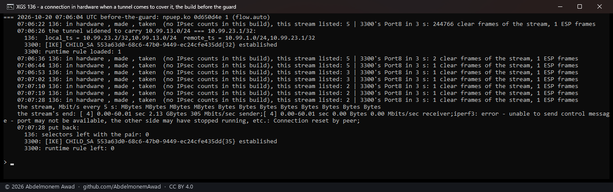
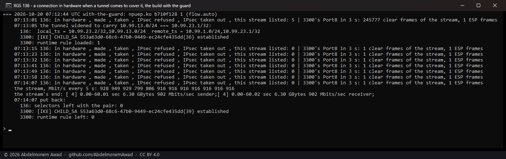
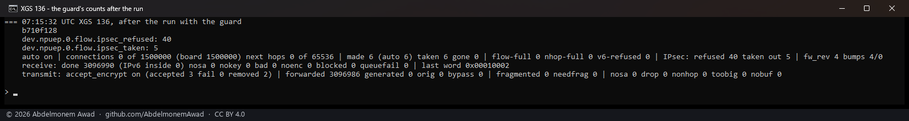

<!-- reviewed: 2026-10-20 -->
# A tunnel brought up over a connection in the XGS 136's hardware. Measured, 2026-10-20

Until this, a connection the XGS 136 had put in hardware stayed there when an IPsec policy came to
cover it, and its frames went on leaving the appliance unencrypted
([issue 575](https://github.com/AbdelmonemAwad/os-xgs-npu/issues/575)). Now the flow maker asks the
kernel's policy database, as the XGS 3300's driver has since its tunnel flows: a connection a policy
covers is never made into a flow, and one already in hardware is taken out the moment a policy comes
to cover it. Measured both ways, on the build before and the build after.

## What the driver does now

- **Before a flow is made**, both of the connection's directions are asked of the policy database,
  each as an outbound and as an inbound selector, the way `ipsec4_forward` and `ipsec6_forward` ask
  (addresses and protocol, ports as ANY) and then once more with the ports, for a selector that names
  them. An IPsec policy or a discard one covers the connection, and it stays with the host, which
  applies the policy; a bypass or no policy does not. Counted in `dev.npuep.0.flow.ipsec_refused`.
- **When the kernel's policy generation moves** - a policy added or removed - the once-a-second sweep
  asks the same about every connection in hardware, and takes a covered one out, its packet counts
  handed to pf first. Its next frame is the host's. Counted in `dev.npuep.0.flow.ipsec_taken`.
- Both are in [npuipsec.c](../../contrib/npuep/npuipsec.c) (`npuipsec_flow_covered`) and
  [npuflow.c](../../contrib/npuep/npuflow.c) (`npuflow_make`, `npuflow_policy_sweep`); the
  `flow.flows` header line prints them beside the other counts.

A new connection a tunnel covers had not been made into a flow before either, but only because its
other direction arrives as ESP and never becomes a candidate - the coprocessor's metadata deciding,
not the driver.

## How it was measured

One stream of 60 seconds from the bench PC by its USB adapter into F1, through the XGS 136 to the
second XGS 3300's Port8 address, in hardware (the flow maker on). Fifteen seconds in, the lab tunnel's
child was widened at both ends to carry exactly that pair, and the 3300 was given a runtime rule
passing it on enc0; from then on the kernel's policy says the pair is IPsec's. Every few seconds: the
136's flow table, and how many of the stream's frames reached the 3300's Port8 in the clear in three
seconds (tcpdump there). At the end both ends' `swanctl.conf` were put back and the 3300's rules
reloaded. `images/deploy/lab-136-policy.sh`, not in this repository; photographed.

| | the build before (`npuep.ko` `0d650d4e`) | with the guard (`b710f128`, 254,568 bytes) |
|---|---|---|
| before the policy | in hardware; 244,766 clear frames in 3 s | in hardware; 245,777 clear frames in 3 s |
| the connection after the policy | **still listed in the flow table for the 60 seconds** | out of the flow table at the next look, within ten seconds of the policy |
| its frames reaching the 3300 in the clear | one in the first count after it, none in the six after - the sender backing off | none |
| the stream | **stopped dead**: the 3300's kernel refused the clear frames by its own policy check; the sender's report never came back | **went on through the tunnel**: 916 Mbit/s every five seconds to the end, 6.30 GB in 60 s |
| the 136's counts afterwards | - | `ipsec_taken` 5, `ipsec_refused` 40; the engine encrypted 3,096,986 frames of it and decrypted 3,096,990 |

## What it does not mean

- **The leak was narrow, and the peer here closed it.** It needs a connection already in hardware
  when a policy comes to cover it - a tunnel brought up for a network a connection already reaches.
  The 3300's kernel refused the clear frames because its inbound policy says the pair must arrive
  encrypted; a peer that does not check would have taken them, and anything between would have read
  them.
- **The forty refusals are the flow maker asking again**: the stream's frames go on being punted as
  candidates, and each pass would make them into a flow and is refused - a policy lookup each time.
- **The counts in the first two photographs are blank**: the tool asked the 136 for them through
  `echo` in a shell that reads `\1` as a control byte, the fault recorded on [the IPv6
  page](ipv6-136-2026-10-20.md#what-it-does-not-mean). The flow table's listing beside them is
  correct, and the counts were read and photographed after the run (the third). The tool now uses
  `printf`; its frame count also adds one line of its own, and the figures above are less that line.
- **Not tunnel connections in hardware.** The guard keeps covered connections out; putting a tunnelled
  connection in the flow table with its association, as the XGS 3300 does, is the next piece, and the
  parity table's grey cell.

All the numbers are in the run's log, `measurements/policy-136-2026-10-20.log` (kept with the bench,
not in this repository).
