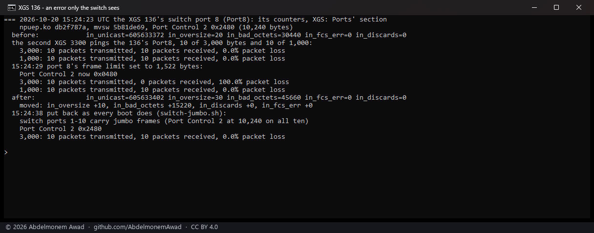
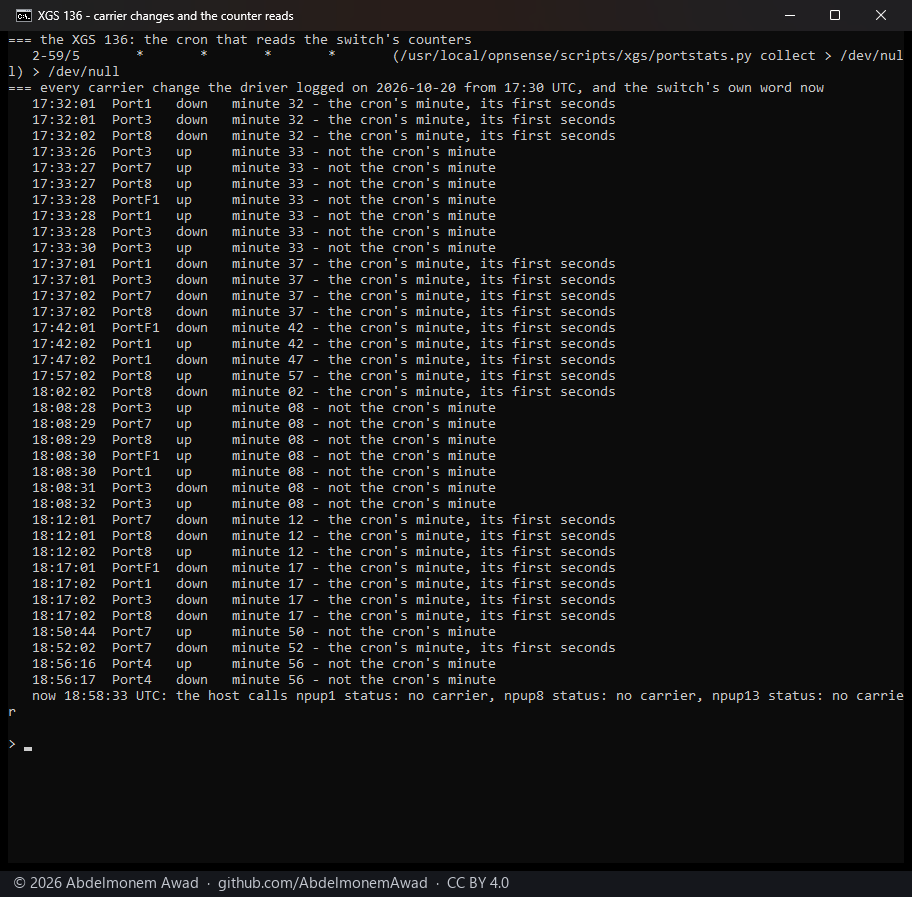

<!-- reviewed: 2026-10-20 -->
<!-- board: an error only the switch sees | XGS 136 | +10 too long, read -->
# An error only the switch sees, counted on XGS: Ports, 2026-10-20

Port1 to Port8 and two of the cages hang off an 88E6193X switch on both families. A frame that switch
takes in with a bad checksum, too short or too long, or drops, is never handed on: the host's
interface counters do not see it and neither do the coprocessor's. The switch counts it itself, in
its RMON counters, and nothing read them until today.

What was built:

- `contrib/mvsw` reads them: `mvsw 0 2 stats [first last]`, every counter of a port read twice and
  compared, because the coprocessor's network agent shares the MDIO bus and about one read in ten
  returns another transaction's data. From the vendor's switch library: Global1 register 0x1D, the
  Stats Operation, reading a port's counter directly.
- `scripts/xgs/portstats.py` asks the coprocessor for them every five minutes - on the XGS 136 over
  the management link in about a second, on the XGS 3300 over its console in about 26 - and keeps
  the reading with the one before it.
- XGS: Ports has a section for them: what each port received and sent, what it received in error,
  what it dropped on arrival and its errors sending, with what changed since the reading before, and
  **Read now**.

Measured on both: every one of the ten ports read on the XGS 136 and on the second XGS 3300, the
traffic counts matching what crossed them - the 136's Port8 had taken in 59 GB of the IPsec soak, its
F1 sent 57 GB on to the PC - and every error counter at 0.

## An error made on purpose

So that one moves: the XGS 136's switch port 8 set for a moment to the switch's smallest frame limit,
1,522 bytes (Port Control 2 bits 13:12 to 0, from 10,240), and the second XGS 3300 - its Port8 cabled
to the 136's, both at MTU 9,000 - pinging across it with frames of 3,042 bytes and, beside them, of
1,042. Then the limit put back the way every boot ~~sets~~ set it then (`switch-jumbo.sh`; since
2026-10-24 the network agent sets it from each port's MTU, [the measurement](switch-frame-limit-2026-10-24.md)).

Script: `images/deploy/lab-136-port-errors.sh`, photographed; run three times, the same each time.

| | frames of 3,042 bytes | frames of 1,042 bytes |
|---|---|---|
| before, the limit at 10,240 | 10 sent, 10 answered | 10 sent, 10 answered |
| the limit at 1,522 | 10 sent, **0 answered** | 10 sent, 10 answered |
| what the switch counted on port 8 | **too long +10**, bytes in bad frames +15,220 - ten times 1,522 | |
| after, the limit put back | 10 sent, 10 answered | |

The ten long frames never reached the 136's host; the switch's own count is the only place they
show.

## Withdrawn on the XGS 136, the same evening

**Reading the switch's counters made the XGS 136's network agent report linked ports down** (#639).
From 18:17:01 UTC `ifconfig` said `no carrier` on Port1, Port3, Port8 and F1 while pings through F1
and Port8 were answered, and the switch's own Port Status register read all four linked. Every
carrier change the driver logged from 17:30 came in the first two seconds of a minute ending in 2 or
7 - the minutes `portstats.py collect` runs from cron - apart from a driver reload at 17:32 and a boot
at 18:08:

The switch is in multi-chip mode: each read is a command written to one register and its answer read
from another, and the coprocessor's network agent does the same on the same bus to follow the links.
When the two interleave, the agent can take a counter's value for a port's status. On this appliance
it follows links by interrupt, so the wrong state stays until a link changes again. The agent's own
all-ports answer (`0x45`, 4,232 bytes) is no substitute: the ten switch ports' blocks in it are
identical and meaningless, as [netagent.md](../npuep/netagent.md) found for `PORT_ATTR_STATS`.

So since then the XGS 136 reads none of them, and XGS: Ports says so. The frames-too-long test above
stands as a measurement of the switch; it is no longer a feature of the 136. The XGS 3300 keeps its
counters - its link changes over the same hour do not line up with its reads - which is the absence of
a finding over one hour, not a proof.

Script: `images/deploy/lab-136-carrier-vs-portstats.sh`, photographed.

## What it does not mean

- **The ports not on the switch have no such row**: the XGS 136's labels 9 to 12 and the XGS 3300's F1
  and F2 and its expansion module. Their counters are the coprocessor's MACs', not read yet.
- **One kind of error, made on purpose.** A bad checksum or a short frame takes a fault on the wire;
  those counters are read the same way and stayed at 0.
- **The section on the page is not photographed yet**: the appliances' GUI asks for a login.
