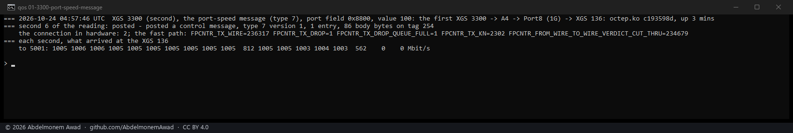
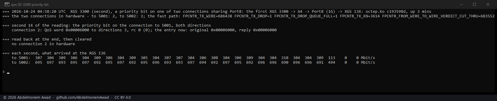
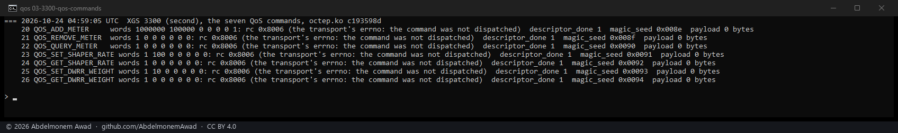
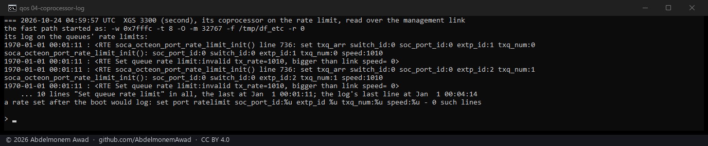

<!-- reviewed: 2026-10-24 -->
# A port's rate, a connection's priority and the QoS commands, measured on the XGS 3300, 2026-10-24

Discoveries 23, 6 and 7 of [the discoveries](../findings/discoveries-2026-10-22.md), each taken from
the source to the hardware on the second XGS 3300 (octep.ko `c193598d`, OPNsense 26.7.7). **None of the
three can be used from the host with this firmware**, and each is said here so nobody builds on it.

The path: TCP streams from the first XGS 3300 to the XGS 136, which reach it only through the second
XGS 3300 - in on its A4 at 10 Gbit/s, out on Port8, a 1 Gbit/s port behind its switch - each made a
connection in hardware there (`FROM_WIRE_TO_WIRE_VERDICT_CUT_THRU`). What arrived was read every second
on the XGS 136 from each stream's pf state. A first try from the bench PC was thrown away: the PC
reached the XGS 136 by a link of its own and never crossed the XGS 3300, which the empty flow table
showed (`images/deploy/lab-port-qos.sh`).

| | what was asked | what happened |
|---|---|---|
| **23, a transmit rate limit for each port** | the port-speed control message (type 7) for Port8 at 100, with the port given as its tag (0x8800) and as 8 and 9 | the fast path took each message as a control message (`FROM_KN_PROC_CMSG` +1) and the stream stayed at 1,000 to 1,006 Mbit/s every second before and after it |
| **6, a connection's priority** | the priority bit and the valid bit on one of two connections sharing Port8, both directions (`CONN_MODIFY_FP`) | accepted, rc 0, and held - the entry read back `0x00006000` both ways - but the two kept their shares: 304 to 310 and 690 to 697 Mbit/s before, the same after |
| **7, the QoS commands** | each of the seven - add, remove and query a meter, set and read a shaper rate, set and read a DWRR weight | `rc 0x8006`, not dispatched, every one: no handler, as the source says |

## Why the rate limit does nothing

The coprocessor says it, over its management link. Its fast path starts with rate limiting on for
the switch's port (`-r 0`), and at its boot it gives each switch port's transmit queue its limit -
1,010 Mbit/s for a gigabit port - and every one of the ten is refused: `Set queue rate
limit:invalid tx_rate=1010, bigger than link speed= 0`, the switch link not up yet at that moment.
Nothing sets them again. A rate set later would log `set port ratelimit ... speed:%u` - the string is
in the fast path's program - and none was logged after any of the port-speed messages. So the
message is taken and goes no further on this firmware; the XGS 136's coprocessor says the feature is
off altogether ([the discoveries](../findings/discoveries-2026-10-22.md#a-transmit-rate-limit-for-each-front-port)).

## What the priority bit may still do

The congestion here was in the switch, at Port8's own queue, which the coprocessor's priority does
not reach: the switch's eight queues a port are weighted on every port and are not told a frame's
priority by the fast path, as far as this shows. Inside the coprocessor the only per-port queue with
a limit is the one above, and it has none - so no congestion could be made where the bit might act,
and a meter, which could make it, cannot be added (discovery 7). The bit is kept in the entry, read
back exactly; what it would decide is not reachable with this firmware.

## The instruments

- `dev.octep.0.dp.conn_qos`: write `"<index> <priority 0|1> [<valid 0|1> [<meter> [<directions 1|2|3>]]]"`
  to set a connection's two QoS words in place (`CONN_MODIFY_FP`, bits 1 and 2 of its field word),
  the entry read back after. A connection made again or revived gets both words 0.
- `dev.octep.0.rpc.qos_args` with `rpc.cmd` 20 to 26 and `rpc.allow_write`: the seven QoS commands,
  for the probe; the driver itself never sends them.
- `dev.octep.0.dp.cmsg_type`, `cmsg_port`, `cmsg_value` and `cmsg_post`, already there: the port-speed message.

Not tried on the XGS 136: its coprocessor's log says its rate limit is disabled, and its driver has no
QoS instrument yet.
