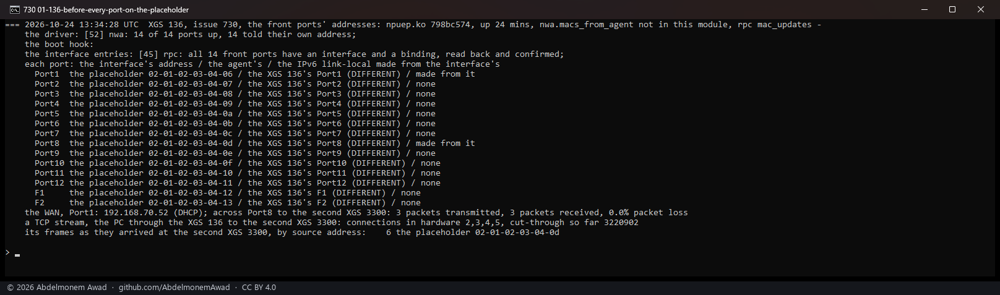
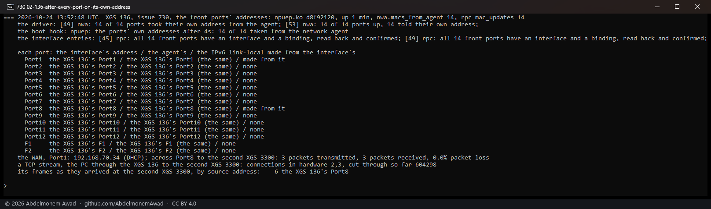
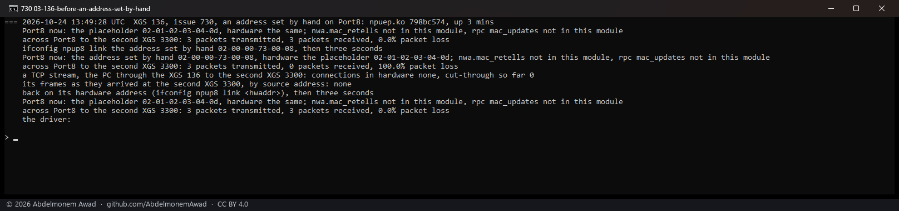
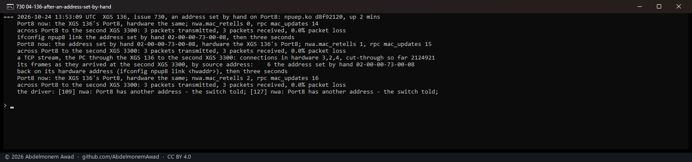

<!-- reviewed: 2026-10-24 -->
# The front ports' own addresses on the XGS 136, measured, 2026-10-24

Issue [730](https://github.com/AbdelmonemAwad/os-xgs-npu/issues/730), found in the support bundle of
the first XGS 126 run by its owner ([#661](https://github.com/AbdelmonemAwad/os-xgs-npu/issues/661)):
its WAN port's IPv6 link-local address was the one made from `02:01:02:03:04:06` - and so was our XGS
136's. **Every appliance of the ARMADA family gave its front ports the same fourteen addresses.** The
driver named each port from the address the coprocessor advertises at the handshake, plus the port's
number - and the coprocessor advertises `00:01:02:03:04:05`, a placeholder, on every one. Two such
appliances on one segment answer to the same addresses, and the IPv6 addresses each makes for
itself carry the same identifier on all of them.

**Each port now takes its own address, the one SFOS gives it.** The coprocessor's network agent holds
one for every port, from the appliance's own range - the platform database the coprocessor builds
from the board's VPD EEPROM at its boot, Port1 the range's base - and answers a request for it
(`NWA_OP_GET`, `NWA_SUB_MAC`) even after the host has told it another. npuep asks it once the agent
answers, the interfaces take the addresses, the switch and the fastpath's interface table are told
them, and the boot hook waits for that before OPNsense configures the interfaces. The XGS 3300's
driver has asked its agent the same from the start, so nothing changes there.

Addresses are printed by name in the photographs: a port's own address identifies one appliance.
The placeholders are printed as they are - every appliance of the family had them.

## Before: every port on the placeholder

npuep.ko `798bc574`. Each port's interface on the placeholder, the agent's own address for it beside
it - different on all fourteen - and a stream from the PC through the XGS 136 to the second XGS 3300
in hardware, its frames arriving with the placeholder as their source: the fastpath writes the
address the interface table was given.

## After: every port on its own address

npuep.ko `d8f92120`, the boot hook as merged. The driver read fourteen addresses from the agent and
the ports took them at second 49 of the boot (`nwa.macs_from_agent` 14), the boot hook waiting four
seconds for it; the fastpath's interface entries were updated to them
(`rpc_channel.mac_updates` 14) and read back. Each port's address is the agent's, and the IPv6
link-local address of the two that have one is made from it - OPNsense configured them after the
change. The WAN asked its DHCP server again as a new client and got a new lease, a ping crossed
Port8, and a stream in hardware arrived at the second XGS 3300 with the XGS 136's own Port8 address.

## The first build put the ports back, and what that showed

The first build changed only each interface's address. By the time OPNsense configured the
interfaces every port was on the placeholder again - and the network was down: no DHCP lease on the
WAN, Port8 answering no ping, no stream (read once, in `measurements/issue-730-2026-10-24.log` at
13:37 UTC, not photographed). OPNsense puts an interface back on its hardware address - `ifconfig`'s
`hwaddr`, which the kernel keeps from the moment the interface attached - whenever no MAC address is
set for it on its page. The switch had been told the new address, the interface had the old one,
and the switch drops every unicast frame to an address it was not told. The build as merged makes
the agent's address the interface's hardware address as well.

It also showed a fault older than this issue. Nothing followed an interface whose address changed
after it came up, so a port given an address by hand - OPNsense's own MAC address field on the
interface's page, which does `ifconfig link` - received broadcast only. With npuep.ko `798bc574`,
Port8 given an address by hand answered no ping, and answered again once put back:

The network agent's link sweep now compares each port's address with the one the switch was last
told and tells it again when they differ, and the fastpath's interface entry follows. The same,
with npuep.ko `d8f92120`:

## What it changes for an owner

After the update and its reboot, every front port of an ARMADA appliance answers to a new address.
A DHCP server upstream sees a new client - the XGS 136's WAN got a different lease - and whatever was
written down against the old addresses (a reservation, a static mapping, a filter by address) has to
be written again. The loader tunable `hw.npuep.mac_from_agent=0` keeps the old placeholders; it was
not tried here.

Not measured: the XGS 126 and the XGS 107, whose agents are expected to answer the same way from
their own ranges; their owners will see it after the update. The XGS 136's ports beyond Port1, Port8
and the stream's path were read, not driven.

## The instruments

- `dev.npuep.0.nwa.macs_from_agent`: how many ports took their own address, -1 until the agent was
  asked - what the boot hook waits for, at most thirty seconds.
- `dev.npuep.0.nwa.mac_retells`: how many times a port's address moved after it came up and the
  switch was told again; `dev.npuep.0.rpc_channel.mac_updates`: interface entries given a port's new
  address.
- `sysctl dev.npuep.0.nwa.probe="4 3 <tag> 0 0"`: the agent's own address for one port, read only.
- `images/deploy/lab-730.sh`, and `lab-730.sh byhand`; `lab-730-series.ps1` photographed them.
