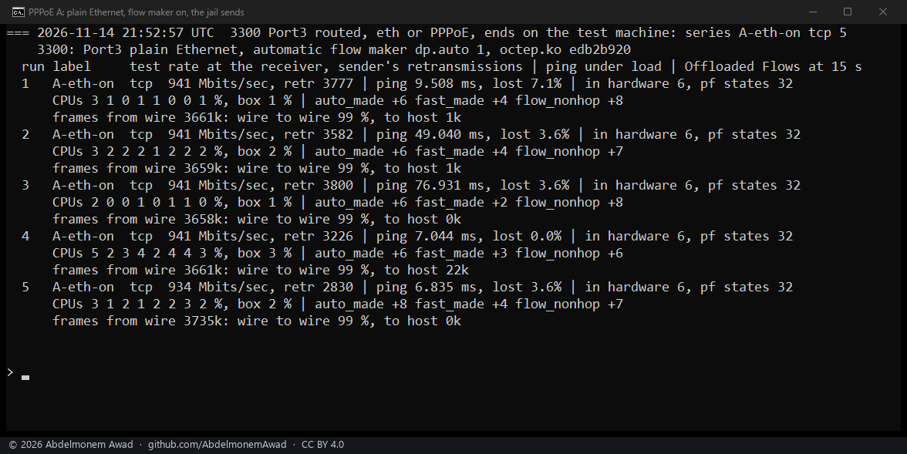
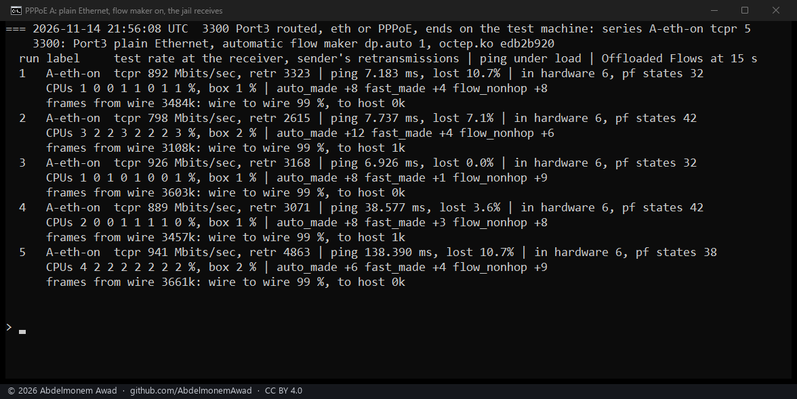
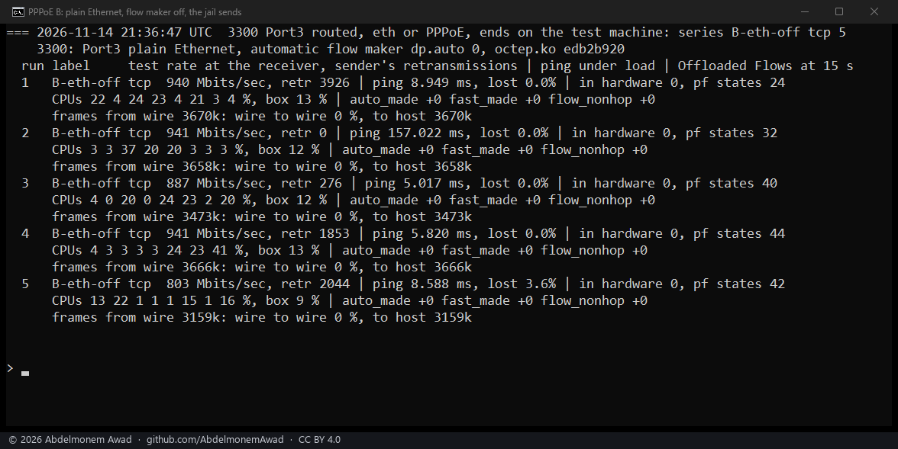
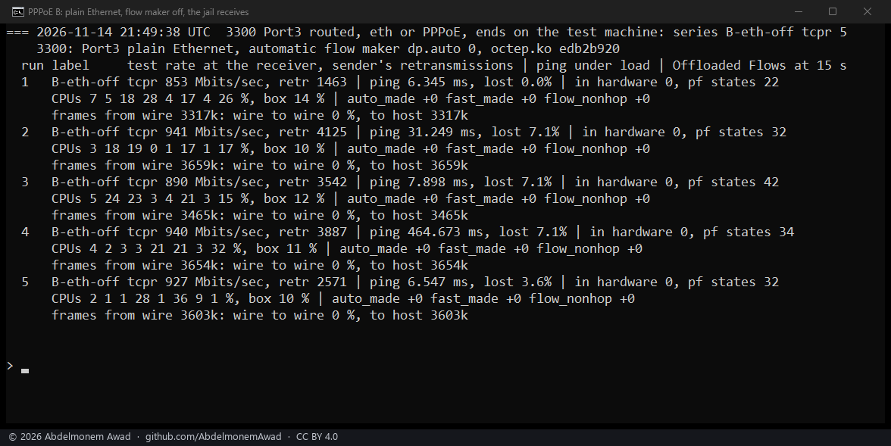
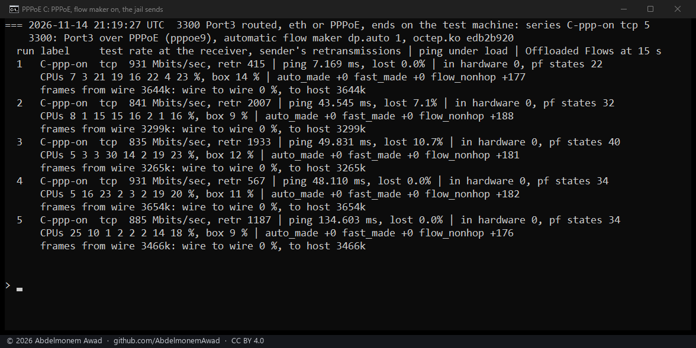
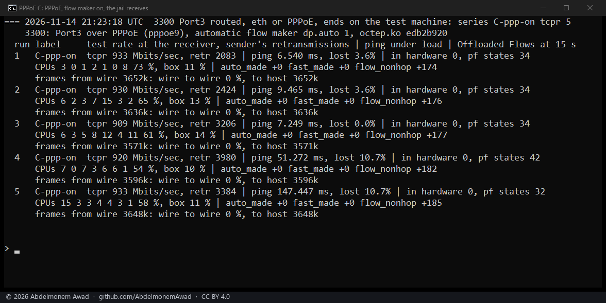
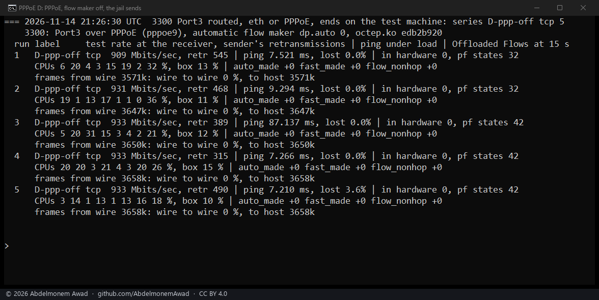
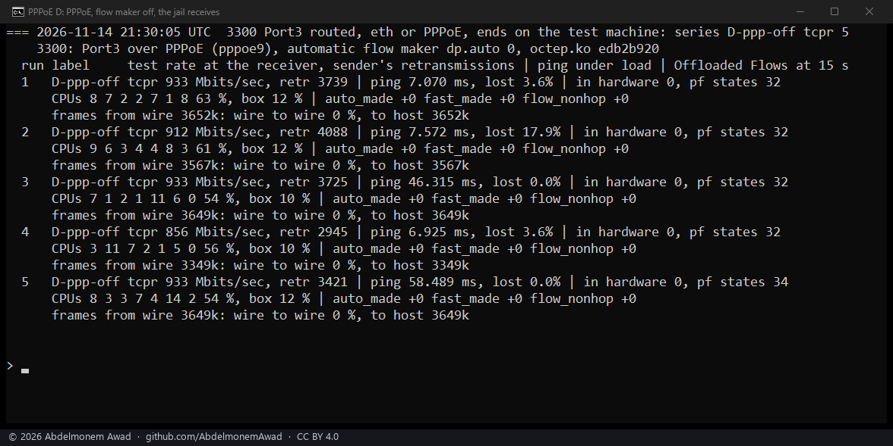

<!-- reviewed: 2026-11-14 -->
# PPPoE through the second XGS 3300: carried by the host at the gigabit link's rate, none of it in hardware, 2026-11-14

A WAN over PPPoE is common, and the drivers were read to refuse it: a connection whose route leaves by an
interface that is not Ethernet underneath gets no next hop, so it stays with the host
(`contrib/octep/octep_nhop.c`, `contrib/npuep/npunhop.c`). Before anything was built for it, the question was
measured: is that what happens, and what does it cost the host?

## How it was measured

2026-11-14 from 21:19 to 21:59 UTC: the second XGS 3300 (vendor version 22, AMD Ryzen Embedded V1780B, eight
CPUs, octep.ko `edb2b920`) between two ends on the FreeBSD test machine (FreeBSD 15.1, two USB 2.5 Gbit/s
adapters, linked at 1 Gbit/s).

- **The path**: Port4 and Port3 taken out of the LAN bridge for the runs. A VNET jail on the test machine
  (10.99.80.x) sends through Port4, where the XGS 3300's address is its gateway; the XGS 3300 routes it out of
  Port3 to the test machine's other adapter, where iperf3 listens.
- **Two ways out of Port3**:
  - **Ethernet**: plain addresses at both ends (10.99.91.x).
  - **PPPoE**: mpd5 on both ends. The XGS 3300 is the client, pppoe9 over Port3, with the settings OPNsense
    26.7 writes for a PPPoE interface (`interfaces.inc`), the MSS clamp among them: 1,452 bytes. It was started
    from the command line, not from OPNsense's pages, so no default route moved and `config.xml` was not
    touched. The server is mpd5 on the test machine, asking for no authentication; the two ends of the link
    are in 10.99.90.x.
- **Routed, not translated**: pass rules in a pf sub-anchor, and a route back to the jail's network at the
  server.
- **Each with the flow maker on and off** (`dev.octep.0.dp.auto` 1 and 0), so four cases: A Ethernet and
  maker on, B Ethernet and maker off, C PPPoE and maker on, D PPPoE and maker off.
- **Five runs of each, both ways**: iperf3, four TCP connections, 30 seconds, the jail sending and then
  receiving (`-R`). Read around every run:
  - the rate at the receiver, and the sender's retransmissions;
  - ping to the far end once a second through the run;
  - the XGS 3300's CPUs (`kern.cp_times`), each and all;
  - the driver's counters (`auto_made`, `fast_made`, `flow_nonhop`);
  - the coprocessor's own frame counters: every frame from the wire, those it forwarded wire to wire, those
    handed to the host (the script behind XGS: Overview);
  - at second 15, the jail's connections in the list behind XGS: Offloaded Flows, and pf's states for them.
- **Taken away after**: the ports back in the bridge, no address, rule, PPPoE interface or state left, the
  flow maker as it was, `config.xml` unchanged.

## Results

| Case | Jail | Received, five runs | CPUs busy, all | Busiest CPU | Wire to wire | In hardware at 15 s |
|---|---|---|---|---|---|---|
| A Ethernet, maker on | sends | 934 to 941 Mbit/s | 1 to 3 % | 2 to 5 % | 99 % | 6 |
| A Ethernet, maker on | receives | 798 to 941 Mbit/s | 1 to 2 % | 1 to 4 % | 99 % | 6 |
| B Ethernet, maker off | sends | 803 to 941 Mbit/s | 9 to 13 % | 22 to 41 % | 0 % | 0 |
| B Ethernet, maker off | receives | 853 to 941 Mbit/s | 10 to 14 % | 19 to 36 % | 0 % | 0 |
| C PPPoE, maker on | sends | 835 to 931 Mbit/s | 9 to 14 % | 16 to 30 % | 0 % | 0 |
| C PPPoE, maker on | receives | 909 to 933 Mbit/s | 10 to 14 % | 54 to 73 % | 0 % | 0 |
| D PPPoE, maker off | sends | 909 to 933 Mbit/s | 10 to 15 % | 18 to 36 % | 0 % | 0 |
| D PPPoE, maker off | receives | 856 to 933 Mbit/s | 10 to 12 % | 54 to 63 % | 0 % | 0 |

- **No PPPoE connection went into hardware**, with the flow maker on or off: every frame went to the host.
  With the maker on, each run's connections were refused 174 to 188 times, all of them counted under "no
  next hop" (`flow_nonhop`).
- **Plain Ethernet on the same ports went into hardware**: 99 % of the frames forwarded wire to wire, the
  CPUs 1 to 3 % busy.
- **The host carries PPPoE at the gigabit link's rate**: 835 to 933 Mbit/s, about what it carries plain
  Ethernet at with the maker off (803 to 941), with the CPUs 9 to 15 % busy against 9 to 14.
- **Receiving through PPPoE falls on one CPU**: with the jail receiving, one of the eight CPUs was 54 to
  73 % busy, against 19 to 36 % for plain Ethernet through the host. On a link faster than this one, that
  CPU would be the first limit; not measured above 1 Gbit/s.
- **The refusals cost nothing that shows**: C and D are the same within the runs' spread.

### What these figures do not mean

- **They stop at 1 Gbit/s**, the test machine's adapters' link.
- **Ping under load is no latency figure here**: with the link full it rose above 40 ms in some runs of every
  case - to 138 ms in the hardware one (A), to 464 ms in one run through the host (B) - and where the queue
  grew was not measured.
- **The PPPoE client was mpd5 started by hand** with OPNsense's settings; the kernel's path is the same,
  OPNsense's own scripts around a link going up were not run.
- **No translation**: a WAN translates, and translating costs the host a little more.
- **Four series were run again**: in runs through the host the test machine's USB adapters stalled three
  times - one kept counting frames sent while the XGS 3300's switch port took in none, or sent oversize and
  corrupt frames, which that port counted (933 oversize by then) - and a fourth series started while a
  stalled one was still running. None of those is counted; each was run again after the adapter was taken
  down and up. No stall came in a run in hardware.

## Why it stays with the host

The coprocessor is told where a connection's frames go with a next hop: two MACs, an ethertype, a VLAN, a
port, its flags and an MTU (`octep_rpc.c`, `npuflow.c` build it). Nothing in it, in a connection's microflow
key or in a logical interface holds a PPPoE session, and the only header the fast path adds or takes off is a
VLAN tag. A frame that is not IPv4 or IPv6 - every PPPoE session frame from the WAN - goes to the host. So a PPPoE header cannot be added or taken off in hardware on either family; only the
coprocessor's own firmware could, and it does not.

## What changed after it

Until then the XGS 3300 counted a PPPoE connection with the faults under "no next hop", and its reason read
"the port the other direction arrives on has no link"; the XGS 136 listed it as "nhop error 51". The refusal is
told apart now, on both families:

- **The drivers** answer a route out of a PPP link - mpd5's interface, which OPNsense uses for PPPoE, PPTP
  and L2TP - with a reason of its own, "the route leaves by a PPP link (PPPoE, PPTP or L2TP), and the
  coprocessor is given nothing that can carry its header - the host keeps the connection", and count it:
  `dev.octep.0.dp.flow_ppp_refused` on the XGS 3300, `dev.npuep.0.flow.ppp_refused` on the XGS 136. A route
  out of another interface that is not Ethernet underneath, a tunnel's, says so too.
- **XGS: Offloaded Flows** shows a "PPP links" card once there is one, and **XGS: Overview** lists "Out of a
  PPP link, such as PPPoE" among the reasons a connection stayed with the host.

Tested 2026-11-14 from 22:14 to 22:25 UTC:

- **The second XGS 3300**, octep.ko `8c359419`, the same PPPoE path: one run counted 187 such refusals
  (`flow_nonhop` up 189), and a by-hand make (`dev.octep.0.dp.accelerate`) during a transfer gave the new
  reason. Plain Ethernet on the same ports after it: 941 Mbit/s, 99 % wire to wire, the counter unchanged.
- **The XGS 136** (vendor version 21, AMD Ryzen Embedded R1606G, npuep.ko `f8ab04b9`), the PPPoE client over
  its Port11 to mpd5 on the test machine, traffic from the XGS 3300 over the Port6-Port7 link: its candidate
  list gave each connection "nhop error 43 (a PPP link: the host keeps it)", `flow.ppp_refused` rose by 62
  in 20 seconds, and none was in hardware.
