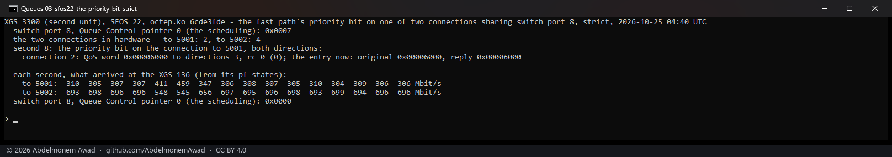

<!-- reviewed: 2026-10-25 -->
# The switch's queue scheduling: every frame from the coprocessor waits in queue 0, 2026-10-25

Discovery 20 of [the discoveries](../findings/discoveries-2026-10-22.md#queue-scheduling-up-to-strict-priority).
Each port of the 88E6193X in front of the XGS 3300's and the XGS 136's ports has eight egress queues,
and their scheduling runs from weighted on all eight to strict priority on all of them - read on
2026-10-22 as weighted on every port, and taken then to be free to use. Measured on the second XGS
3300 (vendor version 22's coprocessor software), where a stream can be made to queue, and read on the first
(vendor version 23) and the XGS 136 (vendor version 21), with octep.ko `6cde3fde` and npuep.ko `590205fb`
(`images/deploy/lab-qsched-report.sh`; the long forms `lab-qsched.sh`, `lab-qsched-conn.sh`,
`lab-qsched-queues.sh`).

## The registers, from the switch's own driver library

The vendor's GPL release carries the switch's driver library (UMSD, its Amethyst family): the
scheduling is the Queue Control register's (0x1C) pointer 0, 0 for weighted on all eight (33, 25,
17, 12, 6, 3, 2, 1) through 7 for strict on all; where a frame's priority comes from is Port
Control (0x04) bits 5:4 - the port's default, the 802.1p tag, the IP header's DSCP, or tag then IP -
with bit 6 choosing the tag when a frame has both; the ingress map from a tag's priority to a queue
is register 0x18's table 0; and the frames waiting in each egress queue are read from register
0x1B, the queue written in bits 15:12 and the count read from 8:0. All of them through os-xgs-npu's
switch tool on the coprocessor.

## Where the streams queue

Switch port 8 of the second XGS 3300 is Port8, a gigabit port to the XGS 136. Two kinds of stream
crossed it at once, each pair more than the port carries: two from the first XGS 3300 through the
board's fast path - in hardware - to the XGS 136, and two from the board's own host to the PC behind
the XGS 136, one of them marked EF (DSCP 46).

| crossing switch port 8 | frames waiting, queue 0 | queues 1 to 7 |
|---|---|---|
| nothing | 0 | 0 |
| two connections in hardware | 24 to 511 | 0 |
| the host's two streams, one marked EF | 3 to 506 | 0 |
| the same, with port 0's ingress map sending priority 0 to queue 3 | 446 to 511 | 0 |

**Every frame the coprocessor sends to the port waits in queue 0** - a connection the fast path
carries and the host's own, marked or not. Switch port 0, the coprocessor's, is in DSA mode, and
neither its ingress map nor its priority source moved them, so as far as this shows they take their
queue from the DSA tag the coprocessor writes on each frame - and that puts every one in queue 0.
So the port's scheduling has one queue to schedule.

## So the scheduling orders nothing

| the host's EF and unmarked streams, 10 s a pair | EF (DSCP 46) | unmarked |
|---|---|---|
| weighted, as the board has it | 438-472 Mbit/s | 463-502 Mbit/s |
| strict priority for all eight | 456-548 | 388-476 |
| strict, port 0 taking the priority from the IP header first (Port Control 0x017f to 0x013f) | 407-441 | 499-535 |

The marked stream did not win under either; in other runs the split wandered from 296 against 643
to 659 against 282 with the scheduling weighted, and stayed near half and half with it strict.

Nor did the fast path's priority bit for a connection ([discovery 6](../findings/discoveries-2026-10-22.md#a-priority-bit-and-a-meter-for-each-connection)),
measured on 2026-10-24 with the scheduling weighted: with it strict, the connection given the bit
kept its share, 304 to 310 Mbit/s against 693 to 699, as before it. The two connections settled at
305 against 695 under either scheduling, and at 224 against 777 too with it strict; one run moved
from the second to the first with nothing changed - which is how one queue shared by two TCP
connections behaves, not a priority.

## The same on all three versions

The three firmwares leave the switch alike: port 0 in DSA mode, every port taking a frame's priority
from its tag and then its IP header, default priority 0, and all eleven ports weighted. One read of
the XGS 136's port 0 came back 0x000f before and 0x017f after - the bus there is shared with the
network agent's polling, which spoils a read now and then
([639](https://github.com/AbdelmonemAwad/os-xgs-npu/issues/639)) - so each register is read three
times and the value seen twice kept.

## What it means for os-xgs-npu

**Not built: nothing sets the scheduling.** Strict priority on a front port would order nothing,
because everything the coprocessor sends there is in one queue. Priority for a front port's
outgoing traffic needs the frames put in different queues first, and the coprocessor does not: the
switch's own ways to override a frame's queue - a TCAM rule on port 0, a priority by address or by
VLAN - were not tried. The other direction, a front port's frames to the coprocessor, takes its
priority from their tag and DSCP as set, but meets a link to the coprocessor far faster than the
ports, where nothing was seen to queue.

## What it does not say

- Whether a TCAM rule, an address's or a VLAN's priority override would move the coprocessor's
  frames out of queue 0 - and so give the scheduling something to do.
- The counts of queues 1 to 7 were never seen above 0, so their reading is not itself shown to work;
  the shares, which follow no marking, agree with it.
- The XGS 136 and the first XGS 3300 were read, not loaded: neither has a front port on the bench
  where a stream could be made to queue safely - the first XGS 3300's two with a link, its WAN and
  Port4, ~~lead off the bench~~ join none of the lab's boards: Port4 has no address on it (read
  again for [frontports-2026-10-25](frontports-2026-10-25.md)).
