<!-- reviewed: 2026-11-11 -->
# Eight receive-path and offload tries that gained nothing or met a limit, XGS 136 and XGS 3300, 2026-11-10 to 2026-11-11

Eight things were tried on the lab's XGS 136 and second XGS 3300 to make the host's receive path faster or
to put more traffic in hardware: a receive queue for each port, a deeper netmap queue under Suricata, jumbo
frames through Suricata, checksum offload on forwarded traffic, a five-tuple spread over Suricata's rings,
GRE in hardware, ICMPv6 and translated IPv6 in hardware, and a bridge over VLANs in hardware. Most gained
nothing, or found where the hardware, its firmware or FreeBSD stops; ICMPv6 in hardware worked, on a test
build. They are written up together so that someone running Intrusion Detection in IPS mode, jumbo frames,
GRE, NAT66 or a bridge over VLANs on these appliances knows what to expect, and which settings did not help
when measured.

## How it was measured

- **The appliances:** the XGS 136 (vendor version 21) and the second XGS 3300 (vendor version 22, octep.ko
  `861b8b50`).
- **The XGS 136's module:** its release module from `/boot/modules` (npuep.ko `ad3b1480`), or a test build
  made on the appliance and loaded in its place for the runs, the release module loaded back after. The test
  builds are not in the repository or in a release, and this page says what they did, not how: `de6c6e3e`
  adds checksum offload in the coprocessor, a bridge over VLANs in hardware, and ICMPv6 and translated IPv6
  tried in hardware, each behind a setting that is 0 by default; `493cb635` asks the coprocessor for its
  five-tuple hash; `efc82f38` was an earlier netmap build.
- **The bench:** the bench PC on the XGS 136's F1 (10.99.13.x); the XGS 136's Port8 cabled to the second XGS
  3300's Port8 (10.99.23.x, the two ends), its Port7 to that one's Port6; the bench VM behind the XGS 3300's
  F2 (10.99.2.x). iperf3 for 10 seconds unless a section says otherwise, the receiver's figure.
- **Host mode:** where every frame had to cross the XGS 136's host, `dev.npuep.0.flow.auto` - XGS: Settings
  "Accelerate connections automatically" - at 0 for the run and back at 1 after.
- **Read:** the frames the XGS 136's host took per receive queue (npuep's `giu.rx_q0` to `giu.rx_q3`) and per
  port (`giu.rx_port`); `npup8`'s frames in and dropped on input, where netmap's emulated queue counts its
  overflow; the CPUs' busy share over the run (`kern.cp_time`); the driver's counts of connections made and
  taken back (`dev.npuep.0.flow.flows`); and on the XGS 3300 the last frame its host took, with the flow slot
  the coprocessor gave it and pf's state (`dev.octep.0.dp.pf_state`).
- **Put back:** every address, VLAN, bridge, jail and rule was made at run time and removed after, and
  Intrusion Detection was turned off again after the IPS runs; for the bridge and IPv6 runs the XGS 136's
  `config.xml` had the same checksum before and after.

| | tried | where, on what | UTC |
|---|---|---|---|
| 1 | which receive queue a port's frames land in | XGS 136, release module | 2026-11-10 20:21-20:23 |
| 2 | a deeper netmap queue under IPS | XGS 136, release module | 2026-11-10 20:27-20:30 |
| 3 | IPS on a port at MTU 9,000 | XGS 136, release module | 2026-11-11 16:31-16:36 |
| 4 | checksum offload | XGS 136, test builds | 2026-11-10 20:48-20:52 and 2026-11-11 16:55-16:57 |
| 5 | a five-tuple spread over four netmap rings | XGS 136, test build `493cb635` | 2026-11-11 17:43-17:45 |
| 6 | GRE's protocol 47 in hardware | second XGS 3300 | 2026-11-10 20:56 and 2026-11-11 17:48-17:50 |
| 7 | ICMPv6 and NAT66 in hardware | XGS 136, test build `de6c6e3e` | 2026-11-11 17:29-17:32 |
| 8 | a bridge over VLANs in hardware | XGS 136, test build `de6c6e3e` | 2026-11-11 17:10-17:23 |

## Results

| | result |
|---|---|
| 1 | the queue follows the connection: one stream's frames from both its ports in one queue, several streams spread; no queue belongs to a port |
| 2 | 1,024 to 4,096 slots: a 256-byte UDP flood from 224 to 255 Mbit/s, the queue's drops from 49 to 45 % |
| 3 | default buffers: the port refused; 9,216-byte buffers: Suricata runs and every frame above 2,048 bytes is lost, cut by FreeBSD's emulated transmit |
| 4 | forwarded: 945 and 943, 939 and 937 Mbit/s, offload off and on; the gain is only for traffic that ends at the appliance |
| 5 | 259, 310 and 276 Mbit/s, against 283 and 334 with the driver's own hash; the CPUs 92-95 % busy |
| 6 | 100 samples of 100 in flow slot 0: never a candidate, so on the host |
| 7 | ICMPv6 echo made in hardware; NAT66 made in hardware stalls TCP, so the driver's refusal stays |
| 8 | made in hardware, the CPUs from 24 % to as little as 5 %, but taken back and made again about every ten seconds; the cause not found |

### 1. A frame's receive queue follows its connection, not its port

The XGS 136 in host mode on its four receive queues, [as many as its coprocessor is set up
for](npuep-queues-2026-11-01.md); TCP from the bench PC into F1, routed out of Port8 to the second XGS 3300,
and back (`-R`).

| run | received | q0 | q1 | q2 | q3 | frames from F1 / Port8 |
|---|---|---|---|---|---|---|
| one stream, PC to XGS 3300 | 903 Mbit/s | 1,550,605 | 1 | 39 | 0 | 775,329 / 775,314 |
| four streams, PC to XGS 3300 | 938 Mbit/s | 442,317 | 53 | 812,296 | 363,484 | 809,099 / 809,050 |
| one stream, XGS 3300 to PC | 930 Mbit/s | 878,578 | 4 | 32 | 17 | 79,885 / 798,745 |
| eight streams, XGS 3300 to PC | 937 Mbit/s | 358,041 | 135,854 | 359,412 | 123,633 | 163,614 / 813,326 |

- **One connection, one queue.** A stream's data, in at one port, and its acknowledgements, in at the other,
  landed in the same queue. Which queue changes with the connection: q0 in both one-stream runs above, q2 in a
  3-second run before them (156,207 frames).
- **Several connections spread, unevenly:** four streams over three queues, eight over all four.
- **No queue belongs to a port.** The driver asks the coprocessor for what its interface calls the two-tuple
  hash (`contrib/npuep/npugiu.c`, where the receive queues are set up); measured, it separates connections
  between the same two hosts, as a hash of the whole connection does.
  [The receive queue as the flow id](flowid-136-2026-11-11.md) builds on this.
- **The XGS 3300 was not measured:** its driver counts no frames per receive ring. Its code says the fast
  path picks the host's ring by hashing the frame, so which ring a frame lands on is not the host's to choose
  (`octep_dp_rx_report` in `contrib/octep/octep_dp.c`); the host takes eight receive rings there
  ([what it cannot do](../guide/limitations.md)).

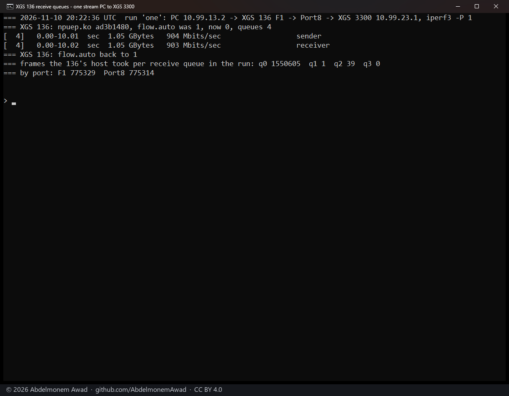

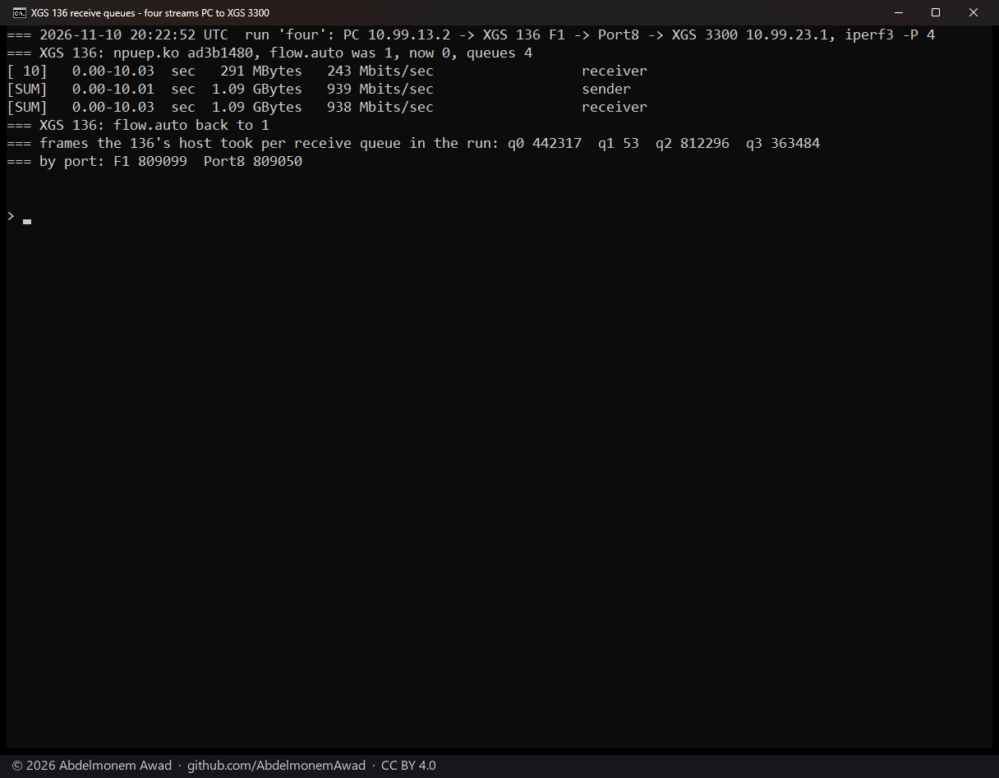

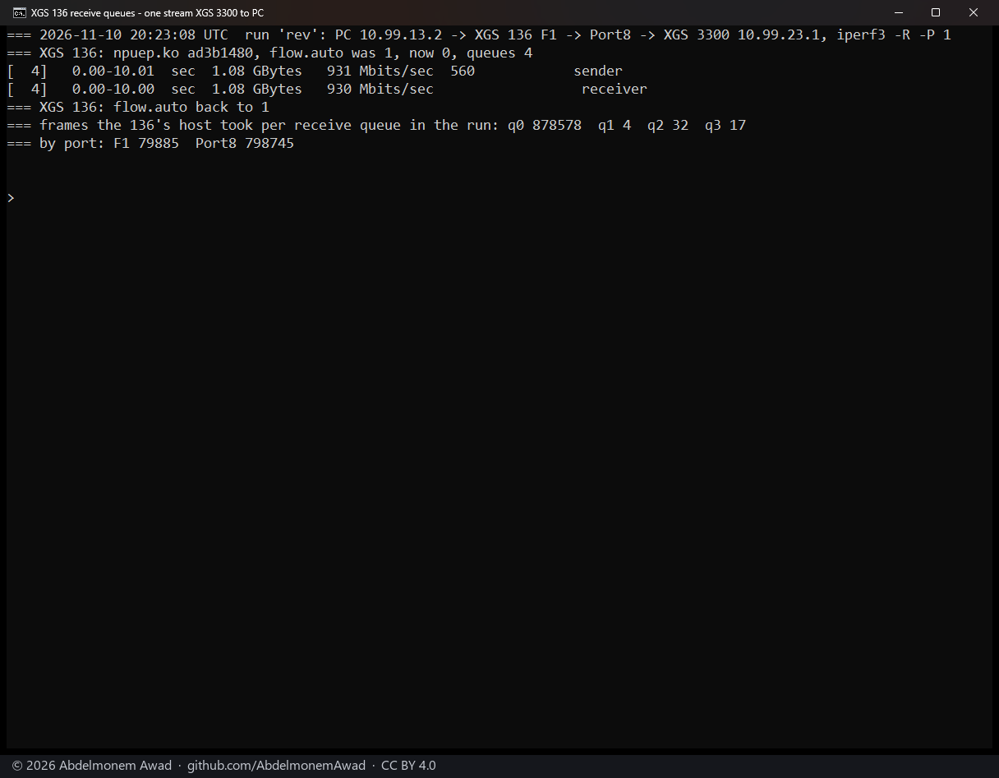

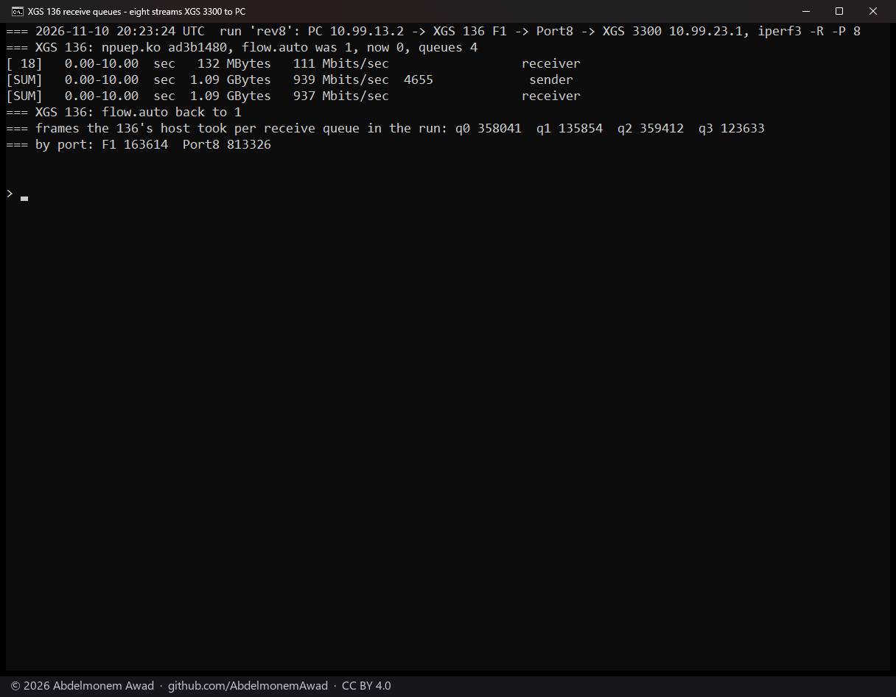

### 2. A deeper netmap queue does not help a UDP flood

Intrusion Detection in IPS mode on the XGS 136's Port8 through netmap's emulated adapter, one ring; the
queue, `dev.netmap.generic_ringsize`, at 1,024 slots (FreeBSD's default), 2,048 and 4,096, changed between
runs with Suricata stopped. The release module, host mode. The second XGS 3300 sent through Port8 and
Suricata, out of F1 to the PC: one UDP flow at 800 Mbit/s in 256-byte datagrams, and eight TCP streams.

| queue | UDP received | lost end to end | dropped at the queue, of frames in | CPUs busy | eight TCP streams |
|---|---|---|---|---|---|
| 1,024 | 224 Mbit/s | 68 % | 1,665,304 of 3,414,090, 49 % | 49 % | 935 Mbit/s, 0 dropped, CPUs 36 % |
| 2,048 | 232 Mbit/s | 67 % | 1,532,531 of 3,416,831, 45 % | 47 % | not run |
| 4,096 | 255 Mbit/s | 63 % | 1,535,023 of 3,417,844, 45 % | 49 % | 825 Mbit/s, 0 dropped, CPUs 47 % |

- **Four times the queue, 31 Mbit/s more.** The drops fell from 49 to 45 % and the CPUs stayed about half
  busy: the queue's depth is not what stops the flood. With one ring, one Suricata thread reads the port, and
  one flow stays in one ring however many there are; eight flows over
  [four rings by flow id](flowid-136-2026-11-11.md) reached 283 and 334 Mbit/s.
- **TCP never filled the queue**, at either size. Eight streams gave 825 Mbit/s at 4,096 slots against 935 at
  1,024, one run each.

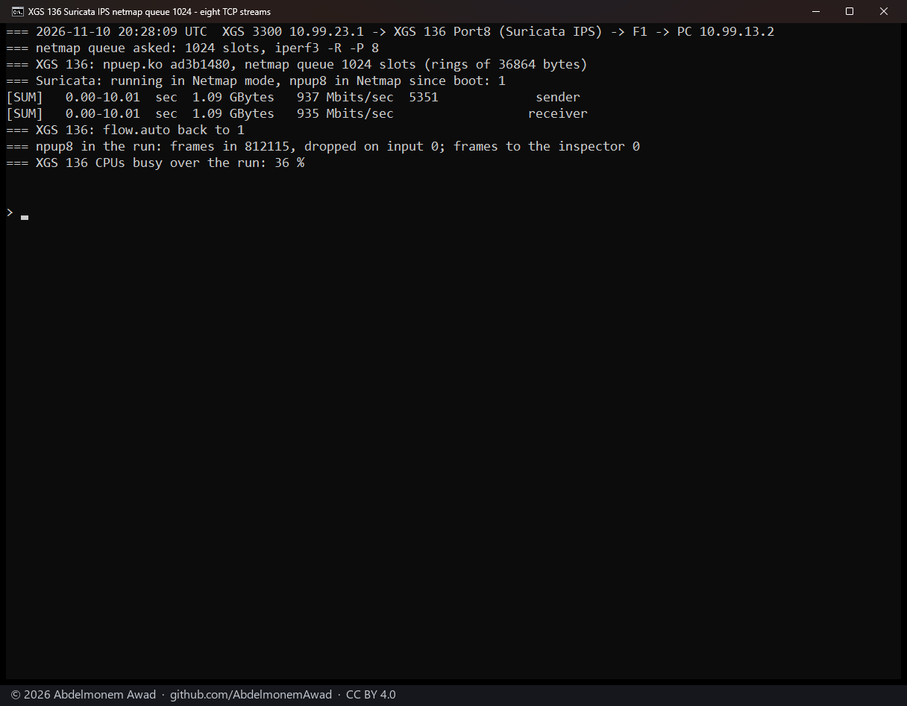

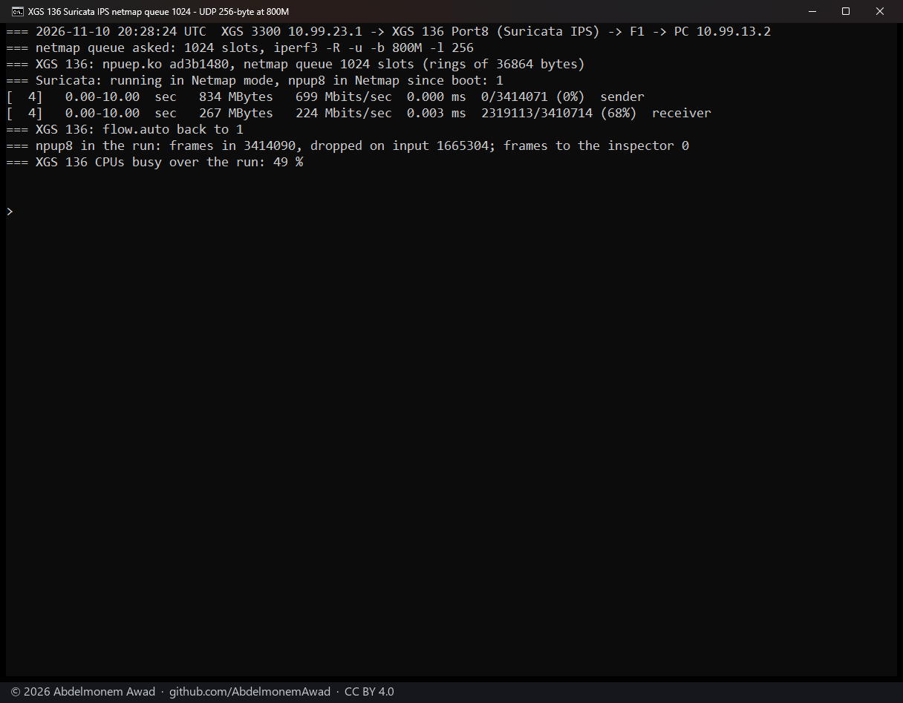

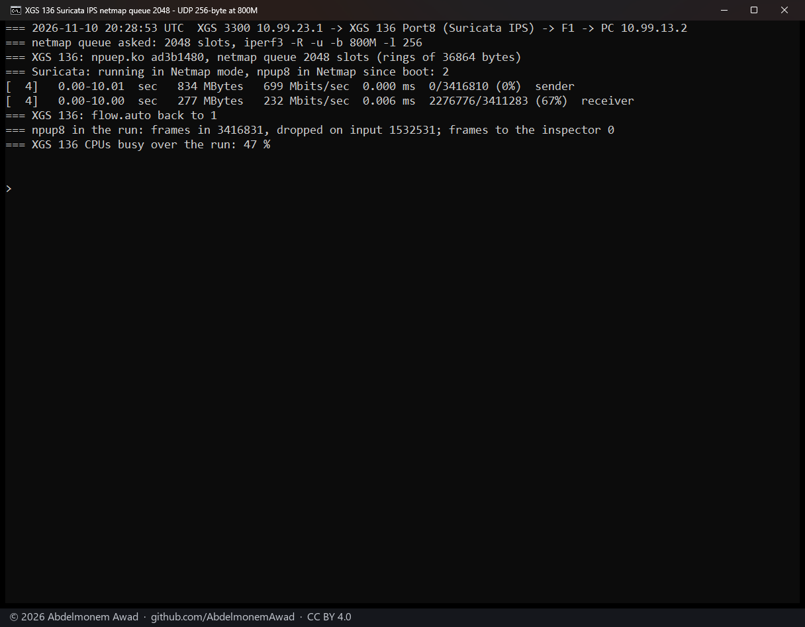

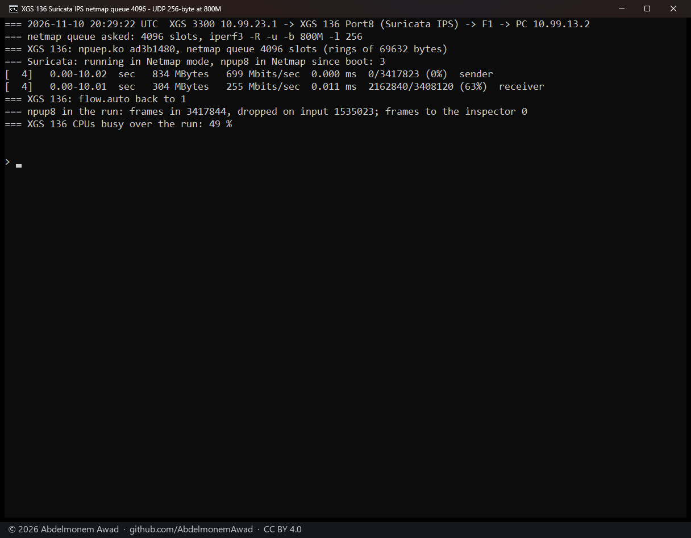

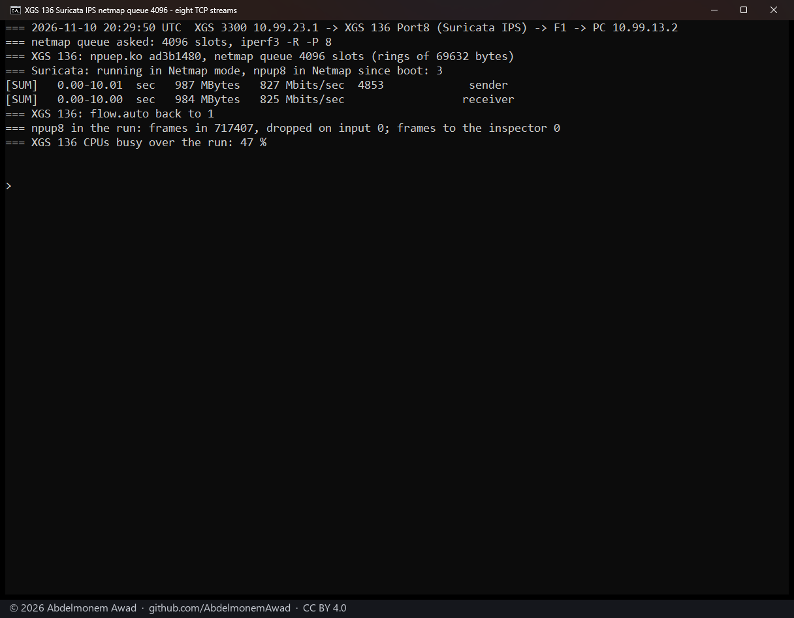

### 3. Jumbo frames through Suricata: netmap's emulated transmit cuts them at 2,048 bytes

The XGS 136 on its release module, its Port8 and the second XGS 3300's Port8 at MTU 9,000, Intrusion
Detection in IPS mode on Port8. Each case: five pings each of 56, 1,472 and 8,972 bytes with don't-fragment
from the XGS 3300 to the XGS 136's Port8, then eight TCP streams from the XGS 3300 through Port8 and
Suricata, out of F1 to the PC, in host mode.

| netmap's buffers, `dev.netmap.buf_size` × `buf_num` | Suricata | 56 and 1,472 bytes | 8,972 bytes | eight TCP streams |
|---|---|---|---|---|
| 2,048 × 163,840, 320 MB, the default | not running: netmap refuses the port | - | - | - |
| 9,216 × 36,864, 324 MB | running | 5 of 5 each | **0 of 5** | 937 Mbit/s, 0 dropped |
| 9,216, and Suricata's packet size 9,018 | running | 5 of 5 each | **0 of 5** | 935 Mbit/s, 0 dropped |
| no IPS | - | 5 of 5 each | 5 of 5 | 935 Mbit/s |

- **At the default buffers netmap refuses the port**: "netmap buf size (2048) < device MTU (9000)" in the
  kernel's log, and Suricata does not run.
- **Bigger buffers let Suricata start, and every frame above 2,048 bytes is lost**, while smaller ones cross.
  The kernel's log says where: "nm_os_generic_xmit_frame size 2048 < len 9014", seven times, rate-limited. A
  frame Suricata passes on leaves through the emulated adapter's transmit, `nm_os_generic_xmit_frame` in
  FreeBSD's `netmap_freebsd.c`, which copies it into one 2,048-byte mbuf cluster and cuts what does not fit;
  9,014 bytes is the 8,972-byte ping's whole frame. Intrusion Detection's "Default packet size" at 9,018
  changed nothing.
- **TCP crossed** at 935-937 Mbit/s, in frames of ordinary size: 814,735 frames for 1.09 GB.
- **Native netmap carries them.** A test build of npuep with native netmap support (`f9b87129`, not in a
  release) did, the same day: with 9,216-byte buffers, 5 of 5 pings of 8,972 bytes crossed Suricata. With
  the release, a port inspected in IPS mode keeps an MTU of 2,048 bytes or less.
- **Left after the runs:** IPS off, the packet size empty again, the tunables back at 2,048 × 163,840; netmap
  still had its 36,864 buffers of 9,216 bytes in use at the end of the log, and when it gave them up was not
  observed.

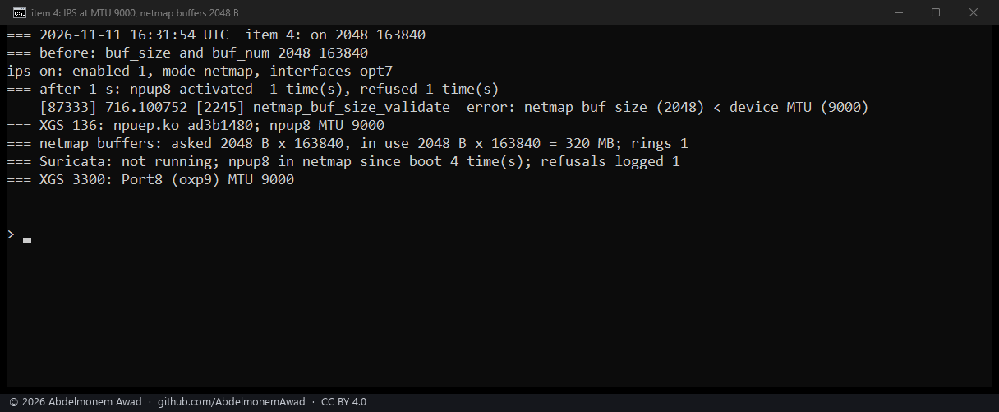

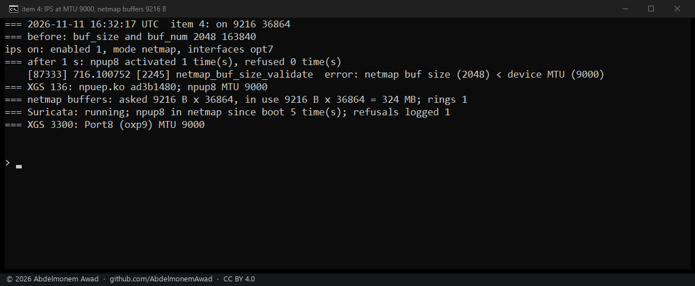

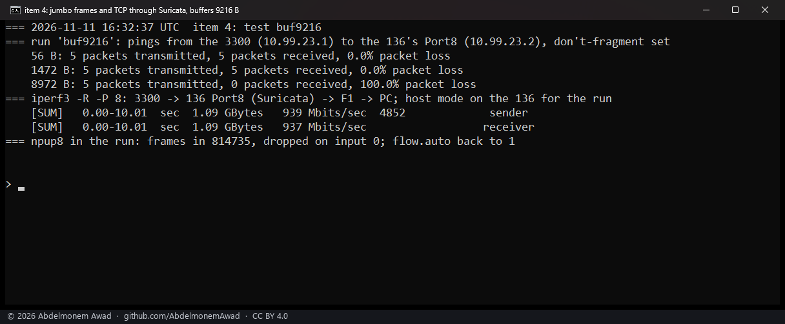

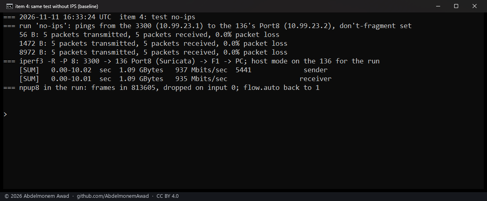

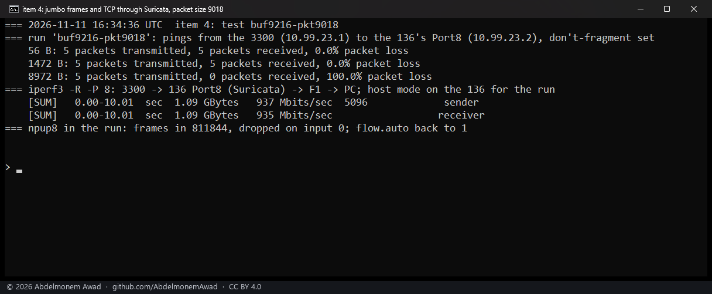

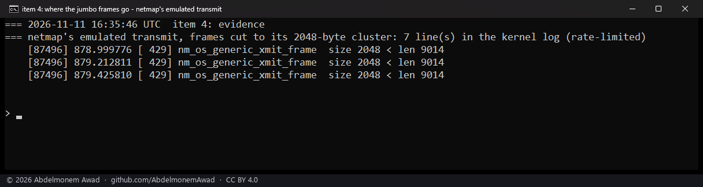

### 4. Checksum offload gains nothing for forwarded traffic

The test build `de6c6e3e`, loaded with its checksum-offload setting on, so that `npup8` offers RXCSUM and
TXCSUM; F1's offload stayed off.

- **Forwarded**, 2026-11-11: eight TCP streams from the PC into F1 and out of Port8 to the second XGS 3300,
  then back, in host mode; Port8's offload switched off and on at run time with `ifconfig`, as OPNsense's
  "Disable hardware checksum offload" (Interfaces: Settings) does.
- **Ending at the appliance**, 2026-11-10: one TCP stream from the XGS 136's own host to the second XGS 3300
  over Port8, then back. Without the setting there were two pairs of runs, the second on the test build
  `efc82f38`, the first on a module the log did not record.

| traffic | offload off | offload on |
|---|---|---|
| forwarded, PC to XGS 3300 | 945 Mbit/s, CPUs 31 % | 943 Mbit/s, 26 %; 817,243 frames in at Port8 checked by the coprocessor, 0 bad; 0 checksums computed by it |
| forwarded, XGS 3300 to PC | 939 Mbit/s, 21 % | 937 Mbit/s, 20 %; 813,526 checked, 0 bad; 0 computed |
| the XGS 136 sends | 990 Mbit/s, 7 %, both pairs | 990 Mbit/s, 7 %; 138,442 computed by the coprocessor, 0 in software |
| the XGS 136 receives | 950 and 914 Mbit/s, 17 and 21 % | 990 Mbit/s, 6 %; 138,844 checked, 0 bad |

- **Forwarded, nothing gained:** 2 Mbit/s apart either way, the CPUs 31 and 26 %, 21 and 20 %, one run each,
  not repeated to see whether the 5 points hold. The coprocessor computed no checksum for a forwarded frame -
  each arrives with its own - and checked 817,243 and 813,526 frames that Port8 took in, none of them bad.
- **The gain is for traffic that ends at the appliance:** receiving, 914-950 Mbit/s at 17-21 % became 990 at
  6 %. Sending did not change.
- **No bad checksum anywhere:** TCP segments dropped for a bad checksum, 0 on both appliances in every run.

OPNsense leaves hardware checksum offload off by default; for traffic the appliance forwards, these runs give
no reason to turn it on.

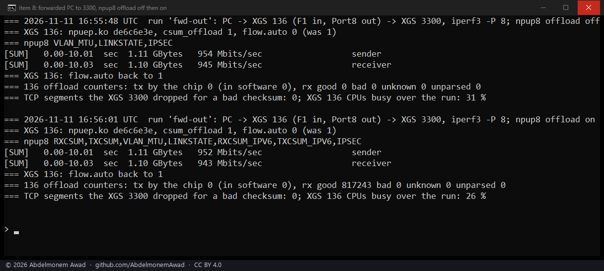

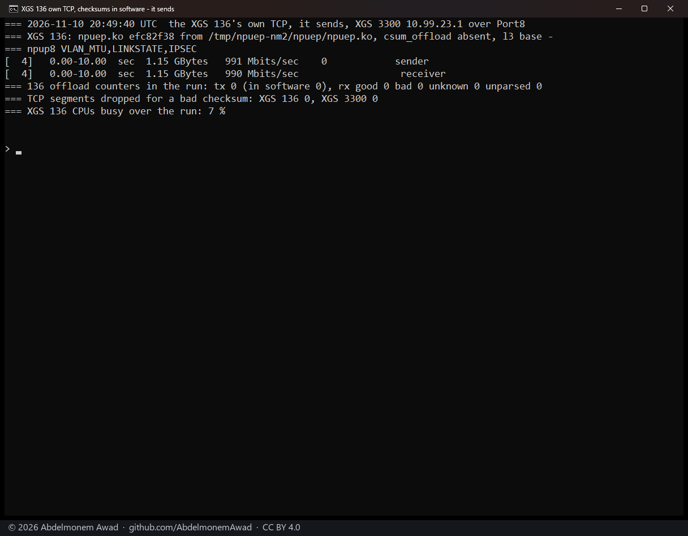

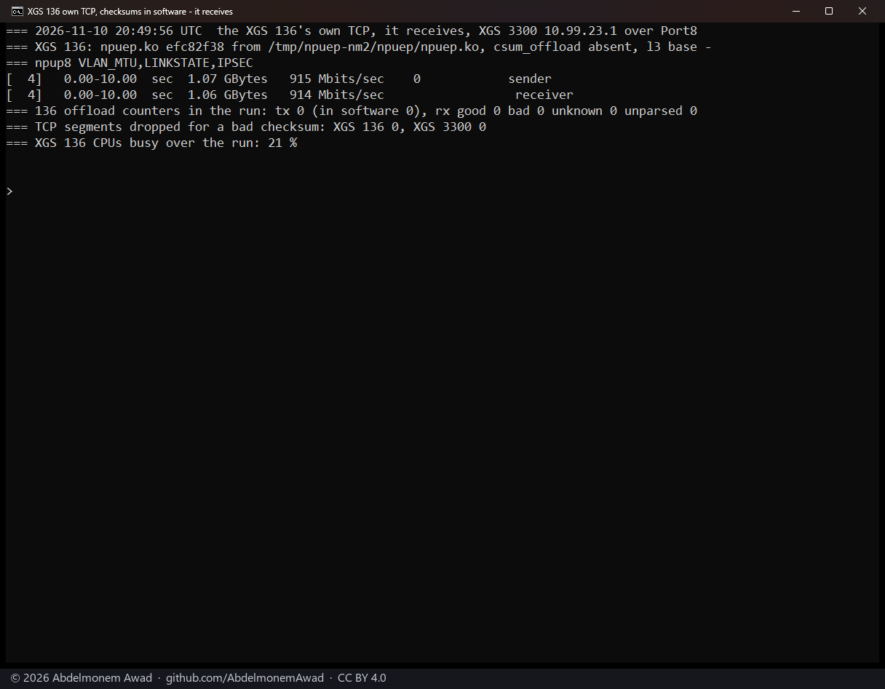

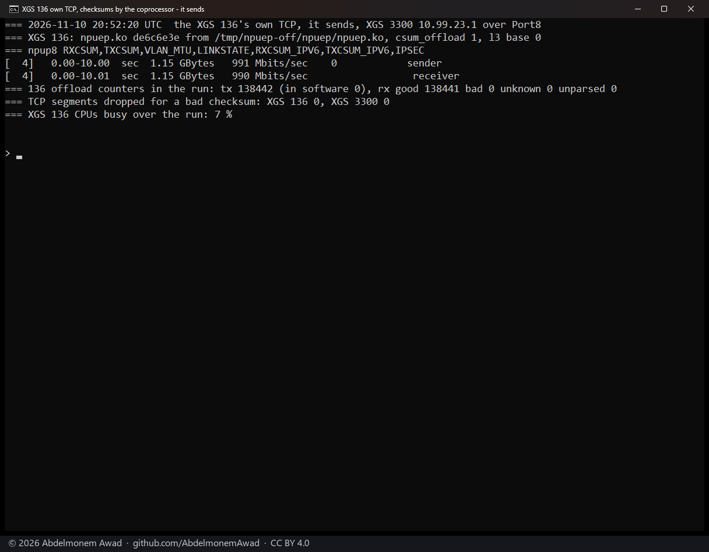

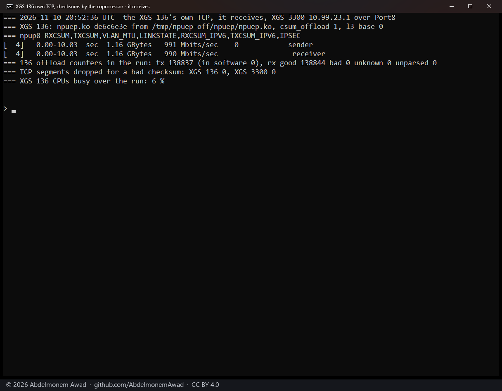

### 5. A five-tuple spread over four netmap rings is no better than the driver's hash

The test build `493cb635`: the receive queue as the flow id (`dev.npuep.0.giu.rx_flowid` at 1,
[now in the driver](flowid-136-2026-11-11.md)) and a loader setting that asks the coprocessor for its
five-tuple hash. Intrusion Detection in IPS mode on Port8 over four netmap rings of 1,024 slots, `npup8` at
MTU 1,500 for the runs, host mode. The second XGS 3300 sent through Port8 to the PC: one TCP stream, then
eight UDP flows of 100 Mbit/s in 256-byte datagrams, three times.

| run | frames per queue, q0 / q1 / q2 / q3 | received | lost end to end | dropped at the ring | CPUs busy |
|---|---|---|---|---|---|
| one TCP stream | 0 / 0 / 807,184 / 39 | 852 Mbit/s | - | 0 | 37 % |
| eight UDP flows, first | 485,655 / 1,456,784 / 485,577 / 1,456,763 | 259 Mbit/s | 68 % | 16 % | 95 % |
| eight UDP flows, second | 972,331 / 972,266 / 972,165 / 972,258 | 310 Mbit/s | 61 % | 12 % | 93 % |
| eight UDP flows, third | 486,074 / 971,822 / 971,796 / 1,449,840 | 276 Mbit/s | 65 % | 11 % | 92 % |

- **The five-tuple hash keeps a connection together:** all 807,184 frames of the TCP stream, both
  directions, in q2.
- **Eight flows still fall by chance:** one, three, one and three to a queue in the first run, two each in the
  second, one, two, two and three in the third. The driver's own hash gave 283 and 334 Mbit/s with 26 and
  12 % dropped on the same traffic ([the flowid page](flowid-136-2026-11-11.md)).
- **The CPUs are the limit**, 92-95 % busy: even the second run's even spread received 310 Mbit/s. A spread
  over eight rings was not built, as four already kept the CPUs that busy.

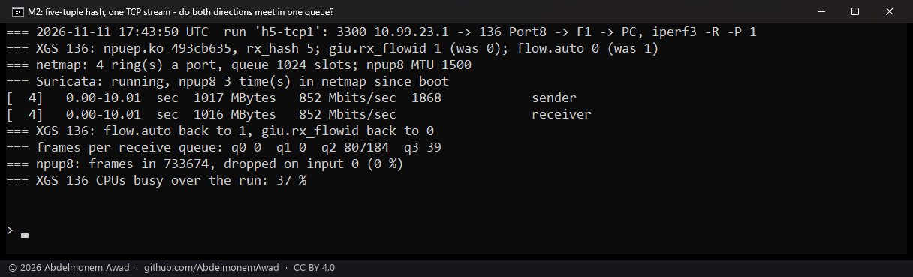

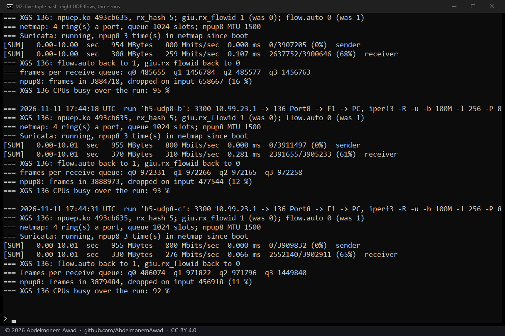

### 6. GRE's protocol 47 always arrives in flow slot 0 on the XGS 3300, so it stays on the host

The second XGS 3300 with its flow maker on (`dev.octep.0.dp.auto` 1). Raw IPv4 packets of protocol 47 - a
four-byte header of zeros and 1,024 bytes, not a GRE tunnel - both ways between the bench VM behind its F2
and the XGS 136 behind its Port8, 500 a second for 20 seconds.

- **2026-11-10, 20:56 UTC:** at second 12 the XGS 3300's flow table and its candidates held no row for
  protocol 47, and its host took in 5,257 then 3,855 frames on F2 for the VM's 9,086 packets, and 5,960 then
  3,982 on Port8 for the XGS 136's 9,942 (seconds 0-12, then 12-20).
- **2026-11-11, 17:48 and 17:49 UTC:** `dev.octep.0.dp.pf_state` read 50 times during each of two runs: all
  100 samples were protocol 47, from both directions (29 and 21, 33 and 17), every one in flow slot 0 with a
  pf state.
- **Slot 0 names no flow, and the driver makes a candidate only of a frame whose metadata names one** (the
  receive path in `contrib/octep/octep_dp.c`). The coprocessor gives a protocol-47 frame no flow, so it never
  becomes a candidate, and the host carries all of it.
- **ICMP echo, for comparison:** 300 echoes from the VM in 15 seconds, all answered, were the last frame in
  none of 50 samples; how many of them the host took was not counted.

### 7. ICMPv6 through the flow maker works; NAT66 in hardware stalls TCP, so the refusal stays

The XGS 136 as the router between two IPv6 nets, on the test build `de6c6e3e`, whose two settings, 0 by
default, offer as connections for hardware the protocols other than TCP and UDP (ICMPv6 here) and the IPv6
connections pf translates. Net A on the Port8 cable (the XGS 3300's host `fd99:23::1`, the XGS 136
`fd99:23::2`); net B on VLAN 200 over the XGS 136's Port7 and the XGS 3300's Port6, the XGS 3300's end in a
jail (`fd99:67::1`). A temporary pass rule for IPv6, then a temporary NAT66 rule on the XGS 136 translating
net A to its own net B address. iperf3 with four streams for 10 seconds; 30 pings at 0.2-second intervals.

| run | test settings | result | in hardware | frames the host took, Port8 + Port7 | CPUs busy |
|---|---|---|---|---|---|
| TCP, routed | both 0 | 921 Mbit/s | 9 made, 4 taken back | 133,114 + 75,065 | 7 % |
| ICMPv6 echo | both 0 | 30 of 30, 0.491 ms on average | none | 30 + 35 | 0 % |
| ICMPv6 echo | other protocols at 1 | 30 of 30, 0.388 ms on average | 1 made of 2 tried, none refused | 5 + 3 | 0 % |
| TCP through NAT66 | both 0 | 912 Mbit/s | none: 50 refused | 832,421 + 441,344 | 25 % |
| TCP through NAT66 | translated IPv6 at 1 | stalled: iperf3 "server test duration expired" | 5 made, 192 tried | 21,894 + 11,922 | 2 % |

- **Routed IPv6 TCP goes into hardware** with both settings at 0: 921 Mbit/s with the CPUs 7 % busy, as
  [measured on 2026-10-18](xgs136-hardware-2026-10-18.md#ipv6) at 929 and 919 Mbit/s.
- **ICMPv6 echo goes into hardware with its setting at 1:** the host took 8 frames of the 60 that the echoes
  and their replies carried, against 65 with it at 0, and the round trip fell from 0.491 to 0.388 ms on
  average.
- **A translated IPv6 connection made in hardware breaks:** at 1, five were made and TCP stopped moving. At 0
  the driver refuses each one - 50 refusals, `v6-refused` in `dev.npuep.0.flow.flows` - and the host carries
  it, 912 Mbit/s at 25 % busy. The refusal is right: the connection block the driver hands the fast path
  carries IPv4 addresses for a translation, as its comment at the refusal says (`contrib/npuep/npuflow.c`).

### 8. A bridge over VLANs: made in hardware, then taken back and made again about every ten seconds

The XGS 136 on the test build `de6c6e3e`, whose setting makes a connection across a bridge of VLAN
interfaces a bridged flow in hardware: 0 off, 1 keeping the VLAN tag, 2 writing it. A bridge of `npup8.100`
and `npup7.100` - VLAN 100 over Port8 and over Port7, both at MTU 1,500 - with one pass rule on it, made at
run time; a first setup failed to add the second member ("Failed to set MTU on new member") until both VLAN
interfaces were made at 1,500. On the second XGS 3300, VLAN 100 over its Port8 on its host (10.99.100.x) and
over its Port6 in a jail (10.99.100.x): its host talked to its own jail through the XGS 136's bridge, tagged
both ways. iperf3 with four streams, for 10 seconds and for 30; read: the frames the XGS 136's host took from
its coprocessor (`giu.rx_port`), its CPUs, and the connections the build made over the bridged VLANs. A first
set of runs counted the interfaces' own counters, which also hold what the coprocessor forwards, and is left
out.

| setting | direction | seconds | received | made | frames the host took, Port8 + Port7 | CPUs busy |
|---|---|---|---|---|---|---|
| 0 | to the jail | 10 | 928 Mbit/s | 0 | 832,138 + 440,204 | 24 % |
| 1 | to the jail | 10 | 934 Mbit/s | 9 | 247,292 + 133,869 | 8 % |
| 2 | to the jail | 10 | 934 Mbit/s | 9 | 177,999 + 97,836 | 5 % |
| 1 | from the jail | 10 | 920 Mbit/s | 9 | 335,889 + 334,651 | 21 % |
| 1 | to the jail | 30 | 933 Mbit/s | 17 | 1,122,364 + 602,461 | 12 % |
| 1 | from the jail | 30 | 922 Mbit/s | 17 | 1,194,172 + 1,191,748 | 18 % |

Three runs a few minutes earlier, counted over all four receive queues, gave 1,266,916 frames at 0 (23 %),
426,685 at 2 (17 %) and 395,577 at 1 from the jail (7 %).

- **The bridge carried the traffic**, 920-934 Mbit/s, and the build refused no connection at any setting.
- **At 0 every frame crossed the host**, 1,272,342 in 10 seconds with the CPUs 24 % busy - what a release
  does, which [leaves a bridge over a VLAN interface to the host](vlan-2026-10-24.md#what-stays-with-the-host).
- **At 1 or 2 the connections were made in hardware** and the CPUs fell to 5-8 % in the 10-second runs to the
  jail, but the host still took 275,835 and 381,161 frames in 10 seconds to the jail and 670,540 from it, and
  1,724,825 and 2,385,920 in 30.
- **Made, taken back, made again.** Each 10-second run made 9 and each 30-second run 17, for four streams and
  iperf3's control connection: the counts fit each stream being made at its start and again about every ten
  seconds. Over all the runs the build made 106 and took 103 back, 28 of them because pf's state was gone.
- **The cause was not found.** Ten seconds is the board's default microflow timeout
  ([board limits](../families/board-limits.md)), and the routed IPv6 run of section 7, on the same build and
  also through a VLAN interface, made 9 and took back 4 in its 10 seconds; nothing measured here ties the
  take-backs to either. The same runs over an untagged bridge on this build were not made. On a release, an
  untagged bridge on the XGS 136 left 145,973 frames to its host in 12 seconds, which
  [the bridged page](bridged-2026-10-24.md#given-back-at-small-frames) puts down to the fast path's
  give-backs at 1,500-byte frames.

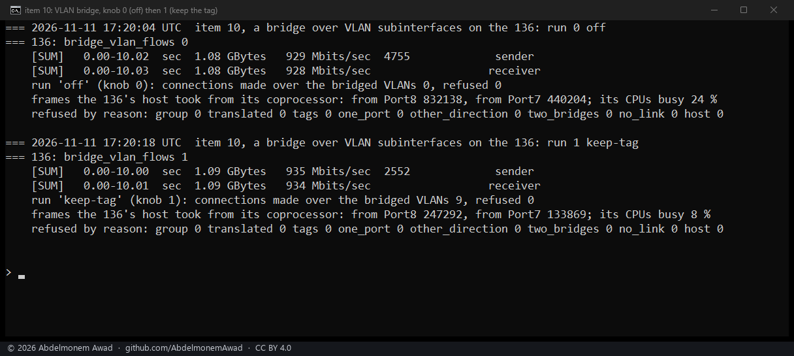

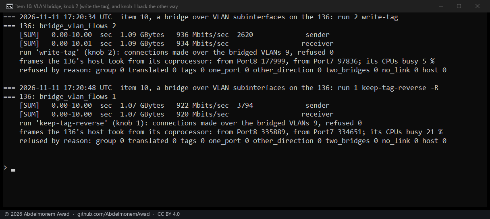

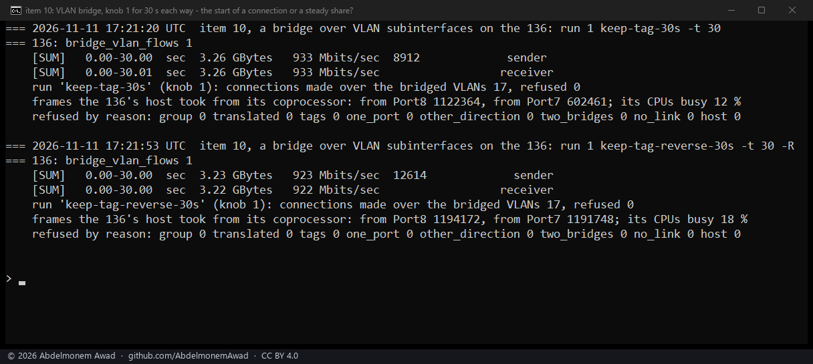

## What it does not mean

- **Only these appliances and builds.** Sections 1 to 5, 7 and 8 ran on the XGS 136, section 6 on the second
  XGS 3300. The test builds and their settings are not in the repository or in a release.
- **Section 1 measured nothing of the XGS 3300's rings.** Its driver gives a received frame no flow id - it
  reads one only to pick a transmit ring (`contrib/octep/octep_dp.c`) - so the XGS 136's four-ring setting has
  no counterpart there, and IPS over several rings on the XGS 3300 was not measured.
- **Section 2 is one run per size.** Whether the 825 Mbit/s of eight TCP streams at 4,096 slots came from the
  queue or from the run was not measured.
- **Section 3 is the emulated adapter's limit.** Native netmap was measured only on a test build; with a
  release, IPS at MTU 9,000 either does not start or loses every frame above 2,048 bytes.
- **Section 4's forwarded runs were in host mode**, every frame crossing the host. With the flow maker on, the
  frames of a connection in hardware never reach the host at all.
- **Section 6 sent raw protocol-47 packets**, not the traffic of an OPNsense GRE tunnel; a GRE tunnel ending
  on the appliance, and the XGS 136, were not tried.
- **Section 7 was not tried on the XGS 3300**, and why a translated connection stalls in hardware was not
  traced past the stall.
- **Section 8's cause is open**, and the comparison with an untagged bridge on the same build was not made.
