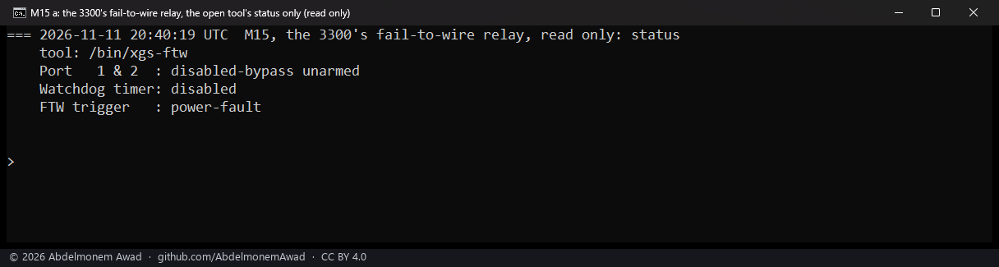
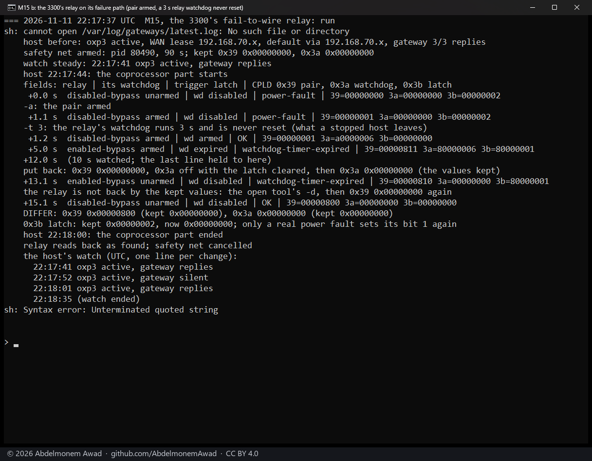
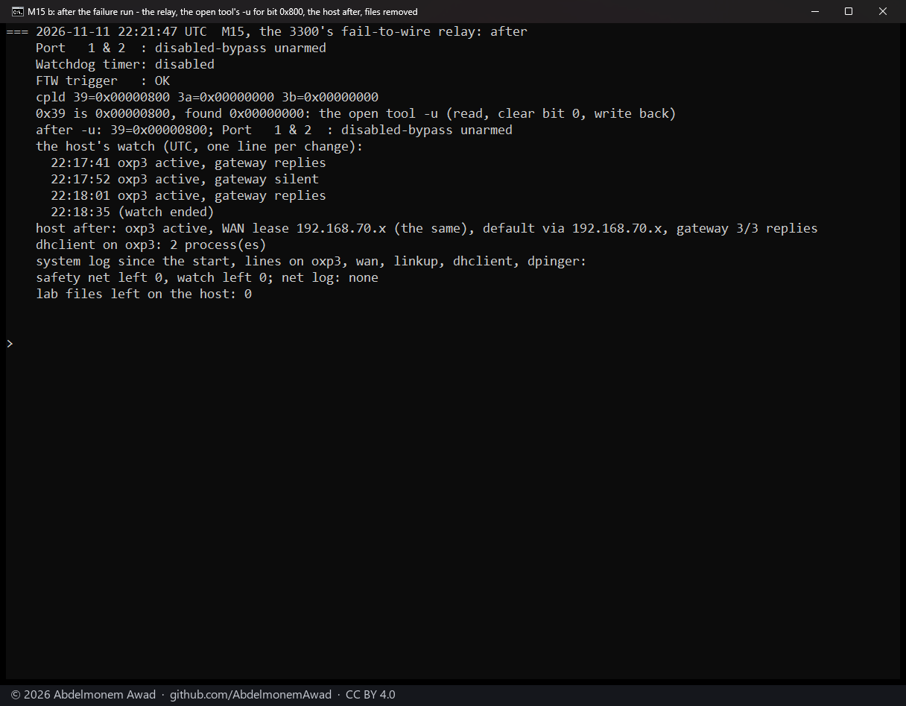

<!-- reviewed: 2026-11-11 -->
# The XGS 3300's fail-to-wire relay: read, and driven on its failure path, 2026-11-11

The second XGS 3300 has one fail-to-wire relay pair, Port1 and Port2. Armed, it joins the two ports' cables
to each other when the appliance fails, so traffic passes without the firewall. Nothing in this plugin reads
or drives it. Two questions: what state does it hold, and does its failure path work when the vendor's own
open tool arms it?

## How it was measured

The second XGS 3300, vendor version 22. The tool is `xgs-ftw` from the vendor's GPL board package
(`xgs-bsp/include/xgs_ftw.h`, `xgs-bsp/lib/xgs_ftw.c`, `xgs-bsp/tools/xgs-ftw.c`), already on the coprocessor as
`/bin/xgs-ftw`, run there through the plugin's `npu-run.sh`. Its source names the board's CPLD registers
through the platform database: `0x39` holds the pair's arm bit (`0x1`), its command field (`0xf00`) and its
status (`0x30`); `0x3a` the relay's watchdog (bit 31 on, bit 29 still counting, bit 28 clears the latch,
bits 5:0 half seconds); `0x3b` what last triggered the relay (bit 0 the watchdog expired, bits 1-12 a
power-good line, bit 31 the relay's OK signal low now).

- **Read only** (`xgs-ftw -s`): the pair, its state, the watchdog, the last trigger.
- **The failure path**, after checking that Port1 had no cable and Port2 was the WAN port - so a bypass joins
  the WAN cable to an empty socket and nothing else: the raw CPLD values kept; a safety net on the host that
  writes them back after 90 s over the PCIe link, which the relay does not touch; the WAN port's link and
  the WAN gateway's replies watched from the host every 0.5 s. Then `xgs-ftw -a` (arm the pair) and
  `xgs-ftw -t 3` (the relay's watchdog for 3 s, never reset - what a host that stopped leaves), the relay read
  every 0.5 s for 10 s, and the kept values written back.

## Results

| | before | armed | 3.8 s after the watchdog | written back | after `-d` |
|---|---|---|---|---|---|
| relay | disabled-bypass | disabled-bypass | **enabled-bypass** | enabled-bypass | disabled-bypass |
| armed | no | yes | yes | no | no |
| watchdog | disabled | disabled | expired | disabled | disabled |
| last trigger | power-fault | power-fault | watchdog-timer-expired | watchdog-timer-expired | OK |
| CPLD `0x39` / `0x3a` / `0x3b` | `0x0` / `0x0` / `0x2` | `0x1` / `0x0` / `0x2` | `0x811` / `0x80000006` / `0x80000001` | `0x810` / `0x0` / `0x80000001` | `0x800` / `0x0` / `0x0` |

- **The relay switched to bypass 3.8 s after its watchdog was armed** and not reset.
- **The WAN was cut for 9 s**: the gateway answered nothing from 22:17:52 to 22:18:01 UTC, **while the host saw
  the WAN port's link up** the whole time, and the system log recorded no link event. The host cannot tell a
  bypass from the link; only the CPLD says it.
- **Writing the kept values back did not release the relay** - unarmed and the watchdog off, it still bypassed
  with the trigger latched. The tool's `-d` (disable-bypass) released it, and cleared the latch.
- **One bit stayed**: `0x39` reads `0x800` where it read `0x0` before - bit 11 of the command field, which the
  open source never writes. The CPLD set it when the watchdog switched the relay (`0x811`); a write of 0 and
  the tool's own `-u` (read, clear the arm bit, write back) both leave it set.
- After: the same WAN lease, the default route, the gateway 3 of 3, no system log line on the WAN port,
  `linkup`, `dhclient` or `dpinger`.

## What it does not mean

- **Traffic across the relay was not measured.** Port1 had no cable; a device cabled there would sit on the
  WAN's network directly, which is what a bypass does.
- **A bypass passes traffic with no firewall between the two ports.** On a firewall that is a security
  decision for whoever runs it, not a default.
- **Whether a power cycle clears bit `0x800`** was not tried, nor what the bit does.
- **Only the second XGS 3300 was measured.** The XGS 136 has no CPLD, so no relay.
