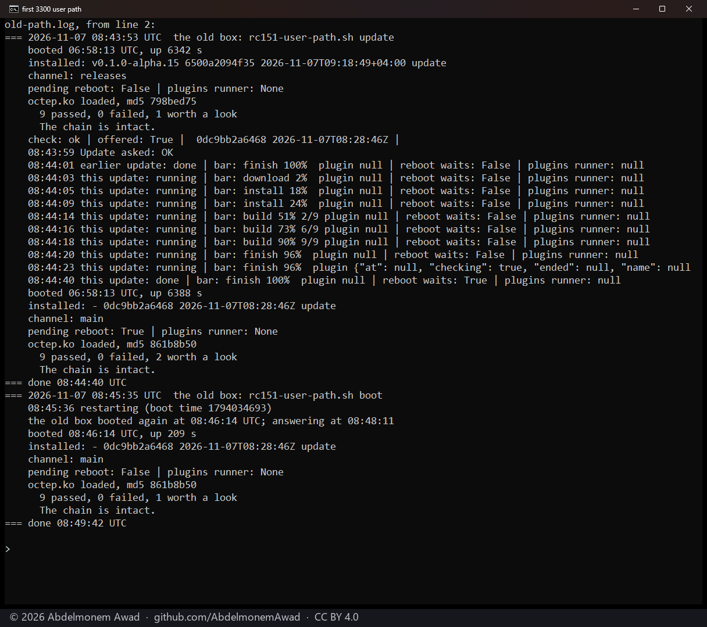
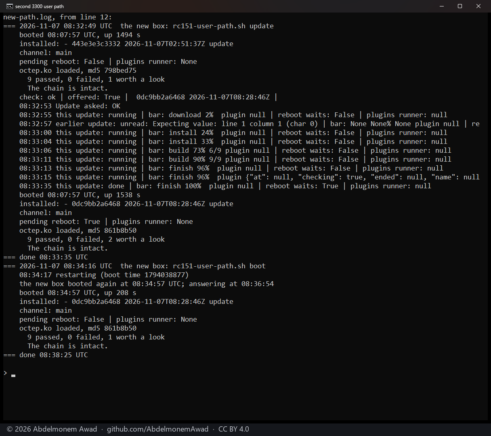
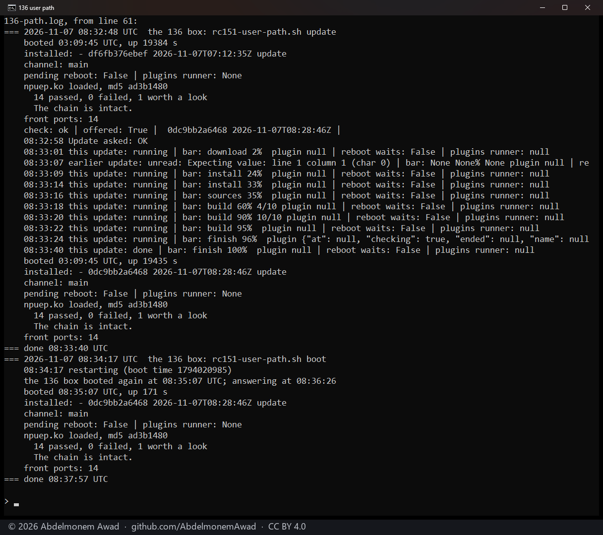
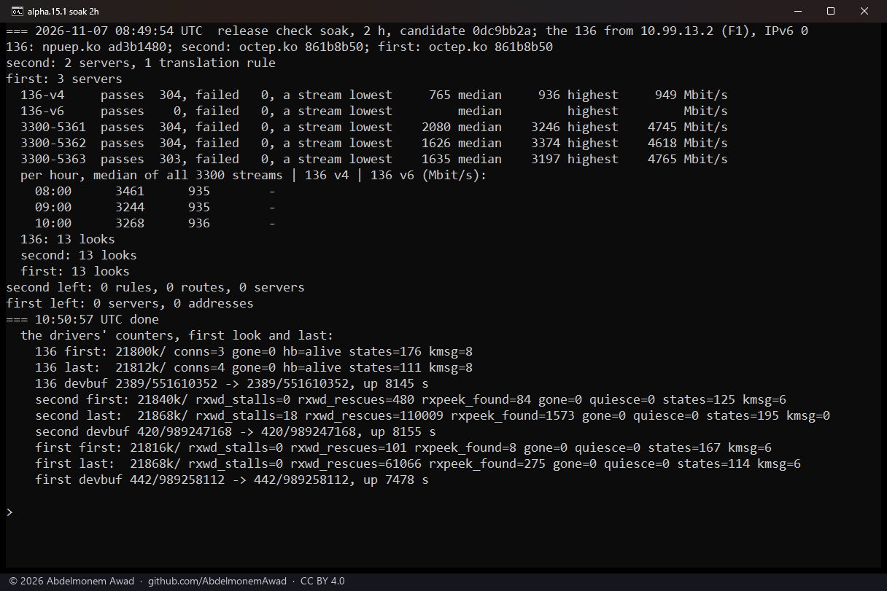
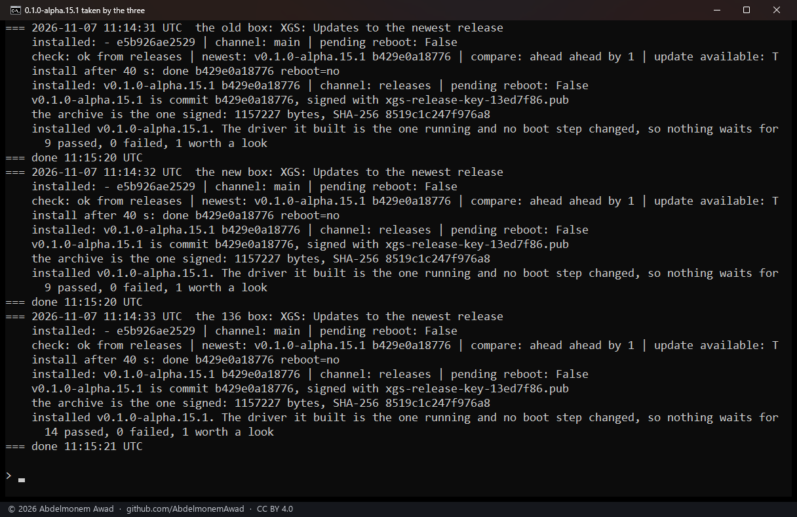

<!-- reviewed: 2026-11-07 -->
# The check before 0.1.0-alpha.15.1, 2026-11-07

What 0.1.0-alpha.15 left - U18, U19 and U20 of the userland review, [issue 890](https://github.com/AbdelmonemAwad/os-xgs-npu/issues/890)'s
thermal sensors, and the ARMADA's module stamp - and what the release check found on the way, checked on the lab's
three appliances before [0.1.0-alpha.15.1](https://github.com/AbdelmonemAwad/os-xgs-npu/releases/tag/v0.1.0-alpha.15.1)
was made: the first XGS 3300 (vendor version 23), the second XGS 3300 (vendor version 22) and the XGS 136 (vendor
version 21), each on OPNsense 26.7 (FreeBSD 15.1). The candidate was main at `0dc9bb2a`, then `e5b926ae` once the third
review's fixes were in. Times are UTC.

## What it found

Three reviews of the code, none of them finding anything of high severity. Each finding was checked against the code
before it was taken, then fixed or shown not to hold; they are K12 to K32 in the userland review's register,
[issue 1072](https://github.com/AbdelmonemAwad/os-xgs-npu/issues/1072), which stands at 168 of its 173 findings fixed.

| review | found | state |
|---|---|---|
| the update path, alpha.15 to the candidate | 10 (K12 to K21) | fixed in [1134](https://github.com/AbdelmonemAwad/os-xgs-npu/pull/1134); K13 did not hold (alpha.15 was published before the next release's commit); K16 is alpha.15's own page - the notes say to reload it; K20 did not hold (below) |
| the hooks and drivers, the same diff | 6 (K22 to K27; K22 reproduced) | fixed in [1135](https://github.com/AbdelmonemAwad/os-xgs-npu/pull/1135) |
| found by the check itself | K28 (writing the fixes), K29 (writing its report) | fixed in 1134 and [1136](https://github.com/AbdelmonemAwad/os-xgs-npu/pull/1136) |
| a third review, of 1134 and 1135's own code | 3 (K30 to K32), and K20 shown not to hold | fixed in 1136 |

K20 said `install(1)` without `-S` takes the old file away before it copies, so a full disk would leave an appliance
without `update.py`. It did not hold: on FreeBSD 14.3, 15.0 and 15.1 `install(1)` always writes a temporary file and
renames it over the old one ("Temporary files are no longer optional", its manual). It was taken without that manual
read and merged in 1134; its text there is struck, and `-S` stays for what it does - each file flushed to disk.

K29 - the reboot action held only for the plugins' runner, so a page left showing Reboot now from an earlier update let
the restart cut a new update's install - and K30 - a whole configuration restored with its history kept, which OPNsense
saves as "/diag_backup.php made changes", taken for a script's save - were run on the first XGS 3300 before 1136 was
merged: the reboot action asked during an update, through a copy of the controller that cannot reboot, refused with
1136 and would have rebooted without it; the restore's save left the thermal setting with 1136 and set it again without.

## The update as an owner takes it

Each appliance through XGS: Updates - Check, Update, a restart, then `install/verify.sh` - to the candidate `0dc9bb2a`:

| appliance | from | Update | after the restart |
|---|---|---|---|
| first XGS 3300 | v0.1.0-alpha.15, as installed from its signed release | 41 s, the driver rebuilt | 9 passed, 0 failed |
| second XGS 3300 | the alpha.15 tree of the comparison below | 42 s, the driver rebuilt | 9 passed, 0 failed |
| XGS 136 | the candidate before the reviews' fixes | 42 s, nothing waiting for a reboot | 14 passed, 0 failed, 14 front ports |

On each, while the update's plugins were being checked, the bar said so ("checking", K18). On two of them one read of
the status during the install found nothing readable - configd restarting under the installer - and the next, two
seconds later, was whole. Then to `e5b926ae` (1136, which changed no driver and no boot step) the same way: 37 to 48 s
each, and "nothing waits for a reboot" on all three.

## Two hours of traffic on all three

08:49:54 to 10:50:57, on `0dc9bb2a`, nothing else run on the appliances meanwhile. The XGS 136 carried downloads from
the second XGS 3300 to the PC on its LAN; the second XGS 3300 carried three streams at once from the first, translated
and handed to its fast path. Every ten minutes each appliance was looked at:

| path | passes | failed | a stream: lowest / median / highest (Mbit/s) |
|---|---|---|---|
| XGS 136 | 304 | 0 | 765 / 936 / 949 |
| second XGS 3300, stream 1 | 304 | 0 | 2080 / 3246 / 4745 |
| second XGS 3300, stream 2 | 304 | 0 | 1626 / 3374 / 4618 |
| second XGS 3300, stream 3 | 303 | 0 | 1635 / 3197 / 4765 |

- No driver gone and none quiesced, the XGS 136's heartbeat alive at every look, no restart.
- The drivers' kernel memory (`devbuf`) the same at the last look as at the first, on all three.
- `feeder.py` at 21.8 MB, 12 to 52 KB more after two hours.
- The second XGS 3300's receive stalls: 18 (32 in the two hours of the check of 2026-11-05).

The check of 2026-11-05 had 1217 passes and none failed. The feeder's CPU time was not recorded this time: the soak's
own `ps` call asked for two columns in a way FreeBSD read as one; it has been put right.

## 0.1.0-alpha.15 against 0.1.0-alpha.14 on the second XGS 3300

Earlier the same day, a question left by 0.1.0-alpha.15's own check: whether its latency under load had grown.
Alternating runs on the second XGS 3300, about 20 minutes each, three streams from the first XGS 3300:

| run | version | a stream, mean (Mbit/s) | latency under load, median (ms) |
|---|---|---|---|
| A1 | 0.1.0-alpha.14 | 3106 | 0.710 |
| B1 | 0.1.0-alpha.15 | 3110 | 0.855 |
| A2 | 0.1.0-alpha.14 | 3110 | 0.590 |
| B2 | 0.1.0-alpha.15 | 3017 | 1.761 |
| B3 | 0.1.0-alpha.15 | void | void |
| A3 | 0.1.0-alpha.14 | 3043 | 0.917 |
| B4 | 0.1.0-alpha.15 | 2696 | 1.417 |
| A4 | 0.1.0-alpha.14 | 2490 | 1.605 |

B3 is void: the first XGS 3300, the far end of every stream, was restarted twice during it for another test, and B2's
last minute and A2 ran beside installs on it. B4 and A4 ran beside heavy work on the PC that sends the latency probes
and receives the streams; both are down, one of each version, so the drop follows the time, not the version. **No
regression is shown**: the cleanest pair, A1 and B1, before any of that, has throughput alike (3106 and 3110 Mbit/s a
stream), and the latency medians of the two versions overlap. A comparison of the parts one by one was not needed.

## The release

0.1.0-alpha.15.1 was published at 11:13:28 by the owner's signing repository, whose run had started at 11:13:12, on the
draft the release workflow made from the merge of its changelog. At 11:14, each appliance was put back on the releases channel by XGS: Updates' own action and took
it: "signed with xgs-release-key-13ed7f86.pub", "the archive is the one signed: 1157227 bytes", 40 s, nothing waiting
for a reboot; verify.sh 9, 9 and 14 passed, none failed.

## What was not run

- On an appliance: K22 (it needs a boot that hung with a console line open), K25 to K27 (a reload of the XGS 136's
  driver, or its coprocessor gone), and K32's failures of npuforge.org's copy - the tests make each of them.
- The reboot action's fall-back for a status that cannot be read: its process pattern was run on the first XGS 3300,
  the fall-back itself not.
- IPv6 through the XGS 136 in the soak: its only IPv6 path is a port kept out of measurements.
