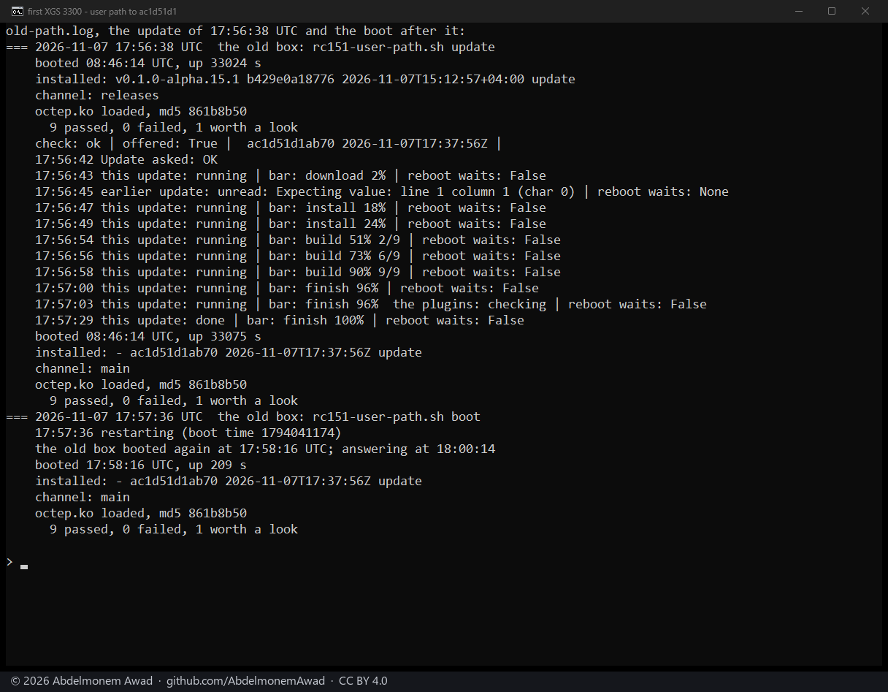
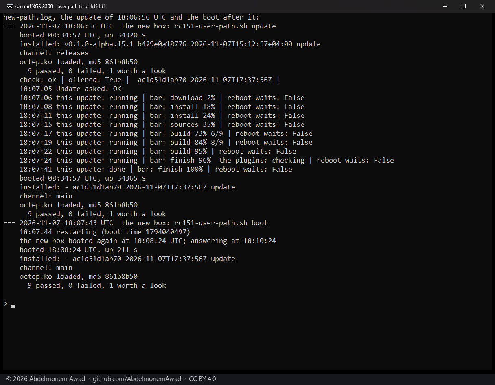
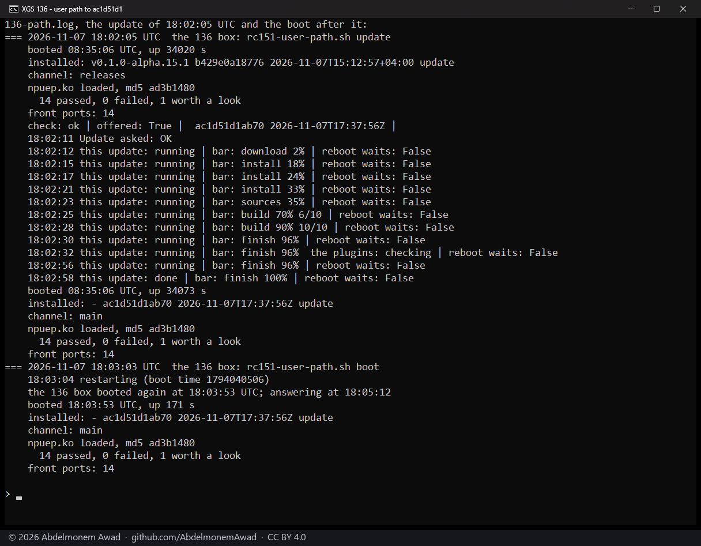
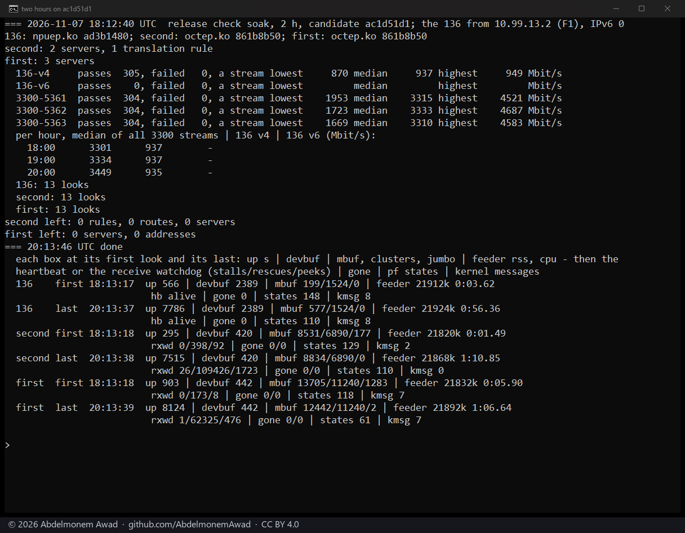
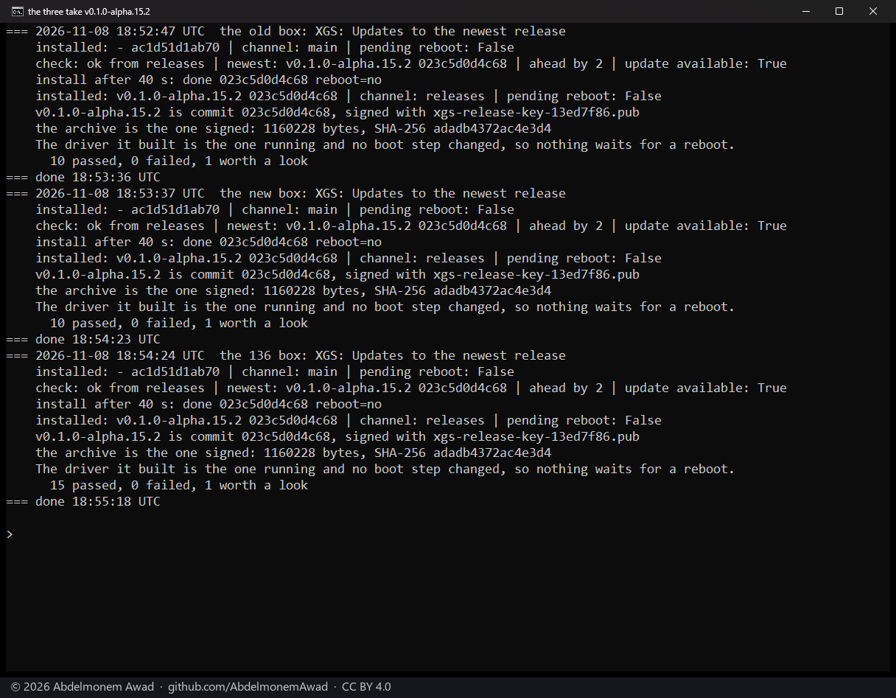

<!-- reviewed: 2026-11-07 -->
# The check before 0.1.0-alpha.15.2, 2026-11-07

What the problem reporter does with a port check on a model the project has not run, and what its Coprocessor
software row says. In [issue 812](https://github.com/AbdelmonemAwad/os-xgs-npu/issues/812) two owners' XGS 126s sent
"they agree" from every boot, forty times between them, and the issue was reopened as if a fix had failed; one of those
coprocessors runs vendor build 20.0.0.222, a version the drivers have no row for. [Pull request 1143](https://github.com/AbdelmonemAwad/os-xgs-npu/pull/1143)
says an agreeing port check once per appliance and table and makes the row say how the driver read the coprocessor's
software; [pull request 1142](https://github.com/AbdelmonemAwad/os-xgs-npu/pull/1142) does the same on the relay's side.
Checked on the lab's three appliances before [0.1.0-alpha.15.2](https://github.com/AbdelmonemAwad/os-xgs-npu/releases/tag/v0.1.0-alpha.15.2)
was made: the first XGS 3300 (vendor version 23), the second XGS 3300 (vendor version 22) and the XGS 136 (vendor
version 21), each on OPNsense 26.7 (FreeBSD 15.1). The candidate was main at `ac1d51d1`. Times are UTC.

## What reaches an appliance

From 0.1.0-alpha.15.1 to `ac1d51d1`, one file an appliance takes: `src/opnsense/scripts/xgs/reporter.py` (74 lines
added, 3 taken away), with its tests.

| pull request | what | reaches an appliance |
|---|---|---|
| [1143](https://github.com/AbdelmonemAwad/os-xgs-npu/pull/1143) | the reporter: an untested model's agreeing port check said once per appliance and table, its state written only once the queue holds the report; the Coprocessor software row says how the driver read the coprocessor's software | yes, `reporter.py` |
| [1142](https://github.com/AbdelmonemAwad/os-xgs-npu/pull/1142) | the relay: an agreeing port check noted once per appliance and binding, never reopening its issue | no, the relay is deployed apart |
| 1138 to 1141 | the site and the measurements pages of 2026-11-07 | no |
| [1144](https://github.com/AbdelmonemAwad/os-xgs-npu/pull/1144) | verify.sh: a coprocessor the driver has taken as gone, or a fast path that stopped answering its heartbeat, fails | yes, `verify.sh`; merged as `e9727368`, after the candidate |

Pull request 1144 came after the check's candidate and is in the release. On 2026-11-08 the first XGS 3300's driver
had taken its coprocessor as gone and the coprocessor's fast path had stopped answering its heartbeat, and verify.sh
still said 9 passed, 0 failed; now either one fails it. It was run on all three appliances before the release, and on
each said "ok    the coprocessor's fast path answers its heartbeat": the second XGS 3300 and the XGS 136 with the
branch's script, 10 and 15 passed, 0 failed; the first XGS 3300 with main's, 10 passed, 0 failed.

## Before the merge

Two reviews of the code. The first, of 1142 and 1143's first versions, found four faults, fixed before the merge: the
two halves contradicting each other, extra front tags, a once-only agreement that could be lost, and a reading claimed
before the driver had placed its numbering. The second, of the merged `reporter.py` from 0.1.0-alpha.15.1 to
`ac1d51d1`, found nothing that would stop a release, and three low findings, each consistent with the design:

- an `untested.json` from before the update has no record of the agreement, so the first agreement after it is sent
  once more;
- an appliance id that fails to read at one look and not at the next sends the agreement once more;
- a collection that fails between the port check and the queue's save repeats the port check at every five-minute look;
  as long as it fails, no report goes out either way.

The reporter's 71 tests passed; the new ones fail on the reporter before 1143. The branch's reporter was then run beside
the installed one on all three appliances, each taken for a model not run here with its own port check: reports made
1, 0, 1, 0, 1 on each, and a look that failed before its queue made the report again at the next boot.

## The update as an owner takes it

Each appliance from v0.1.0-alpha.15.1 through XGS: Updates - Check, Update, a restart - to the candidate `ac1d51d1`:

| appliance | Update | after it | after the restart |
|---|---|---|---|
| first XGS 3300 | 47 s, the driver rebuilt | nothing waits for a reboot; 9 passed, 0 failed | `octep.ko` the same, 9 passed, 0 failed, the chain intact |
| XGS 136 | 47 s | nothing waits for a reboot; 14 passed, 0 failed, 14 front ports | 14 passed, 0 failed, 14 front ports |
| second XGS 3300 | 36 s | nothing waits for a reboot; 9 passed, 0 failed | `octep.ko` the same, 9 passed, 0 failed |

On the first XGS 3300, as at the last check, one read of the status during the install found nothing readable -
configd restarting under the installer - and the next, two seconds later, was whole.

After the restart, the installed reporter's Coprocessor software row on each:

| appliance | the row |
|---|---|
| first XGS 3300 | vendor build 23.0.0.329, fast path 3f430ea4 (PROD), read by the driver as vendor version 23 |
| XGS 136 | vendor build 21.0.0.169, fast path 1cacb7d1 (PROD), read by the driver as vendor version 21 |
| second XGS 3300 | vendor build 22.0.2.546, fast path 51f76d3b (PROD), read by the driver as vendor version 22 |

Its first look after the restart ran on all three, and the page's list of reports answers on each; reporting is manual
there, so nothing was sent.

## Two hours of traffic on all three

18:12:40 to 20:13:46 on 2026-11-07, two hours on `ac1d51d1`. The XGS 136 carried IPv4 downloads; the second XGS 3300 carried three streams at once from the first. Every ten minutes each appliance was looked at:

| path | passes | failed | a stream: lowest / median / highest (Mbit/s) |
|---|---|---|---|
| XGS 136, IPv4 | 305 | 0 | 870 / 937 / 949 |
| second XGS 3300, stream 1 | 304 | 0 | 1953 / 3315 / 4521 |
| second XGS 3300, stream 2 | 304 | 0 | 1723 / 3333 / 4687 |
| second XGS 3300, stream 3 | 304 | 0 | 1669 / 3310 / 4583 |

1217 passes in all, none failed. The median of all the XGS 3300's streams, hour by hour: 3301, 3334 and 3449 Mbit/s;
of the XGS 136's: 937, 937 and 935 Mbit/s.

- No appliance's coprocessor taken as gone, the XGS 136's heartbeat alive.
- The drivers' kernel memory (`devbuf`) flat on all three from the first look to the last: 2389 allocations on the
  XGS 136, 420 on the second XGS 3300, 442 on the first.
- No IPv6 pass ran this time.

## The release

0.1.0-alpha.15.2 was published at 18:52:19 on 2026-11-08, signed and immutable, with three files: the archive,
`release.json` and its signature. Each appliance, from the candidate on channel main, checked the releases channel
("ahead by 2") and took it through XGS: Updates in 40 s: "v0.1.0-alpha.15.2 is commit 023c5d0d4c68, signed with
xgs-release-key-13ed7f86.pub", "the archive is the one signed: 1160228 bytes, SHA-256 adadb4372ac4e3d4", nothing
waiting for a reboot; verify.sh 10, 10 and 15 passed, 0 failed.

## What was not run

- A comparison of performance between versions: no driver, datapath or hook file changed. The reporter runs from cron
  every five minutes and at boot, and its change adds one port check's key and one sentence to a report.
- A coprocessor the driver reads as no version it knows, or before it has placed its numbering: none of the lab's three
  is either. The tests make both and check the row's wording.
- The relay's change: the release does not deploy it; the relay is deployed apart.
