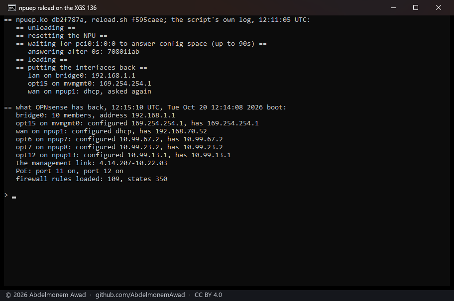
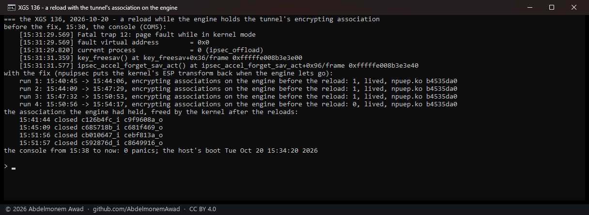

<!-- reviewed: 2026-10-20 -->
<!-- board: a reload puts the interfaces back | XGS 136 | 15 of 16 lived -->
# A reload of the module puts OPNsense's interfaces back, XGS 136, 2026-10-20

A reload of `npuep.ko` destroys every front port's interface and makes it again, and OPNsense is not
told. Until today the XGS 136 came back from one with its LAN bridge empty and without its address,
and the WAN on Port1 without its own - reachable over its console only, until three `configctl` calls
by hand. `contrib/npuep/reload.sh` now does what a boot does once the ports are back:

- the bridges made again with their members (`configctl interface bridge configure`);
- every interface assigned to a front port, a bridge, a VLAN, a LAGG or the management link to the
  coprocessor configured again (`configctl interface reconfigure`, one key at a time), and the rules;
- the coprocessor's own end of the management link set again (`mgmt-link.sh coprocessor`, as the
  bootup hook does) - its reset forgot it;
- the PoE ports the owner switched off switched off again, and the cages' media told again.
- since the same evening, first of all, what a boot applies once the ports are there - the
  coprocessor's acceleration gate, the never-offloaded list, the flow maker and the counts - from the
  boot hook itself (`07-npuep settings`). Without it a reload left the flow maker off whatever
  XGS: Settings said: found when an IPsec soak started after one reported "the flow maker off", and
  stopped; after a reload with it the flow maker, the counts to pf and to the ports read 1, and a
  reboot after the change came up with the same.

Script: `images/deploy/lab-136-reload.sh`, photographed; the series, `lab-136-reload-series.sh`, with
the console listened to beside it.

## Measured

`npuep.ko` md5 `db2f787a`, `reload.sh` md5 `f595caee`:

| | |
|---|---|
| reloads with the put-back | **16** |
| the host lived through them | **15** |
| checked afterwards, each with the bridge's 10 members and its address, the WAN's DHCP address, the three static addresses and the management link back | **7 of 7** |
| a reload, start to the interfaces back | 80 seconds |
| stopped the host | **1** - the watchdog restarted it ([603](https://github.com/AbdelmonemAwad/os-xgs-npu/issues/603)) |



The first reload, before the script configured the management link again, came back with everything
but that: the coprocessor answered a ping and not ssh, until `configctl interface reconfigure` for the
management interface by hand.

## Why one reload stopped the host, and the fix

The same evening a reload stopped the host again, at the same point of the script, and this time its
console (COM5) was listened to. It was a panic, from the kernel's IPsec offload taskqueue:

```
Fatal trap 12: page fault while in kernel mode
fault virtual address = 0x0, current process = 0 (ipsec_offload)
key_freesav() at key_freesav+0x36
ipsec_accel_forget_sav_act() at ipsec_accel_forget_sav_act+0x96
```

followed by the debugger tracing every thread over the 115,200-baud console - long enough for the
watchdog (`watchdogd -t 128`) to restart the host, which is why the first stop showed no message.

`npuipsec_interpose()` gives an association the engine encrypts for a copy of the kernel's ESP
transform, kept in the module's own data, and nothing ever gave it the kernel's back. The kernel takes
the association off a departing interface at the reload, but frees it later - when strongSwan replaces
it - and `key_cleansav` then calls `xf_cleanup` through the unloaded module's memory. So it needs the
engine to hold the tunnel's encrypting association at the moment of the reload; most reloads did not.

The fix gives the kernel's transform back in `npuep_ipsec_sa_deinstall`, which the kernel calls for
every association a departing interface carries before it goes. Measured with it (`npuep.ko`
`b4535da0`), the tunnel's child brought up before each reload and the engine seen to hold its
encrypting association, two minutes after each, the console listened to:

| | |
|---|---|
| reloads with the encrypting association on the engine | **3**, and a fourth without |
| the associations the engine had held, freed by the kernel after the reloads | 4, at 15:41:44, 15:45:09, 15:51:56 and 15:51:57 |
| panics on the console | **0**; the host's boot unchanged |

Before it, the first reload in that state panicked. Script: `images/deploy/lab-136-xform-reload.sh`,
its report `lab-136-xform-report.sh`, photographed.



## What it does not mean

- ~~**One reload in sixteen stopped the host**, with no message and no dump, while the interfaces were
  being configured again and devd ran `rc.linkup` for the same ports; twelve more back to back did
  not. That stays open in [603](https://github.com/AbdelmonemAwad/os-xgs-npu/issues/603).~~ Found and
  fixed the same evening, above: a reload while the engine held the tunnel's encrypting association.
- **Nothing in the product reloads the module.** A boot loads it once; this is the developer's path.
