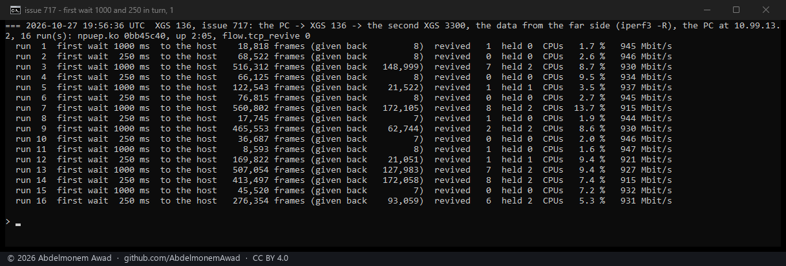
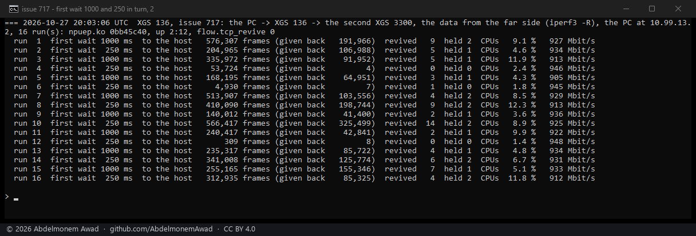
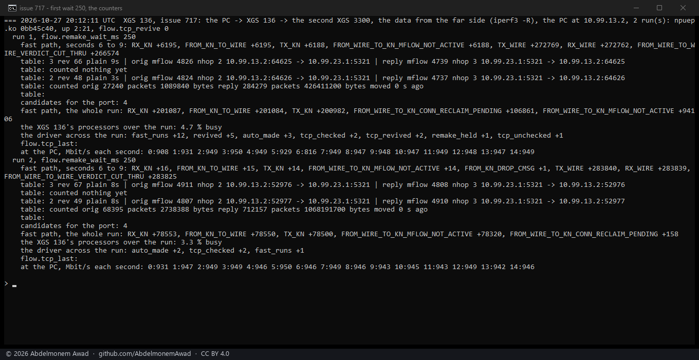

<!-- reviewed: 2026-10-27 -->
# The first wait after a give-back, 1,000 ms against 250 ms on the XGS 136: no clear difference, 2026-10-27

[717](https://github.com/AbdelmonemAwad/os-xgs-npu/issues/717): a stream whose data comes from the far
side still goes through the XGS 136's host for part of some runs. The page before
([revive-after-136-2026-10-27.md](revive-after-136-2026-10-27.md#what-the-runs-show-instead)) found the
heavy runs held: a connection given back soon after it was made stays with the host for a wait, a second
doubling each time. It named a shorter first wait as what to measure next. Measured, 250 ms against
1,000 ms makes no clear difference. The counters show why: most of the frames that reach the host do not
arrive during that wait.

## What was built

npuep.ko `0bb45c40`, built from the branch `npuep-717-remake-wait`, which is not merged. The first wait
comes from a sysctl, `flow.remake_wait_ms` - 1,000 by default, as since 2026-10-19 - so one build
measured both. It was loaded by hand on the XGS 136 (vendor version 21).

## How it was measured

As on the page before (`images/deploy/lab-717c.sh`):

- **The stream:** a 15-second iperf3 stream with the data from the far side - the second XGS 3300,
  behind the XGS 136's Port8, sending.
- **The PC:** on the XGS 136's F1, at 1 Gbit/s.
- **Each run:** its pf states killed first, `flow.remake_wait_ms` set to 1,000 and 250 in turn.
- **The runs:** two sets of 16, then six more at 250 ms that print every counter that moved.

## 1,000 ms and 250 ms in turn

| first wait | runs | frames to the host, mean | median | runs above 300,000 | rate |
|---|---|---|---|---|---|
| 1,000 ms | 16 | 294,405 | 247,791 | 7 | 905 to 947 Mbit/s |
| 250 ms | 16 | 188,747 | 123,319 | 5 | 912 to 948 Mbit/s |

The mean and the median are lower at 250 ms. But under both settings the runs spread over two orders of
magnitude and more - 8,593 to 576,307 frames at 1,000 ms, 309 to 566,417 at 250 ms - so sixteen runs
each do not separate them. Runs with 250 ms sent 413,497 and 566,417 frames to
the host, held twice, and revived the connection 8 and 14 times.

## Where the frames go instead

The six runs at 250 ms that print every counter; the photograph is the last two:

| run | to the host | the connection not active yet | given back | revived | held |
|---|---|---|---|---|---|
| 1 | 248,019 | 205,830 | 42,108 | 2 | 2 |
| 2 | 228,062 | 100,146 | 127,720 | 6 | 1 |
| 3 | 310,450 | 236,549 | 73,822 | 4 | 2 |
| 4 | 119,728 | 98,729 | 20,921 | 1 | 1 |
| 5 | 201,087 | 94,106 | 106,861 | 5 | 1 |
| 6 | 78,553 | 78,320 | 158 | 0 | 0 |
| **all six** | **1,185,899** | **813,680 (69 %)** | **371,590 (31 %)** | | |

The two kinds are the fast path's own counters:

- **Not active yet** is `FROM_WIRE_TO_KN_MFLOW_NOT_ACTIVE`: a frame for a connection the fast path holds,
  but whose microflow is not active.
- **Given back** is `FROM_WIRE_TO_KN_CONN_RECLAIM_PENDING`: a frame for one it has given back.

What the six show:

- **Most of the host's frames came while the connection was not active yet.** That is 69 % of them over
  the six runs.
- **A connection with no give-back still sent about a second of itself.** Run 6 was never given back and
  never revived, and still sent 78,320 frames before its microflow was active - about a second of the
  stream, at the 78,000 frames a second that 930 Mbit/s makes.
- **Others did far better.** Runs in the two sets above sent as few as 309 and 4,930 frames in all, so
  that second is not fixed.
- **The runs with give-backs sent more of the first kind too.** They sent 94,106 to 236,549 frames for
  a connection not active yet, against run 6's 78,320. That reads as each revival also waiting before
  it is active; the counters do not time it.

## What remains

The first wait is not the lever: `flow.remake_wait_ms` stays unmerged, and
[717](https://github.com/AbdelmonemAwad/os-xgs-npu/issues/717) stays open. The next measurement is
per connection: from the moment the driver makes it to the moment its microflow is active. That shows
why it is a second on one run and almost nothing on another, and why the fast path gives the same
connection back several times in a fifteen-second stream.
