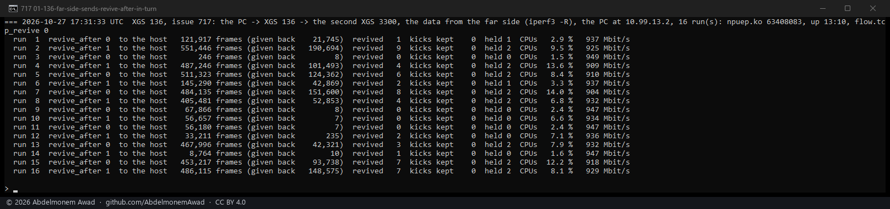
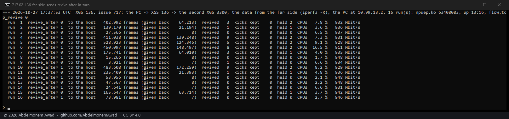

<!-- reviewed: 2026-10-27 -->
# Reviving at the end of a receive pass, on the XGS 136: no difference, 2026-10-27

[717](https://github.com/AbdelmonemAwad/os-xgs-npu/issues/717): a stream whose data comes from the far
side still went through the XGS 136's host for part of some runs. The page of 2026-10-24 named what to try
next ([revive-hold-136-2026-10-24.md](revive-hold-136-2026-10-24.md#what-remains)): reviving a connection
at the end of a receive pass, with few frames in the host's path, since one revived from inside a pass
overtakes the frames still in it. It was built and measured, and it made no difference.

## What was built

npuep.ko `63408083`, built from the branch `npuep-717-revive-after-batch`, which is not merged.
`npuflow_cand_push`, called for every punted frame, no longer kicks the let-go pass itself. It marks the kick
wanted, and `npuflow_rx_done`, called once a pass has handed its frames up, gives it - and only if the pass
left the rings empty. A sysctl, `flow.revive_after`, chose between that (1) and the kick from inside the pass
as before (0), so one build measured both.

## How it was measured

As on 2026-10-24 (`images/deploy/lab-717b.sh`, made from `lab-717.sh`): a 15-second iperf3 stream with
the data from the far side - the second XGS 3300 behind the XGS 136's Port8 sending - with the setting in
turn, each run's pf states killed first, and the XGS 136's fast-path and driver counters read across each
run. One change of bench: the PC's end was on the XGS 136's F1, routed, at 1 Gbit/s. Its
Port3, bridged, which the runs of 2026-10-24 used, now links at 100 Mbit/s. Two sets of 16 runs made over it
first, at 95 Mbit/s, never met a give-back to speak of, and are left out.

## The far side sending, the setting in turn

| `flow.revive_after` | runs | frames to the host, mean | median | runs above 300,000 | revivals | processors, mean | rate, mean |
|---|---|---|---|---|---|---|---|
| 0, the kick from inside the pass | 16 | 234,415 | 175,741 | 6 | 43 | 6.0 % | 933 Mbit/s |
| 1, the kick at the pass's end | 16 | 239,122 | 145,290 | 7 | 56 | 6.6 % | 933 Mbit/s |

No difference. And `kicks kept` was 0 in all 32 runs: every pass that asked for a kick ended with the rings
empty, so the change only moved the kick to the end of passes that were short anyway.

## What the runs show instead

Every run that sent the host 300,000 frames or more had both directions of its connection taken out and
held (`held 2`). Given back under a new identity soon after it was made, a connection is taken out and stays
with the host for a wait, a second doubling each time (`npuflow_letgo`, `NPUFLOW_REMAKE_WAIT_MIN`). At
930 Mbit/s a stream is about 78,000 frames a second, so a wait of one second and then two would account for
the mean above; that is arithmetic, not a measurement of the waits. The rule came in on 2026-10-19 because
making such a connection again at once gave it back again
([xgs136-giveback-2026-10-19.md](xgs136-giveback-2026-10-19.md)). A shorter first wait is what to measure
next. The branch is not merged, and [717](https://github.com/AbdelmonemAwad/os-xgs-npu/issues/717) stays
open.

The shorter first wait was measured the same evening, and made no clear difference:
[remake-wait-136-2026-10-27.md](remake-wait-136-2026-10-27.md).
