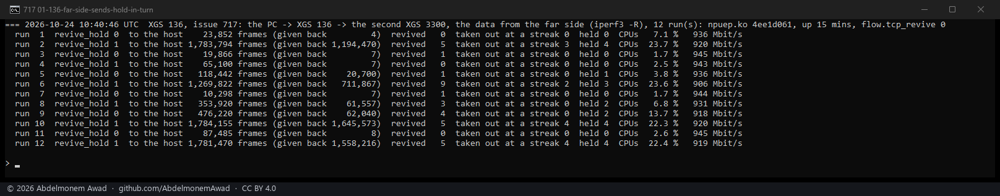
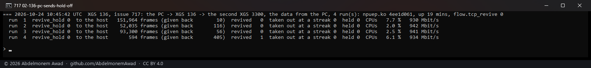

<!-- reviewed: 2026-10-24 -->
# A connection given back is revived every time on the XGS 136, measured, 2026-10-24

Issue [717](https://github.com/AbdelmonemAwad/os-xgs-npu/issues/717): a TCP stream whose data comes
from the far side - the bench PC opens it, the second XGS 3300 behind the XGS 136's Port8 sends - stayed
with the host for most of its length on some runs, every frame `CONN_RECLAIM_PENDING`. The fast path
had given the connection back by its retransmission rule, the driver revived it, and after four
revivals in four seconds took it out and left it with the host for a wait - a second, then two, then
four - which a stream with losses meets again and again. **That rule was the XGS 136's alone.** The
XGS 3300's driver measured the same rule on 2026-10-20, found it no help, and revives every time
([xgs3300-many-2026-10-19.md](xgs3300-many-2026-10-19.md#the-xgs-136s-hold-tried-on-the-xgs-3300-2026-10-20)).
The XGS 136 now does the same: `flow.revive_hold`, 0 by default, revives a connection the fast path
gives back every time; 1 keeps the old rule, as an instrument.

## How it was measured

npuep.ko `4ee1d061`, one build for both settings. A 15-second iperf3 stream between the PC (on the
XGS 136's Port3, its LAN bridge) and the second XGS 3300 (behind Port8), the XGS 136 routing it, at
1,500-byte frames; each run's pf states killed first. Read on the XGS 136 across each run: the frames
its fast path handed to the host (`RX_KN`), of them those of a connection given back
(`CONN_RECLAIM_PENDING`), the driver's revivals and take-outs, and its processors (`kern.cp_time`);
the rate at the PC (`images/deploy/lab-717.sh`, `SUMMARY=1` for one line a run).

## The far side sending, the setting in turn

| `flow.revive_hold` | runs | frames to the host, mean | the processors, mean | runs the host carried nearly all of |
|---|---|---|---|---|
| 0 | 16 | 447,000 | 9.5 % | 3 |
| 1, the rule before | 16 | 931,000 | 14.9 % | 8 |

Thirty-two runs over three sets of the same build, the last twelve photographed. With the rule before,
a run that met it sent the host 1.27 to 1.79 million frames in its 15 seconds - nearly every frame of
the stream - and its processors at 21 to 32 %: the connection taken out at a streak's end two to four
times (`streak_out`) and held each time (`remake_held`). With 0 no connection was taken out at a streak,
and in the photographed set none of the six stayed with the host.

The rate at the PC is 906 to 946 Mbit/s either way: the host carries a gigabit too. What the host
carrying it costs is its processors.

## The PC sending, the setting at 0

In hardware, as the issue saw it this way: 930 to 942 Mbit/s, 594 to 151,964 frames to the host, the
processors 2.0 to 7.7 %.

## What remains

**Three of the sixteen runs at 0 still went mostly through the host** (1.31, 1.39 and 1.77 million
frames), each with 20 to 27 revivals. The cause is the one
[xgs136-giveback-2026-10-19.md](xgs136-giveback-2026-10-19.md#what-remains) names: each time a
connection goes back into hardware, its frames still in the host's path are overtaken, the receiver
answers the reordering with a run of duplicate acknowledgements, and the fast path's rule - ten in a
row, a constant in its firmware - gives the connection back again. On the XGS 136 the host takes its
frames in batches (a receive poll and the doorbells), so more of them are in its path at a revival than
on the XGS 3300. Reviving at the end of a receive batch, with few frames in the host's path, is the
next thing to try; it is not built. [717](https://github.com/AbdelmonemAwad/os-xgs-npu/issues/717)
stays open for it.

## The instruments

- `dev.npuep.0.flow.revive_hold`: 0, the default, revives every time; 1 takes a connection out after
  four revivals in four seconds and holds it, a second doubling to a minute.
- `dev.npuep.0.flow.streak_out`: connections taken out at a streak's end with the setting at 1.
- `flow.revived`, `flow.remake_held`, and the fast path's `CONN_RECLAIM_PENDING`, as before.
