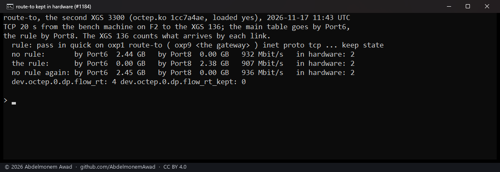
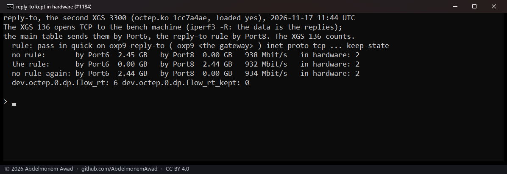

<!-- reviewed: 2026-11-17 -->
<!-- board: route-to in hardware | XGS 3300 | all by the rule's gateway -->
# A connection a rule sends by a gateway, kept on that gateway in hardware. Measured, 2026-11-17

A firewall rule can send a connection to a gateway of its own - OPNsense's Gateway on a pass rule, pf's
route-to; and on a rule where connections come in, reply-to sends their replies back the way they
came. Until this, a connection kept to its rule's gateway only while the host had it: once in
hardware, both drivers took its next hop from the main routing table. Measured on the second XGS 3300
the same morning, before the fix: 11 MB by the rule's gateway, then 2.36 GB by the main route
([#1182](https://github.com/AbdelmonemAwad/os-xgs-npu/issues/1182)).

Now each driver reads the gateway pf keeps in the connection's states - route-to for the direction
from the opener, reply-to for the replies - and that direction's next hop is the rule's gateway. A
connection whose rule cannot be followed (a dup-to, a gateway of the other address family, a bridged
or tunnelled connection a rule sends by a gateway) stays with the host. `dp.flow_rt` counts the
connections made with a rule's gateway, `dp.flow_rt_kept` those left to the host for it.

## How it was measured

On the second XGS 3300 (OPNsense 26.7.9), the driver of this change built on the appliance and loaded
by a reboot (octep.ko 1cc7a4ae; main's put back after by another). The XGS 136 counts, on its own
host, what arrives on each of its two links to the 3300: from Port6, the main table's way, and from
Port8, the rule's gateway's. Each run is 20 s of TCP, in hardware.

- **route-to**: the bench machine on F2 sends to an address of the XGS 136 that the main table
  reaches by Port6; a rule on F2 sends it by the gateway out of Port8.
- **reply-to**: the XGS 136 opens the connection to the bench machine through Port8, and the data is
  its replies (iperf3 -R); the main table sends them by Port6, a reply-to rule on Port8 back by Port8.
- Each without the rule, with it, and without it again.

## What came of it

| | by Port6 (main route) | by Port8 (the rule's gateway) | rate | in hardware |
|---|---|---|---|---|
| route-to: no rule | 2.44 GB | 0 | 932 Mbit/s | yes |
| route-to: the rule | 0 | 2.38 GB | 907 Mbit/s | yes |
| route-to: no rule again | 2.45 GB | 0 | 936 Mbit/s | yes |
| reply-to: no rule | 2.45 GB | 0 | 938 Mbit/s | yes |
| reply-to: the rule | 0 | 2.44 GB | 932 Mbit/s | yes |
| reply-to: no rule again | 2.44 GB | 0 | 934 Mbit/s | yes |

`dp.flow_rt` counted every connection made with a rule's gateway (two a run: iperf3's control and
data); `dp.flow_rt_kept` stayed 0.

## Not measured

- The XGS 136's driver, which has the same change, built and loaded on it: nothing in the lab
  forwards a connection through that unit.
- IPv6, and the cases kept with the host (dup-to, af-to, a bridged or tunnelled connection with a
  gateway): OPNsense's rule page offers neither dup-to nor af-to.
