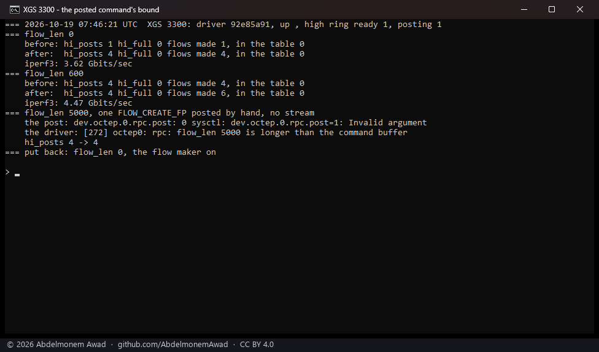

<!-- reviewed: 2026-10-19 -->
# A posted command stays in its slot, measured, 2026-10-19

Both drivers post some commands to the coprocessor without waiting for the answer: on the high RPC
ring, each into a slot of its own. A review found that neither driver kept such a command inside its
slot ([#524](https://github.com/AbdelmonemAwad/os-xgs-npu/issues/524)):

- **npuep (XGS 136)** cleared 64 bytes past the payload. Its check let a payload fill the 4,096-byte
  slot to the last byte, so the clear could reach the next slot or, after the last, past the region.
  It now stops at the slot's end.
- **octep (XGS 3300)** copied a posted request into a 512-byte slot without looking at its length.
  Every request the driver builds fits, but `rpc.flow_len` - a sysctl for finding the length the
  coprocessor's FLOW_CREATE_FP handler wants, by hand - sets that length to anything: past 504 the copy
  ran over the next slot, and past 4,088 the coprocessor was told to read beyond the command buffer.
  Now a request longer than a slot goes on the low ring instead, and a `flow_len` past the buffer is
  refused.

Neither was reached by the drivers' own commands. Both were measured on the appliances after a
reboot onto the fixed drivers.

## XGS 3300

`octep.ko` 398,936 bytes, md5 `92e85a91`. One stream of 8 seconds from the bench PC on F1 through the
appliance to the bench VM behind F2, with the flow maker on, with `flow_len` 0 and then 600; and then,
with no stream, one FLOW_CREATE_FP posted by hand with `flow_len` 5000
(`images/deploy/lab-3300-post-bound.sh`, photographed):

| `flow_len` | posted on the high ring | flows made | the driver |
|---|---|---|---|
| 0, the driver's own length | 3 | 3 | - |
| 600, longer than a slot | 0 | 2, on the low ring | - |
| 5000, longer than the command buffer, by hand | 0 | - | `rpc: flow_len 5000 is longer than the command buffer`; the post answered `Invalid argument` |

After the run the coprocessor had refused none of the driver's writes (`rpc.refused` 0), and
`flow_len`, the flow maker, `rpc.cmd` and `rpc.allow_write` were as before.

## XGS 136

`npuep.ko` 238,560 bytes, md5 `19dbfd58` - a build that also keeps the last unknown-tag frame
([xgs136-counts-2026-10-19.md](xgs136-counts-2026-10-19.md)). Through two streams of 24 seconds in
hardware from the bench PC on Port3 to the second XGS 3300 behind Port8, the high ring took the flows'
commands as before: 3 posted in each, none refused for a full ring and none sent on the low ring
instead (`dev.npuep.0.rpc_channel.hi_commands`, `hi_full`, `hi_fallback`). Every command npuep posts
is far shorter than a slot, so the bound itself cannot be reached from outside the driver; what was
measured is that the posted path still works with it.
