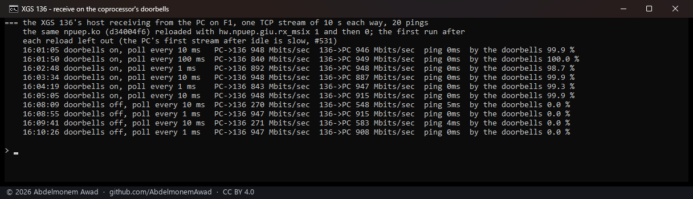
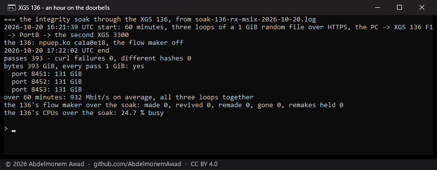
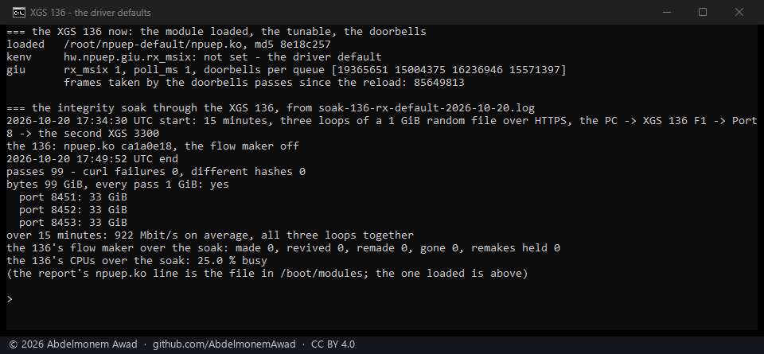

<!-- reviewed: 2026-10-20 -->
<!-- board: receive on the doorbells | XGS 136 | 948 Mbit/s at 10 ms -->
# The XGS 136's receive rings on the coprocessor's doorbells, 2026-10-20

Until today the XGS 136's host emptied its receive rings on a clock: every millisecond since
[2026-10-17](../findings/a-hundred-polls-a-second-on-the-armada.md), and only then. The coprocessor has
four target-to-host doorbells for the GIU - MSI-X vectors the driver allocated and counted - and they
never rang, because every receive queue was added with `msix_id` 0. The vendor's own host driver runs
its receive on them by default (`msix_mode` 1, "Rx"), giving queue *q* the facility's doorbell *q*,
whose id is that vector's place in the order the vectors are allocated in.

`contrib/npuep/npugiu.c` now does the same ~~when the loader tunable `hw.npuep.giu.rx_msix` is 1~~ - by
default since [an hour with it on](#an-hour-with-the-doorbells-on), unless the loader tunable
`hw.npuep.giu.rx_msix` is 0 or **Receive on the coprocessor's doorbells** is off on XGS: Settings: each
receive queue is added on its doorbell, and a doorbell schedules one pass over the rings on a task of
its own, its frames handed up as the poll's are. The poll stays underneath at whatever
`dev.npuep.0.giu.poll_ms` says. New counts: `giu.rx_msix`, `giu.rx_irqs` (per queue),
`giu.rx_task_runs`, `giu.rx_task_frames`.

## Measured

The same module, `npuep.ko` `d34004f6`, reloaded once with the tunable at 1 and once at 0, so the one
thing that changed is the doorbells. One TCP stream of 10 s from the PC's adapter on F1 into the 136's
own host and one back, then twenty pings, at poll intervals of 1, 10 and 100 ms. The first run after
each reload is left out: the PC's first stream after it has been idle is slow, as
[531](https://github.com/AbdelmonemAwad/os-xgs-npu/issues/531) found.

| | the PC to the 136's host | the 136's host to the PC | ping | frames the doorbells' passes took |
|---|---|---|---|---|
| doorbells off, poll every 1 ms | 947, 947 Mbit/s | 915, 908 | 0 ms | - |
| doorbells off, poll every 10 ms | **270, 271 Mbit/s** | 548, 583 | **5, 4 ms** | - |
| doorbells on, poll every 1 ms | 892, 843 Mbit/s | 948, 947 | 0 ms | 98.7, 99.3 % |
| doorbells on, poll every 10 ms | **948, 948, 948 Mbit/s** | 946, 887, 915 | **0 ms** | 99.9 % |
| doorbells on, poll every 100 ms | 840 Mbit/s | 949 | 0 ms | 100.0 % |

So the doorbells carry the receive: with them nearly every frame is taken by their passes, and the rate
and the ping no longer depend on the clock - at a poll ten times slower the stream ran at the gigabit
link's rate, where the poll alone fell to a quarter of it and the ping to five milliseconds. At a
1 ms poll both ways reach the link.

Script: `images/deploy/lab-136-rx-msix.sh`, its report `lab-136-rx-msix-report.sh`, photographed.

## An hour with the doorbells on

The integrity soak of [2026-10-19](xgs136-soak-2026-10-19.md), run again with the doorbells on: a
1 GiB file of random bytes served over HTTPS by the second XGS 3300, downloaded from the PC through
the 136 - in at F1, out of Port8 - in three loops at once, every pass checked by curl's TLS and by the
file's SHA-256 against the server's. The 136's flow maker was off, so every frame crossed the host's
receive rings, the thing under test, instead of being forwarded by the coprocessor; the poll was at
10 ms, so the doorbells carried the receive. `npuep.ko` `ca1a0e18`, the tunable at 1.

| | |
|---|---|
| from, to | 16:21:39 to 17:22:02 UTC |
| passes | 393, 131 GiB on each loop - none failed, none differed |
| rate | 932 Mbit/s on average, the three loops together |
| the 136's CPUs | 24.7 % busy |

The 136 was up an hour and fifty minutes when it ended, since its last boot. So the doorbells
became the default: `npuep.ko` `8e18c257` has the tunable at 1 when nothing is set, and the
settings page has **Receive on the coprocessor's doorbells**, on, to turn them off (a loader tunable,
so at the next boot).

## The defaults, fifteen minutes

That module loaded on the 136 by `contrib/npuep/reload.sh` with no tunable set - `giu.rx_msix` 1, the
poll at its 1 ms, the doorbells' counters moving - and the same soak for fifteen minutes, the flow
maker off again so the frames crossed the host. The soak's report names the file in `/boot/modules`,
still `ca1a0e18`; the module loaded, `8e18c257`, is the photograph's first lines, read after it:

| | |
|---|---|
| from, to | 17:34:30 to 17:49:52 UTC |
| passes | 99, 99 GiB - none failed, none differed |
| rate | 922 Mbit/s on average, the three loops together |
| the 136's CPUs | 25.0 % busy |

Script: `images/deploy/lab-136-soak.sh`, run with `LOG` naming each log, photographed with its report;
the second photograph by `images/deploy/lab-136-rx-default-report.sh`, the module read first.

## What it does not mean

- ~~**It is off by default.** A loader tunable, chosen before the queues are added; no soak has run with
  it on yet, and that comes before it is anyone's default.~~ **It is on by default** since the hour
  above; still a loader tunable, chosen before the queues are added, so turning it off takes a reboot.
- **One stream, to the host.** Forwarded traffic in hardware never reaches these rings; what reaches
  them is the host's own and what the host forwards.
- **The poll is still there**, under the doorbells, as the net; at 1 ms it competes with them and the
  stream into the host was a little slower than at 10.
