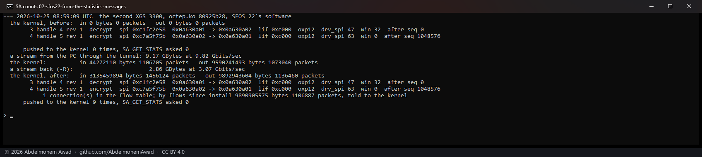

<!-- reviewed: 2026-10-25 -->
# An offloaded tunnel's counts, from the connections' statistics messages, 2026-10-25

[761](https://github.com/AbdelmonemAwad/os-xgs-npu/issues/761): the XGS 3300's driver took what a
tunnel's connections in hardware carried - packets the host never sees - from the engine with
`SA_GET_STATS`, and handed it to the kernel's association, whose byte lifetime and rekey run on it.
Vendor version 23's coprocessor software answers that command with 0 bytes and 0 packets for an association that
has carried millions (vendor version 21 on the XGS 136 does the same; the ARMADA driver never used it). Since
octep.ko `80925b28` the driver takes those counts from the coprocessor's statistics messages instead,
which bring every connection's counts once a second, unasked, on all three versions: each direction's
growth is added to the association its microflow names (`octep_ipsec_flow_count`), and the once-a-second
poll hands the totals to the kernel with no command at all. `SA_GET_STATS` is read once only, at an
install, where it is also the test that the coprocessor answers.

Measured on the lab tunnel between the two XGS 3300s, whose selectors are the second board's LAN and
the first board's own address - so the second board forwards the tunnel's traffic in hardware and the
first only ends it (`images/deploy/lab-sa-counts.sh`, `lab-sa-counts-series.ps1`). `ipsec.flows` is 1:
a connection's encrypting direction goes into hardware, the decrypted direction stays with the host,
which counts it itself.

## Vendor version 22, before: from SA_GET_STATS

## Vendor version 22, after: from the statistics messages

| octep.ko | source | stream | by flows, told to the kernel | bytes a packet | `SA_GET_STATS` asked |
|---|---|---|---|---|---|
| `6cde3fde` (main) | `SA_GET_STATS` | 758 MBytes | 798,999,634 bytes, 89,394 packets | 8,938 | 22 |
| `80925b28` | statistics messages | 9.17 GBytes | 9,890,905,575 bytes, 1,106,887 packets | 8,936 | 0 |

The two sources count the same thing - the frames the flow table forwarded, the stream's segments at
MTU 9,000 and their headers - to within two bytes a packet; the new one asks the coprocessor nothing.
The kernel's figure read straight after the stream is a second behind (9,590,241,493 bytes): the last
message comes after it, and the reading after the second stream has caught up. The first stream ran at
794 Mbit/s and the second at 9.82 Gbit/s; why the first was slow was not looked into - both boards
were rebooted between the two, for the new module.

## Vendor version 23: the tunnel it ends, and its statistics messages

The first board forwards nothing into this tunnel, so its flow table never carries the tunnel and the
change has nothing to count there. What the change needs on vendor version 23 is that the statistics messages
count connections in hardware at all, and they do: `dp.hw_counted` went from 163 to 325 across a
20-second stream through the board (the flow test of [vendor version 23's flow offload](sfos-versions-2026-10-25.md)).
A tunnel forwarded in hardware by a board on vendor version 23 is not measured: the lab's tunnel gives that
board no network of its own behind it.

**What the picture also shows, and this change does not touch:** the 1.36 GBytes the first board
sent back went out through the engine and are in no count the kernel keeps - `out 0 bytes 0
packets`. A packet the appliance itself sends into an offloaded tunnel takes the kernel's own offload
path, which tags it for the driver and counts it only in a separate software counter; the
association's lifetime counts what the driver reports, and neither driver reports those - its own
issue, on both families: [774](https://github.com/AbdelmonemAwad/os-xgs-npu/issues/774).
