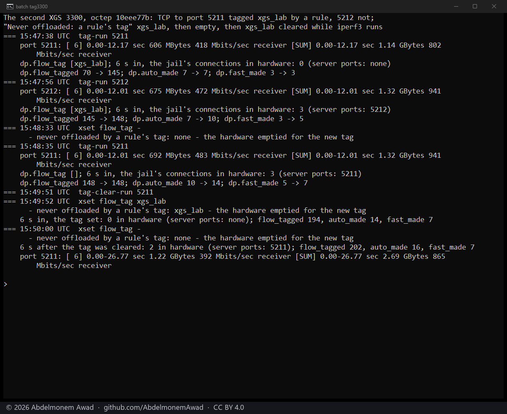
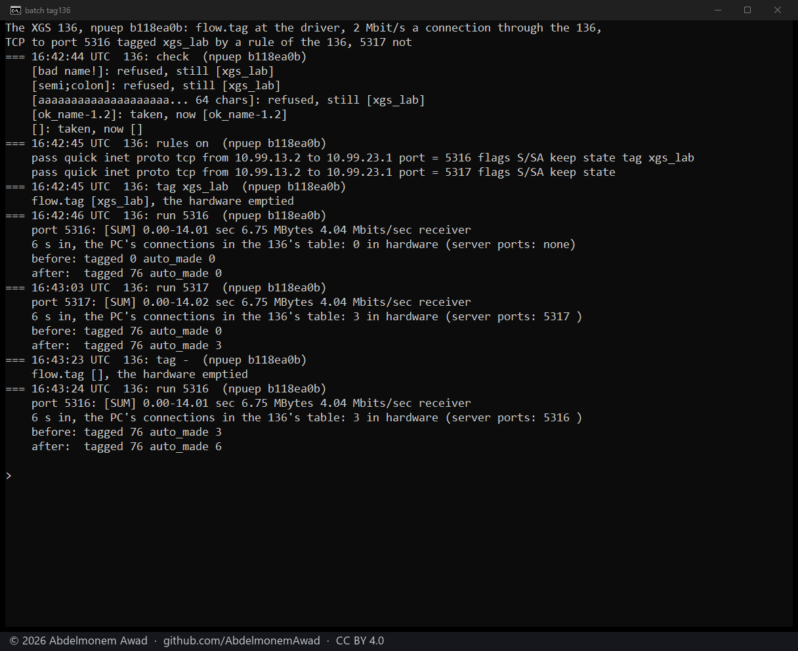
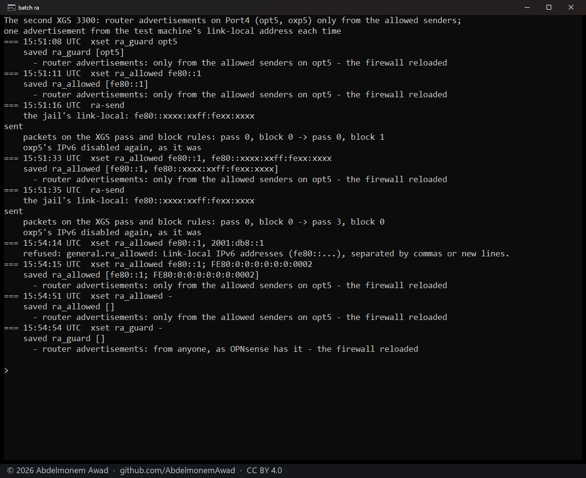
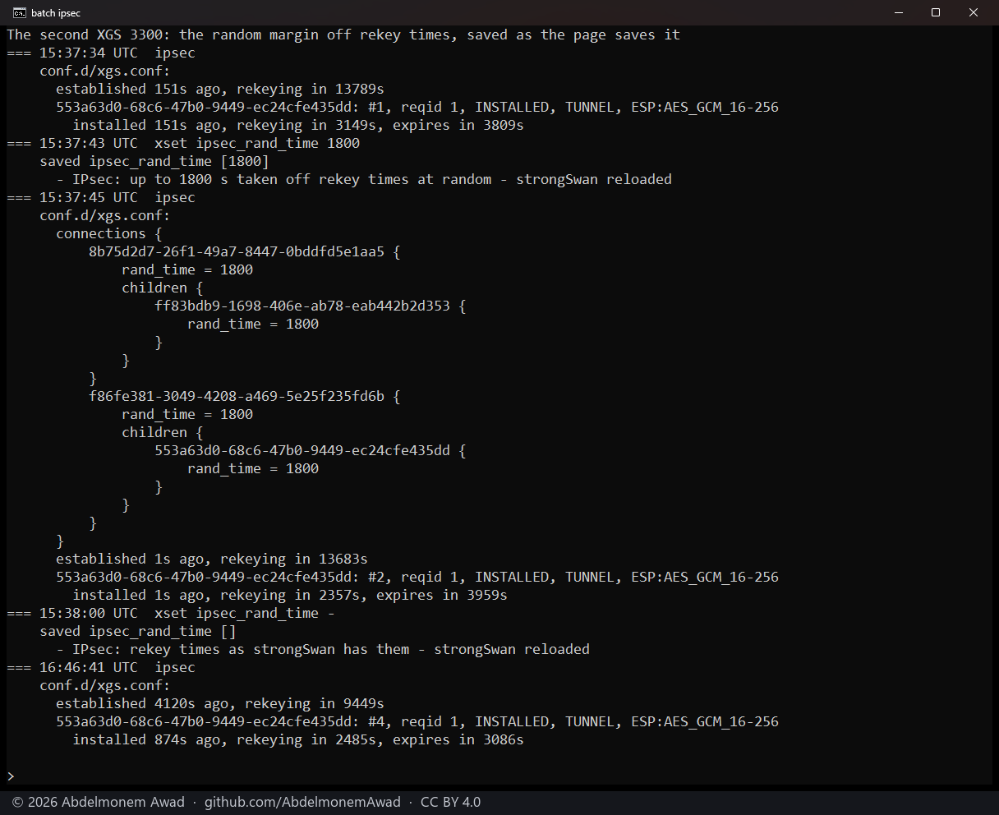
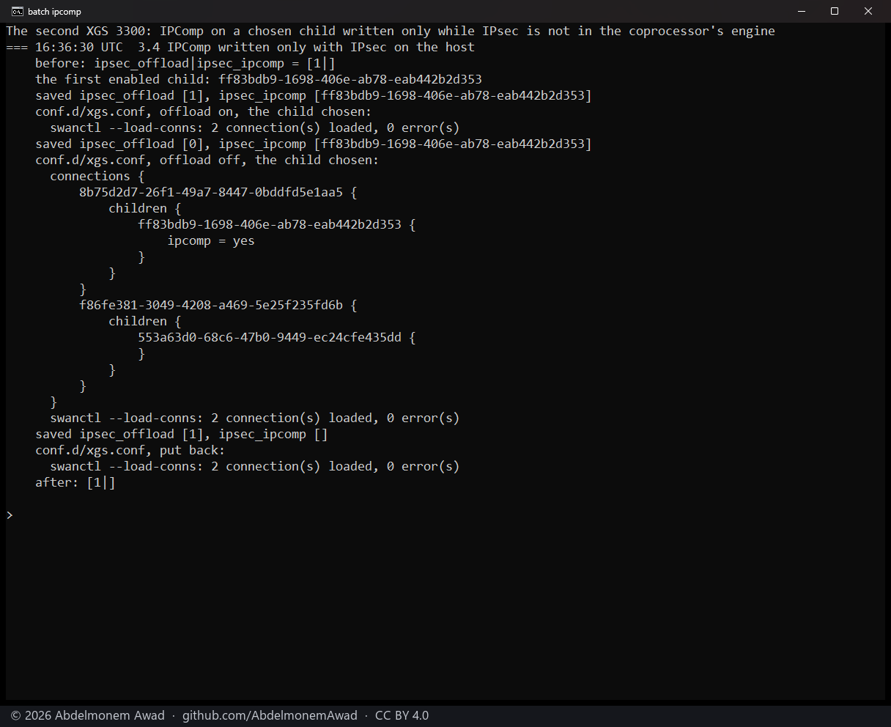
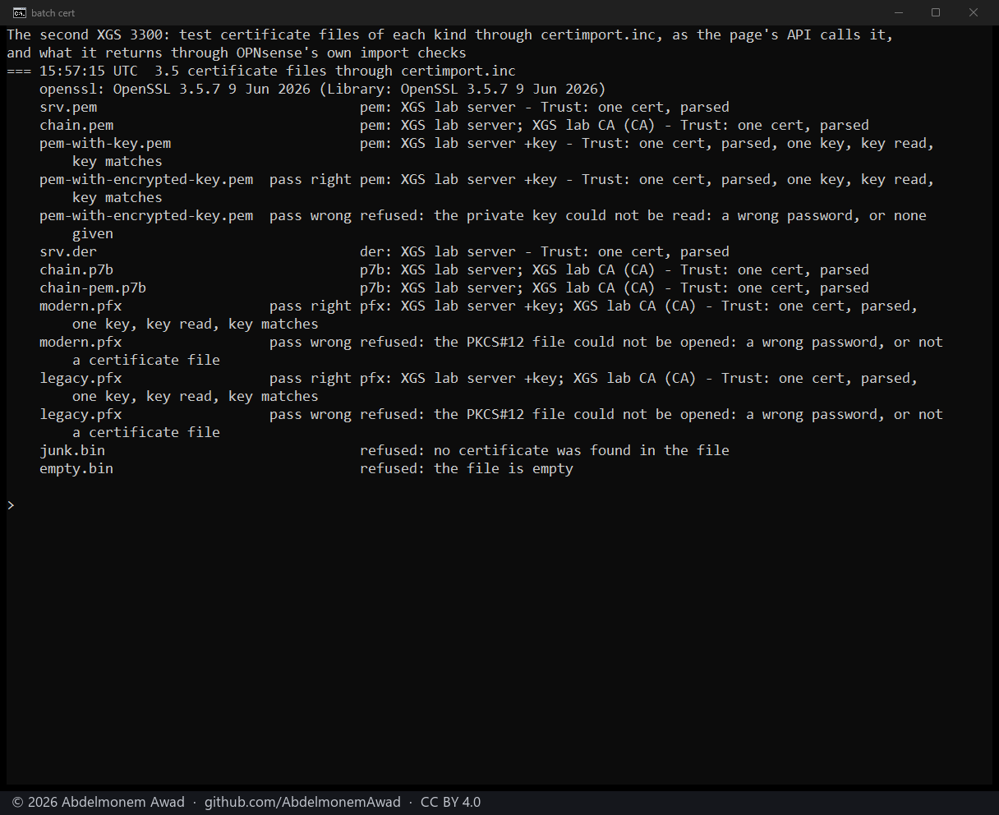
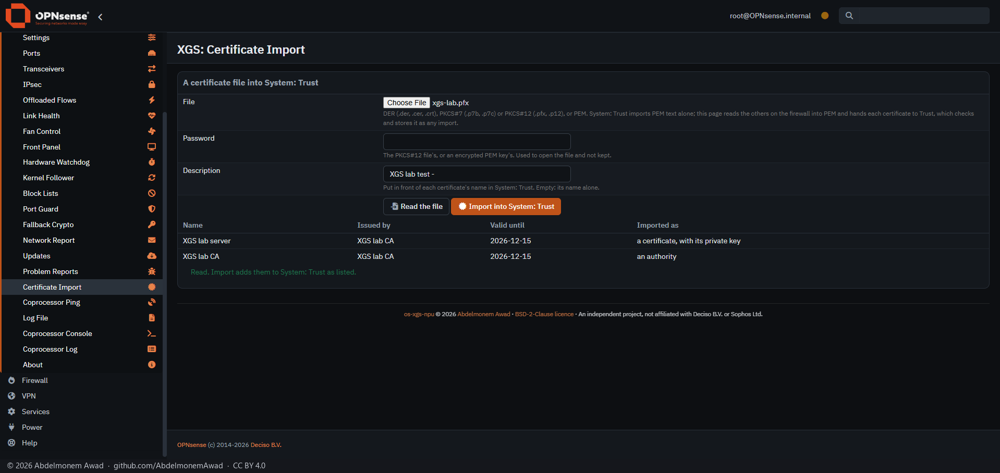
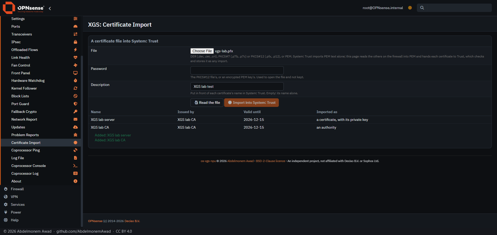
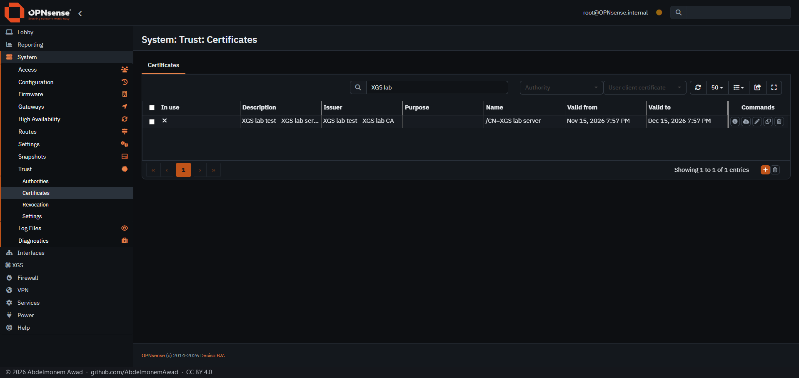
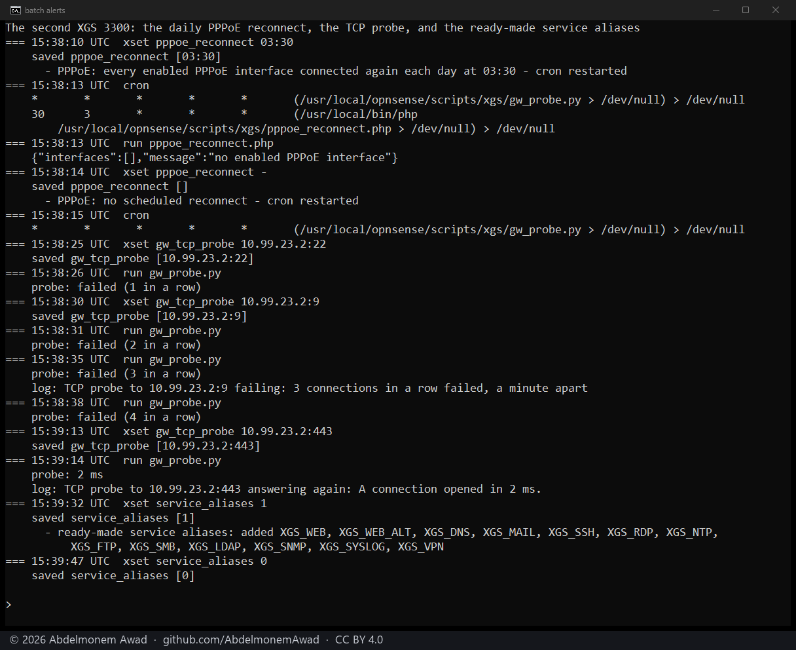

<!-- reviewed: 2026-11-15 -->
# A rule's tag kept out of hardware, router advertisements from listed senders only, a certificate import page and five more additions, each run as a save runs it, 2026-11-15

Plan 01's packages 3.2 to 3.9 add eight things to XGS: Settings and one page. Each was run on the second XGS 3300
as a save on the page runs it - the field written through the model and saved, then `scripts/xgs/apply.php`, the
script behind Apply - and what it did was read back on the appliance; the driver part of 3.2 was run on the XGS 136
as well.

| Package | Where | What it does |
|---|---|---|
| 3.2 | XGS: Settings, Acceleration: **Never offloaded: a rule's tag** | a connection any of whose pf states carries the tag a firewall rule set ("Set local tag") is never put in hardware - `dp.flow_tag` on the XGS 3300, `flow.tag` on the XGS 136 |
| 3.3 | Security: **Router advertisements only from allowed senders, on** and **Allowed router advertisement senders** | on the interfaces chosen, IPv6 router advertisements pass from the listed link-local addresses and are blocked, and logged, from any other |
| 3.4 | IPsec: **Random margin off rekey times** and **Compress what these tunnels carry (IPComp)** | written to `/usr/local/etc/swanctl/conf.d/xgs.conf`, which OPNsense's own `swanctl.conf` includes |
| 3.5 | XGS: **Certificate Import** | a DER, PKCS#7 or PKCS#12 file read into PEM on the firewall and handed to System: Trust's own import |
| 3.6 | Security: **Ready-made service aliases** | thirteen port aliases, XGS_WEB to XGS_VPN, added to Firewall: Aliases |
| 3.7 | Hardware: **PPPoE: reconnect every day at** | a daily job that connects each enabled PPPoE interface again, as Interfaces does when it is applied |
| 3.8 | Hardware: **Gateway jitter alert** and **TCP probe** | alerts through os-netreport and the system log; OPNsense's own gateway monitoring keeps every decision |
| 3.9 | System: Access, the privileges | five "Read only: ..." privileges, each reaching a page and the requests it reads with, none it saves with |

## How it was tested

2026-11-15, 15:37 to 16:53 UTC.

- **The second XGS 3300** (vendor version 22) with the batch's octep.ko (`10eee77b`) installed and its files in
  place. Each setting written through the model and saved, then `apply.php` run, its steps printed, and the
  appliance read: the driver's counters, the firewall's rules and their counters, strongSwan's view, the cron table,
  Firewall: Aliases, the privileges OPNsense lists.
- **Traffic for 3.2**: a routed path through the XGS 3300 - the test machine's jail on Port4 to its other adapter on
  Port3 - with a rule of the lab's own anchor tagging TCP to port 5211 `xgs_lab` and passing 5212 untagged; iperf3,
  two TCP streams and its control connection, for 12 or 26 seconds. The jail's connections in the coprocessor's
  table were read 6 seconds into each run with `flows.py`, the Offloaded Flows page's own script.
- **The XGS 136** (vendor version 21): the batch's npuep.ko (`b118ea0b`) loaded by its reload script. Its installed
  files are from 2026-11-08, so `flow.tag` was written at the driver as `scripts/xgs/flow_exclude.php` writes it -
  the tag, then `flow.fw_rev_bump` - and a light stream, 2 Mbit/s a connection, went from a PC on its F1 port
  through it to the second XGS 3300, a rule of the 136 tagging TCP to port 5316 and not 5317. The module it ran
  before was loaded again after.
- **3.3**: one router advertisement at a time, sent by the jail from its link-local address to `ff02::1` on Port4,
  and the packet counters of the two rules the setting adds.
- **3.5**: test files of each kind made on the firewall with its OpenSSL 3.5.7 - a lab authority and a server
  certificate it signs - read by the converter as the page's API calls it; then the page itself in a browser, with a
  PKCS#12 file that has no password.

## Results

### 3.2 A rule's tag

| The XGS 3300 | In hardware 6 s in | `dp.flow_tagged` | `dp.auto_made` | Received |
|---|---|---|---|---|
| port 5211 (tagged), the setting `xgs_lab` | 0 | 70 → 145 | 7 → 7 | 802 Mbit/s |
| port 5212 (not tagged), the setting `xgs_lab` | 3 | 145 → 148 | 7 → 10 | 941 Mbit/s |
| port 5211 (tagged), the setting empty | 3 | 148 → 148 | 10 → 14 | 941 Mbit/s |
| port 5211 (tagged), `xgs_lab` cleared 8 s into a 26 s run | 0 before the save, 2 six seconds after | 194 → 202 | 14 → 16 | 865 Mbit/s |

| The XGS 136 | In hardware 6 s in | `flow.tagged` | `flow.auto_made` | Received |
|---|---|---|---|---|
| port 5316 (tagged), `flow.tag` `xgs_lab` | 0 | 0 → 76 | 0 → 0 | 4.04 Mbit/s |
| port 5317 (not tagged), `flow.tag` `xgs_lab` | 3 | 76 → 76 | 0 → 3 | 4.04 Mbit/s |
| port 5316 (tagged), `flow.tag` empty | 3 | 76 → 76 | 3 → 6 | 4.04 Mbit/s |

- **A tagged connection stayed with the firewall** on both appliances: none of the run's three connections was in
  hardware, and the maker, which tries again as a connection carries frames, was refused 75 times in 12 seconds on
  the XGS 3300 and 76 in 14 on the XGS 136. The untagged port's connections went in, and so did the tagged port's
  with the setting empty.
- **Cleared while they ran**, two of the run's three connections were in hardware six seconds after the save.
- **The three refusals counted while port 5212 ran** were of states carrying the tag - only such a state is refused,
  and port 5212's were not tagged: the 5211 run's, as they closed.
- **The rate**: 802 Mbit/s with every frame of the tagged run through the host, 941 Mbit/s - the link - in hardware.
- **Names**: the driver of the XGS 136 refused `bad name!`, `semi;colon` and a name of 64 characters, and took
  `ok_name-1.2` and the empty name; the field takes letters, digits, `_`, `-` and `.`, up to 63.
- **What a save says** when the tag is cleared was reworded after these runs: "the hardware emptied; the
  connections the old tag kept with the host go to it as they carry traffic", what the cleared run measured.

### 3.3 Router advertisements from the listed senders only

- **The rules**, as `pfctl` listed them at 15:51 with Port4 guarded and `fe80::1` listed: a pass of router
  advertisements from `fe80::1` on `oxp5`, then a block that logs any other, both `quick` and both ahead of
  OPNsense's own rules for router advertisements.
- **From a sender not listed** - the jail's link-local address - the block rule counted the advertisement (0 → 1)
  and the pass rule nothing. **Listed**, the pass rule counted 3 packets and the block rule none.
- **The field** refused `fe80::1, 2001:db8::1` when it was saved, with its message; `fe80::1;
  FE80:0:0:0:0:0:0:0002` was saved, and the rules named `fe80::1` and `fe80::2`. Emptied and the interface taken
  off, the firewall was reloaded and no rule of the setting was left.

### 3.4 IPsec: the rekey margin and IPComp

- **The margin**: at 1800, `xgs.conf` named both of the appliance's connections and their children with `rand_time
  = 1800`, strongSwan was reloaded, and the child it installed again a second later was to rekey in 2357 s. Without
  the setting the margin is strongSwan's own, the gap between a child's life (3960 s here) and its rekey time (3600
  s), so a rekey falls between 3240 and 3600 s: the child before was to rekey at 3300 s, and one installed after
  the setting was emptied at 3359 s.
- **IPComp** on a chosen child: with IPsec in the coprocessor's engine nothing was written; with the engine off
  `ipcomp = yes` was written on that child alone, and strongSwan loaded both connections with no error. Both
  settings were put back after.

### 3.5 Certificate Import

- **Fourteen files**: a certificate in PEM, a chain in PEM, PEM with its key and with its key encrypted (right
  and wrong password), DER, a chain in PKCS#7 as DER and as PEM, PKCS#12 with today's encryption and with the older
  RC2 and 3DES (right and wrong password each), random bytes and an empty file. Each was read as its kind, or
  refused with the reason the page shows; the first certificate of each passed OPNsense's own import checks, and a
  key matched its certificate.
- **The older PKCS#12**: OPNsense 26.7's `openssl.cnf` loads OpenSSL's legacy provider, so PHP opened it itself. The
  converter's other way, through the `openssl` command, was called by itself on the same file: its two certificates
  and its key, nothing for a wrong password, and no temporary folder left.
- **The page**, in a browser on the appliance: the file read, its server certificate listed "a certificate, with its
  private key" and its authority "an authority"; Import added both to System: Trust, which listed the certificate
  with the authority as its issuer. Both were taken away after. Import now stays off after an import until a file is
  read again: before, a second press added the same certificates twice.

### 3.6, 3.7 and 3.8: aliases, the PPPoE reconnect, the gateway alerts

- **Ready-made service aliases**: turned on, the save added thirteen port aliases - XGS_WEB 80 and 443, XGS_WEB_ALT
  8080 and 8443, XGS_DNS 53 and 853, XGS_MAIL 25, 110, 143, 465, 587, 993 and 995, XGS_SSH 22, XGS_RDP 3389,
  XGS_NTP 123, XGS_FTP 20 and 21, XGS_SMB 139 and 445, XGS_LDAP 389 and 636, XGS_SNMP 161 and 162, XGS_SYSLOG 514
  and 6514, XGS_VPN 500, 4500, 1194 and 51820. A second save found all there and changed none; turned off, none was
  taken away. They were taken away by hand after.
- **PPPoE**: at 03:30 the cron table got a line for 03:30 each day, and lost it when the field was emptied. Run by
  hand, the script found no enabled PPPoE interface, which the lab appliance has none of.
- **TCP probe**: three failures in a row raised the alert - in the system log "TCP probe to ... failing: 3
  connections in a row failed, a minute apart" and a file for os-netreport - the fourth none, and the first success
  "answering again: A connection opened in 2 ms." The runs were by hand, seconds apart; the cron job runs it each
  minute. A failure counted toward the next target's alert when the target changed: the count now starts again
  with a new target, measured after the change (a target's second failure, then another target saved - "failed (1
  in a row)").
- **Jitter**: read from OPNsense's own `gateway_status.php`, which on the lab appliance monitors no gateway - "0
  monitored, 0 over". The alert itself, once over and once back under, is checked by `tools/test-gw-probe.py`, not
  on an appliance.

### 3.9 The read-only privileges

OPNsense listed the five, each named "Read only: " and the page it reaches. `tools/test-readonly-acl.py` matches
each against the requests its page makes on OPNsense 26.7, with OPNsense's own way of matching a request to a
privilege, ported - compared with OPNsense's PHP on the appliance on eight addresses, which agreed: each reaches its
page's reads and none of its writes.

### What these figures do not mean

- **A user holding only the read-only privileges** was not made, so no page was opened as one.
- **A tunnel compressing**: whether IPComp is used is the far end's to agree; that the setting is written and loaded
  was measured, not a compressed tunnel.
- **A real PPPoE redial**, and **a jitter alert from a monitored gateway**: the lab appliance has no PPPoE interface
  and monitors no gateway.
- **The XGS 136's setting through its page**: its installed files are older than the batch, so its driver was
  driven as the batch's script drives it.
- **A rekey at the moment**: the times are strongSwan's schedule as it showed them, not rekeys watched.

The pictures show the runs as their logs have them (`lab-batch-3300.sh`, `lba-cert.sh`, `lba-ipcomp.sh`,
`lab-tag-136.sh`), not runs done again for the camera; a link-local address made from a MAC address is masked,
and lines the logs repeat - the steps of a save that name the other settings - are left out.
