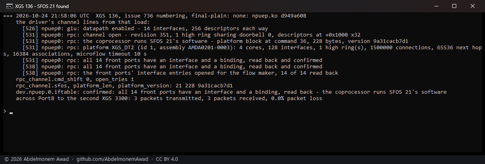
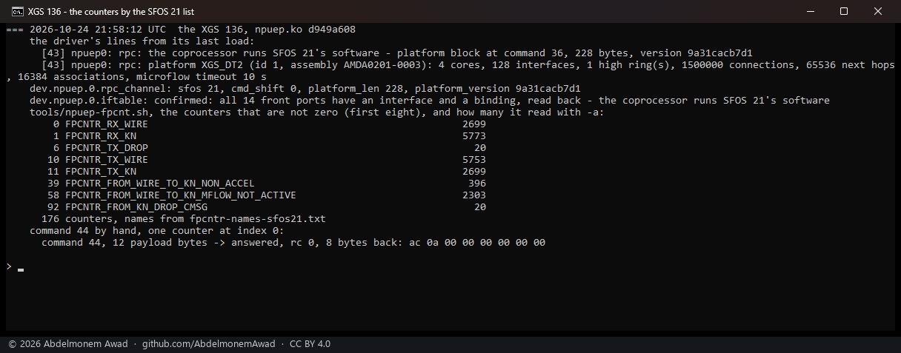
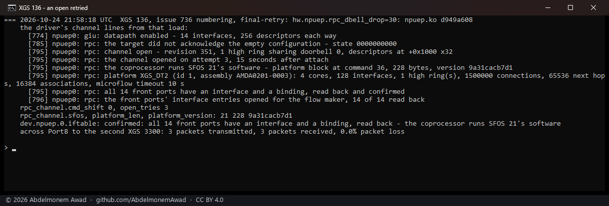
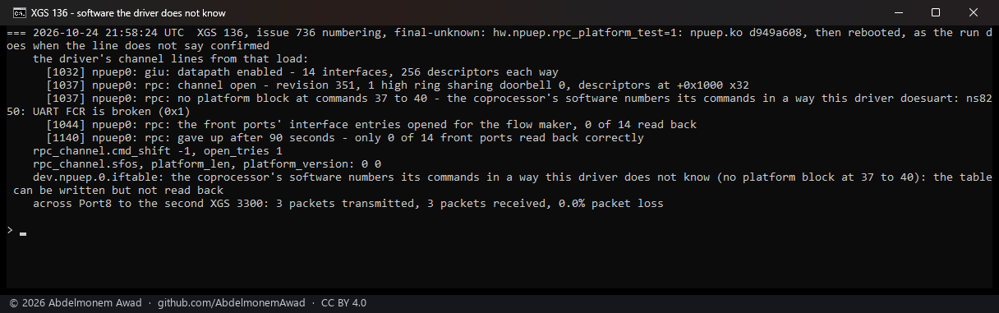
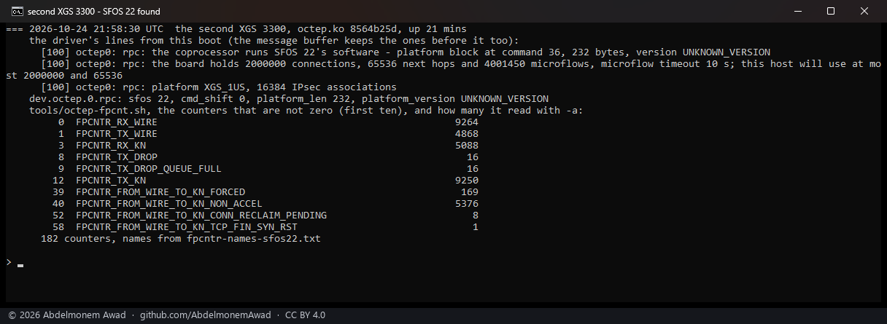

<!-- reviewed: 2026-10-25 -->
# The coprocessor's SFOS version found by the drivers, 2026-10-25

[rpc-numbering.md](../families/rpc-numbering.md) says how the two drivers tell which SFOS left its
software on a board's coprocessor - SFOS 23 numbers the control channel's commands from 36 on one
higher than 21 and 22 do (issue #736) - and what they do with the answer. This is that, run on the two
boards here whose coprocessors speak a numbering this project already knew: the XGS 136, whose
coprocessor runs SFOS 21's software, and the second XGS 3300, which runs SFOS 22's. No board running
OPNsense here speaks SFOS 23's yet; that run is the next one.

The modules: npuep.ko `d949a608` and octep.ko `8564b25d`, both built from this change against the
appliances' own kernel (OPNsense 26.7, `abbbe67a45e7`). Each run on the XGS 136 is a reload of the
driver - the coprocessor reset and the module loaded at once (`contrib/npuep/reload.sh`) - with the
loader setting under test given for that one load with `kenv`, and read 150 seconds later. The XGS
3300 was rebooted onto its module.

## The XGS 136: SFOS 21's software, found

- The platform block answered at **36, 228 bytes, version `9a31cacb7d1`** - the three things that
  make SFOS 21 - and the driver said so: `rpc_channel.sfos` 21, `cmd_shift` 0.
- **All fourteen front ports confirmed**, read back entry for entry at command 37 - the read the
  shift is checked by - and the line `dev.npuep.0.iftable` prints names the version.
- Across Port8 to the second XGS 3300, three pings out of three.

`tools/npuep-fpcnt.sh`, with no list named, took `fpcntr-names-sfos21.txt` from the driver's `sfos`
and read all 176. Command 44 sent by hand went as 44 - on this numbering the drivers' and the
coprocessor's are the same, so the report carries no "sent as".

## The XGS 136: an open the target did not acknowledge, retried

The same load with `hw.npuep.rpc_dbell_drop=30`: the first thirty configuration doorbells are not
rung, which is how a doorbell lost in the target's listening gap (#736's second cause) is made to
happen on a board where it does not.

- The first open was **not acknowledged** - the line the driver says once - and the channel
  **opened on attempt 3, fifteen seconds after attach**: the doorbell rung again every half second
  while waiting, the open retried every second.
- Then everything as above: SFOS 21's software, fourteen ports confirmed, three pings out of three.

## The XGS 136: software the driver does not know

The same load with `hw.npuep.rpc_platform_test=1`: the search for the platform block starts at 37,
and on SFOS 21's numbering nothing from 37 to 40 is a block - which is what software numbered in a
way this driver does not know looks like from here.

- **No platform block at 37 to 40**, `cmd_shift` -1, `sfos` 0, and the reason line says so: the
  table can be written but not read back. No command from 36 on was sent from then on - the
  read-back included - so the ports' entries were never confirmed, and the run rebooted the
  appliance, as it does when the line does not say confirmed.
- **The ports carried traffic all the same**: three pings out of three across Port8, because
  everything that sets a port up is below 36. This is the path a version not yet seen takes.

## The second XGS 3300: SFOS 22's software, found

Rebooted onto octep.ko `8564b25d`; the lines are this boot's, and the counters were read with the
tools from this change.

- The platform block answered at **36, 232 bytes, `UNKNOWN_VERSION`** - SFOS 22's - and the driver
  said so: `rpc.sfos` 22, `cmd_shift` 0.
- `num_mflows` **4,001,450**, read from offset 224 because the block is 232 bytes long - the same
  figure [octep.h](../../contrib/octep/octep.h) records against what the vendor's own tool printed under
  SFOS 22.
- `tools/octep-fpcnt.sh` took `fpcntr-names-sfos22.txt` from the driver's `sfos` and read all 182.

## What it does not say

- **Nothing here ran on SFOS 23.** The numbering it moves to was read from SFOS 23 EAP 1's own host
  module, and the counters' names for it are derived (rpc-numbering.md); the first board running
  OPNsense with SFOS 23's software on its coprocessor is the measurement that settles both.
- The OCTEON TX driver's unknown-software path was not run: on the second XGS 3300 the PC reaches the
  board only through one of its own front ports, and that run is one where the ports' tables are
  not read back. It is the same decision the ARMADA driver's run above shows, from the same table.
