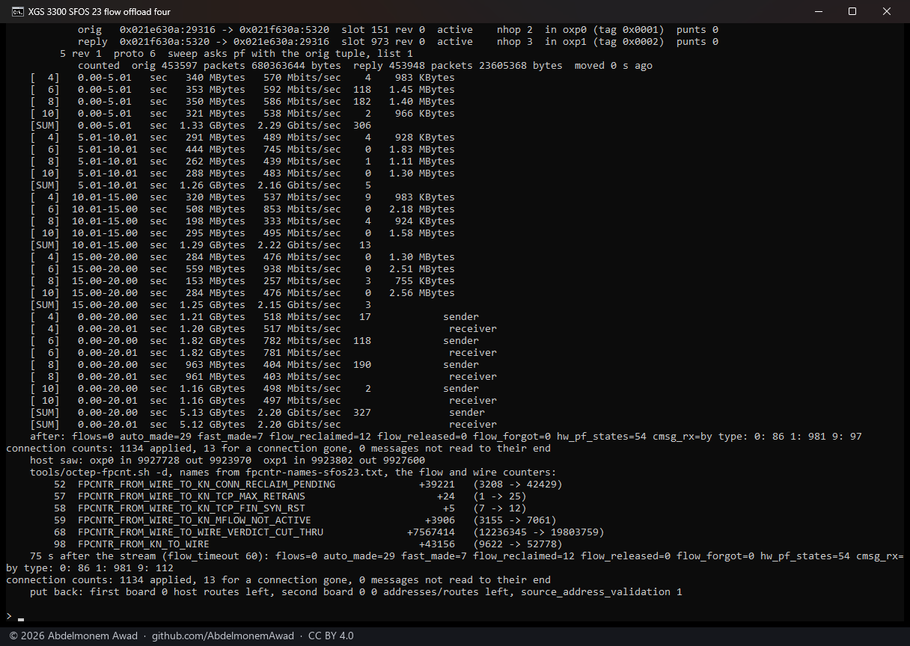

<!-- reviewed: 2026-10-25 -->
# The coprocessor's vendor version found by the drivers, 2026-10-25

[rpc-numbering.md](../families/rpc-numbering.md) says how the two drivers tell which vendor version left its
software on a board's coprocessor - vendor version 23 numbers the control channel's commands from 36 on one
higher than 21 and 22 do (issue #736) - and what they do with the answer. This is that, run on the two
boards here whose coprocessors speak a numbering this project already knew: the XGS 136, whose
coprocessor runs vendor version 21, and the second XGS 3300, which runs vendor version 22. ~~No board running
OPNsense here speaks vendor version 23 yet; that run is the next one.~~ And the same evening on the first XGS
3300, whose coprocessor runs vendor version 23 EAP 1 - [below](#the-first-xgs-3300-vendor-version-23-found) -
and its hardware flow offload over that software, [after it](#the-first-xgs-3300-flow-offload-over-vendor-version-23).

The modules: npuep.ko `d949a608` and octep.ko `8564b25d`, both built from this change against the
appliances' own kernel (OPNsense 26.7, `abbbe67a45e7`). Each run on the XGS 136 is a reload of the
driver - the coprocessor reset and the module loaded at once (`contrib/npuep/reload.sh`) - with the
loader setting under test given for that one load with `kenv`, and read 150 seconds later. The XGS
3300 was rebooted onto its module.

## The XGS 136: vendor version 21, found

- The platform block answered at **36, 228 bytes, version `9a31cacb7d1`** - the three things that
  make vendor version 21 - and the driver said so: `rpc_channel.sfos` 21, `cmd_shift` 0.
- **All fourteen front ports confirmed**, read back entry for entry at command 37 - the read the
  shift is checked by - and the line `dev.npuep.0.iftable` prints names the version.
- Across Port8 to the second XGS 3300, three pings out of three.

`tools/npuep-fpcnt.sh`, with no list named, took `fpcntr-names-sfos21.txt` from the driver's `sfos`
and read all 176. Command 44 sent by hand went as 44 - on this numbering the drivers' and the
coprocessor's are the same, so the report carries no "sent as".

## The XGS 136: an open the target did not acknowledge, retried

The same load with `hw.npuep.rpc_dbell_drop=30`: the first thirty configuration doorbells are not
rung, which is how a doorbell lost in the target's listening gap (#736's second cause) is made to
happen on a board where it does not.

- The first open was **not acknowledged** - the line the driver says once - and the channel
  **opened on attempt 3, fifteen seconds after attach**: the doorbell rung again every half second
  while waiting, the open retried every second.
- Then everything as above: vendor version 21, fourteen ports confirmed, three pings out of three.

## The XGS 136: software the driver does not know

The same load with `hw.npuep.rpc_platform_test=1`: the search for the platform block starts at 37,
and on vendor version 21's numbering nothing from 37 to 40 is a block - which is what software numbered in a
way this driver does not know looks like from here.

- **No platform block at 37 to 40**, `cmd_shift` -1, `sfos` 0, and the reason line says so: the
  table can be written but not read back. No command from 36 on was sent from then on - the
  read-back included - so the ports' entries were never confirmed, and the run rebooted the
  appliance, as it does when the line does not say confirmed.
- **The ports carried traffic all the same**: three pings out of three across Port8, because
  everything that sets a port up is below 36. This is the path a version not yet seen takes.

## The second XGS 3300: vendor version 22, found

Rebooted onto octep.ko `8564b25d`; the lines are this boot's, and the counters were read with the
tools from this change.

- The platform block answered at **36, 232 bytes, `UNKNOWN_VERSION`** - vendor version 22 - and the driver
  said so: `rpc.sfos` 22, `cmd_shift` 0.
- `num_mflows` **4,001,450**, read from offset 224 because the block is 232 bytes long - the same
  figure [octep.h](../../contrib/octep/octep.h) records against what the vendor's own tool printed under
  Vendor version 22.
- `tools/octep-fpcnt.sh` took `fpcntr-names-sfos22.txt` from the driver's `sfos` and read all 182.

## The first XGS 3300: vendor version 23, found

Vendor version 23 EAP 1 was installed on this appliance on 2026-10-24 to learn what that version changed, which
left its software on the coprocessor; OPNsense went back on from
[the ready image of v0.1.0-alpha.7.1](https://github.com/AbdelmonemAwad/xgs-image-builder/releases/tag/images-v0.1.0-alpha.7.1),
with the appliance's configuration restored from its backup of 2026-10-24. octep.ko `62e2f6b3` is the
module that image built at its first boot, from this release's source.

- The platform block answered at **37, 232 bytes, `UNKNOWN_VERSION`** - vendor version 23 - and the driver
  said so: `rpc.sfos` 23, `cmd_shift` 1, every command from 36 on sent one higher. The second
  configuration after it, the high ring the block asks for, was taken in 25 ms, and the board's two
  links to the second XGS 3300, F1 and F2, answered three pings out of three each.
- **The vendor version 23 counter list, derived rather than read, holds where it could be checked.** Its first
  inserted counter moves every name after index 90 one place, and the counters' own sums agree with
  the moved names: frames from the host, `RX_KN` at 3, are the ones sent on to the wire,
  `FROM_KN_TO_WIRE` at 98 - which equals `TX_WIRE` - plus the control messages, `FROM_KN_PROC_CMSG`
  at 95 (2,362 = 2,337 + 25); frames from the wire, `RX_WIRE`, are the three handed to the host at 39,
  40 and 59 (1,314 = 12 + 317 + 985), each the same as `TX_KN`. On vendor version 22's list 95 would read
  `FROM_KN_DROP_NO_METADATA` and 98 `FROM_KN_TO_IPSEC_ENCR`. From 112 on, after the second inserted counter,
  nothing moved during the run, so those names are still the derivation's.
- The channel's first configuration was acknowledged on the seventh attempt, after six of three
  seconds each went unanswered - the target listening late, which the driver already waits out.
  Whether vendor version 22 does the same on this board was not looked at.

## The first XGS 3300: flow offload over vendor version 23

The same board, the same night, after the owner updated it to OPNsense 26.7.7 (PHP 8.5.12) and
turned its XGS settings on - hardware offload with its flows made automatically among them; it was
rebooted between the second run below and the third to apply them. octep.ko `8564b25d` is the module
rebuilt at that update, from the same source, for the kernel the second XGS 3300 runs, and the same
bytes as that board's.
A TCP stream went through it from F1 (`oxp0`) to F2 (`oxp1`) and its replies back, both ends on the second
XGS 3300: for each run that board took two addresses of its own, one for the client and one for the
server, and a second routing table that sends each to the other through the first board, over its
own two links to it; the first board took a host route to each. Its check that
drops a packet arriving from one of its own addresses (`net.inet.ip.source_address_validation`) was
off for the run, and everything went back when it ended. Read on the first board: the driver's flow
count and its flow table ten seconds in, the fast path's counters by `tools/octep-fpcnt.sh` with the
Vendor version 23 list, its two ports' counters, and the flows again 75 seconds after the stream - the flow
timeout is 60.

Every run, photographed or not:

| Run (UTC) | Streams | Rate | Retransmits | Flows, 10 s in | Cut through (68) | Also |
|---|---|---|---|---|---|---|
| 23:14 | 1 | - | - | 0 | 0 | nothing crossed: the second board dropped each end's packets as its own, the check above still on |
| 23:20 | 1 | 1.01 Gbit/s | 76 | 2 | 3,507,640 | before the reboot that applied the settings; 1,161 frames dropped by `FROM_WIRE_DROP_TCP_SEQ_CHK_INVALID` (30), 6,315 handed to the host by `CONN_RECLAIM_PENDING` (52) |
| 23:25 | 1 | 1.25 Gbit/s | 0 | 2 | 4,300,301 | after it |
| 23:28 | 1 | 1.26 Gbit/s | 0 | 2 | 4,379,422 | |
| 23:30 | 1 | 1.03 Gbit/s | 1 | 2 | 3,556,621 | the first picture |
| 23:32 | 4 | 2.20 Gbit/s | 327 | 5 | 7,567,414 | the second |

- **The coprocessor forwarded the streams itself.** In the run of the first picture the two ports
  took in 1,780,626 and 1,780,256 frames, and the fast path cut 3,556,621 of those 3,560,882 through
  to the other port by itself (`FROM_WIRE_TO_WIRE_VERDICT_CUT_THRU`, 68); the host sent 4,285 on
  (`FROM_KN_TO_WIRE`, 98). The flows were made by themselves, one per connection - the stream and
  iperf3's own control connection - and the flow table shows both directions of each active, the
  original arriving on `oxp0` and the reply on `oxp1`, each with its next hop.
- **Flows were taken back when their connections closed**, not left to time out: none was left right
  after each stream, `flow_reclaimed` rose by two a run (by five for four streams), the coprocessor's
  "connection gone" messages rose with it, and the closing segments came to the host
  (`FROM_WIRE_TO_KN_TCP_FIN_SYN_RST`, 58). The frames that arrived while a flow was being taken
  back went to the host too (`CONN_RECLAIM_PENDING`, 52).
- **The counters that moved are the vendor version 23 list's checked ones.** Every counter that moved sits
  below the first inserted one, where the vendor version 22 and vendor version 23 lists agree, apart from 95 and 98, the
  two the sums above already checked. Nothing from 112 on moved here either, so those names are
  still the derivation's.
- The 23:20 run, before the reboot, is the only one with the sequence check's drops and the
  retransmits at the stream's end; the vendor version 22 runs of [the window check](tcp-window-2026-10-22.md)
  count the same two counters. One run before the reboot does not say what made the difference.

## What it does not say

- ~~**Nothing here ran on vendor version 23.** The numbering it moves to was read from vendor version 23 EAP 1's own host
  module, and the counters' names for it are derived (rpc-numbering.md); the first board running
  OPNsense with vendor version 23 on its coprocessor is the measurement that settles both.~~ The
  OCTEON TX driver ran on vendor version 23, above, offloading flows too. The ARMADA driver has not: no ARMADA
  board here runs vendor version 23; the XGS 126 of #736 does.
- **The rates of the flow runs are the ends', not the first board's.** Both iperf3 ends ran on the
  second XGS 3300's own processor, sending and receiving at once; every port on the way is 10 Gbit/s
  (`10Gbase-SR`). With the PC and a board as the ends, the second XGS 3300 forwarded 9.79 Gbit/s over
  Vendor version 22 ([the window check](tcp-window-2026-10-22.md)); what the first board forwards
  over vendor version 23 was not measured.
- The OCTEON TX driver's unknown-software path was not run: on the second XGS 3300 the PC reaches the
  board only through one of its own front ports, and that run is one where the ports' tables are
  not read back. It is the same decision the ARMADA driver's run above shows, from the same table.
