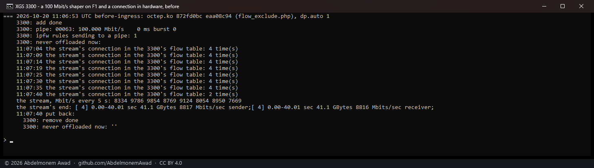
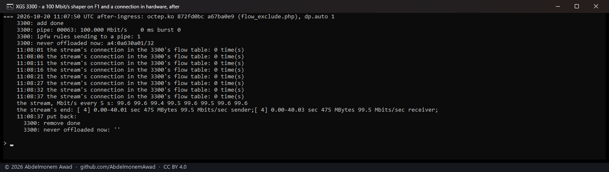

<!-- reviewed: 2026-10-20 -->
# The Traffic Shaper and a connection in hardware, measured, 2026-10-20

OPNsense's Traffic Shaper and its Captive Portal decide in **ipfw**, and ipfw sees a packet only while
the host forwards it. A connection the coprocessor forwards itself never reaches it: it escapes a
shaper's pipe, and a portal's client that logs out keeps what it had open. Nothing in this project
knew that until today. Measured on the second XGS 3300, and fixed: whatever an enabled shaper rule or
portal zone names is now kept with the host, as if the owner had put it on the never-offloaded list.

## Measured

A 100 Mbit/s pipe and a rule sending what arrives on F1 for the first XGS 3300's address through
it, made through OPNsense's own Traffic Shaper model and applied the way its page applies them; one
stream of 40 seconds from the PC's 10G port into F1, through the second XGS 3300 to the first, its
flow maker on (`octep.ko` md5 `872fd0bc`). `images/deploy/lab-3300-shaper.sh`, photographed:

| | the stream | its connection in the 3300's flow table |
|---|---|---|
| **before** - the list written as it was (`flow_exclude.php` md5 `eaa08c94`) | **8,816 Mbit/s** | there, the whole run |
| **after** - `flow_exclude.php` md5 `a67ba0e9` | **99.5 Mbit/s**, every five seconds 99.4 to 99.6 | never; the list held `a4:0a630a01/32`, that address |

Before, the shaper held the stream for the moment it crossed the host, and then the flow maker
handed it to the coprocessor: from there on it ran at 8.8 Gbit/s through a 100 Mbit/s pipe. After,
the rule's destination was on the list before the stream began, the flow maker left the connection
with the host, and the pipe held it to its rate.

**Without a hand on it.** The Traffic Shaper's and the Captive Portal's pages call nothing of this
plugin, so the plugin's cron makes the list again every minute and writes it when it changed
(`flow_exclude.php --if-changed`). Measured the same way, with no hand-run step: the shaper rule
applied at 11:08:57, the list held that address four seconds later and the XGS log said why - *the
Traffic Shaper: lab-shaper -* and the address; the rule removed, the list was empty within the minute -
*the Traffic Shaper and the Captive Portal keep nothing now*.

**A portal zone**, made on F2 through the Captive Portal's model, put F2's two networks on the list -
its IPv4 and its IPv6 one - and taking the zone away took them off. No client went through a
portal for this.

## How the list is made

- A shaper rule's source and destination networks; a rule that names none, its single ports.
- A portal zone's interfaces' networks, as config.xml fixes them.
- **Everything** - 0.0.0.0/0 and ::/0, so the flow maker forwards nothing - when a rule names nothing
  narrower than an interface, a port range, a "not", or anything this cannot read; when a zone is on
  an interface without a fixed network; and when the owner's list and these together pass the 64
  entries a driver keeps. Too much kept with the host costs speed; too little lets a connection past
  a shaper, so the doubt goes the safe way.
- An entry matches either end of a connection, as the owner's entries do, so a rule for one
  destination keeps with the host everything to or from that address.

## What it does not mean

- **The shaper itself.** A rule on the way **out** of A4, the first one tried, matched nothing even
  with the stream crossing the host (ipfw counted the stream's packets twice, in and out, and that
  rule's count stayed 0): the measured rule is the one on the way in. That is OPNsense's matter, not
  this plugin's, and not looked into further.
- **The XGS 136** writes the same list into its own driver (`flow.exclude`, measured with the owner's
  entries on 2026-10-19); this run was on the XGS 3300 alone.
- **A portal with clients** was not run: only the list it makes.
