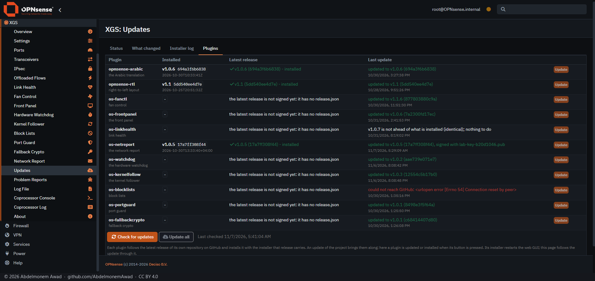
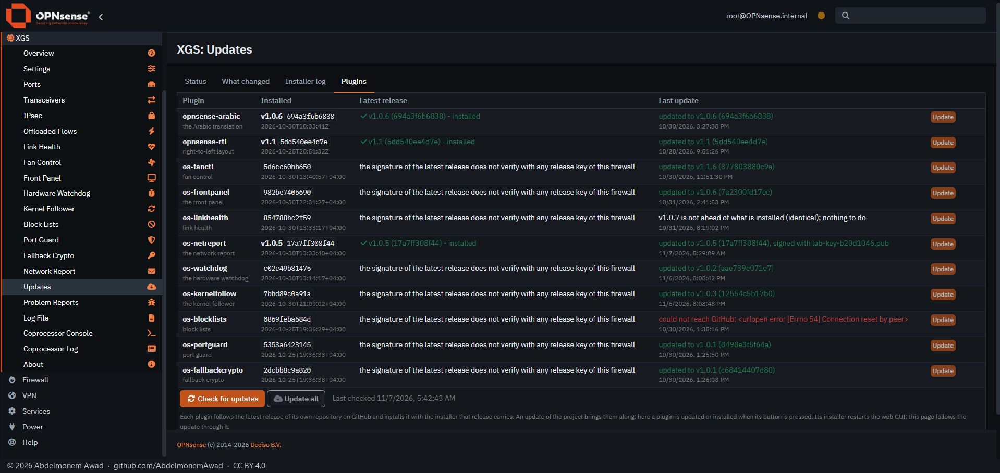
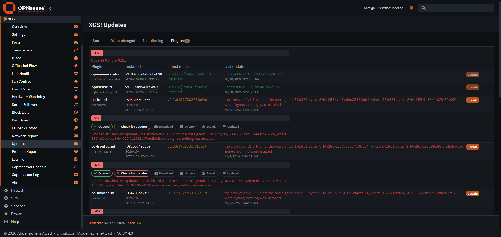
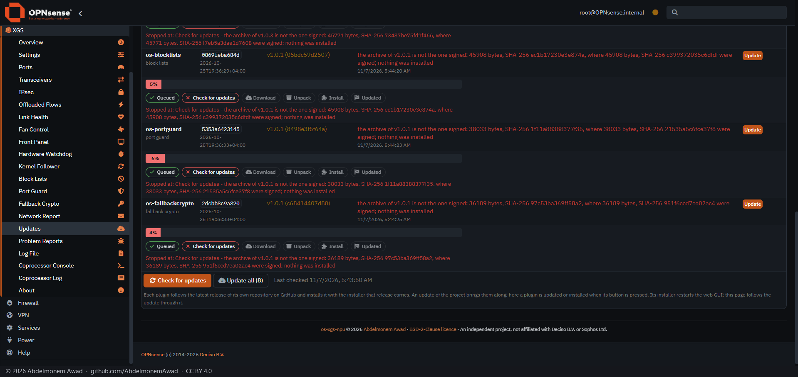
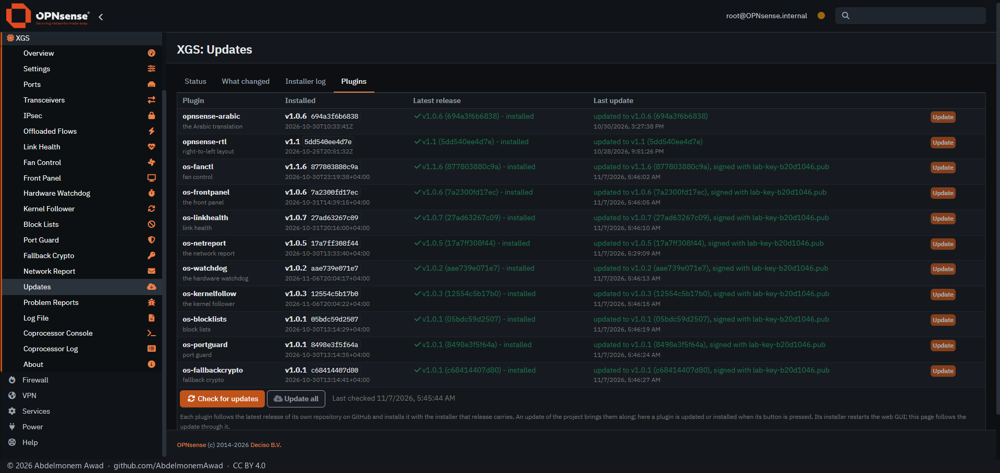

<!-- reviewed: 2026-11-07 -->
# The plugins' signed releases, run on the first XGS 3300, 2026-11-07

Until 2026-11-07 every plugin's `self-update.py` asked GitHub's API, or npuforge.org's copy of it, for
its latest release and the release's commit, and installed that commit's tarball as it came: the copy's
answer chose what the Plugins tab of XGS: Updates installed, as it had for this project's own update
until [signed releases](signed-releases-2026-11-07.md) ([1072](https://github.com/AbdelmonemAwad/os-xgs-npu/issues/1072),
G3 and U5).

Now a plugin's release is installed only as its owner signed it, as this project's is. Each release
carries three more files: the tag's tree as an archive, `release.json` naming the tag, its commit and
date and the archive's SHA-256 and size, and `release.json.sig`, the manifest's Ed25519 signature, made
with the project's release key by the owner's private signing repository. A plugin's own release
workflow makes the release a draft, with its package, and that repository signs and publishes it. Each
plugin installs the public key beside its `self-update.py`, fingerprint
`13ed7f86a4a7669bdaee666d01894443e151da4051c1f500cb6406d7888fd33b`. A check reads the latest release's
manifest from GitHub's download of it, not the API, and offers the release only when the signature
verifies and the release is not dated before what is installed. The update confirms the tag's commit
with GitHub's list of references, and installs the archive the manifest names only when its SHA-256
and size are the signed ones.

os-netreport went first ([its pull request 43](https://github.com/AbdelmonemAwad/os-netreport/pull/43),
with [its own page](https://github.com/AbdelmonemAwad/os-netreport/blob/main/docs/signed-releases.md)).
This page is the eight that followed - os-fanctl, os-frontpanel, os-linkhealth, os-watchdog,
os-kernelfollow, os-blocklists, os-portguard and os-fallbackcrypto - all at once.

## How it was run

The first XGS 3300 (vendor version 23), 01:40 to 01:47 UTC. Each plugin's branch was installed by its
own `install/install.sh`, as a hand install does. Every step after that went through the Plugins tab
itself: its Check, and its Update all.

A release cannot be put up on GitHub for a test, so each plugin read its latest release from a lab
place, as a test firewall may (`releases-from`, `file://`). The archive was made by `git archive` from
the tag, with its manifest, and signed with a throwaway key whose public half stood in for the release
key while the test ran. Each plugin's installed copy was said to be the release before it, so that the
latest was offered. Each latest release carries the `self-update.py` from before signing, so the update
left each plugin as it had been before the test. The log of every step is kept with the measurements
(`plugins-old3300.log`).

## What it did

GitHub's own latest releases, published before signing, are not offered: *the latest release is not
signed yet: it has no release.json*. Every installed plugin will say this until its next release, the
first signed one.

The lab releases, signed with the throwaway key, while only the real release key was installed: not
offered - *the signature of the latest release does not verify with any release key of this firewall*.

The throwaway key installed, and one byte of each archive changed after signing. All eight were
offered, since each manifest was as signed. Update all stopped each one once its archive was down:
*the archive of v1.1.6 is not the one signed: 330461 bytes, SHA-256 bab56dee351636d7, where 330461
bytes, SHA-256 9c1541a37a62b02b were signed; nothing was installed*, and the same for the other seven.
Updated 0 of 8 in 21 s. No `installed.json` changed, and nothing was left in `/var/tmp`. The bars stop
at *Check for updates*: the tab follows the files an update leaves in `/var/tmp`, and an archive read
from a local place in under half a second was gone before it looked; the message is the update's own.

Everything as signed: all eight offered and installed by Update all in 32 s, each one *updated to
<tag> (<commit>), signed with lab-key-b20d1046.pub*, its `installed.json` naming the signed commit with
the date signed. The fan controller, the front panel's client and watchdogd were running afterwards,
and the appliance was not restarted.

| Plugin | Release | Archive, bytes | Commit |
|---|---|---|---|
| os-fanctl | v1.1.6 | 330461 | 877803880c9a |
| os-frontpanel | v1.0.6 | 141501 | 7a2300fd17ec |
| os-linkhealth | v1.0.7 | 167263 | 27ad63267c09 |
| os-watchdog | v1.0.2 | 32324 | aae739e071e7 |
| os-kernelfollow | v1.0.3 | 45771 | 12554c5b17b0 |
| os-blocklists | v1.0.1 | 45908 | 05bdc59d2507 |
| os-portguard | v1.0.1 | 38033 | 8498e3f5f64a |
| os-fallbackcrypto | v1.0.1 | 36189 | c68414407d80 |

The lab files, the lab places and the branches' trees were taken away after. The release-keys
directories went too, since the `self-update.py` installed again reads none. Each plugin's
`self-update.py` was the file it had been before the test, by its MD5.

Without a firewall, a plugin's [test-self-update.py](https://github.com/AbdelmonemAwad/os-netreport/blob/main/tools/test-self-update.py)
makes releases and signs them with throwaway keys: 42 checks of what a check takes and refuses and
what an update installs. Each plugin's pull request for this change adds it to that plugin's checks,
and all 42 passed in each of the eight before it was run here.
