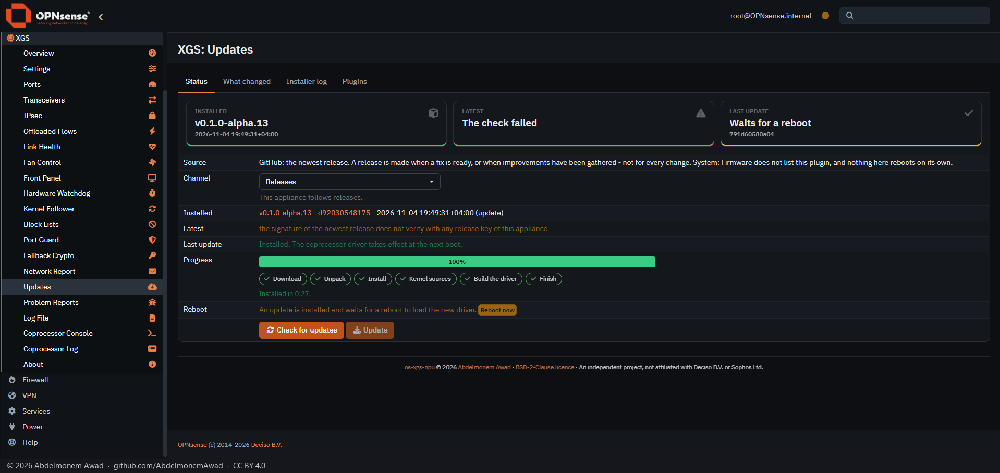
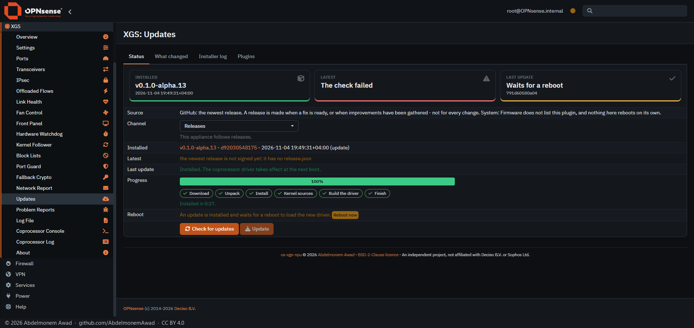
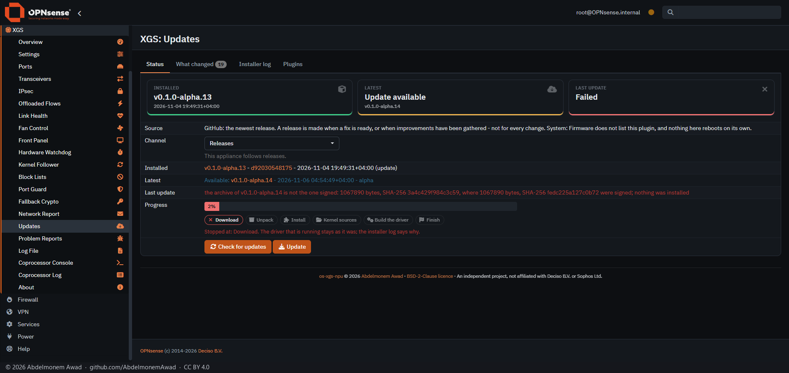
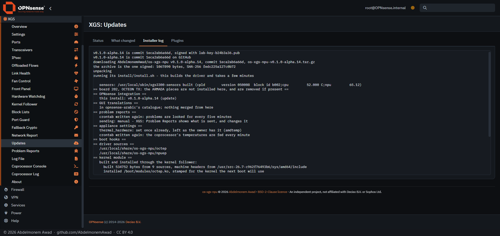

<!-- reviewed: 2026-11-07 -->
# Signed releases, run on the first XGS 3300, 2026-11-07

Until 2026-11-07 the newest release was found through npuforge.org's copy of GitHub's API, and the
copy's answer chose what XGS: Updates installed: which release was newest, and so which commit
(confirmed with GitHub's own tag since 0.1.0-alpha.8.4), and whether there was anything newer at all.
A copy that is down, wrong or in other hands could have kept a release from every appliance or taken
them back to an older one; and the API it stands in for answers sixty requests an hour from one
address ([1072](https://github.com/AbdelmonemAwad/os-xgs-npu/issues/1072), U5).

[1115](https://github.com/AbdelmonemAwad/os-xgs-npu/pull/1115): a release is installed only as its
owner signed it. Three files go up with each release - the tag's tree as an archive, `release.json`
naming the tag, its commit and date and the archive's SHA-256 and size, and `release.json.sig`, the
manifest's Ed25519 signature, made with the release key, never in this repository's own CI
([RELEASING.md](../../RELEASING.md), step 5). The appliance holds the public key, fingerprint
`13ed7f86a4a7669bdaee666d01894443e151da4051c1f500cb6406d7888fd33b`. The check reads the newest
release's manifest from GitHub's download of it - not the API - and offers it only when its signature
verifies and it is dated after what is installed; the update reads it again and installs the archive
it names only when its SHA-256 and size are the signed ones. The copy of the API is asked only for
what the page shows beside the release, and decides nothing.

## How it was run

The first XGS 3300 (vendor version 23), the change installed as a test appliance follows a branch;
then every step through the page's own Check and Update. A release cannot be put up on GitHub for a
test, so the appliance read one from a lab place, as a test appliance may (`releases-from`, file://):
v0.1.0-alpha.14 - commit 1eca2ab6, the commit GitHub's tag names - archived, described and signed in
the signing tool's lab mode, with a throwaway key whose public half stood in for the release keys
while the test ran. What was installed was said to be v0.1.0-alpha.13, so that 14 was offered. The log
of every step is kept with the measurements (`signed-releases.log`).

## What it did

With the real release key alone installed, the lab release - signed with another key - was not
offered.

Without its `release.json`: not offered, and said not signed yet - as GitHub's own 404 for a file a
release does not have says it. Found in this run: a file missing from a file:// place first said
"could not reach GitHub", and is taken as that 404 since; checked again here.

One letter of the manifest's commit changed after it was signed: not offered, the signature not
verifying. One byte of the archive changed: offered - the manifest is as signed - and the update
stopped once the archive was down, nothing installed.

Everything as signed: offered, and installed - the log saying the key it was signed with, the tag the
same commit on GitHub, and the archive the one signed, 1,067,890 bytes, SHA-256 `fedc225a127c0b72...`.

The lab files, the lab place and the throwaway key were taken away after, the installed release keys
put back, and the appliance updated to `main` again.

## What it does not show

- A release put up on GitHub itself: the first is the next one, signed with the key above. Until it
  is signed, an appliance that has this change says the newest release is not signed yet.
- The plugins: each one's own self-update still chooses its release as before (G3 in 1072).
