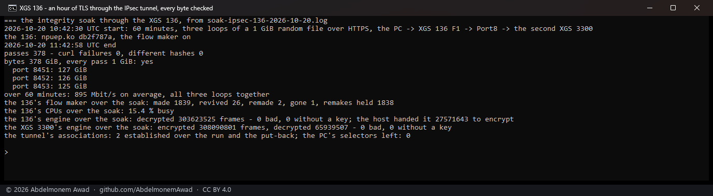

<!-- reviewed: 2026-10-20 -->
<!-- board: IPsec soak, an hour | XGS 136 | 378 GiB, 0 changed -->
# An hour of TLS through the XGS 136's IPsec engine, every byte checked, 2026-10-20

The integrity soak of 2026-10-19 ([two hours of TLS](xgs136-soak-2026-10-19.md)) again, through
the lab IPsec tunnel this time - the one row of the XGS 136's resilience the first one left open:

- a 1 GiB file of random bytes, served over HTTPS by three TLS servers on the second XGS 3300;
- downloaded by the bench PC in three loops at once for 60 minutes, in through the XGS 136's F1 and
  out of its Port8 **inside the tunnel**: the tunnel's child widened at both ends to carry exactly the
  PC's network and the 3300's Port8 address for the run, and put back after;
- the XGS 136 encrypting the PC's side on its engine - its tunnel flows on, so the connections in
  its fast path, encrypted there - and decrypting the 3300's on its engine; the second XGS 3300 the
  other way round;
- each pass checked twice: curl's own TLS, which refuses a record that does not authenticate, and the
  file's SHA-256 against the server's;
- the XGS 136 - `npuep.ko` md5 `db2f787a` (the tunnel-flow lifetime feed, #593), its flow maker on.

Script: `images/deploy/lab-136-ipsec-soak.sh`, its report `lab-136-ipsec-soak-report.sh`, photographed.

## Measured

| | |
|---|---|
| passes, in 60 minutes | **378** - 127, 126 and 125 GiB on the three loops |
| passes curl failed | **0** |
| passes whose file differed | **0** |
| bytes | 378 GiB, every pass the whole 1 GiB |
| rate, the three loops together, over the whole run | **895 Mbit/s** on average |
| the XGS 136's CPUs, over the whole run | 15.4 % busy |
| frames the XGS 136's engine decrypted | **303,623,525** - none bad, none without a key |
| frames the XGS 3300's engine encrypted toward it | 308,090,801 |
| frames the XGS 3300's engine decrypted from it | 65,939,507 - none bad, none without a key |
| frames the XGS 136's host handed its engine to encrypt | 27,571,643 - the rest of the PC's side went in hardware |

The flow maker over the hour: 1,839 connections made, 26 revived in place, 1,838 given back soon
after they were made and left with the host a while (#532's hold - each pass is a new TLS
connection, and its first acknowledgements arrive in runs), 2 made again from new identities, 1 gone.

## What it does not mean

- **An hour, not two.** The clear-text soak ran two hours; this one ran one.
- **One tunnel, one association a direction.** Many tunnels at once is its own measurement.
- **The rate is the gigabit link's,** less the tunnel's envelope; not a limit of the engine.
