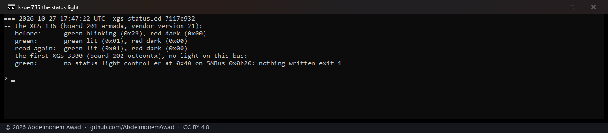
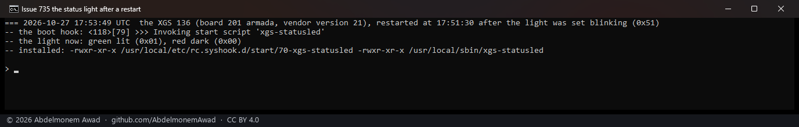

<!-- reviewed: 2026-10-27 -->
# The XGS 126 and 136's status light, lit once the appliance is up, 2026-10-27

[735](https://github.com/AbdelmonemAwad/os-xgs-npu/issues/735): under OPNsense the status light on the
front of an XGS 126 blinked for as long as the appliance ran. The vendor's appliance table, which its
installer images carry, gives each model a `STATUS_LED` field. For the XGS 126 and 136 it is `I2C`, in the
installer images of vendor versions 21, 22 and 23 alike: the light is two registers of the board's
controller at slave `0x40` on the host's SMBus - `0xf2` the green, `0xf3` the red, each `0x01` lit, `0x51`
blinking and `0x00` dark; a blinking one can read back as `0x29`. The board's own start leaves the green
blinking, and the vendor's software lights it at the end of its boot. Under OPNsense nothing did. (The XGS
3300's field is `NO`: the vendor's software never sets that one.)

## Read, then lit

`tools/statusled/xgs-statusled.c` reads the two registers through the host's auxiliary SMBus controller,
the AMD FCH's second PIIX4-style block at I/O `0x0b20`. It writes those two registers and those three values
only - the same controller holds other registers, a factory-reset flag among them - and before writing
anything it reads `0xf2`: on a bus where nothing answers, it writes nothing. Built on the first XGS 3300,
the build box, with `-Wall -Wextra -Werror`, and run by `images/deploy/lab-735-statusled.sh`:

On the XGS 136 (board 201, vendor version 21) the green read blinking (`0x29`) and the red dark: what an
owner's XGS 126 showed. Lit green, it read lit (`0x01`) two seconds later. On the first XGS 3300 (board
202), where nothing answers at `0x40` on that bus, the tool refused and wrote nothing.

## At every boot

`install.sh` builds the tool on board 201 only, with the appliance's own cc as it does the XGS 3300's sensor
tool, and lights the light. The start hook `70-xgs-statusled` lights it again at the end of every boot; it
asks `board.sh`, and does nothing on any other board. The XGS 136 with this change installed by
`install.sh`, the light set blinking (`0x51`), then restarted (`images/deploy/lab-735-boot.sh`):

The hook ran 79 s into the boot, and the light read lit (`0x01`).

## Not done

- **An XGS 126 was not run.** It has the same board (201) and the same table entry as the XGS 136, so the
  same registers; there is no XGS 126 in the lab.
- **Other models are left alone.** The table drives the 87, 88, 107 and 108's lights through the host's
  GPIO, and the 118 and 128's through their embedded controller; neither is this change's.
- **XGS: Overview does not show the light yet.**
