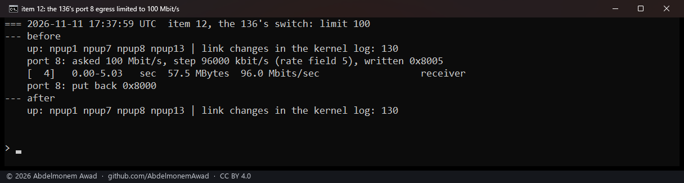
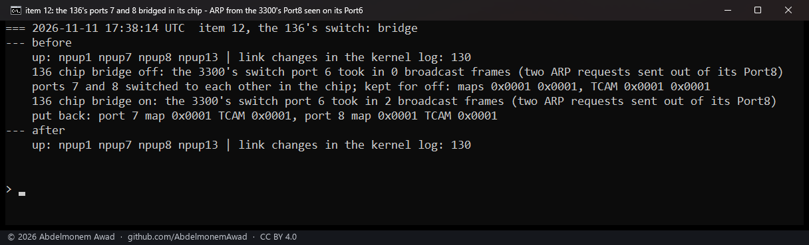

<!-- reviewed: 2026-11-11 -->
# The XGS 136's switch chip mirrors a port, limits a port and switches two ports, with no link changed, 2026-11-11

The XGS 136 has the same switch chip in front of its coprocessor as the XGS 3300, an 88E6193X
([queue scheduling](qsched-2026-10-25.md)). The same day, on the second XGS 3300, that chip was made to copy
one port's frames to another, to hold a port's egress to a rate, and to switch two ports to each other
without the host. On the XGS 136 the host has kept off the chip's bus since 2026-10-24: the coprocessor's
network agent follows the links on that bus, and the host's reads and writes there have made it report
ports down that were up ([639](https://github.com/AbdelmonemAwad/os-xgs-npu/issues/639),
[706](https://github.com/AbdelmonemAwad/os-xgs-npu/issues/706)). The question here: can the host do the
same three things on the XGS 136's switch without a port going down, on an appliance whose own way in, F1,
is a port of that chip? It matters to anyone who wants a port copied for a capture, a port held to a rate,
or two ports switched in hardware on this model.

## How it was measured

- **The appliance:** the XGS 136 (vendor version 21) on its release module from `/boot/modules` (npuep.ko
  `ad3b1480`), 2026-11-11 from 17:35 to 17:39 UTC. Its switch ports 1 to 8 are Port1 to Port8, ports 9 and
  10 are F1 and F2, and port 0 is the coprocessor's.
- **The way in:** as on the XGS 3300, the switch tool `mvsw` (`contrib/mvsw`) on the coprocessor, run from
  the host by the plugin's `npu-run.sh`. Three small shell tools made for these runs, not in the repository,
  set the mirror, the egress limit and the chip bridge. Each reads a register three times and uses the value
  only when the three agree, for up to four rounds; it keeps what it read and writes it back when switched
  off. Nothing was written to switch port 9 (F1), the bench PC's way in. The registers are as Linux's
  `mv88e6xxx` driver names them for this chip's family.
- **The watch:** before and after each step, which front ports had link and how many link-change lines
  (`npupN: link state changed`) the kernel's log held. On the XGS 136 a port state the agent takes wrongly
  stays until the link changes ([the 2026-10-24 page](switch-frame-limit-2026-10-24.md)), so a port taken
  down would show in both.
- **The traffic, counted at the far end:** the second XGS 3300 (vendor version 22), its Port8 cabled to the
  XGS 136's Port8 and its Port6 to the XGS 136's Port7 ([front ports](frontports-2026-10-25.md)), counted
  frames with its own switch's counters, so the XGS 136's bus carried only the tools' reads and writes. The
  stream: iperf3 from the bench PC into the XGS 136's F1, routed out of its Port8 to the second XGS 3300,
  5 seconds.

## Results

| UTC | step | result | link-change lines in the kernel's log, before / after |
|---|---|---|---|
| 17:35:23 | read only, each register three times: the chip's id; on ports 7 and 8 Port Control 2, the VLAN map, the TCAM mode and the egress rate; Global2 0x05. Then 20 seconds' wait | the 88E6193X; port 8's values as on the second XGS 3300's port 8 | 130 / 130 |
| 17:37:21 | the limit tool reads port 8 | egress rate 0x8000: no limit | 130 / 130 |
| 17:37:23 | the bridge tool reads ports 7 and 8 | VLAN map 0x0001 and TCAM mode 0x0001 on both | 130 / 130 |
| 17:37:30 | the mirror tool reads the chip | no mirror set; three of eleven ports' reads disagreed | 130 / 130 |
| 17:37:32 | port 8 mirrored both ways into port 7 during a 100 Mbit/s stream | 85,900 frames into the second XGS 3300's port 6; the stream at 99.8 Mbit/s | 130 / 130 |
| 17:37:59 | port 8's egress limited to 100 Mbit/s | the stream at 96.0 Mbit/s | 130 / 130 |
| 17:38:14 | ports 7 and 8 switched to each other in the chip; ARP from the second XGS 3300 | 0 broadcast frames crossed without, 2 with | 130 / 130 |
| 17:38:42 | the bridge tool reads ports 7 and 8 again | 0x0001 and 0x0001 on both, as before | 130 / 130 |

- **The same chip, set as the XGS 3300's.** The chip answered switch id 0x1930, device 0x0193 revision 0.
  Port 8 held what the second XGS 3300's port 8 held that day:

  | register | XGS 136, port 8 | second XGS 3300, port 8 |
  |---|---|---|
  | Port Control 2 (0x08) | 0x2480 | 0x2480 |
  | port-based VLAN map (0x06) | 0x0001 | 0x0001 |
  | TCAM mode (0x0d) | 0x0001 | 0x0001 |
  | egress rate (0x0a) | 0x8000 | 0x8000 |
  | ingress mirror destination (policy pointer 0x30) | 0x301f | 0x301f |
  | the chip's egress mirror destination (Global2 0x05) | 0x041f | 0x041f |

  Port 7 held 0x0480 in Port Control 2 and port 8, which runs at MTU 9,000, 0x2480: frames of 1,522 and
  10,240 bytes, what the agent sets for a port at MTU 1,500 and one at 9,000
  ([the 2026-10-24 page](switch-frame-limit-2026-10-24.md#the-agents-own-way)). A VLAN map of 0x0001 lets a
  port send to port 0 alone, the coprocessor ([the ARMADA family](../families/armada.md)), and the TCAM is on,
  as on every front port ([front ports](frontports-2026-10-25.md#the-tcam-on-all-three-versions)). Both
  mirror destinations held port 31, none.
- **The mirror copies the port's frames both ways.** With port 8's ingress and egress frames mirrored into
  port 7 (Port Control 2 bits 0x0010 and 0x0020, the policy pointer 0x30 and Global2 0x05 set to port 7), the
  second XGS 3300's port 6 took in 85,900 unicast frames from the XGS 136's port 7 during the 5-second
  stream, received at 99.8 Mbit/s. On the second XGS 3300's own port 8 the same stream was 42,948 to 43,039
  frames in and 42,952 to 43,043 out in that day's runs there, and mirrored at that end of the same cable on
  2026-11-10 it gave 85,900 frames as well.
- **The limit is on the XGS 3300's scale.** Asked for 100 Mbit/s, the tool wrote 0x8005 into port 8's egress
  rate register - rate field 5, the step of 96,000 kbit/s measured on the XGS 3300 - and the stream through
  Port8 arrived at 96.0 Mbit/s. The same value gave 96.2 Mbit/s on the second XGS 3300's Port8 that day. On the
  XGS 136 the coprocessor's own transmit limit for each port is off in its firmware
  ([discovery 23](../findings/discoveries-2026-10-22.md#a-transmit-rate-limit-for-each-front-port)): the
  switch's register is the one measured to work.
- **Two ports switch in the chip.** With each of ports 7 and 8 given the other in its VLAN map and both
  ports' TCAM mode cleared, an ARP request the second XGS 3300 sent out of its Port8 came back into its own
  Port6 through the XGS 136's chip. It cleared its ARP entry for the XGS 136's Port8 twice, each time pinging
  it, so it sent two ARP requests: its port 6 took in 0 broadcast frames without the bridge, 2 with it.
- **No link changed.** Port1, Port7, Port8 and F1 (`npup1`, `npup7`, `npup8`, `npup13`) had link before and
  after every step, and the kernel's log held 130 link-change lines before and after each of the eight. Every
  register was written back to the value read before it: 0x2480 into port 8's Port Control 2, 0x041f into
  Global2 0x05 and 0x301f into the policy pointer after the mirror, 0x8000 after the limit, 0x0001 into both
  VLAN maps and both TCAM modes after the bridge, which the last step read back.
- **The bus flickers.** In the read-only step one of the 27 register reads came back with another value -
  port 8's VLAN map read 0x000f once and 0x0001 twice - and in the mirror tool's pass over the eleven ports
  three reads of 33 did, on ports 0, 4 and 6. This is the known flicker on this appliance, about one read in
  ten, the agent working the same bus ([the ARMADA family](../families/armada.md)). No tool wrote on such a
  read.

## Beside issues 639 and 706

[The 2026-10-24 page](switch-frame-limit-2026-10-24.md) gives the mechanism. The switch is in multi-chip
mode, where a read is a command to one register and its answer in another; the coprocessor's network agent
follows the links over the same bus; and when the host's commands and the agent's interleave, the agent can
take the host's answer for a port's status. In [639](https://github.com/AbdelmonemAwad/os-xgs-npu/issues/639)
the plugin's counter reads left four ports reported down for more than forty minutes while pings crossed
them; in [706](https://github.com/AbdelmonemAwad/os-xgs-npu/issues/706) the boot hook's frame-limit writes
left Port3 and F1 down, and no connection through Port3 went into hardware that boot. Since then the agent
sets each port's frame limit itself, and the host no longer touches the switch's bus on the XGS 136.

These runs did on purpose what those issues found harmful - the host reading and writing the switch while
the agent ran - and the agent reported no port down: 130 link-change lines through all eight steps. The reads
showed the same sharing from the host's side, some of them coming back with another transaction's data,
which is why no tool wrote on fewer than three equal reads. The agent's polling mode, which every agent here
refuses ([discovery 25](../findings/discoveries-2026-10-22.md#the-network-agents-polling-mode)), was not
needed for it.

The 2026-10-24 page also found the agent's mistake rare: two runs of the old hook's reads, of three and of
ten rounds, changed nothing, and a third of ten rounds - 300 reads in 26 seconds - took Port7 down for two
seconds. Eight steps with no link change show that these steps took no port down this time, not that the
same steps never will.

## What it does not mean

- **The bus is not shown to be safe.** Eight small steps took no port down; the 2026-10-24 page saw one run
  of reads in three do it, so a rare loss of a port is not ruled out.
- **Nothing here is in a release.** The three tools were made for these runs and are not in the repository;
  a release still does not touch the XGS 136's switch.
- **The mirror was counted, not captured.** No count of the second XGS 3300's port 6 was taken with the
  XGS 136's mirror off, and a mirror of one direction alone was not tried on the XGS 136.
- **One limit was measured,** 100 Mbit/s. Other rates, and the other count modes, were not tried on the
  XGS 136.
- **The chip bridge carried two ARP frames.** Its throughput, and what the XGS 136's host and its rules see of
  it, were not measured. On the second XGS 3300 the same kind of bridge carried 938 Mbit/s that day while its
  host took in no frame and pf held no state: traffic between two ports switched in the chip never meets the
  firewall.
- **No register of ports 0, 9 and 10 was written** (the coprocessor's, F1 and F2), and no setting was kept
  across a reboot.
