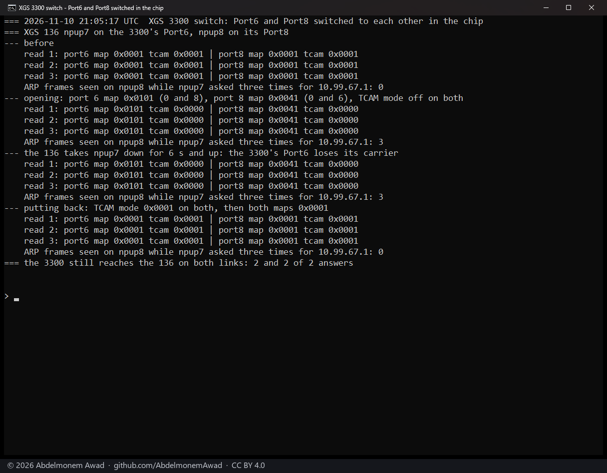
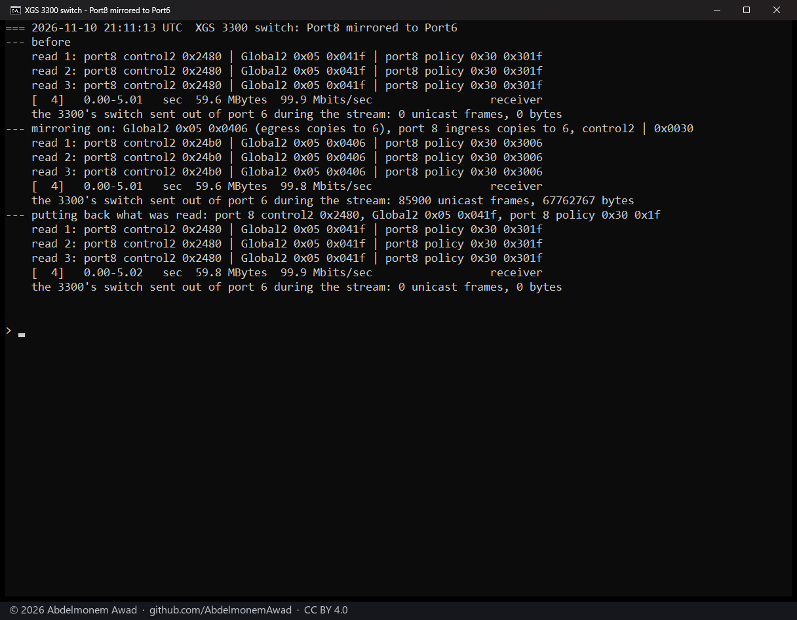
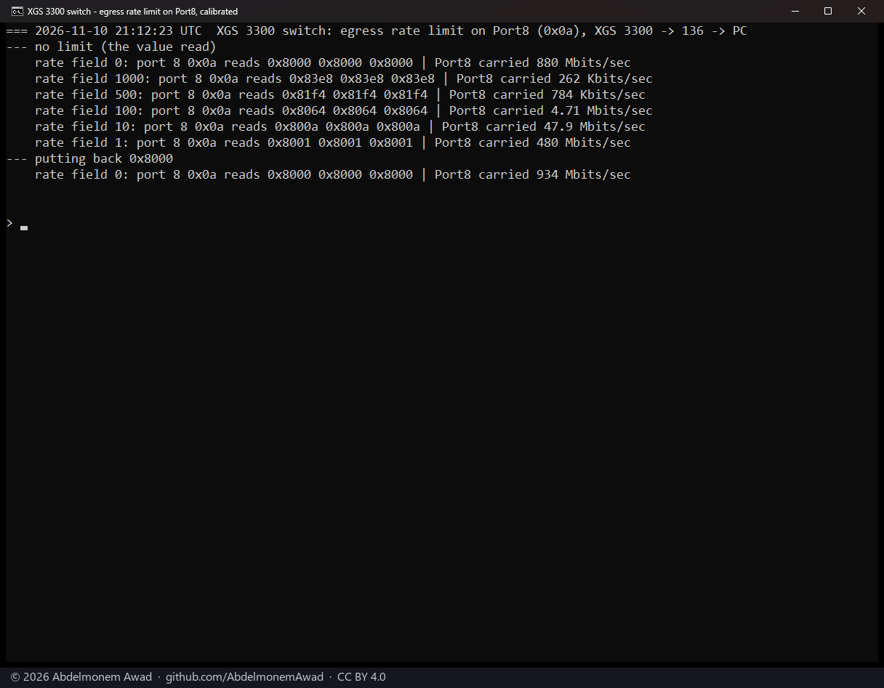
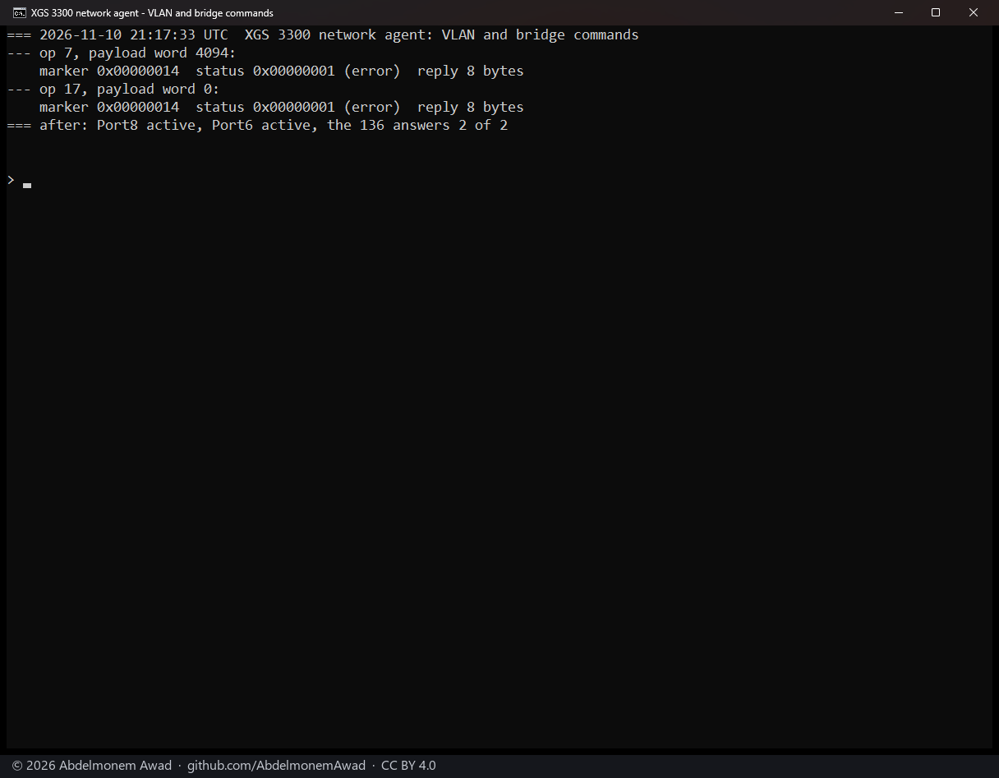

<!-- reviewed: 2026-11-10 -->
# Inside the XGS 3300's switch chip: two front ports switched to each other, one mirrored and limited, and the network agent's VLAN and bridge deletes refused, 2026-11-10

The second XGS 3300's copper ports sit behind an 88E6193X switch chip, whose port 0 leads to the
coprocessor. As the vendor's software leaves the chip, ports 6 and 8 send to port 0 only. So two
devices on Port6 and Port8 reach each other only through the appliance, routed by the firewall, and a
frame from one addressed to the other does not cross ([2026-10-25](frontports-2026-10-25.md)).

These runs asked what the chip itself does when a few of its registers are set by hand: switch two
front ports to each other, copy one port's frames out of another, limit what a port sends. They also
asked whether the coprocessor's network agent acts on two of the VLAN and bridge commands it declares
([discovery 26](../findings/discoveries-2026-10-22.md#vlans-bridges-and-address-entries-through-the-agent)).
For anyone running the appliance one point matters above the rest: **traffic switched inside the chip
never reaches the firewall's rules.**

## How it was measured

The second XGS 3300, vendor version 22 (octep `861b8b50`, release 0.1.0-alpha.15.2), with the XGS 136
(vendor version 21) cabled to two of its front ports: the 136's `npup7` to the 3300's Port6 and its
`npup8` to Port8. Port6 is the chip's port 6 and Port8 its port 8; the 3300's host calls them `oxp7`
and `oxp9`. The bench PC (10.99.13.x) reaches the 3300 (10.99.23.x) through the 136 and Port8. iperf3
3.22 at both ends.

The chip was read and written with `mvsw` on the coprocessor, run from the 3300's host. At every step
each register was read three times, since the network agent uses the same bus, and every value written
was put back to the one read before. Register names and fields are those of the open Linux driver for
this chip family (`mv88e6xxx`): a port's VLAN map (register `0x06`; bit n lets the port send to port
n), its TCAM mode (`0x0d`, bits 1:0), its mirror bits (Port Control 2, `0x08`: `0x0010` ingress,
`0x0020` egress) and its ingress mirror destination (`0x0e`, pointer `0x30`), and the chip's egress
mirror destination (Global2 `0x05`; port 31 means none). The scale of register `0x0a` was measured, not
taken from a source.

- **Two ports switched in the chip, 21:05 UTC.** The 136 sent three ARP requests out of `npup7` for the
  3300's Port6 address (10.99.67.x) and counted the ARP frames that arrived on `npup8`. As found; with
  port 6's map at `0x0101` (ports 0 and 8), port 8's at `0x0041` (ports 0 and 6) and TCAM mode 0 on
  both; again after the 136 took `npup7` down for 6 s and up, so that Port6 lost its carrier; and after
  the put-back, TCAM mode first.
- **Mirror, 21:11 UTC.** Port8's frames, in and out, copied out of port 6 during a 100 Mbit/s TCP stream
  of 5 s from the bench PC to the 3300 through Port8. Counted by the switch itself: the unicast frames
  and bytes port 6 sent during the stream, on a link that carries nothing else then. As found, with the
  mirror on, and after the put-back.
- **Egress limit, 21:12 UTC.** Port 8's register `0x0a` read `0x8000`. It was written `0x8000` plus N, for
  N = 1000, 500, 100, 10 and 1, then `0x8000` again. At each value, what the 3300 sent out of Port8 to
  the bench PC (iperf3 `-R`, 4 s).
- **Network agent, 21:17 UTC.** Two requests through octep's request sysctls (`dev.octep.0.nwa.*`):
  `VLAN_DELETE` (op `0x07`) of VLAN 4094, which nothing uses, and `BRIDGE_DELETE` (op `0x11`) of bridge
  0, as [the network agent's operations](../npuep/netagent.md#the-operation-space-named) name and
  number them.
  Each answer was read at once from `dev.octep.0.nwa.last`; then the state of Port6 and Port8, and two
  pings from the 3300 to the 136. A first pass at 21:17:17 printed no fields; the pass at 21:17:33 is
  the one shown.

## Results

| run | the chip | measured |
|---|---|---|
| three ARP requests, `npup7` to `npup8` | as found: maps `0x0001`, TCAM mode 1 | 0 arrived |
| | maps `0x0101` and `0x0041`, TCAM mode 0 | 3 arrived |
| | the same, after Port6 lost its carrier | 3 arrived; the registers as set |
| | put back | 0 arrived; the 3300 answered on both links, 2 of 2 |
| 100 Mbit/s stream through Port8 | no mirror | port 6 sent 0 frames; 99.9 Mbit/s received |
| | Port8 mirrored, in and out, to port 6 | port 6 sent 85,900 frames, 67,762,767 bytes; 99.8 Mbit/s |
| | put back | port 6 sent 0 frames; 99.9 Mbit/s |
| what Port8 carried from the 3300 | `0x0a` = `0x8000`, as found | 880 Mbit/s |
| | `0x8001` (N = 1) | 480 Mbit/s |
| | `0x800a` (N = 10) | 47.9 Mbit/s |
| | `0x8064` (N = 100) | 4.71 Mbit/s |
| | `0x81f4` (N = 500) | 784 kbit/s |
| | `0x83e8` (N = 1000) | 262 kbit/s |
| | `0x8000`, put back | 934 Mbit/s |
| network agent | `VLAN_DELETE`, VLAN 4094 | marker `0x14`, status 1 (error), reply 8 bytes |
| | `BRIDGE_DELETE`, bridge 0 | marker `0x14`, status 1 (error), reply 8 bytes |
| | after both | Port8 and Port6 active; the 136 answered 2 of 2 |

- **Two front ports switch to each other inside the chip** once each one's VLAN map names the other and
  TCAM mode is 0 on both. The three ARP requests from `npup7` reached `npup8`; none did before, and none
  after the put-back. The setting held through Port6's carrier loss: the four registers read the same
  after it, and ARP still crossed.
- **Traffic switched this way never reaches the firewall's rules.** It crosses from port to port in the
  chip. On [2026-11-11](switch-3300-2026-11-11.md) the same setting carried 938 Mbit/s between Port8 and
  Port6 while the 3300's host took in not one frame on either port and pf held no state for the traffic.
- **This contradicts the "never" of
  [discovery 21](../findings/discoveries-2026-10-22.md#two-front-ports-never-switch-to-each-other-in-the-chip).**
  As the vendor's software leaves the chip nothing crosses, as [2026-10-25](frontports-2026-10-25.md)
  measured. But the chip itself switches two front ports once two registers are changed on each. Both
  were changed together here. On 2026-11-11 the maps alone, with TCAM mode left at 1, let nothing cross;
  TCAM mode 0 with the vendor's maps was not tried.

- **The mirror copies one port's frames out of another.** During the 100 Mbit/s stream switch port 6
  sent 85,900 frames (67.8 MB) with Port8 mirrored to it, none before and none after. The stream kept
  99.8 Mbit/s. The counts per direction, frame for frame, are on
  [2026-11-11](switch-3300-2026-11-11.md).
- **Counted on the XGS 136 first, the stream slowed.** Two runs before this one, at 21:07 and 21:09
  UTC, counted the copies on the 136, with `npup7` promiscuous; the second also with the 136's
  automatic acceleration off (`dev.npuep.0.flow.auto` at 0). The 136's host counted 1 frame of the
  stream at every step, mirror on or off. And the stream fell to 52.9 and 53.4 Mbit/s while the mirror
  was on, from 99.8 before and after. With `npup7` not promiscuous and the copies counted by the
  switch, the stream did not fall. What slowed it was not isolated.

- **Port 8's register `0x0a` limits what Port8 sends** to about 480 Mbit/s divided by N: 480 at N = 1,
  47.9 at 10, 4.71 at 100. N = 0 is no limit: 880 Mbit/s as found, 934 after the put-back. With the
  register's top bits as found, no value of N gives a limit between 480 Mbit/s and the line rate.
- At N = 500 and 1000 the stream carried less than 480/N: 784 and 262 kbit/s. Why was not measured.
  Finer steps, and the other values of the top bits, were measured on
  [2026-11-11](switch-3300-2026-11-11.md).

- **The network agent refused both commands.** Each answer began with the reply marker `0x14` (`ACK`,
  which begins every reply), carried status 1 (error) and was 8 bytes long. The driver counts the
  reply's 8-byte header in that length (`octep_nwa.c`), so there was no payload. It is the answer the
  network agent gave to `SET_POLLING_MODE` on [2026-10-25](pollmode-2026-10-25.md). Port6 and Port8
  stayed active, and the 136 answered the 3300's pings.
- Discovery 26 marks these commands "source" and "never sent". Two of them were sent here, to vendor
  version 22, and refused. A VLAN loaded directly into the chip's VLAN table worked on
  [2026-11-11](switch-3300-2026-11-11.md).

## What it does not mean

- **Set by hand.** The registers were written directly for these runs and put back after each.
- **One appliance, two ports.** Only ports 6 and 8 of the second XGS 3300, vendor version 22. The first
  XGS 3300 (vendor version 23) was out of service, and the XGS 136's own switch was not touched.
- **The switching was shown with three ARP frames.** Throughput, the 3300's host counters and pf were
  measured on [2026-11-11](switch-3300-2026-11-11.md).
- **It held through one carrier loss**, with the link down for 6 s. Whether the vendor's software writes
  these registers back over hours, or at a boot, was not measured.
- **The mirror was counted, not captured.** No machine on Port6 read the copies.
- **The limit was measured with full-size TCP frames that the 3300 itself sent.** Small frames, UDP and
  traffic routed through Port8 were not tried with it.
- **The refusal is of two deletes**, of VLAN 4094, which nothing uses, and of bridge 0. No create was
  sent, so whether `VLAN_CREATE` or `BRIDGE_CREATE` is refused the same way was not measured.
