<!-- reviewed: 2026-11-11 -->
# Inside the XGS 3300's switch chip: two ports bridged at 938 Mbit/s past the firewall, a VLAN in its table, an exact mirror, egress steps and one TCAM rule, 2026-11-11

On [2026-11-10](switch-3300-2026-11-10.md) two front ports of the second XGS 3300 were switched to each
other inside its 88E6193X switch chip, and one port was mirrored and its egress limited. These runs
measured each with traffic. What does the chip carry when it switches two ports itself, and what does
the firewall see of it? Does a VLAN loaded into the chip's own VLAN table work? How exact is the
mirror, and what does it cost? Which egress limits does the chip offer? Does a rule of one's own fit in
its TCAM, the table of rules the vendor's software fills?

For anyone running the appliance the first answer matters most: **traffic switched inside the chip
never reaches the firewall's rules.** Not one frame of it reached the 3300's host, and pf held no state
for it.

## How it was measured

The second XGS 3300, vendor version 22 (octep `861b8b50`, release 0.1.0-alpha.15.2), with the XGS 136
(vendor version 21) as the far end, cabled as on 2026-11-10: the 136's `npup7` to the 3300's Port6 (the
chip's port 6, `oxp7` on the 3300's host) and its `npup8` to Port8 (port 8, `oxp9`). The bench PC
(10.99.13.x) reaches the 3300 (10.99.23.x) through the 136 and Port8. iperf3 3.22 at both ends.

The chip was driven with `mvsw` on the coprocessor, from the 3300's host, by small shell tools made for
these runs and not in the repository: one switches two ports to each other, one mirrors a port (both
directions, ingress only or egress only), one limits a port's egress (the nearest step at or below a rate
asked, or a raw value), and two more drove the VLAN table and the TCAM.
Each reads a register three times and writes nothing when the reads differ, keeps what it found, and
writes exactly that back at the end. Every setting was in place for less than four minutes. Register
names and fields are those of the open Linux driver for this chip family (`mv88e6xxx`); the scale of
the egress limit's register, `0x0a`, was measured, not taken from a source.

- **Two ports switched in the chip, 16:49-16:52 UTC.** Both ends on the XGS 136: `npup8` on its host
  (10.99.68.x) and `npup7` moved into a VNET jail (10.99.68.x), so traffic between them crosses Port8,
  the chip and Port6. A ping before. Then ports 6 and 8 switched to each other: each one's VLAN map
  (`0x06`) naming the other, TCAM mode (`0x0d`) 0 on both. A ping, and four TCP streams for 10 s each
  way. The switching off, a ping, the 136 put back. Read on the 3300 over each stream: the frames ports
  6 and 8 sent (the switch's counters), the frames its host took in on `oxp7` and `oxp9`, pf's states
  for 10.99.68.x, and how busy its CPUs were (`kern.cp_time`).
- **A VLAN in the chip's table, 18:47-18:52 UTC.** VLANs 300 and 301 on both ends of the 136
  (`npup8.300` and `npup8.301` on its host, `npup7.300` and `npup7.301` in a jail), with static ARP
  entries at first. VID 300 was loaded into the chip's VLAN table (VTU) as the Linux driver loads one:
  ports 6 and 8 tagged members (`0xefff 0x003e`), FID 300, which no port uses as its own, and SID 0,
  after an STU entry for SID 0 was loaded into the empty STU. VLAN 301 never entered the table: it is
  the control. The ports' 802.1Q mode stayed the vendor's FALLBACK (Port Control 2 `0x2480`). The steps:
  as found; the maps naming each other, TCAM mode on; VID 300 loaded, TCAM mode on; TCAM mode 0; four
  TCP streams for 10 s over VLAN 300; port 8 alone a member (`0xffff 0x003e`); the entry deleted; the
  entry back, with VLAN 300's static ARP entries removed; everything put back in reverse order. At each
  step three pings on each VLAN, and the 3300's own two pings to the 136 on Port8 and on Port6. The
  chip's tables were read before and after.
- **The TCAM, 18:22-18:29 UTC.** The chip's tables were read first, nothing written. Then free entry 3
  was loaded with one rule: EtherType `0x88b5` arriving on port 6, action REPLACE with an empty
  destination. It was loaded in the order the Linux driver loads an entry; the driver's own rules
  replace the destination with the CPU's port, and the empty destination is the test. The 136 sent 100
  frames of that EtherType out of `npup7`, and the 3300's host counted them on `oxp7` with tcpdump:
  before the rule, with it, and after it was flushed, each time with three pings to the 136 over Port6.
  The first three counts sent the frames to the broadcast address, the next three to `oxp7`'s own
  address.
- **Mirror, 16:39-16:43 UTC.** Port8 into Port6: no mirror, both directions, ingress only, egress only.
  Each during a 100 Mbit/s TCP stream of 5 s from the bench PC to the 3300 through Port8, counted by the
  switch's own counters: the frames port 8 took in and sent, the frames and bytes port 6 sent. Port6's
  link carries nothing else, and `npup7` was not promiscuous. Then four TCP streams for 10 s, without
  the mirror and with it both ways.
- **Egress limit, 16:43-16:47 UTC.** What the 3300 sent out of Port8 to the bench PC (iperf3 `-R`, 4 s):
  at six rates asked of the tool; with N = 10 written as `0x000a`, `0x400a`, `0x800a` and `0xc00a`; and
  with the register's top bits at 00 and N = 100, 800, 1000, 2000 and 4000. After each, the value
  found, `0x8000`, was written back and read.

## Results

| run | measured |
|---|---|
| Port6 and Port8 switched in the chip, four TCP streams | 938 Mbit/s one way, 817 back; the 3300's host took in 0 frames, pf held 0 states, its CPUs 0 and 4 % busy |
| VLAN 300 in the chip's table, TCAM mode 0, four TCP streams | 934 Mbit/s; the host took in 0 frames, pf held 0 states, its CPUs 0 % busy |
| VLAN 300 in the chip's table, TCAM mode on | 0 of 3 pings |
| a rule in TCAM entry 3, frames to `oxp7`'s address | 501 lines at the host before, 1 with the rule, 501 after |
| the same rule, frames to the broadcast address | 501 lines before, with the rule and after |
| mirror, both directions | port 8 took in 43,039 frames and sent 43,043; port 6 sent 86,082 |
| mirror, four TCP streams | 946 Mbit/s without, 948 with |
| egress limit, top bits as found | 240, 160, 96.2, 48.0 and 9.95 Mbit/s at N = 2, 3, 5, 10 and 48: 480/N |
| egress limit, top bits 00 | 847, 726, 364 and 183 Mbit/s at N = 800, 1000, 2000 and 4000 |

### Two ports switched inside the chip

| | ping | four TCP streams | the chip sent | the 3300's host took in | pf states | the 3300's CPUs |
|---|---|---|---|---|---|---|
| as found: maps `0x0001`, TCAM mode 1 | 0 of 3 | - | - | - | - | - |
| switched, host to jail | 3 of 3 | 938 Mbit/s | 826,307 frames out of port 6, 424,569 out of port 8 | 0 on `oxp7`, 0 on `oxp9` | 0 | 0 % busy |
| switched, jail to host | | 817 Mbit/s | 791,555 out of port 6, 793,928 out of port 8 | 0, 0 | 0 | 4 % busy |
| put back | 0 of 3 | - | - | - | - | - |

- **Ports 6 and 8 switched in the chip carried 938 Mbit/s, and the firewall saw none of it.** While the
  chip sent 826,307 frames out of port 6, the 3300's host took in not one frame on `oxp7` or `oxp9`. pf
  held no state for 10.99.68.x, and the CPUs were 0 % busy. **Traffic switched inside the chip never
  reaches the firewall's rules**: no rule, state, inspection, shaper or log on the 3300's host sees it.
- Before the switching and after it, the jail and the host did not reach each other (0 of 3 pings): as
  the vendor's software leaves the chip, nothing crosses between the two ports. After `off` the maps
  and TCAM modes read `0x0001` again, the 136's `config.xml` was the one from before (`67d26d0b`), and
  the 3300 reached the 136 on Port6 and Port8, 2 of 2.
- From the jail to the host the streams carried 817 Mbit/s, with 15,408 segments sent again against
  1,630 the other way. Why this direction was slower was not measured; both ends were on the one XGS
  136.

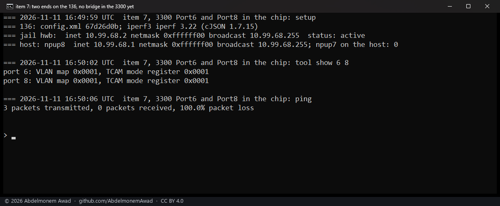

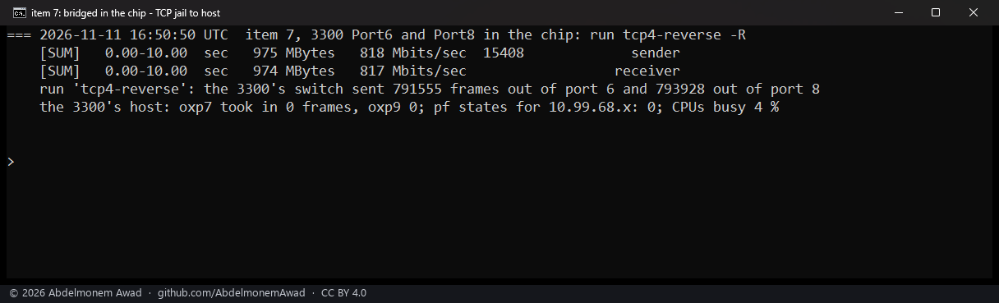

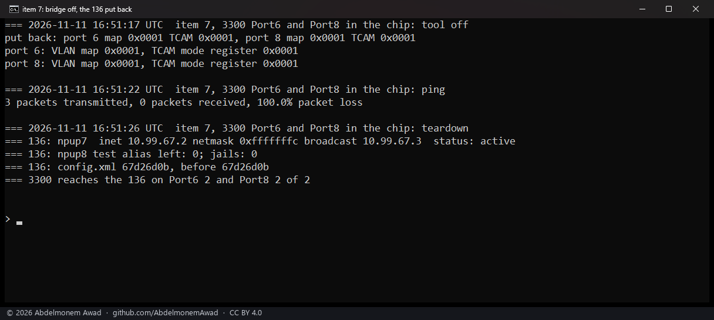

### A VLAN in the chip's own table

| step | TCAM mode | VLAN 300 | VLAN 301, never in the table | the 3300's own pings, Port8 and Port6 |
|---|---|---|---|---|
| as found | on | 0 of 3 | 0 of 3 | 2 and 2 of 2 |
| maps name each other | on | 0 of 3 | 0 of 3 | 2 and 2 of 2 |
| VID 300 in the table, ports 6 and 8 | on | 0 of 3 | 0 of 3 | 2 and 2 of 2 |
| the same | 0 | 3 of 3 | 3 of 3 | 2 and 2 of 2 |
| port 8 alone a member | 0 | 0 of 3 | 3 of 3 | 2 and 2 of 2 |
| the entry deleted | 0 | 3 of 3 | 3 of 3 | 2 and 2 of 2 |
| the entry back, ARP learned | 0 | 3 of 3 | 3 of 3 | 2 and 2 of 2 |
| put back | on | 0 of 3 | 0 of 3 | 2 and 2 of 2 |

- **A VLAN in the chip's table carried 934 Mbit/s with TCAM mode 0, and the firewall saw none of it.**
  Four TCP streams over VLAN 300 carried 934 Mbit/s (935 sent). The 3300's host took in not one frame
  on `oxp7` or `oxp9`, pf held no state for 10.99.73.x, its CPUs were 0 % busy, and the chip sent
  823,115 frames out of port 6. Like the two switched ports, this traffic never reaches the firewall's
  rules.
- **With TCAM mode on nothing crossed**, whether the maps alone named each other or VID 300 was in the
  table as well. The pings were unicast, by the static ARP entries, and the TCAM drops a unicast frame
  for another machine (next section).
- **The table decides per VLAN.** With port 8 alone a member of VID 300, VLAN 300 stopped and VLAN 301
  went on: membership is enforced in the vendor's FALLBACK mode. With the entry deleted, VLAN 300
  crossed again by the maps, as VLAN 301 did throughout. A VID that is not in the table crosses wherever
  the maps allow, so keeping VLANs apart takes an entry for each, or the SECURE mode, which was not
  tried.
- **ARP works inside VLAN 300.** With its static entries removed the pings went 3 of 3: broadcast
  reaches the entry's members.
- **The 3300's own routed traffic on Port6 and Port8 never stopped**: 2 of 2 on each at every step, the
  steps with TCAM mode 0 among them. These were pings only: routed throughput, and whether it stays in
  hardware with TCAM mode 0, were not measured.
- **Put back**: TCAM mode 1; the entry deleted, FID 300's learned addresses flushed and the ATU's FID
  register back to `0x0000`; the STU entry purged; the maps `0x0001`. Both VLANs were cut again. The
  tables read after the teardown equal those before: no VTU or STU entry, every port on FID 0. The
  136's `config.xml` was unchanged (`386165f4`).

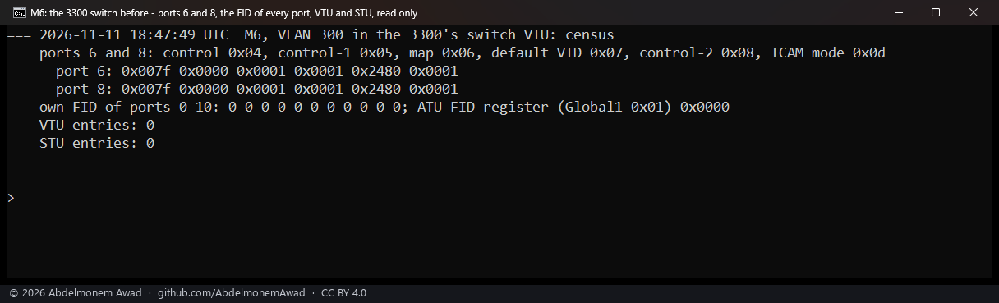

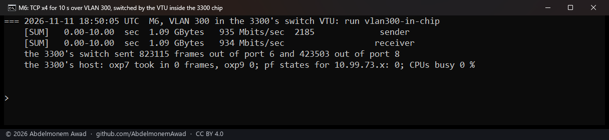

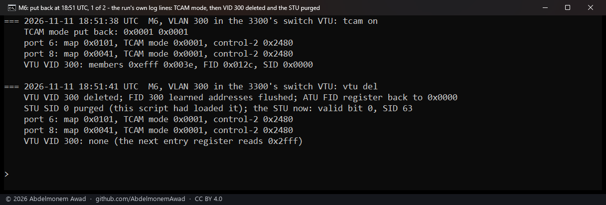

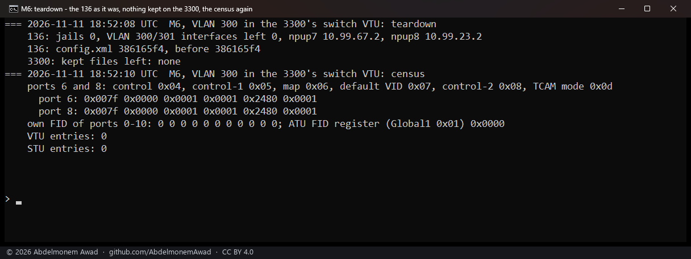

### The TCAM: why nothing crosses with it on, and one rule of one's own

| 100 frames of EtherType `0x88b5` into Port6 | lines at the 3300's host, before | with the rule in entry 3 | after it was flushed |
|---|---|---|---|
| to the broadcast address | 501 | 501 | 501 |
| to `oxp7`'s own address | 501 | 1 | 501 |

- **254 of the TCAM's 256 entries are in use, and 3 and 255 are free**, as
  [discovery 19](../findings/discoveries-2026-10-22.md#the-tcam-254-of-256-entries-are-the-vendors) read.
- **What the vendor's entries do**, as read on the 3300 on 2026-11-11: broadcast from any port goes to
  the coprocessor (entry 0), and so does multicast from ports 2, 6 and 8 (entry 2) and every frame for
  the appliance's own address on each port (entries 4 to 253). **Entry 254 drops every normal frame
  that no earlier entry took.** A unicast frame for another machine, arriving on port 6 or 8, is dropped
  inside the chip; it is not sent to the coprocessor. That is why nothing crossed between ports 6 and 8
  with TCAM mode on, whatever the maps or the VLAN table allowed.
- **A rule in entry 3 works, for unicast frames.** On frames addressed to `oxp7`, the host's capture
  printed 501 lines before the rule, 1 with it and 501 after it was flushed. The pings over Port6 went
  3 of 3 throughout, and entry 3 read back free after the flush. An empty destination drops the frame.
- **On broadcast frames the rule did nothing**: 501 lines before, with it and after. Entry 0 takes them
  first. A rule acts only on what no entry before it took.
- **Of the two free entries, only entry 3 comes before entry 254**, which takes every normal frame. A
  rule in entry 255 was not tried.
- **Not explained**: for 100 frames sent, the host's capture printed 501 lines in every count without
  the rule.
- **This is not the reason given on [2026-10-25](frontports-2026-10-25.md) and in
  [discovery 21](../findings/discoveries-2026-10-22.md#two-front-ports-never-switch-to-each-other-in-the-chip)**,
  that the vendor's TCAM sends every frame from a front port to the coprocessor. That page's count of
  the same kind of frame does not fit entry 254's drop either: ten frames into Port6 for the device on
  Port8, which the coprocessor's fast path counted as dropped, not addressed to the port
  (`FROM_WIRE_DROP_LIF_NOT_MY_MAC` +10). The coprocessor's counters were not read in these runs.

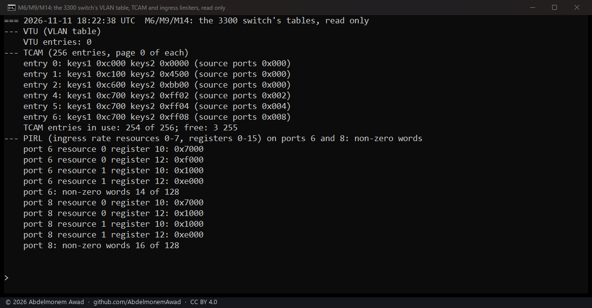

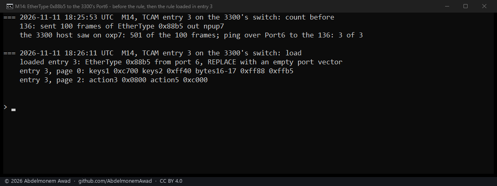

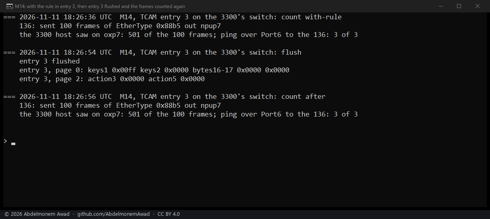

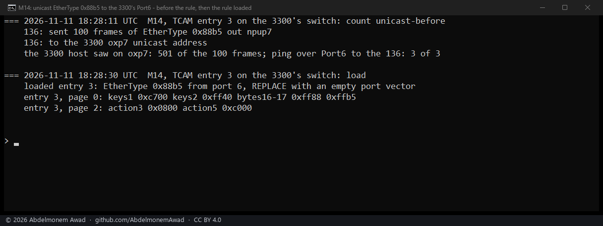

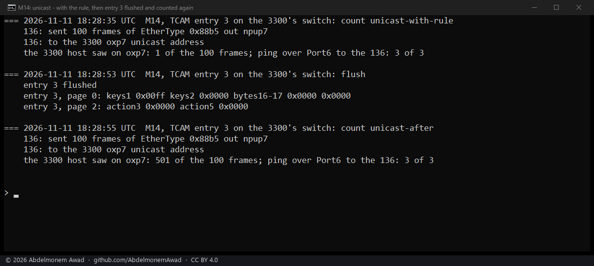

### The mirror

| mirror | port 8 took in | port 8 sent | port 6 sent | bytes port 6 sent | the stream |
|---|---|---|---|---|---|
| none | 43,038 | 43,042 | 0 | 0 | 99.9 Mbit/s |
| both directions | 43,039 | 43,043 | 86,082 | 67,905,902 | 99.8 Mbit/s |
| ingress only | 42,948 | 42,952 | 42,948 | 65,012,942 | 99.8 Mbit/s |
| egress only | 42,948 | 42,952 | 42,952 | 2,749,697 | 99.9 Mbit/s |

- **The mirror is exact, frame for frame.** In both directions port 6 sent 86,082 frames: the 43,039
  port 8 took in and the 43,043 it sent. Ingress only: 42,948 copies of 42,948. Egress only: 42,952 of
  42,952. The stream's data enters at port 8 and its acknowledgements leave there, hence 65.0 MB of
  copies one way and 2.7 MB the other. The first set of counts gave the same sums (86,080 for 43,038
  and 43,042).
- **It costs no speed.** The 100 Mbit/s stream ran at 99.7 to 99.9 Mbit/s with each mirror, and four
  TCP streams at 946 Mbit/s without the mirror and 948 with it both ways.
- After every `off` the registers read what they held before: Global2 `0x05` at `0x041f` (no egress
  destination), port 8's Port Control 2 at `0x2480` and its ingress destination at `0x301f` (none).
- This is the switch's own port mirror, which sends the copies out of another port. It is not the
  coprocessor's copies for a packet capture on the host ([2026-10-25](mirror-2026-10-25.md)).

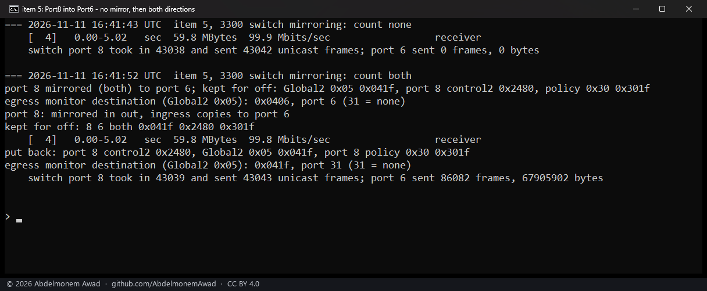

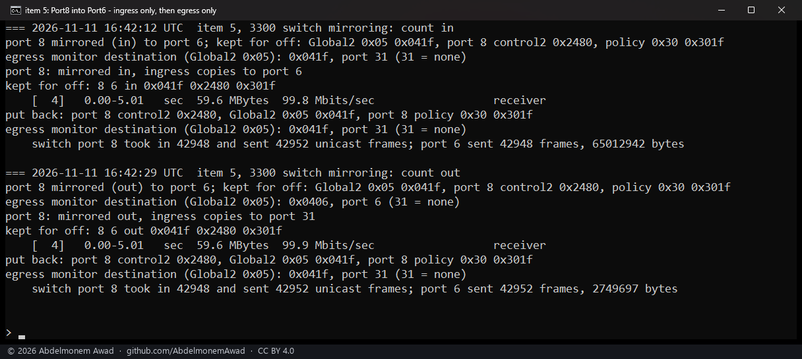

### The egress limit

| written to port 8's `0x0a` | what Port8 carried |
|---|---|
| `0x8002`: N = 2, asked 300 Mbit/s, step 240 | 240 Mbit/s |
| `0x8003`: N = 3, asked 200, step 160 | 160 Mbit/s |
| `0x8005`: N = 5, asked 100, step 96 | 96.2 Mbit/s |
| `0x800a`: N = 10, asked 50, step 48 | 48.0 Mbit/s |
| `0x8030`: N = 48, asked 10, step 10 | 9.95 Mbit/s |
| `0x81e0`: N = 480, asked 1, step 1 | 784 kbit/s |
| `0x000a`: N = 10, top bits 00 | 931 Mbit/s |
| `0x400a`: N = 10, top bits 01 | 47.4 Mbit/s |
| `0x800a`: N = 10, top bits 10 | 47.9 Mbit/s |
| `0xc00a`: N = 10, top bits 11 | 48.6 Mbit/s |
| `0x0064`: N = 100, top bits 00 | 939 Mbit/s |
| `0x0320`: N = 800, top bits 00 | 847 Mbit/s |
| `0x03e8`: N = 1000, top bits 00 | 726 Mbit/s |
| `0x07d0`: N = 2000, top bits 00 | 364 Mbit/s |
| `0x0fa0`: N = 4000, top bits 00 | 183 Mbit/s |

- **With the top bits as the vendor leaves them (`0x8000`), the limit is 480/N Mbit/s.** Asked 300,
  200, 100, 50 and 10 Mbit/s, the tool wrote N = 2, 3, 5, 10 and 48, and Port8 carried 240, 160, 96.2,
  48.0 and 9.95. At N = 480, a step of 1 Mbit/s, the stream carried 784 kbit/s; why it fell short was
  not measured. No step lies between 480 Mbit/s and the line rate.
- **The top bits 01 and 11 give no finer steps**: at N = 10 they gave 47.4 and 48.6 Mbit/s, against 47.9
  with the bits as found (10).
- **With the top bits 00 the limit lies above 480 Mbit/s.** N = 10 and 100 left the line rate (931 and
  939 Mbit/s). N = 800 gave 847, 1000 gave 726, 2000 gave 364 and 4000 gave 183: doubling N halved the
  rate. This setting covers the range between 480 Mbit/s and the line rate that the bits as found leave
  empty.
- The runs name the four values of the top bits frames (00) and layer-1, layer-2 and layer-3 bytes (01,
  10, 11), as the count-mode field of the chip's ingress limiter is named in Marvell's open UMSD driver
  (BSD-3). That naming was not checked against a source for register `0x0a`. With full-size frames, as
  here, a limit on frames and a limit on bytes look the same; smaller frames were not tried.
- After each step the register read `0x8000` again: no limit.

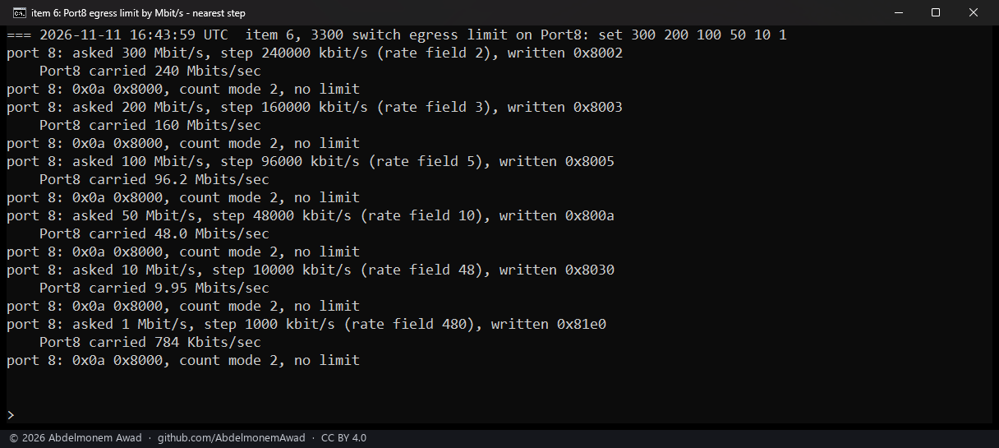

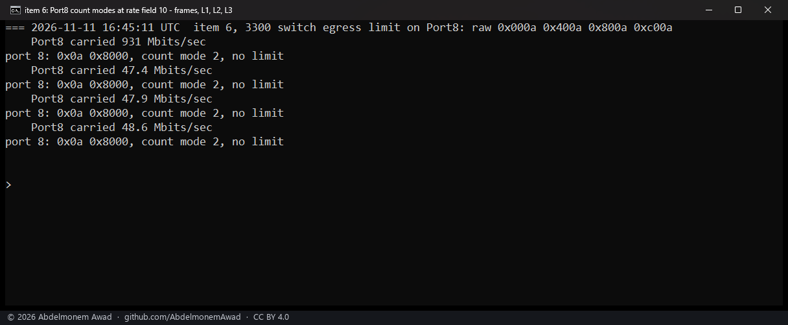

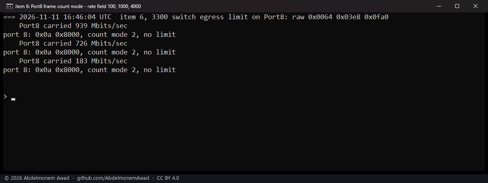

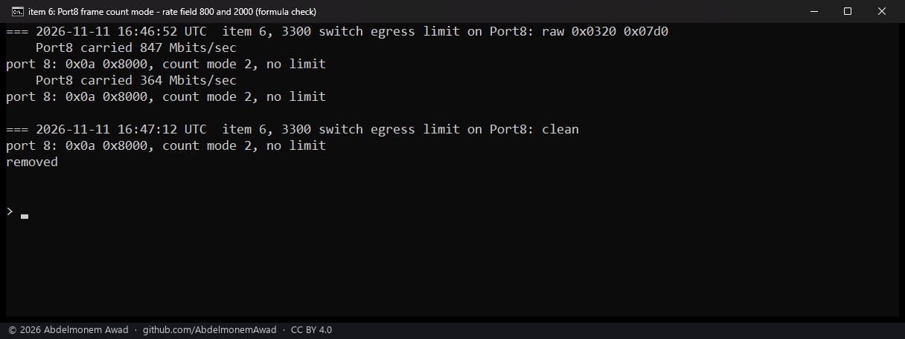

### Against the earlier pages

- [Discovery 21](../findings/discoveries-2026-10-22.md#two-front-ports-never-switch-to-each-other-in-the-chip)
  says two front ports never switch to each other in the chip, and
  [2026-10-25](frontports-2026-10-25.md) that there is nothing to build. As the vendor's software leaves
  the chip, that holds. But the chip switches two ports, at 938 Mbit/s plainly and 934 by VLAN, once
  two registers are changed on each, and then outside the firewall.
- [Discovery 19](../findings/discoveries-2026-10-22.md#the-tcam-254-of-256-entries-are-the-vendors)
  concludes that the TCAM is not free for rules of one's own. Entry 3 took one, and it worked for
  unicast frames.
- [Discovery 23](../findings/discoveries-2026-10-22.md#a-transmit-rate-limit-for-each-front-port)'s
  transmit limit for each port is refused by the coprocessor ([2026-10-24](port-qos-2026-10-24.md)).
  The chip has its own: port 8's register `0x0a` limits what the port sends.
- [Discovery 26](../findings/discoveries-2026-10-22.md#vlans-bridges-and-address-entries-through-the-agent)'s
  VLAN and bridge commands through the network agent were refused on
  [2026-11-10](switch-3300-2026-11-10.md). A VLAN loaded directly into the chip's table worked.

## What it does not mean

- **Outside the firewall.** What the chip switches between two ports, plainly or by VLAN, meets no rule,
  state, inspection or log on the appliance's host.
- **Both ends were one XGS 136**, its host and a jail. 938, 817 and 934 Mbit/s are what that one box
  sent and received at once, not the chip's ceiling, which was not measured. An OPNsense bridge on the
  3300 was not measured beside it: that needs a bridge of the 3300's two routed links.
- **The 3300's routed traffic with TCAM mode 0** was checked with pings only.
- **Short, and by hand.** Each setting was in place for less than four minutes and put back. Whether the
  vendor's software writes these registers back over hours, at a link event or at a boot was not
  measured, nor whether they last over a reboot.
- **One appliance, two ports**: ports 6 and 8 of the second XGS 3300, vendor version 22. The first XGS
  3300 (vendor version 23) was out of service.
- **The mirror was counted, not captured.** No machine on a free port read the copies. A mirror's
  destination port sends other machines' frames, with their addresses, to whatever is on it: on
  [2026-11-10](switch-3300-2026-11-10.md) a stream through the mirrored port fell from 99.8 to 52.9 and
  53.4 Mbit/s while the device on the destination port was promiscuous, and the cause was not isolated.
- **The egress limit** was measured with full-size TCP frames that the 3300 itself sent. Small frames,
  UDP and traffic routed through Port8 were not tried with it here.
- **The TCAM rule** was one EtherType on one port, in place for less than a minute. The 501 lines for
  100 frames are not explained.
